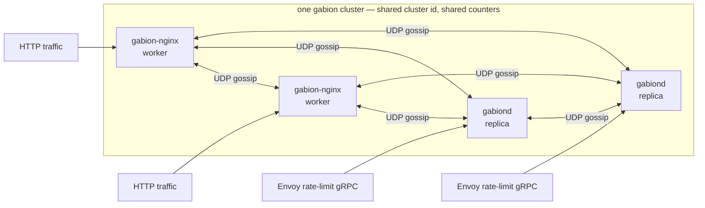

# Gabion

Gabion is a distributed rate limiter for nginx and Envoy. Every member
of a cluster keeps per-origin counters in a CRDT and exchanges them
with its peers over a UDP gossip protocol, so that each incoming
request can be admitted or rejected against the cluster-wide aggregate
rather than whatever fraction of traffic happens to land on the
current node. Counts are eventually consistent across the cluster,
while the admission decision itself is taken locally without locks or
heap allocations.



A single node is only one corner of the cluster; it serves its own
ingress (HTTP through nginx, gRPC through `gabiond`) while gossiping
with every other process about what it has just admitted. The same
library sits underneath both adapters, so an nginx worker and a
`gabiond` replica are interchangeable peers as long as they share a
cluster id, and they count a rule together when it is written the same way
in both
([how](crates/gabion/README.md#writing-the-same-rule-for-nginx-and-gabiond)).

## Rate limiting in two minutes

A **limit** is a number of requests per span of time for one key, such as
"100 requests a second per client IP" or "1,000 a minute per tenant". gabion
writes it as a *rate* (`100r/s`), enforced over a *window* (the rate's own
period unless you widen it), counted in *buckets* inside the window: one
bucket per window for a fixed window, several for a sliding one. A request
whose key has already used the limit in the current window is rejected
(`429` from NGINX, `OVER_LIMIT` to Envoy).

**Why one node's count is not enough.** A deployment of N replicas, each
counting only the requests it sees, admits up to N times the limit: each
replica lets its own share through. gabion makes every replica count every
replica's requests, so a key gets its limit once across the cluster.

**What it costs.** Each replica decides alone, from its local copy of the
cluster's counts, so a decision never waits on the network. The copies are
*eventually consistent*: a hit admitted on one replica reaches every other
replica's count a moment later, in 337 ms at the 99th percentile on an
80-pod cluster in the study. A burst that arrives everywhere at once can
therefore overshoot a limit by what lands in that moment; measured, the
cluster admitted about 1 % more than the limit on the keys that reached it
([what we measured](crates/gabion/README.md#what-we-measured)).

## Try the simulator in your browser

A gossip protocol tends to be easier to follow when you can watch it
run, so the gabion gossip runtime and CRDT have been compiled to
WebAssembly and [hosted as an interactive
demo](https://prosody-events.github.io/gabion/). The code that runs
there is the same code that runs in a `gabiond` replica or an nginx
worker, adapted for the browser environment. UDP gives way to an
in-process router that connects the runtimes by direct call. The
system clock gives way to a hand-driven counter that the transport bar
advances at whatever pace you pick. Two thin shims wrap the transport
and the aggregate store so that the frontend can read their updates as
a typed event stream.

Clicking on a node injects a burst of hits there at the current
virtual time, and the cluster gossips outward until each node's view
of the total catches up to the ground-truth oracle that the simulator
maintains alongside the runtimes. Some scenario presets begin with the
network partitioned, and a Heal control restores the severed links so
that you can watch convergence resume. A panel on the right plots the
cluster-wide disagreement decaying to zero, which is the anti-entropy
curve the protocol produces.

## Contents

- [Rate limiting in two minutes](#rate-limiting-in-two-minutes)
- [When to use gabion](#when-to-use-gabion)
- [Quickstart](#quickstart)
- [How it works](#how-it-works)
- [Choose your adapter](#choose-your-adapter)
- [Glossary](#glossary)
- [Running across a cluster](#running-across-a-cluster)
  - [Kubernetes checklist](#kubernetes-checklist)
  - [Running outside Kubernetes](#running-outside-kubernetes)
- [Fail-open invariant](#fail-open-invariant)
- [When something is wrong](#when-something-is-wrong)
- [Versioning](#versioning)
- [Repository layout](#repository-layout)
- [Further reading](#further-reading)
- [Contributing](#contributing)
- [License](#license)

## When to use gabion

A single nginx process distributes incoming connections across several
worker processes, and a deployment of any size distributes them again
across several replicas. Each of those admission points sees only its
own slice of traffic, so a per-tenant limit enforced independently on
each of them gives the tenant `workers × replicas × limit` of
headroom, which is rarely what the limit was intended to express.
Gabion earns its keep at the moment a single number has to hold across
more than one admission point.

If you run a single nginx box and only need that box's own view of the
world, nginx core's `limit_req` is simpler and you should use it
instead. If you run Envoy with the rate-limit filter, gabion also
ships a drop-in `envoy.service.ratelimit.v3` server, `gabiond`, that
shares state through gossip rather than through a central Redis (or
equivalent) backend, so that the failure of any one replica costs the
cluster a little freshness rather than its ability to enforce at all.
Gabion is a young project, and the Envoy adapter in particular is
still considered experimental at this stage; both its gRPC surface
and its YAML schema may shift before they settle.

## Quickstart

- **NGINX.** Load the module (or run the published image, which loads it
  for you) and follow [Your first rule](crates/nginx/README.md#your-first-rule):
  a limit zone, one `gabion_limit_rule` and one `gabion_limit`.
- **Envoy.** Run `gabiond` with the configuration in
  [Your first YAML](crates/server/README.md#your-first-yaml) and point
  Envoy's rate-limit filter at it.
- **Kubernetes.** Apply the manifests in
  [`deploy/kubernetes/`](deploy/kubernetes/README.md): one adapter's
  Deployment and Service, the discovery RBAC and the NetworkPolicy. The pods
  find each other and their zones with no further configuration.

## How it works

Admission sits on every request's hot path, so the work it does has
to be both cheap and bounded. Each cluster member matches the request
against its rule table and then, for each matched rule, reads the
cluster-wide aggregate for that rule's live buckets — through atomic
loads against one aggregate table, which nginx keeps in a shared-memory
limit zone and `gabiond` on its heap, in either case one probe per live
bucket. The decision is taken without issuing any system calls
or allocating on the heap. If the aggregate plus the hits attributed
to the current request would cross the rule's configured limit the
request is rejected; otherwise it is allowed through and the hit is
recorded into a local queue.

Everything else happens asynchronously, driven by those recorded hits.
A background gossip task on each member folds them into a CRDT,
sends its changed counts over UDP at each 500 ms heartbeat or sooner,
directly to the peers of its zone and to one gateway per remote zone that
relays them, resends what a peer has not acknowledged, applies inbound
deltas back into the local aggregate, and expires bucket rows as time
advances. Each packet decodes on its own, so a dropped UDP packet costs
the cluster at most one heartbeat of staleness rather than a missed
update.

The gossip cadence adapts to per-rule pressure (the **adaptive emit
rate**): a hot rule can fire a threshold round between heartbeats so that
each rule's contribution to cluster-wide unreplicated error stays inside a
per-rule error budget, while a cold rule simply rides the heartbeat.

The full protocol, including the two tiers, the streams and acks, failure
detection, the math behind the budget and the wire format, is documented in
[`crates/gabion/GOSSIP.md`](crates/gabion/GOSSIP.md); the operator knobs that
control it are in
[`crates/gabion/README.md`](crates/gabion/README.md#operator-knobs).
The CRDT data structures themselves are described in
[`crates/gabion/CRDT.md`](crates/gabion/CRDT.md).

## Choose your adapter

| You're running…                       | Component                                                       | Configuration surface                                       |
|---------------------------------------|-----------------------------------------------------------------|-------------------------------------------------------------|
| nginx (in-process, dynamic module)    | [**gabion-nginx**](crates/nginx/README.md)                      | `load_module ngx_http_gabion_module.so` + `gabion_*` directives in `nginx.conf` |
| Envoy (out-of-process, gRPC sidecar)  | [**gabiond**](crates/server/README.md) *(experimental)*         | `envoy.service.ratelimit.v3` server, YAML config            |
| Both, with shared counters            | Run both adapters side by side                                  | Point them at the same cluster id (see [Running across a cluster](#running-across-a-cluster)) |

Each adapter's README is a self-contained operator guide covering its
directives or YAML schema, its runbook entries, and the shape of its
logging. The sections below only cover the vocabulary and behaviour
that apply to both.

## Glossary

The vocabulary is shared across the adapter READMEs. A few entries are
tagged where they apply to only one surface; the rest are universal.

Rate, window, and bucket are easy to conflate, so it is worth being
explicit that gabion treats them as three separate knobs on one shape.
A *rate* is a sustained allowance written `Nr/<unit>`, such as
`100r/s`. A *window* is the time horizon over which that rate is
enforced; by default it is the rate's own period, but it can be
widened to multiply the limit. A *bucket* is the granularity inside
the window: equal to the window for fixed-window enforcement, or
smaller than the window for sliding-window enforcement. Each adapter
accepts the same shape through its own surface — an nginx directive
or a YAML field — and the precise syntax is documented in
[`crates/nginx/README.md`](crates/nginx/README.md) and
[`crates/server/README.md`](crates/server/README.md).

| Term            | Definition                                                                                                                                |
|-----------------|-------------------------------------------------------------------------------------------------------------------------------------------|
| **rule**        | One rate-limit policy (e.g. `per_ip`, `per_tenant`).                                                                                      |
| **zone**        | An availability zone, from `gossip.zone` or the node's own Kubernetes EndpointSlice entry.                                                |
| **limit zone**  | The shared-memory area where counters live (nginx only, `gabion_limit_zone`).                                                             |
| **descriptor**  | A `key=value` pair like `tenant=acme` that names what the rule is counting.                                                               |
| **binding**     | The recipe for building a descriptor from request data — e.g. `tenant:$arg_tenant` (nginx) or an Envoy descriptor action (`gabiond`).     |
| **predicate**   | An `except_if=$var` condition that exempts a request from a rule when the variable is truthy (nginx only).                                |
| **rate**        | Sustained allowance, written `Nr/<unit>`. The rate's period is the default window unless overridden by `window=`.                         |
| **window**      | The time horizon the rate is enforced over. Defaults to the rate's period; set `window=` to widen it (the resolved limit scales up).      |
| **bucket**      | The granularity inside the window. Defaults to the window (one fixed-window bucket); set `bucket=` for sliding-window enforcement.        |
| **cardinality** | How many distinct counters a rule can hold; bounded to keep memory steady when descriptor keys are unbounded user input.                  |
| **fail-open**   | Gabion never rejects on its own internal errors; only on a measured limit overflow. See [Fail-open invariant](#fail-open-invariant).      |
| **gossip**      | The UDP background exchange that keeps counters in sync across nodes.                                                                     |
| **origin**      | The node that admitted a hit; every count is kept per origin and summed across origins.                                                   |
| **cell**        | One counter: one rule's key, in one bucket, from one origin.                                                                              |
| **tick**        | The heartbeat, every `gossip.tick_interval` (500 ms by default): a node sends what it has not yet sent, even when nothing pushes it sooner. |
| **gateway**     | The one node of another zone that a node sends its changes to, for relaying into that zone.                                               |
| **relay**       | What a gateway does with those changes: it passes them to the other nodes of its own zone.                                                |
| **cluster**     | The set of gabion processes (nginx workers and/or `gabiond` replicas) that share counters via gossip.                                     |

## Running across a cluster

Beyond a single node, gabion's value lies in counters being shared,
and three pieces of plumbing turn a set of processes into a cluster
regardless of which adapter they are running:

1. **Bind a gossip socket.** The choice of UDP is deliberate: gabion's
   wire codec is self-describing and tolerant of loss, so that a
   dropped frame costs one tick of staleness rather than opening a
   correctness hole. Each process binds a single socket and uses it
   both to send and to receive.

2. **Pick a cluster id.** Every gabion process that should share
   counters declares the same non-zero u128, and a node drops gossip
   carrying any other id, so two clusters on one network stay apart.
   The id is a label, not a secret, and gossip packets carry no
   authentication: isolate the gossip port with a Kubernetes NetworkPolicy
   (or a security group outside Kubernetes) that admits UDP only from
   gabion pods.
   [`deploy/kubernetes/gabion-networkpolicy.yaml`](deploy/kubernetes/gabion-networkpolicy.yaml)
   is one.

3. **Find the peers and the zone.** On Kubernetes (see the
   [Kubernetes checklist](#kubernetes-checklist)) a member watches the
   EndpointSlices of the namespaces and Services it is configured with,
   picks peer pods up and lets them go as those slices change, with no
   restart when the topology shifts. It also finds its own entry there by
   pod name and reads its zone from it, so zones need no configuration.
   Outside Kubernetes, list the peers in `gossip.bootstrap_peers` (one
   list may name every node, the node itself included) and set each
   node's `gossip.zone`; static peers are never removed. See
   [Zones](crates/gabion/README.md#zones), which also gives commands that
   read the zone from cloud metadata.

The directive names differ between adapters (`gabion_gossip_*` and
`gabion_discovery_*` for nginx, the `gossip:` and `discovery:` blocks in
`gabiond` YAML), but
the shape is identical. The precise syntax for each is documented in
[`crates/nginx/README.md#running-across-a-cluster`](crates/nginx/README.md#running-across-a-cluster)
and
[`crates/server/README.md#running-across-a-cluster`](crates/server/README.md#running-across-a-cluster).

### Kubernetes checklist

Discovery finds peers through three Kubernetes objects. If one is missing,
the pod logs the code in parentheses and finds no peers; each code has an
entry in [`crates/gabion/TROUBLESHOOTING.md`](crates/gabion/TROUBLESHOOTING.md).

- **A Service with a UDP port named `gabion`** whose `port` is the gossip bind
  port, in a namespace discovery watches. Without it discovery logs
  `no_gabion_service`.

  ```yaml
  ports:
    - name: gabion
      protocol: UDP
      port: 9000
  ```

- **A Role** that lets the pods read what discovery watches, in every
  namespace discovery watches. Without it discovery logs `kubernetes_forbidden`
  and stops.

  ```yaml
  apiVersion: rbac.authorization.k8s.io/v1
  kind: Role
  metadata:
    name: gabion-endpointslice-reader
  rules:
    - apiGroups: [""]
      resources: ["pods"]
      verbs: ["get"]
    - apiGroups: [""]
      resources: ["services"]
      verbs: ["get", "list", "watch"]
    - apiGroups: ["discovery.k8s.io"]
      resources: ["endpointslices"]
      verbs: ["get", "list", "watch"]
  ```

- **A RoleBinding** from that Role to the pods' ServiceAccount, in the same
  namespace. A complete set, with the ServiceAccount, is in
  [`deploy/kubernetes/gabion-discovery-rbac.yaml`](deploy/kubernetes/gabion-discovery-rbac.yaml).

- **A `topology.kubernetes.io/zone` label on every node.** Kubernetes copies
  it into each pod's EndpointSlice entry, where gabion reads its zone. EKS,
  GKE and AKS set it; on a self-managed cluster run
  `kubectl label node <node> topology.kubernetes.io/zone=<zone>`. Without it
  the pod logs `zone_unknown` and runs as one zone: counts stay correct, but
  cross-zone traffic is not reduced.

### Running outside Kubernetes

List every node's gossip address in `gossip.bootstrap_peers` (NGINX: one
`gabion_gossip_bootstrap_peers` per peer) and give each node its zone with
`gossip.zone`; the list may name the node itself, and its peers are never
removed. [Outside Kubernetes](crates/gabion/README.md#outside-kubernetes)
gives the settings in both adapters and commands that read the zone from
cloud metadata.

The defaults need no tuning at production sizes: in the study, a hit
reached every pod in 337 ms at the 99th percentile on 80 pods and 301 ms on
183 ([what we measured](crates/gabion/README.md#what-we-measured)). The
operator-knob reference is in
[`crates/gabion/README.md`](crates/gabion/README.md#operator-knobs).

## Fail-open invariant

A rate limiter that rejects valid traffic because of its own bug or
its own saturation is, in practice, worse than one that briefly
under-counts during the same kinds of failure. Gabion takes that
position seriously, on the grounds that failing closed manifests as a
self-inflicted outage whereas failing open manifests as a metric an
operator can graph and respond to at their own tempo.

The invariant that follows is that the only path which can return a
rejection (`429` on nginx, `OVER_LIMIT` on `gabiond`) is a successful
and decisive determination that a request has crossed a configured
limit. Every other condition — whether it is a variable missing, a
predicate that cannot be resolved, a template allocation failure, the
local queue being full, the shared-memory accessor being unavailable,
or anything else unanticipated — allows the request through. The
request counter only increments when an allow is recorded into the
local queue, so that rejects, declines, cardinality skips, and queue
drops never push.

The one deliberate exception is the descriptor byte budget
(`max_descriptor_bytes`), which returns `400 Bad Request` on nginx or
`OVER_LIMIT` on `gabiond` because the request itself is pathological:
client-supplied input has already blown a documented cap. Every
*internal* gabion limit, including the matched-rules cap, a missed
rule-table lookup, or a full SHM queue, declines rather than rejects.

These bypasses do not happen silently. Each path that allows because
of an internal condition emits a structured log line naming the
condition, so that an operator watching their logs sees the
under-counting as it happens; the `/snapshot` admin endpoint on
`gabiond` exposes the same counts for periodic scraping. Each
adapter's README lists the specific log lines and the runbook entries
they map to.

## When something is wrong

Every log line gabion writes for an operator carries a `code` field; find its
entry by that code. The library's codes are in
[`crates/gabion/TROUBLESHOOTING.md`](crates/gabion/TROUBLESHOOTING.md), each
adapter's own in its README.

| Symptom | Where to look |
|---|---|
| Requests over the limit are admitted | The fail-open warnings: [`cell_store_full`](crates/gabion/TROUBLESHOOTING.md#cell_store_full), [`aggregate_full`](crates/gabion/TROUBLESHOOTING.md#aggregate_full), [`queue_dropped`](crates/nginx/README.md#queue_dropped), [`request_queue_full`](crates/server/README.md#request_queue_full), [`matched_rule_overflow`](crates/server/README.md#matched_rule_overflow); then [`peer_version_mismatch`](crates/gabion/TROUBLESHOOTING.md#peer_version_mismatch) during an upgrade; then whether NGINX and `gabiond` write the rule [the same way](crates/gabion/README.md#writing-the-same-rule-for-nginx-and-gabiond). |
| `nginx -t` fails | The line ends with ` code=NAME`: [Configuration errors](crates/nginx/README.md#configuration-errors-nginx--t). |
| `gabiond` exits with status 1 | Its one error line: [`gabiond_exit`](crates/server/README.md#gabiond_exit), [`listener_failed`](crates/server/README.md#listener_failed), [`server_stopped`](crates/server/README.md#server_stopped) or [`gossip_stopped`](crates/server/README.md#gossip_stopped). |
| No peers are found | [`no_gabion_service`](crates/gabion/TROUBLESHOOTING.md#no_gabion_service), [`kubernetes_forbidden`](crates/gabion/TROUBLESHOOTING.md#kubernetes_forbidden), [`kubernetes_unreachable`](crates/gabion/TROUBLESHOOTING.md#kubernetes_unreachable); the [Kubernetes checklist](#kubernetes-checklist). |
| The zone is unknown or wrong | [`zone_unknown`](crates/gabion/TROUBLESHOOTING.md#zone_unknown), [`zone_conflict`](crates/gabion/TROUBLESHOOTING.md#zone_conflict). |
| A warning says something is full | Its entry names the setting to raise: [`cell_store_full`](crates/gabion/TROUBLESHOOTING.md#cell_store_full), [`peer_table_full`](crates/gabion/TROUBLESHOOTING.md#peer_table_full), [`rule_dictionary_full`](crates/gabion/TROUBLESHOOTING.md#rule_dictionary_full), [`node_dictionary_full`](crates/gabion/TROUBLESHOOTING.md#node_dictionary_full). |
| Gossip packets are rejected | [`decode_rejected`](crates/gabion/TROUBLESHOOTING.md#decode_rejected) (its `reason` field), [`peer_version_mismatch`](crates/gabion/TROUBLESHOOTING.md#peer_version_mismatch). |
| Gateways keep switching | [`gateway_failover`](crates/gabion/TROUBLESHOOTING.md#gateway_failover), [`relay_stalled`](crates/gabion/TROUBLESHOOTING.md#relay_stalled). |

## Versioning

gabion is versioned 0.x under semantic versioning, released by
release-please from the conventional commits on `main`; each release's notes
are in [`CHANGELOG.md`](CHANGELOG.md). While the major version is 0, a minor
release may change the gossip wire format or remove settings. Every node of a
cluster, NGINX and `gabiond` alike, runs one release; roll a new one through
quickly, as [Upgrading](crates/gabion/README.md#upgrading) describes.

## Repository layout

The workspace lives under `crates/`:

| Crate                                              | Role                                                                                          |
|----------------------------------------------------|-----------------------------------------------------------------------------------------------|
| [`gabion`](crates/gabion/README.md)                | The library. Pure Rust, no transport bindings. CRDT, gossip runtime, wire codec, rule machinery, discovery, defaults. |
| [`gabion-server`](crates/server/README.md)         | The `gabiond` binary. Tonic gRPC service speaking `envoy.service.ratelimit.v3`, plus a small admin HTTP endpoint. |
| [`gabion-nginx`](crates/nginx/README.md)           | The nginx dynamic module. Builds with `cargo build -p gabion-nginx --features ngx-module --release`. |
| `gabion-loader`                                    | Load generator. Drives the gRPC service (or an HTTP endpoint sitting in front of nginx) with a configurable tenant / hit-rate mix. |
| [`gabion-wasm`](crates/gabion-wasm/README.md)      | The visualizer's WebAssembly bridge. Stands up N gossip runtimes on the deterministic in-process router and exposes them over a command channel to the browser frontend that ships to the hosted simulator. |
| [`gossip-bench`](crates/gossip-bench/README.md)    | The study harness: a deterministic simulator of a gabion cluster under production-shaped load, scored against the true count, with the judge and regression gate that compare a change with the measured baselines. |

Deployment manifests, the nginx docker-compose harness, Kubernetes
smoke tests, and the cross-version nginx / OpenResty build matrices
live under [`deploy/`](deploy).

## Further reading

- [Interactive gossip simulator](https://prosody-events.github.io/gabion/) — the gabion runtime in a browser, for stepping through convergence interactively.
- [`crates/gabion/README.md`](crates/gabion/README.md) — the library guide: operator knobs, sizing, zones, upgrading and what we measured.
- [`crates/gabion/GOSSIP.md`](crates/gabion/GOSSIP.md) — the gossip protocol as built, and the wire format byte by byte.
- [`crates/gabion/CRDT.md`](crates/gabion/CRDT.md) — design of the counter store, end to end.
- [`crates/gabion/TROUBLESHOOTING.md`](crates/gabion/TROUBLESHOOTING.md) — what each library log message means and what to do about it.
- [`crates/nginx/README.md`](crates/nginx/README.md) — operator guide for the nginx module.
- [`crates/server/README.md`](crates/server/README.md) — operator guide for `gabiond` (experimental).
- [`crates/gabion-wasm/README.md`](crates/gabion-wasm/README.md) — how the visualizer is wired to the gossip core.
- [`crates/gossip-bench/README.md`](crates/gossip-bench/README.md) — running the study harness, its CI smoke and the regression gate.
- [`deploy/kubernetes/README.md`](deploy/kubernetes/README.md) — the Kubernetes manifests, and the smokes that check them.
- [`deploy/nginx/README.md`](deploy/nginx/README.md) — building the module against different nginx / OpenResty base images.

## Contributing

Pull requests are welcome; please run `make test` before sending one.
`make loom` model-checks the nginx module's shared-memory queue, leader lease
and aggregate seqlock with [loom](https://github.com/tokio-rs/loom), across
every thread interleaving with up to two preemptions; run it after touching
any of them.

## License

MIT. See [`LICENSE`](LICENSE).
