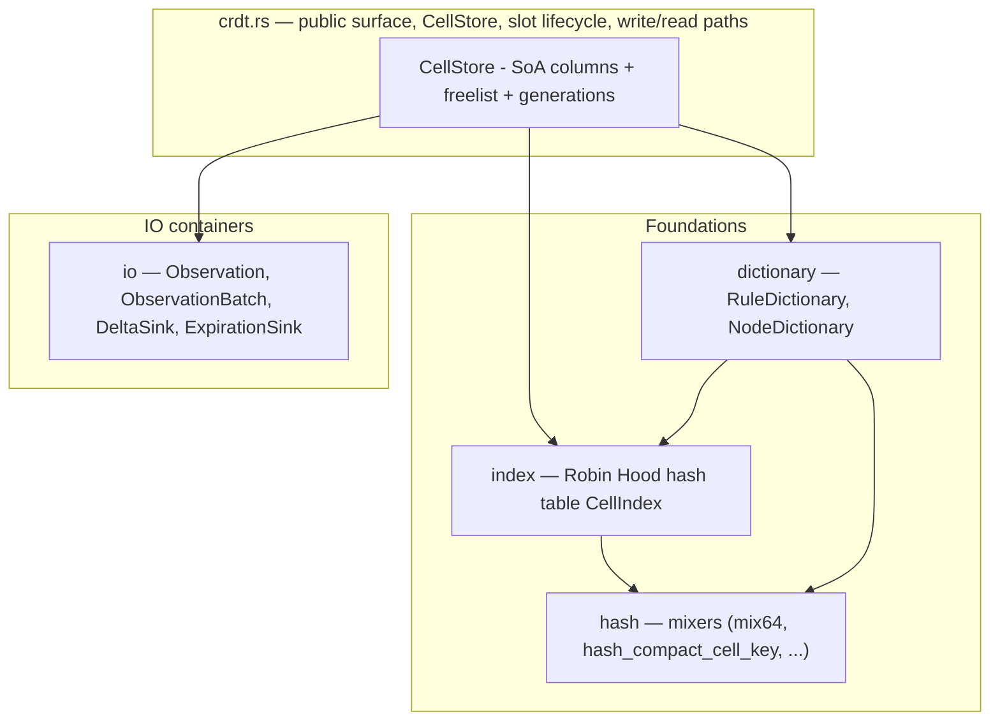
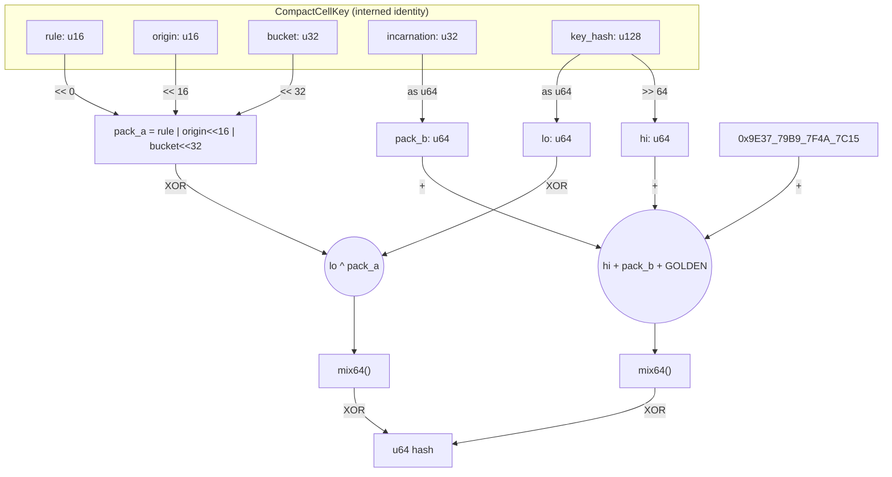
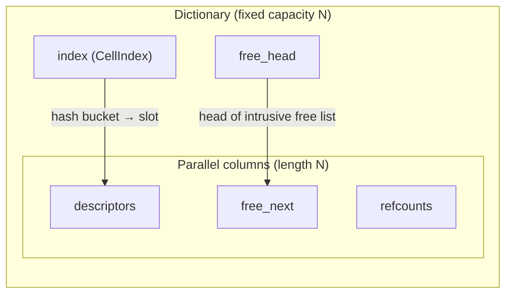
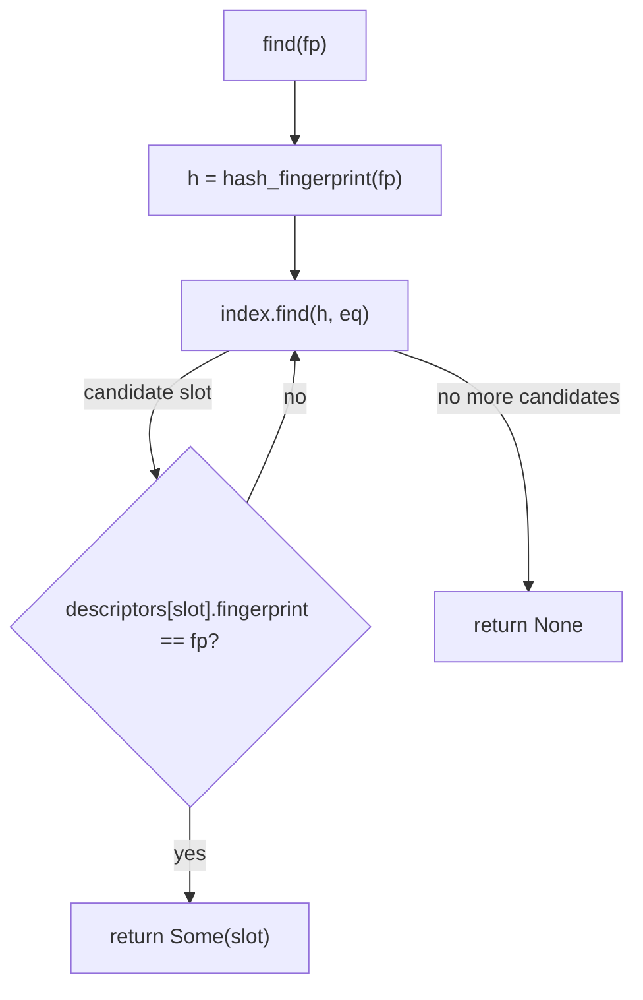
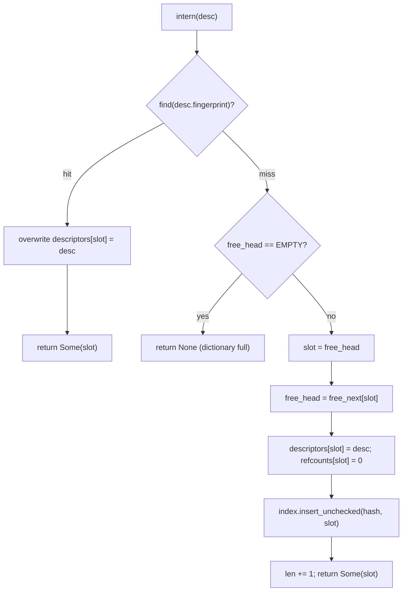
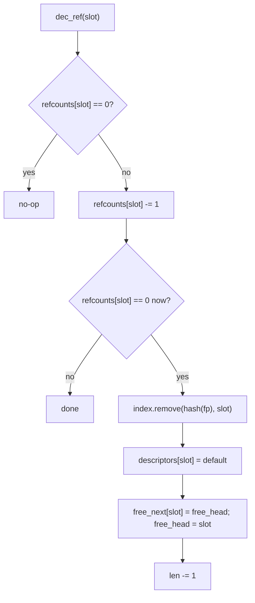
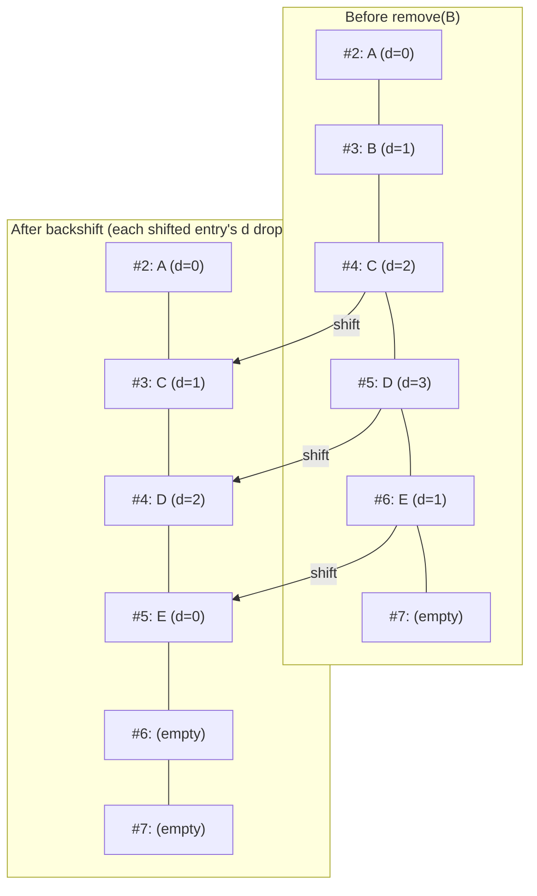
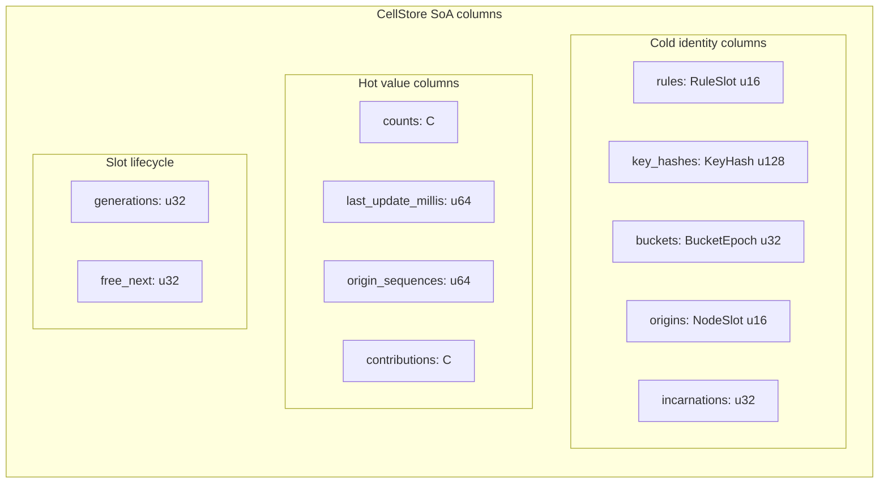
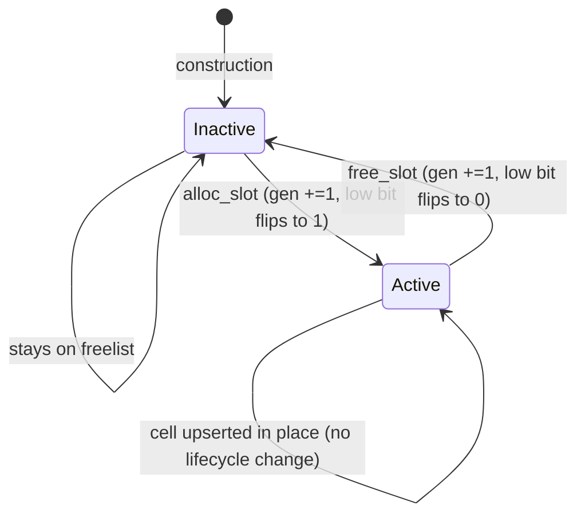
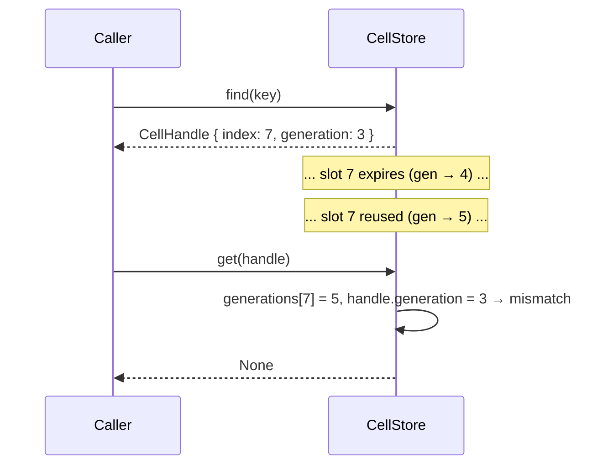

# The `crdt` module

A guide to `crates/gabion/src/crdt/*` for somebody who has never opened this code before. The deep-dive companion to [`README.md`](README.md#how-gossip-works) — which documents the gossip runtime that sits on top of the structures described here. Key ownership, syncs, broadcasts and their repair all live there; this file is the data structures and the writes that flow through them.

Read it end-to-end and you should be able to open `crdt.rs` and recognise every type, every column, and every method named below.

---

## Table of contents

1. [The problem the module solves](#1-the-problem-the-module-solves)
2. [Module map](#2-module-map)
3. [Foundations](#3-foundations)
   - 3.1 [`hash` — deterministic mixers](#31-hash--deterministic-mixers)
   - 3.2 [`dictionary` — identity interning](#32-dictionary--identity-interning)
   - 3.3 [`index` — the Robin Hood hash table](#33-index--the-robin-hood-hash-table)
4. [The cell store](#4-the-cell-store)
   - 4.1 [Structure-of-arrays column layout](#41-structure-of-arrays-column-layout)
   - 4.2 [Slot lifecycle: freelist + generation tagging](#42-slot-lifecycle-freelist--generation-tagging)
   - 4.3 [Handles](#43-handles)
   - 4.4 [The `Count` trait — width-parametric counters](#44-the-count-trait--width-parametric-counters)
   - 4.5 [Defaults and the production tunables](#45-defaults-and-the-production-tunables)
5. [I/O containers](#5-io-containers)
   - 5.1 [`Observation` and `ObservationBatch` — input](#51-observation-and-observationbatch--input)
   - 5.2 [`DeltaSink` — output for rising counts](#52-deltasink--output-for-rising-counts)
   - 5.3 [`ExpirationSink` — output for aged-out cells](#53-expirationsink--output-for-aged-out-cells)
   - 5.4 [`CompactCellKey` vs `CellIdentity`](#54-compactcellkey-vs-cellidentity)
6. [Data flow](#6-data-flow)
   - 6.1 [Write: `ingest_local`](#61-write-ingest_local)
   - 6.2 [Write: `merge_remote` — an owner folds contributors' cells](#62-write-merge_remote--an-owner-folds-contributors-cells)
   - 6.3 [Write: `merge_totals` — a receiver folds an owner's totals](#63-write-merge_totals--a-receiver-folds-an-owners-totals)
   - 6.4 [The shared core: `find_or_insert` and `raise`](#64-the-shared-core-find_or_insert-and-raise)
   - 6.5 [Read: `find`, `resolve`, `get`, `count_of`, and the view](#65-read-find-resolve-get-count_of-and-the-view)
7. [Gossip and convergence](#7-gossip-and-convergence)
8. [Expiry](#8-expiry)
9. [End-to-end traced example](#9-end-to-end-traced-example)
10. [Invariants reference](#10-invariants-reference)
11. [Cross-module map](#11-cross-module-map)
12. [Glossary](#12-glossary)

> *Anchor aliases.* Other docs cross-link these sections without the leading section numbers. The HTML anchors below — `module-map`, `gossip-and-convergence`, `expiry`, `invariants-reference` — sit on the respective headings so both `#2-module-map` (GitHub's auto-slug) and the bare `#module-map` resolve.

---

## 1. The problem the module solves

A node receives a stream of **hits** — events that should increment a counter. Which counter to increment depends on five fields:

- a **rule** (e.g. "100 requests / minute per API key"),
- an application **key** (e.g. the hashed API key),
- a time **bucket** (which one-minute slice we are in right now),
- the **origin** node that observed the hit, and
- that origin's **incarnation** (a small integer bumped each restart, so successive lifetimes of one node are distinguishable).

A rate-limit decision wants the global sum across all origins for the current bucket. Each node counts its own hits in its own origin's cells. Every `(rule, key)` has an **owner** (chosen by the gossip runtime): contributors send it their cells, which it max-merges per origin — counts only rise, so the per-origin maximum is an exact, idempotent join, which is what makes it a CRDT — and it broadcasts each bucket's **total**. Every other node keeps, per bucket, a single **others** cell: a count of everyone else's hits that only rises, and only to a lower bound of the truth. A node's **view** of a bucket is its own cell plus its others cell.

The `crdt` module is responsible for:

1. **Storing** these counters compactly and at bounded capacity (no allocation after construction).
2. **Observing** local hits and **merging** observations heard from peers.
3. **Emitting deltas** when a counted cell (own or others) rises and **emitting expirations** when one is freed, so an external aggregate store stays consistent with the view.
4. **Reporting totals**: each bucket's view total, for the owner's broadcasts, repairs and snapshots.
5. **Expiring** cells whose bucket has aged out of the live window.

Everything in the module is single-threaded and bounded, with all capacities picked at `CellStore::new` time and never grown thereafter. The module-level comment says it plainly: *"Nothing in this module allocates after construction."* Two storage conventions enforce this. The store's own columns are `Box<[T]>` — slices that cannot grow, sized once at construction — while the caller-owned I/O containers (§5) are `Vec<T>` so that the caller can `clear()` them between frames and reuse the same capacity, calling `with_capacity` once at startup so they never reallocate in steady state.

For the cluster-level protocol — key ownership, syncs and acknowledgements, broadcasts and their repair — see [`README.md`](README.md#how-gossip-works). This document does not describe those; it describes the data structures the runtime drives.

---

<a id="module-map"></a>
## 2. Module map



§3 walks the three foundations bottom-up — they have no dependencies on the cell store and compose into it. §4 introduces the store; §5 the I/O containers; §6 traces a write through both; §7 says how the gossip runtime uses the view; §8 covers expiry.

---

## 3. Foundations

These four submodules are the load-bearing primitives. They have no dependencies on the cell store itself, so it is easiest to understand them first; the cell store then composes them.

### 3.1 `hash` — deterministic mixers

File: `crates/gabion/src/crdt/hash.rs`.

`hash.rs` is roughly forty lines of pure arithmetic. Its job is to turn structured CRDT identifiers — a 128-bit rule fingerprint, a `(node_id, incarnation)` pair, or a five-field `CompactCellKey` — into a 64-bit hash that the Robin Hood index and the dictionaries can use as a probe position.

#### The shared finalizer: `mix64`

```rust
#[inline(always)]
pub(super) fn mix64(mut h: u64) -> u64 {
    h ^= h >> 33;
    h = h.wrapping_mul(0xff51_afd7_ed55_8ccd);
    h ^= h >> 33;
    h = h.wrapping_mul(0xc4ce_b9fe_1a85_ec53);
    h ^= h >> 33;
    h
}
```

This is Austin Appleby's `fmix64` finalizer from MurmurHash3. The constants are not chosen here; they are the published values that achieve full bit-avalanche — flipping any one input bit flips, on average, half the output bits. Three rounds of shift-multiply-xor are enough to produce a well-mixed `u64` from a `u64`.

`wrapping_mul` means "ignore overflow," which gives us the `Z/2^64` group operation that any open-addressing hash table is naturally built on. `#[inline(always)]` is load-bearing: the function is called twice per CRDT lookup, and inlining lets LLVM fold its constants into each call site.

#### `hash_compact_cell_key` — the main entry point



The algorithm packs `rule | origin | bucket` into one `u64` (16 + 16 + 32 = 64 bits, no overlap), splits the 128-bit `key_hash` into low and high halves, and runs two independent `mix64` lanes that are XOR-folded at the end. The `0x9E3779B97F4A7C15` constant, which is `2^64 / golden_ratio` and is also known as SplitMix64's increment, prevents the all-zero input from collapsing to zero and breaks symmetry between the two lanes.

#### Invariants — what callers rely on

1. **Determinism across peers (load-bearing).** The CRDT only converges if every node agrees on the bucket assignment for a given cell. The function uses no runtime seed, so the output depends only on the input bytes. *Do not introduce per-process randomness here.*
2. **Total function.** Every `CompactCellKey` produces a `u64`, with no panic, no `Option`, and no error path.
3. **Allocation- and syscall-free.** The body is pure arithmetic on stack integers.
4. **All five `CompactCellKey` fields participate.** If a sixth field is added, this function must be updated, or distinct cells will collide.
5. **The hash is a probe hint, not an identity.** Hash collisions are inevitable in a 2^64 universe, so `CellIndex` returns candidate slots whose stored hash matches and the caller — `CellStore::lookup_index` — confirms a hit by re-comparing all five identity columns.

#### Why a small custom mixer, not SipHash

`std::collections::HashMap` defaults to SipHash with a per-process random seed because it must resist hash-DoS over adversarial byte inputs. None of that reasoning applies here: the inputs are already-hashed 128-bit keys plus 16/32-bit dictionary slots, there is no DoS surface inside this function, and a random seed would actively *break* the CRDT by making peers disagree on bucket assignments.

Two sibling helpers — `hash_fingerprint(u128)` and `hash_node_identity(NodeId, Incarnation)` — follow the same recipe with different large odd constants, so the rule and node dictionaries see uncorrelated distributions even if two values happen to share a bit pattern.

---

### 3.2 `dictionary` — identity interning

File: `crates/gabion/src/crdt/dictionary.rs`.

Every cell carries a `RuleSlot` (`u16`) and a `NodeSlot` (`u16`) instead of a full 128-bit rule fingerprint and a full `(NodeId, Incarnation)` pair. The two dictionaries are what turn the long identities into those small handles.

**Why intern at all?**

1. **Compact rows.** A `u16` slot in every cell replaces 128 bits of fingerprint plus 160 bits of node identity; the module-level comment notes this drops the per-row identity cost from 52 bytes to 28.
2. **Fast equality on small ints.** Cell-to-cell comparisons become `u16 == u16` rather than 128-bit compares.
3. **No per-cell allocation.** All descriptor storage lives inside pre-allocated boxed slices.
4. **Stable local mapping.** For the lifetime of a single dictionary, a given fingerprint (or node identity) maps to one slot, and that slot is not reused for a different value while its refcount is non-zero.

One subtlety is worth flagging: slots are **not** globally stable across peers. Peer A might assign `RuleSlot = 3` to a fingerprint that peer B happens to call `RuleSlot = 7`. The wire formats therefore key on fingerprints and on `(NodeId, Incarnation)` rather than on slot numbers, because slots are a purely local optimisation.

#### Shared layout

Both dictionaries share the same five fields plus capacity:

| Field         | Type             | Role                                                                                         |
| ------------- | ---------------- | -------------------------------------------------------------------------------------------- |
| `descriptors` | `Box<[Desc]>`    | One slot per index. Holds the canonical record. Default at free slots.                       |
| `refcounts`   | `Box<[u32]>`     | Parallel array. Zero means "free". Non-zero means "in use by N cells".                       |
| `index`       | `CellIndex`      | `hash(value) → slot`, with a closure to confirm equality on hits.                            |
| `free_next`   | `Box<[u16]>`     | Intrusive singly linked list of free slots. `free_next[i]` is the next free slot after `i`.  |
| `free_head`   | `u16`            | Head of the free list. `EMPTY_DICT_SLOT` (`u16::MAX`) when full.                             |
| `len`         | `u16`            | Number of live (non-zero-refcount) slots.                                                    |
| `capacity`    | `u16`            | Total slots allocated; set once at construction.                                              |



`EMPTY_DICT_SLOT = u16::MAX` does double duty: it marks both "no such slot" and "end of free list," and the constructors assert `capacity < u16::MAX` precisely so that real slot values can never collide with the sentinel.

Right after `with_capacity(8)` every slot is free, chained as `0 → 1 → … → 7 → EMPTY`. Allocation peels off the head and freeing pushes back onto it, with the intrusive list living inside the same `free_next` slice that was sized once at construction.

#### `RuleDictionary`

```rust
pub struct RuleDescriptor {
    pub fingerprint: u128,
    pub window_millis: u32,
    pub bucket_millis: u32,
    pub limit: u64,
    pub flags: u32,
    pub local_rule_id: u32, // u32::MAX => wire-only
}
```

`fingerprint` is the canonical 128-bit identity and the key the hash index hashes. The remaining fields describe the rate-limit rule itself.

`local_rule_id` carries a useful sentinel: a value of `u32::MAX` (the `Default`) means the rule is known on the wire only. Cells under such rules are still tracked, replicated, and expired, but `applies_locally()` returns `false` so the local aggregator skips them — which is what happens when a peer is gossiping a rule the local node does not itself enforce.

**Read path.** `descriptor(slot)` bounds-checks and verifies `refcount > 0` before returning. A free slot returns `None` even though the backing array still holds a default value at that index. `find(fingerprint)` hashes via `hash_fingerprint`, asks `CellIndex` for candidate slots, and confirms a match with `fingerprint == fingerprint`.



**Write path — `intern`.** `intern(descriptor) -> Option<RuleSlot>` is the only way to create a rule slot:



`intern` overwrites the descriptor on a hit, which is how mutable
metadata like `local_rule_id` updates make their way in. When a rule
first arrives on the wire (wire-only, `local_rule_id = u32::MAX`)
and is later registered locally, a re-intern with a real
`local_rule_id` patches the descriptor in place without disturbing
the slot. `intern` deliberately does not touch refcounts: a freshly
interned slot starts at `refcount = 0`, and the `CellStore` calls
`inc_ref` and `dec_ref` as cells reference and release the slot.

**Refcounting.** `inc_ref` saturates at `u32::MAX`; `dec_ref` is a no-op at zero. When `dec_ref` drives the count to zero, four things happen in sequence:



The descriptor reset is critical: it clears the fingerprint so that a `find` during recycling cannot resolve to the now-free slot.

#### `NodeDictionary`

`NodeDictionary` is structurally a twin of `RuleDictionary` — same five fields, same free list, same hash-index lookup — but with three deliberate differences.

```rust
pub struct NodeDescriptor {
    pub node_id: NodeId,
    pub incarnation: Incarnation,
}
```

The interned key is the *pair* `(node_id, incarnation)`, not just the node id, and this distinction is load-bearing. When a node restarts (or otherwise increments its incarnation), the new `(node_id, incarnation)` is a different key from the old one: `intern` allocates a fresh slot, and old cells produced by the previous incarnation stay pinned to the old slot until released. The two incarnations cannot alias inside the CRDT, which is exactly what we need; otherwise replayed sequence numbers from the dead incarnation could clobber state from the live one.

The three asymmetries with the rule version are:

1. **`intern` does not overwrite the descriptor on a hit.** There is nothing to overwrite, because the descriptor *is* the key.
2. **`dec_ref` returns `bool`.** A return value of `true` means this call dropped the refcount to zero and freed the slot, which the caller uses to decide whether to also tear down per-origin auxiliary state — the per-origin sequence allocator.
3. **Different incarnations get different slots.** A node that bumps its incarnation never shares a `NodeSlot` with its previous identity.

#### Capacity sizing — `pow2_index_capacity_for`

```rust
pub(super) fn pow2_index_capacity_for(capacity: u32) -> u32 {
    let base = capacity.max(1).next_power_of_two();
    base.saturating_mul(2).max(2)
}
```

The helper offers three guarantees. The result is always a power of two, which lets the hash index use bitmasking instead of modulo; it doubles the descriptor capacity so the index sits at roughly a 50% load factor at full occupancy; and the bounds are safe at the edges, because `.max(1)` keeps `next_power_of_two` defined, `.saturating_mul(2)` guards against `u32` overflow at the absurd end, and `.max(2)` floors the result at two buckets. As a worked example, `capacity = 100` rounds up to `next_power_of_two(100) = 128`, which doubles to `256` index buckets, giving about 39% load at full occupancy.

#### Dictionary invariants

1. **Stable mapping during a slot's lifetime.** Once a value is interned to a slot, that slot is stable until `refcount` drops to zero.
2. **No duplicates.** At any time at most one live slot holds a given key.
3. **Bounded size.** `len <= capacity <= u16::MAX - 1`.
4. **No allocation after construction.**
5. **`intern` never mutates refcounts.**
6. **A freed slot is unreachable via `find` before it is recycled** — `dec_ref` removes the index entry and resets the descriptor *before* pushing the slot onto the free list.
7. **`RuleDictionary::intern` overwrites the descriptor on a hit; `NodeDictionary::intern` does not.**
8. **Different incarnations get different `NodeSlot`s.**
9. **`EMPTY_DICT_SLOT = u16::MAX`** is both "no slot" and "end of free list"; the capacity assertion makes the dual use safe.
10. **`inc_ref` saturates; `dec_ref` is a floor** — refcounts can neither overflow nor underflow.

---

### 3.3 `index` — the Robin Hood hash table

File: `crates/gabion/src/crdt/index.rs`.

The slot tables are accessed by index, but cells are looked up by `CompactCellKey`. That mapping lives in `CellIndex`, a power-of-two open-addressed hash table that uses Robin Hood probing for inserts and backshift deletion for removes, with no tombstones.

#### The minimum vocabulary

- **Open addressing.** Collisions are resolved by walking forward in the same flat array rather than by chaining. Everything stays contiguous.
- **Probe sequence.** The walk a key follows looking for its home. Here it is *linear*: `slot = (slot + 1) & mask`.
- **Power-of-two masking.** If capacity is a power of two, `x mod capacity == x & (capacity - 1)`. A single bitwise AND replaces a division.
- **Ideal slot.** `(hash as u32) & mask` — the bucket the key wants.
- **Probe distance / displacement.** How far an entry sits from its ideal slot, measured along the probe sequence. An entry living at its ideal slot has distance 0. The function is `slot.wrapping_sub(ideal) & mask`; the `wrapping_sub` plus mask handles wrap-around correctly.
- **Load factor.** `len / capacity`. This index keeps load factor strictly below 1 (it is fixed-capacity).
- **Robin Hood hashing.** On insert, when you find a bucket whose occupant has a *smaller* probe distance than the entry you are carrying, swap — leave yours, continue walking with theirs. Probe distances stay tightly bunched around their mean.
- **Tombstone.** A "deleted-but-don't-skip-me" marker used by simpler open-addressing tables. They accumulate forever under churn and inflate average probe distance. `CellIndex` does not use tombstones.
- **Backshift deletion.** When you remove an entry, walk forward and pull each subsequent displaced entry back by one slot — but only while those entries have probe distance > 0 (otherwise they would no longer be findable). The table ends up exactly as it would have been if the removed entry had never been inserted.

#### Why Robin Hood + backshift?

Three properties matter here, and this combination wins on all of them.

- **Bounded displacement under churn.** Plain linear probing concentrates clusters: a few keys hashing near each other build a long run, and every subsequent insertion into that cluster has to walk to the end of it. Robin Hood actively equalises displacement, because any entry that has walked further than the incumbent steals the slot, so the maximum probe distance stays small and slow-growing in practice.
- **No tombstone bloat.** A CRDT for rate-limit counters churns continuously as old buckets expire and free their cells while new ones arrive. A tombstoned table would either degrade over time or require periodic rebuilds, whereas backshift deletion restores the table to a freshly-inserted shape after every removal.
- **Simple cache behaviour.** The structure is two flat parallel arrays of `u32` and `u64`, so every probe step is a one-line index into contiguous memory and the probe sequence `slot = (slot + 1) & mask` reads sequentially in a way that CPU prefetchers can follow trivially.

The Robin Hood early-exit on probe distance is what makes deletion-by-backshift correct in the first place. If `find` encounters a bucket whose occupant has a smaller probe distance than the searcher has walked, the key being searched for cannot be in the table, because if it were it would have stolen this bucket from the current occupant during its own insert. That same fact guarantees, during `remove`'s backshift, that no other key relies on the now-empty slot remaining non-empty.

#### Data layout

Two parallel arrays of length `capacity` form the buckets:

| Column         | Width | Purpose                                                                                                                     |
|----------------|-------|-----------------------------------------------------------------------------------------------------------------------------|
| `slot_indexes` | `u32` | The row index in the outer `CellStore`. **Also encodes occupancy.**                                                         |
| `hashes`       | `u64` | The full hash of the key stored here. Used for ideal-slot math and as a fast pre-filter before the caller's equality check. |

A bucket is empty iff `slot_indexes[i] == EMPTY_INDEX_SLOT`, defined as `u32::MAX`, and only `slot_indexes` is authoritative for occupancy. The `hashes` column is data rather than state: it is zeroed on construction and zeroed by backshift when it vacates a bucket, but the value `0` is a perfectly legal stored hash, not a tombstone.

Capacity is fixed at construction (`with_capacity`) and must be a power of two greater than zero, with both conditions asserted; the table never resizes. The `CellStore` picks the index's capacity via `pow2_index_capacity_for(cell_capacity)`, which gives the index headroom, and insert asserts `self.len < self.capacity` so the index always reserves at least one empty bucket. That single empty bucket is the termination guarantee for the probe loops: as long as one bucket is empty, every walk eventually hits it and stops.

#### Lookup — `find`

`find(hash, eq)` searches for an entry whose stored hash equals `hash` and for which the caller-supplied closure `eq(stored_slot)` returns true. The split between hash equality (done by the index) and key equality (done by the caller's closure) is deliberate, because the index does not know what a key is: the caller — `CellStore` — owns the cold identity columns (`rules`, `key_hashes`, `buckets`, `origins`, `incarnations`) needed to confirm a true hit. The stored 64-bit hash is a near-perfect pre-filter, so the closure only fires on real hash collisions.

```mermaid
sequenceDiagram
  autonumber
  participant C as Caller (CellStore)
  participant I as CellIndex.find
  participant B as Buckets

  C->>I: find(hash, eq)
  alt len == 0
    I-->>C: None
  else
    I->>I: slot = hash & mask; dist = 0
    loop probe walk
      I->>B: read slot_indexes[slot], hashes[slot]
      alt slot empty
        I-->>C: None
      else dist > stored_dist
        Note over I: Robin Hood early exit
        I-->>C: None
      else hash matches AND eq(stored_slot)
        I-->>C: Some(stored_slot)
      else
        I->>I: slot = (slot+1) & mask; dist += 1
      end
    end
  end
```

The Robin Hood early exit is what makes negative lookups — the common case for any cache-like structure — cheap.

#### Insert — `insert_unchecked`

`insert_unchecked(hash, slot_index)` is `unchecked` because the caller has already verified the entry is not present. It carries two asserted preconditions: `slot_index != u32::MAX` and `self.len < self.capacity`.

```mermaid
sequenceDiagram
  autonumber
  participant C as Caller
  participant I as CellIndex.insert_unchecked
  participant B as Buckets

  C->>I: insert_unchecked(hash, slot_index)
  I->>I: assert slot_index != EMPTY; assert len < capacity
  I->>I: slot = hash & mask; carry = (hash, slot_index, dist=0)
  loop probe walk
    I->>B: read slot_indexes[slot]
    alt slot empty
      I->>B: write carry into bucket
      I->>I: len += 1
      I-->>C: return
    else carry.dist > occupant.dist
      Note over I,B: Robin Hood steal: swap carry with occupant
      I->>B: bucket := carry
      I->>I: carry := old occupant (with its own dist)
    end
    I->>I: slot = (slot+1) & mask; carry.dist += 1
  end
```

The invariant the loop preserves is exactly Robin Hood: at every step, the entry being carried has the larger displacement of the two candidates competing for the next bucket.

#### Delete — `remove` + `backshift`

The search phase of `remove` is structurally identical to `find` with two adaptations. Equality matches on both `stored_hash == hash` and `stored_slot == slot_index` (the caller already knows the exact slot), and on a successful match `remove` calls `backshift(slot)` and decrements `len`.

`backshift` slides subsequent displaced entries one slot back until it hits a stopping condition:

```text
loop:
  next = (slot + 1) & mask
  if bucket[next] is empty:           stop (clear bucket[slot])
  if probe_distance(bucket[next]) == 0:
      stop (clear bucket[slot])       # entry at its ideal slot cannot move back
  bucket[slot] = bucket[next]
  slot = next
```

Both stopping conditions matter. The "probe distance 0" case is the reason backshift is safe: an entry sitting at its ideal slot would become unreachable if pulled one slot earlier, so we leave it alone and clear the trailing bucket instead.

The diagram below shows one contiguous row of buckets. `B` is removed from slot #3, after which `C`, `D`, and `E` each shift one slot left and their probe distances each drop by exactly one — which is fine, because by hypothesis each distance was at least 1, otherwise backshift would have stopped. Slot #6 ends empty.



Each shifted entry's probe distance drops by exactly one.

#### Index invariants

1. **Power-of-two capacity, mask is `capacity - 1`.** Set in `with_capacity`, never mutated.
2. **`len < capacity` after every operation.** Guarantees at least one empty bucket exists for probe termination.
3. **No tombstones.** Every bucket is exactly *empty* or *occupied*. `slot_indexes[i] == u32::MAX` is the sole occupancy predicate.
4. **Robin Hood ordering.** At any bucket encountered during a probe walk, if its occupant has probe distance strictly less than the searcher's distance, the searched key cannot be in the table.
5. **The first entry of any contiguous run has probe distance 0 or is empty.** Backshift maintains this.
6. **No reserved values other than `u32::MAX` in `slot_indexes`.** Insert asserts `slot_index != u32::MAX`.
7. **Allocation-free after construction.** Two `Box<[T]>` columns sized exactly in `with_capacity`.

---

---

## 4. The cell store

With the foundations in hand, the store itself can be described. It is defined in the top-level `crates/gabion/src/crdt.rs`.

### 4.1 Structure-of-arrays column layout

The most important shape choice in this module is SoA — Structure of Arrays. Instead of holding rows as a `Box<[Cell]>` where `Cell` is a struct, the store holds each field in its own boxed slice:



Each column is a `Box<[T]>` of length `capacity`. Cell `i` is reconstructed by reading index `i` from every column.

**Why SoA?**

1. **Identity lookups touch only the cold columns.** `lookup_index` reads `rules`, `key_hashes`, `buckets`, `origins`, and `incarnations` to confirm a hash match, so the hot value columns never enter cache during a lookup.
2. **Merge passes touch only the hot columns.** Fold paths can stream over `counts` without dragging 28 bytes of identity along with each value.
3. **Identity is interned into small ints.** Each cell's identity row is five small integers totalling 28 bytes (`RuleSlot u16 + KeyHash u128 + BucketEpoch u32 + NodeSlot u16 + Incarnation u32` = 2 + 16 + 4 + 2 + 4 = 28). The module comment notes that this replaces a 52-byte AoS struct.

The interning that makes this compaction possible is exactly what the two dictionaries from §3.2 buy.

The four most load-bearing public types in this section are `CompactCellKey` (the node-local interned identity used as the hash-index key), `CellIdentity` (the portable boundary identity exported through the sinks), `CellHandle` (a generation-stamped slot reference), and `InsertReject` (the single enum that names every capacity-exceeded rejection). The exhaustive list lives in `.audit/api-surface.md` and in `crates/gabion/src/crdt.rs`; rather than restate it here, those types are introduced inline at the section that depends on them, and `CellIdentity` versus `CompactCellKey` gets a dedicated treatment in §5.4.

---

### 4.2 Slot lifecycle: freelist + generation tagging

The store has up to `capacity` cells, where a **slot** is an index in `0..capacity`. At any moment a slot is either *active* — meaning it holds a live cell, the hash index has an entry for it, and the dictionary refcounts are held — or *inactive*, meaning it sits on the freelist with all columns stale but harmless.

The lifecycle is controlled by two columns and two scalars:

- `generations: Box<[u32]>` carries one counter per slot, whose low bit is the active flag and whose high 31 bits are the ABA tag.
- `free_next: Box<[u32]>` is the intrusive freelist link.
- `free_head: u32` holds the head of the freelist.
- `active_len: u32` is the count of active slots.

#### The freelist

At construction the freelist is built as `0 → 1 → 2 → ... → cap-1 → NO_FREE` so that every slot is free.

`alloc_slot` pops the head: it returns `free_head`, sets `free_head = free_next[old_head]`, writes `NO_FREE` into the popped slot's `free_next`, and bumps the generation by one — flipping the low bit from 0 to 1. `free_slot` reverses the operation by bumping the generation again (flipping 1 to 0), setting `free_next[slot] = free_head`, and then assigning `free_head = slot`.

The intrusive freelist costs zero extra memory beyond the `free_next` column. Allocation and deallocation are O(1) with perfect locality, since you almost always reuse the most recently freed slot, and slots are interchangeable so there is no fragmentation.

#### The generation counter — active flag and ABA tag fused

Each slot has a single `u32` `generations[slot]` with two roles fused into it. The low bit (`& 1`) is the active flag: zero means inactive, one means active, and `is_active(slot)` is just `(generations[slot] & 1) == 1`. The upper 31 bits hold an increasing ABA tag that distinguishes each successive lifetime of the slot.

Every `alloc_slot` and every `free_slot` runs `generations[slot] = generations[slot].wrapping_add(1)`. Because each lifecycle goes through two of those bumps, even generations are inactive and odd generations are active:

```
generation 0 (inactive)  --alloc--> 1 (active, lifetime A)
                                      --free--> 2 (inactive)
                                      --alloc--> 3 (active, lifetime B)
                                      ...
```

This single counter answers two questions cheaply: whether the slot is currently in use (read the low bit) and whether this is still the same use of that slot it was a moment ago (compare the full `u32` for equality).



#### Freeing a cell — `free_cell_at`

When a cell is freed (e.g. expired), `free_cell_at` does the bookkeeping the slot-level `free_slot` does not:

1. Reconstruct `CompactCellKey` from the columns.
2. Remove the corresponding entry from `CellIndex`.
3. Decrement the rule dictionary refcount; the rule slot is released if nothing else references it.
4. Decrement the node dictionary refcount; if that frees the node slot, also reset its `next_sequence_by_origin` counter.
5. Call `free_slot` to flip the generation and push onto the freelist.

Dictionary refcounts are why the insert path, `find_or_insert`, calls `rule_dictionary.inc_ref(...)` and `node_dictionary.inc_ref(...)`: the cell *holds* a reference and releases it here.

---

### 4.3 Handles

```rust
pub struct CellHandle { pub index: u32, pub generation: u32 }
```

A `CellHandle` captures both the slot index and the generation tag as it stood at handle-creation time (`handle_for`).

`resolve` validates a handle in three checks:

```rust
if handle.index >= self.capacity { return None }
if self.generations[handle.index] != handle.generation { return None }
if (handle.generation & 1) != 1 { return None }
```

A stale handle — one whose slot was freed and reused — is rejected on a single `u32` equality compare against `generations[index]`, without any epoch tables, per-handle metadata, or allocation.

#### Why generation tagging — the ABA problem

Suppose handles were just `u32` indices, without a generation. Caller X calls `find(...)` and gets a handle to slot 7. Some unrelated path then expires slot 7's bucket, the slot is freed, and its columns are now stale. A new cell is inserted, the freelist pops slot 7 again, and slot 7 now holds a completely different counter. When caller X calls `get(handle)`, it reads the wrong cell silently: the same address has been observed twice with a different value in between, which is the classic ABA problem.

The handle's generation, combined with `resolve`'s equality check, makes the entire class of stale-handle bugs unobservable:



A single `u32` equality check makes the stale-handle bug disappear without ever scanning a freelist or maintaining tombstones.

---

### 4.4 The `Count` trait — width-parametric counters

```rust
pub trait Count: Copy + Eq + Ord + Default + Into<u64> + 'static {
    const MAX: Self;
    fn saturating_from_u64(value: u64) -> Self;
    fn saturating_add_hits(self, hits: u64) -> Self;
    fn saturating_delta(new: Self, old: Self) -> Self;
}
```

`CellStore<C: Count>` is generic over the count column's integer width. Implementations are provided for `u16`, `u32`, and `u64`. The width is fixed per `CellStore` instance via monomorphisation — narrow for high-throughput tables, wide for large limits.

All arithmetic is saturating, so incrementing a `u16` past 65,535 clamps at `u16::MAX` rather than wrapping; `saturating_delta(new, old)` is `new.saturating_sub(old)`, used to compute the delta emitted into the `DeltaSink` on every change.

This trait is the only place width matters, and everywhere else the store is column-agnostic.

---

### 4.5 Defaults and the production tunables

The cell store carries its own construction-time defaults (`CellStoreConfig::default()`) that are deliberately small — the type exists to keep unit tests cheap and to make the construction surface explicit. The deployed adapters use the larger constants from `gabion::defaults` instead.

| Knob                                    | `CellStoreConfig::default()` | `gabion::defaults`                     |
|-----------------------------------------|------------------------------|----------------------------------------|
| `cell_capacity`                         | 256                          | `STORAGE_MAX_CELLS` = 131,072          |
| `rule_dictionary_capacity`              | 32                           | `STORAGE_RULE_DICTIONARY_CAPACITY` = 64|
| `node_dictionary_capacity`              | 32                           | `STORAGE_NODE_DICTIONARY_CAPACITY` = 1,024 |
| `local_dirty_capacity` (the runtime's sync queue) | 64             | `STORAGE_LOCAL_DIRTY_CAPACITY` = 65,536 |
| `forwarded_dirty_capacity` (its broadcast queue) | 64              | `STORAGE_FORWARDED_DIRTY_CAPACITY` = 524,288 |
| `peer_capacity`                         | 16                           | `STORAGE_PEER_CAPACITY` = 256          |

`gabion::defaults` is the canonical home for the production tunables; both adapters (`gabion-server`, `gabion-nginx`) read them. Each is exposed as an operator-visible config key — touching any of them is an operator decision, not a library-level one.

---

## 5. I/O containers

File: `crates/gabion/src/crdt/io.rs`.

`io.rs` defines three SoA value types that carry data into and out of the store: `ObservationBatch<C>` for input, `DeltaSink<C>` for the output of rising counts, and `ExpirationSink<C>` for aged-out cells. All three are themselves SoA, because the same shape choice that paid off inside the store extends to the I/O buffers.

### Why SoA in the I/O containers

The aggregator's job — folding a column of deltas by key and rule into a running window — is exactly what SoA lets you stream a single column through. With a `Vec<CellDelta>` the count is interleaved with `CellHandle`, `CellIdentity`, two other counts, and a bool, so the CPU pulls a full cache line per element and discards most of it. With SoA, the `deltas` column is a contiguous `Vec<C>`, which for `C = u32` packs sixteen counts per cache line.

Three further reasons matter. Every row has the same shape, so there is no enum discriminant and no per-row match dispatch. Each column is a packed array of a single primitive, so the rows are smaller and free of struct padding. And every column is a single `Vec<T>`, sized at `with_capacity` and reused via `clear()` between frames, which makes it easy to audit against the no-allocation-after-construction rule.

The trade-off is that cross-column invariants are not enforced by the type system. `push` is the social contract that patches this, and the receiver runs `assert_consistent` under `debug_assertions`.

### 5.1 `Observation` and `ObservationBatch` — input

The input shape has two layers. Callers build rows as a `Observation<C>` struct and push them into `ObservationBatch<C>`, which keeps the SoA columns:

```rust
#[derive(Clone, Copy, Debug)]
pub struct Observation<C: Count> {
    pub rule_fingerprint: u128,
    pub key_hash: KeyHash,
    pub bucket: BucketEpoch,
    pub origin: NodeId,
    pub incarnation: Incarnation,
    pub count: C,
    pub last_update_millis: u64,
}

#[derive(Clone, Debug, Default)]
pub struct ObservationBatch<C: Count> {
    pub rule_fingerprints: Vec<u128>,
    pub key_hashes: Vec<KeyHash>,
    pub buckets: Vec<BucketEpoch>,
    pub origin_node_ids: Vec<NodeId>,
    pub incarnations: Vec<Incarnation>,
    pub counts: Vec<C>,
    pub last_update_millis: Vec<u64>,
}
```

The `Observation` row exists because constructing seven positional arguments at the call site is error-prone, especially when two of them share the type `u128`. Bundling them into a struct names each field, and `ObservationBatch::push(row)` then unpacks the row into the SoA columns in one place.

| Column | Meaning |
|---|---|
| `rule_fingerprints: Vec<u128>` | 128-bit hash of the rule definition. Resolved to a `RuleSlot` during ingest by looking up (or interning into) `RuleDictionary`. The fingerprint is produced by `gabion::rules::Descriptor`. |
| `key_hashes: Vec<KeyHash>`     | 128-bit hash of the application key (account, IP, customer tuple…) — opaque to the CRDT. |
| `buckets: Vec<BucketEpoch>`    | Which time bucket the observation falls into. |
| `origin_node_ids: Vec<NodeId>` | The node that originally observed the event. **Ignored** by `ingest_local`, which always stamps `local_node_slot`. Used by `merge_remote` to record per-origin counters. |
| `incarnations: Vec<Incarnation>` | The origin's incarnation. Same ignore-for-local rule as `origin_node_ids`. |
| `counts: Vec<C>`               | Load-bearing; meaning depends on entry point. See below. |
| `last_update_millis: Vec<u64>` | Wall-clock timestamp to stamp onto the cell on apply. |

#### The dual meaning of `counts`

The same column plays two roles depending on the entry point that consumes the batch:

| Entry point | Meaning of `counts[i]` | Fold operation |
|---|---|---|
| `ingest_local` | Number of new hits to add to the local cell. | Saturating add. |
| `merge_remote` | A contributor's *absolute* stored count for its cell. | Max-merge — only writes if `new > previous`. |
| `merge_totals` | An owner's view total for the bucket (origin columns ignored). | The others cell rises to `total − own`, if that is higher. |

Mixing the semantics in one batch is not supported; pick the entry point and fill `counts` accordingly.

#### API surface

| Method | Purpose |
|---|---|
| `with_capacity(cap)`  | Allocate every column with `Vec::with_capacity(cap)` so no reallocation happens for the first `cap` rows. |
| `push(row: Observation<C>)` | Append one row across all seven columns in lockstep. |
| `len()` / `is_empty()`| Number of rows; defined as the length of `rule_fingerprints`. |
| `clear()`             | `.clear()` each column. Capacity preserved. |
| `assert_consistent()` | `debug_assert_eq!` each column's length to `rule_fingerprints.len()`. Called by every entry point before iteration. |

`push` is the only safe way to add a row, since it pushes to every column unconditionally, so the parallel-length invariant cannot drift as long as all writes go through it.

### 5.2 `DeltaSink` — output for rising counts

```rust
#[derive(Clone, Debug, Default)]
pub struct DeltaSink<C: Count> {
    pub handles: Vec<CellHandle>,
    pub keys: Vec<CellIdentity>,
    pub previous: Vec<C>,
    pub current: Vec<C>,
    pub deltas: Vec<C>,
    pub applies_locally: Vec<u8>, // byte flags, not Vec<bool>
}
```

| Column | Meaning |
|---|---|
| `handles`         | Generation-stamped pointer to the cell, so the caller can revisit the row without re-hashing the identity. |
| `keys`            | **Portable** identity tuple `(rule_fingerprint, key_hash, bucket)` — see §5.4. The aggregate store keys on this; it never sees a node-local slot. |
| `previous`        | Stored count immediately before the merge. For a brand-new cell, `C::default()`. Rows are emitted only for counted cells (own and others; §6). |
| `current`         | Stored count after the merge. |
| `deltas`          | `saturating_delta(current, previous)`; stored explicitly so the aggregator does not have to recompute it and so the saturation semantics are fixed at emission time. |
| `applies_locally` | `0` / `1` flag. `1` means the rule has a resolved local rule id, so the local aggregator should fold this delta into its enforcement state. |

#### Visibility model

`ObservationBatch::push` is fully `pub` because the caller writes the batch, while `DeltaSink::push` is `pub(super)` because the `CellStore` writes the sink and no outside caller has business appending to it. The columns themselves remain `pub` for read access.

#### Drain semantics

`DeltaSink` does not actually expose a "drain"; instead the caller passes `&mut sink` to `ingest_local`, `merge_remote` or `merge_totals`, the call returns with zero or more new rows appended, the caller iterates `0..sink.len()` and folds each row into its aggregator state, then calls `sink.clear()` before the next submission.

`clear()` is idempotent and preserves capacity, so the next frame refills the same buffer. The convenience method `row(i)` materialises one delta as an AoS `CellDelta<C>` for callers that prefer the struct shape — typically logging and tests — but there is no iterator that yields `CellDelta`s, because production code walks the columns directly to keep the SoA benefits.

### 5.3 `ExpirationSink` — output for aged-out cells

`ExpirationSink` is a symmetric SoA sink that captures the other half of the view's signal: every freed counted cell. The CRDT module appends one row per own or others cell that `expire` releases, before the slot is freed, so that the external aggregate store can keep its summary consistent with the view as cells age out. Contributor cells are freed silently: they never reached the `DeltaSink` either.

```rust
#[derive(Clone, Debug, Default)]
pub struct ExpirationSink<C: Count> {
    pub handles: Vec<CellHandle>,
    pub keys: Vec<CellIdentity>,
    pub last_counts: Vec<C>,
    pub last_update_millis: Vec<u64>,
    pub applies_locally: Vec<u8>,
}
```

| Column | Meaning |
|---|---|
| `handles`            | Generation-stamped pointer to the cell that just expired. Resolvable through this call only — after the slot is freed the handle no longer matches. |
| `keys`               | Portable `CellIdentity` (§5.4). |
| `last_counts`        | The stored count at the moment of expiry. |
| `last_update_millis` | The last write timestamp on the cell. |
| `applies_locally`    | Byte flag, same semantics as `DeltaSink`. |

`ExpirationSink::push` is `pub(super)` so that only `CellStore::expire` and its convenience wrapper `expire_at` (§8) append to it, and the same read-then-`clear()` pattern as `DeltaSink` applies.

`CellExpiration<C>` is the AoS row type — the same shape as `CellDelta<C>` but with the columns described above — returned by `ExpirationSink::row(i)` for the same logging-and-tests convenience.

### 5.4 `CompactCellKey` vs `CellIdentity`

Two cell-identity types exist in the public surface; the distinction is load-bearing.

```rust
pub struct CompactCellKey {     // node-local
    pub rule: RuleSlot,         // u16 dictionary slot
    pub key_hash: KeyHash,
    pub bucket: BucketEpoch,
    pub origin: NodeSlot,       // u16 dictionary slot
    pub incarnation: Incarnation,
}

pub struct CellIdentity {       // portable
    pub rule_fingerprint: u128, // never a slot
    pub key_hash: KeyHash,
    pub bucket: BucketEpoch,
}
```

`CompactCellKey` is the *node-local* identity. Its `rule` and `origin` are dictionary slots — `u16`s meaningful only inside this process, where slot 3 on this node might be slot 7 on another. This is the key the hash index probes on, the key inserted into and removed from the index, and the key reconstructed from the cold columns inside `lookup_index`.

`CellIdentity` is the *portable* identity. Its `rule_fingerprint` is the same `u128` on every node by construction, because the fingerprint is a content hash of the rule definition produced by `gabion::rules::Descriptor`. Origin identity is intentionally omitted, because the external aggregate store keys on `(rule_fingerprint, key_hash, bucket)` and has no business interpreting the originator.

`DeltaSink::keys` and `ExpirationSink::keys` are both `Vec<CellIdentity>`, not `Vec<CompactCellKey>`. The aggregate store boundary is exactly where node-local slots stop being meaningful, so the sinks shed them at emission time.

#### I/O invariants

1. **Parallel column lengths.** Maintained by `push`; checked by `assert_consistent` at the entry points.
2. **Capacity is set at construction.** `with_capacity` is the only normal allocation point.
3. **Idempotent and capacity-preserving `clear`.**
4. **Same-row reads only.** A read at index `i` must read every column at the same `i`.
5. **`applies_locally` is canonical 0/1.** `push` writes `applies_locally as u8`, so the column only ever contains 0 or 1.

---

## 6. Data flow

With the store, the I/O containers, and the four foundations defined, the trace through the system is direct.

### 6.1 Write: `ingest_local`

`ingest_local(obs, sink)` loops over the observation batch and, for each row:

1. Finds the rule slot by fingerprint (`translate_rule`). If the rule is unknown, it is interned with a default descriptor; since the rule is unknown locally, `applies_locally()` will return `false`, but cells are still stored and expired.
2. Finds or inserts the local cell `(rule, key, bucket, local_node_slot, local_incarnation)` (`find_or_insert`).
3. Raises it by the row's hits, saturating (`raise`), which emits a delta row: the local cell is counted.

The origin and incarnation columns of the batch are ignored on the local path because the local node is always the origin.

### 6.2 Write: `merge_remote` — an owner folds contributors' cells

`merge_remote(obs, sink)` is what a key's owner calls on a contributor's sync. For each row:

1. A row that claims the local identity or `OTHERS` is skipped: a peer cannot speak for this node or for its others cell.
2. `translate_identity` interns the rule and the contributor's `(node_id, incarnation)`.
3. The contributor's cell is max-merged: it rises to the observed count if that is higher. It is not counted, so nothing reaches the sink.
4. Whatever the cell rose by is added to the bucket's **contributions** (a column on the bucket's others cell), and the others cell rises to at least the new sum. That rise is the row's only sink output.

Re-sent or reordered syncs cannot double count, since the per-origin cell only takes the maximum, and the others cell is at least the sum of the contributors this node holds.

### 6.3 Write: `merge_totals` — a receiver folds an owner's totals

`merge_totals(obs, sink)` is what every node calls on an owner's broadcast, repair or snapshot. Each row's count is the owner's view total of `(rule, key, bucket)`. The owner cannot hold more of this node's hits than this node has, so `total − own` is a lower bound of everyone else's hits, and the others cell rises to it if that is higher. The rows' origin columns are ignored.

The others cell therefore holds the larger of two lower bounds: owners' totals less this node's hits, and (on an owner) its contributors' sum. A node that held a larger count from a previous owner keeps it, so the view never drops and never double counts; the cost is that the larger of two lower bounds is not their union (see the README's owner-aggregation notes).

### 6.4 The shared core: `find_or_insert` and `raise`

Every entry point is built from two primitives:

- `find_or_insert(key) -> Result<slot, InsertReject>` looks the `CompactCellKey` up in the `CellIndex`, and on a miss pops a slot off the freelist (`CellStoreFull` if there is none), writes the identity columns, zeroes the count and contributions, takes a reference on the rule and node dictionaries, and inserts the slot into the index.
- `raise(slot, next, now, sink) -> rise` writes `next` if it is higher than the stored count, stamps `last_update_millis` and a fresh per-origin sequence, and, if the cell is counted (its origin is the local node or `OTHERS`), appends a delta row. It returns how much the count rose.

#### The per-origin sequence allocator

`next_sequence_by_origin` is sized to `node_dictionary_capacity`. Each origin gets its own monotonic counter, and `next_origin_sequence` saturating-adds one before returning, so the first sequence ever minted is 1; a `0` read back from a never-allocated origin slot means "nothing here yet." The wire codec carries a cell's sequence; when a node slot is freed by refcount, its counter is reset.

#### The pinned slots

When `CellStore::new` runs, it interns the local identity and `OTHERS` into the node dictionary and pins both with an extra `inc_ref`, so neither can be freed via `dec_ref`. Without the pin, freeing the last cell of either origin would free its slot, leaving the store unable to attribute its own writes or its others counts.

### 6.5 Read: `find`, `resolve`, `get`, `count_of`, and the view

All read primitives are lock-free.

| Method | Role |
|---|---|
| `find(key) -> Option<CellHandle>` | Hashes the key, walks `CellIndex` until a probe hit matches all five cold columns. Returns the generation-tagged handle. |
| `find_rule(fp)` / `find_node(id, inc)` | Read-only dictionary lookups; do not intern. |
| `resolve(handle) -> Option<u32>` | Bounds-checks, then `generations[handle.index] == handle.generation && (handle.generation & 1) == 1`. |
| `get(handle) -> Option<CellRow<C>>` | Reads every column for a slot and assembles a snapshot. |
| `count_of(handle) -> Option<C>` | Hot fast path: touches only the `counts` column. |
| `view(rule, key, bucket)` | Own plus others: this node's count of the bucket. |
| `bucket_total(rule, key, bucket)` | The bucket's `KeyTotal` and the cell that reports it (its others cell, or its local cell if it has none). |
| `view_totals()` | One `KeyTotal` per bucket in the view, by a scan of the whole store; for snapshots. |
| `near_limit(rule, key, now, percent)` | Whether the view's window total has reached `percent` of the rule's limit. |
| `active_handles()` | Diagnostic helper that walks `0..capacity` and yields handles only for slots with odd generation. Scans the full capacity, not just `active_len`; not for hot paths. |

There is no atomic "snapshot the whole store" operation. The structure is single-threaded, so a snapshot is logically the iterator `active_handles().map(|h| store.get(h).unwrap())`; higher layers persist via the `DeltaSink`/`ExpirationSink` streams.

---

<a id="gossip-and-convergence"></a>
## 7. Gossip and convergence

The store does no gossip bookkeeping of its own: the runtime (`crates/gabion/src/gossip/`) keeps the sync and broadcast queues, the per-owner record of which broadcasts arrived, and the history it repairs from, all keyed by cell handles and key buckets. What it needs from the store is the three writes above and the view:

- a local hit is `ingest_local`; the runtime queues the local cell for its owner, or, on the owner, for broadcast;
- a contributor's sync is `merge_remote` on the owner, whose sink rows (others cells) are the buckets to broadcast;
- a broadcast, repair or snapshot is `merge_totals`;
- a broadcast round reads `bucket_total` for each changed bucket, a repair re-reads the buckets of the broadcast it re-sends, and a snapshot reads `view_totals`.

Convergence follows from the view's two properties: counted cells only rise, and only to lower bounds of the truth. Any total that reaches a node, from whichever owner and in whatever order, can only bring its view closer to the truth.

---

<a id="expiry"></a>
## 8. Expiry

`expire(current_epoch_by_rule, live_buckets, sink)` sweeps the active set and frees any cell whose bucket has aged out. The keep rule is:

```
keep if buckets[slot] + live_buckets[rule] >= current_epoch_by_rule[rule]
```

A cell is kept while its bucket plus the rule's live window covers the current epoch. Cells in older buckets are freed via `free_cell_at`; the counted ones (own and others) are first emitted into the `ExpirationSink`. A bucket's cells share its expiry, so its contributor cells go with its others cell. Both input slices are indexed by `RuleSlot`, and out-of-range slot indices — a rule whose dictionary slot lies beyond either array — are silently skipped, so the caller's array shape governs which rules participate.

The emission order matters. `expire` calls `emit_expiration(sink, slot)` before `free_cell_at(slot)`, because `emit_expiration` needs the rule descriptor to construct the portable `CellIdentity` (the rule's fingerprint) and to read `applies_locally`, whereas `free_cell_at` decrements the rule's refcount and may drop the descriptor entirely. The emit-then-free order keeps the fingerprint lookup live for the row that needs it.

The convenience entry point `expire_at(now_millis, sink)` derives the two arrays from each rule's `RuleDescriptor` (its `window_millis` and `bucket_millis`) using pre-allocated scratch storage held in the cell store, then delegates to `expire`. It is the allocation-free entry point for "expire whatever has aged out as of now," while the lower-level `expire` exists for callers — tests, alternative time sources — that want to drive the epochs explicitly.

---

## 9. End-to-end traced example

A small concrete sequence that ties the previous sections together.

**Initial state.** Empty store, capacity 4. `free_head = 0`, freelist `0 → 1 → 2 → 3 → NO_FREE`. All generations are 0 (inactive).

**Step 1 — local hit on rule `R1`, key `K`, bucket `42`, count 1.**

- `lookup_index` misses.
- `alloc_slot` pops slot 0. `generations[0] = 1` (active, lifetime A). `free_head = 1`.
- Cell columns at index 0 set: `rules[0] = R1_slot, key_hashes[0] = K, buckets[0] = 42, origins[0] = local_node_slot, incarnations[0] = local_incarnation, counts[0] = 1, last_update_millis[0] = now`.
- `next_sequence_by_origin[local_node_slot]` advances to 1; `origin_sequences[0] = 1`.
- Dictionary refs incremented for both rule and node.
- `CellIndex` inserts `(hash, 0)`.
- `DeltaSink` row appended: `(handle {0,1}, CellIdentity { R1_fingerprint, K, 42 }, previous=0, current=1, delta=1, applies_locally=true)`.

**Step 2 — another local hit on the same cell, count 5.**

- `lookup_index` finds slot 0.
- `raise` with `next = 1.saturating_add_hits(5) = 6`.
- `counts[0] = 6`, sequence advances to 2, `origin_sequences[0] = 2`.
- `DeltaSink` row appended: `(handle, identity, 1, 6, 5, ...)`.

**Step 3 — bucket 42 expires.**

- `expire_at(now)` computes `current_epoch_by_rule[R1] = 44` and `live_buckets[R1] = 1`. For slot 0, `buckets[0] = 42` and `42 + 1 < 44` → expired.
- `emit_expiration(sink, 0)` pushes one `ExpirationSink` row: `(handle {0,1}, CellIdentity { R1_fingerprint, K, 42 }, last_count=6, last_update_millis=…, applies_locally=true)`. The rule descriptor is still live for the lookup.
- `free_cell_at(0)` removes from `CellIndex`, decrements rule and node refcounts, calls `free_slot(0)`.
- `generations[0]` goes from 1 → 2 (inactive, ABA tag now 1).
- Slot 0 pushes back onto freelist; `free_head = 0`, `free_next[0]` points at the old head.

**Step 4 — someone still holds `CellHandle { 0, 1 }` from step 1.**

- `resolve(handle)`: `generations[0] = 2 ≠ 1`. Returns `None`. No stale read, no panic.

**Step 5 — the freelist hands slot 0 back out for a brand-new cell.**

- `alloc_slot` pops 0. `generations[0]` goes 2 → 3 (active, lifetime B, ABA tag 1).
- Old handle `{0, 1}` still resolves to `None`. New handle is `{0, 3}`.

The same physical slot has been recycled, the columns hold completely different data, and the old reference is rejected by a single `u32` equality check.

---

<a id="invariants-reference"></a>
## 10. Invariants reference

The whole structure relies on the following properties. They are grouped by submodule for navigation.

### Cell store (top-level `crdt.rs`)

1. **Generation parity ⇔ active flag.** `(generations[slot] & 1) == 1` iff the slot is active. Maintained by exactly one `wrapping_add(1)` in each of `alloc_slot` and `free_slot`.
2. **Freelist is a valid linked list.** `free_head` is `NO_FREE` or a slot index in `0..capacity`; each `free_next[slot]` for an inactive slot is `NO_FREE` or another inactive slot index.
3. **No slot appears on the freelist twice.** `alloc_slot` pops only the head and writes `NO_FREE` into the popped slot's `free_next`; `free_slot` only pushes a slot once.
4. **Hash index contains an entry iff slot is active.** `find_or_insert` calls `index.insert_unchecked`; `free_cell_at` calls `index.remove`.
5. **Dictionary refcounts cover exactly the live cells.** `find_or_insert` calls `inc_ref` on both dictionaries; `free_cell_at` calls `dec_ref`. The local and `OTHERS` node slots each have one extra permanent refcount (pin).
6. **`active_len` equals the number of slots with odd generation.** Maintained by `alloc_slot` (`+= 1`) and `free_slot` (`-= 1`).
7. **`origin_sequences[slot]` is monotonically non-decreasing while a slot is active.** `next_origin_sequence` allocates before each write.
8. **`CellHandle` is resolvable iff in-range, generation matches, low bit is set.**
9. **`next_sequence_by_origin[node_slot]` is reset to 0 only when the node slot is fully freed** (refcount drops to zero in `free_cell_at`).
10. **Only counted cells reach the sinks.** A cell is counted iff its origin is the local node or `OTHERS`; `raise` and `expire` check this. Each sink therefore sees the view, own plus others, per bucket.
11. **An others cell's count is at least its contributions**, and never exceeds the truth of everyone else's hits: it only rises, to an owner's total less this node's own hits or to its contributors' sum.
12. **`expire` emits each freed counted cell into the `ExpirationSink` before calling `free_cell_at`.** The descriptor lookup for the portable `CellIdentity` would otherwise see a dropped refcount.
13. **No allocation after construction.**

### Dictionaries

1. Stable mapping during a slot's lifetime.
2. No duplicates.
3. `len <= capacity <= u16::MAX - 1`.
4. No allocation after construction.
5. `intern` never mutates refcounts.
6. A freed slot is unreachable via `find` before recycling.
7. `RuleDictionary::intern` overwrites the descriptor on a hit; `NodeDictionary::intern` does not.
8. Different incarnations always get different `NodeSlot`s.
9. `EMPTY_DICT_SLOT = u16::MAX` is both "no slot" and "end of free list."
10. `inc_ref` saturates; `dec_ref` is a floor.

### Hash mixers

1. Determinism across peers (load-bearing).
2. Total function.
3. Allocation- and syscall-free.
4. `#[inline(always)]` is required so constants fold at call sites.
5. All five `CompactCellKey` fields participate.
6. The hash is a probe hint, not an identity.

### Robin Hood index

1. Power-of-two capacity, mask is `capacity - 1`.
2. `len < capacity` after every operation.
3. No tombstones.
4. Robin Hood ordering: at any bucket encountered during a probe walk, if the occupant's probe distance is strictly less than the searcher's, the key is not in the table.
5. The first entry of any contiguous run has probe distance 0 or is empty.
6. No reserved values other than `u32::MAX` in `slot_indexes`.
7. Allocation-free after construction.

### I/O containers

1. Parallel column lengths.
2. Capacity is set at construction.
3. `clear()` is idempotent and capacity-preserving.
4. Same-row reads only.
5. `applies_locally` is canonical 0/1.
6. `DeltaSink::keys` and `ExpirationSink::keys` carry `CellIdentity` — the portable identity that omits the node-local slot.

---

## 11. Cross-module map

A reverse lookup of the submodule names that appear in `crdt.rs`:

| Name | Submodule | What it is |
|---|---|---|
| `RuleDictionary`, `NodeDictionary` | `dictionary` | Bounded interners with refcounts and their own free-list lifecycle. |
| `RuleDescriptor`, `NodeDescriptor` | `dictionary` | Per-slot payload for each dictionary. |
| `pow2_index_capacity_for` | `dictionary` | Power-of-two sizing helper for `CellIndex`. |
| `hash_compact_cell_key`, `hash_fingerprint`, `hash_node_identity`, `mix64` | `hash` | SplitMix / MurmurHash-style mixers. |
| `CellIndex` | `index` | Robin Hood open-addressing hash table, backshift deletion, power-of-two capacity. |
| `Observation`, `ObservationBatch`, `DeltaSink`, `ExpirationSink` | `io` | SoA input row + input/output buffers. |

#### Public entry points on `CellStore`, at a glance

| Method | Role |
|---|---|
| `new(config, local_identity)` | Build a store; all allocation happens here. |
| `capacity()`, `active_len()`, `is_empty()`, `stats()` | Observability. |
| `intern_rule`, `intern_node`, `find_rule`, `find_node` | Dictionary plumbing. |
| `find(key)` | Hash-index lookup by `CompactCellKey`. |
| `resolve(handle)`, `get(handle)`, `count_of(handle)` | Handle-based reads. |
| `active_handles()` | Diagnostic full-scan iterator. |
| `ingest_local(obs, sink)` | Apply locally observed hits (saturating add). |
| `merge_remote(obs, sink)` | Fold contributors' cells as their keys' owner (per-origin max-merge; the others cell rises to their sum). |
| `merge_totals(obs, sink)` | Fold owners' totals (the others cell rises to total less own). |
| `view`, `bucket_total`, `view_totals`, `near_limit` | Read the view (§6.5). |
| `expire(current_epoch_by_rule, live_buckets, sink)` | Free aged-out cells; emit one `ExpirationSink` row per freed counted cell. |
| `expire_at(now_millis, sink)` | Allocation-free convenience wrapper around `expire`. |
| `clear()` | Reset to empty; preserves local identity registration. |

---

## 12. Glossary

CRDT-internal terms first; a couple of cluster-wide terms repeated here for self-containment (the canonical cross-adapter glossary lives in the root README).

- **ABA problem.** A subtle stale-handle bug: address A points to value X, gets recycled to value Y, then back to X, so a comparison `cur == old` succeeds even though the intervening Y was observable.
- **ABA tag.** Extra bits in a handle that change on every recycle, so an old handle cannot match a new use of the same slot.
- **AoS / SoA.** Array-of-Structures vs. Structure-of-Arrays — two memory layouts for tabular data.
- **Avalanche.** Property of a hash function: a one-bit change in the input flips, on average, half the output bits.
- **Backshift deletion.** Deleting from an open-addressed table by walking forward and pulling displaced entries one slot back, until you hit empty or an ideal-slot entry.
- **Bucket epoch.** `now_millis / rule.bucket_millis` — which time window an observation belongs to.
- **CRDT.** Conflict-free Replicated Data Type. Multiple nodes can mutate independently and the result still converges once everyone has seen everyone's updates.
- **Cell.** One logical counter inside the store, keyed by `(rule, key, bucket, origin, incarnation)`.
- **Contributor cell.** On a key's owner, a contributor's cell as folded from its syncs. Exact per origin, but not counted: it never reaches a sink.
- **Contributions.** On an others cell, the sum of the contributor cells folded into it.
- **`CellIdentity`.** The portable cell identity: `(rule_fingerprint, key_hash, bucket)`. The boundary type for the sinks (§5.4).
- **`CompactCellKey`.** The node-local cell identity using interned `RuleSlot` and `NodeSlot` indices. Lives only inside one process (§5.4).
- **Dictionary / interning.** Giving every distinct value a single canonical home in a fixed-size array, handing out a small integer slot in exchange.
- **Fingerprint.** A canonical 128-bit hash of a rule's shape and parameters. Same on every node by construction; produced by `gabion::rules::Descriptor`.
- **G-counter.** Grow-only counter — a CRDT where each replica only ever increases its own component, and merge is element-wise max.
- **Generation.** A `u32` per slot; low bit is the active flag, high 31 bits are the ABA tag.
- **Handle.** `(index, generation)` pair that points at a cell and detects recycling.
- **Idempotent merge.** Applying the same update twice gives the same state as applying it once.
- **Incarnation.** Small integer bumped each restart, distinguishing successive lifetimes of one node.
- **Open addressing.** Hash-table collision resolution by walking forward in the same flat array.
- **Origin.** Node that originally produced a write.
- **Others cell.** The cell, of origin `OTHERS`, in which a node counts everyone else's hits on a bucket. Counted; only rises, and only to a lower bound of the truth.
- **Origin sequence.** Per-origin monotonic `u64` counter, allocated on every write.
- **Probe distance.** How far an entry sits from its ideal slot, measured along the probe sequence.
- **Robin Hood hashing.** Linear probing with displacement-equalising swaps on insert.
- **Saturating arithmetic.** Operations that clamp at the type's max instead of overflowing. The whole module uses saturating adds so a hot counter can never wrap to zero.
- **Slot.** Index in `0..capacity` into the SoA columns.
- **View.** A node's count of a bucket: its own cell plus its others cell. What the sinks carry, and what an owner broadcasts as the bucket's total.
- **Tombstone.** Deleted-but-don't-skip marker in some open-addressed tables. Not used here.
