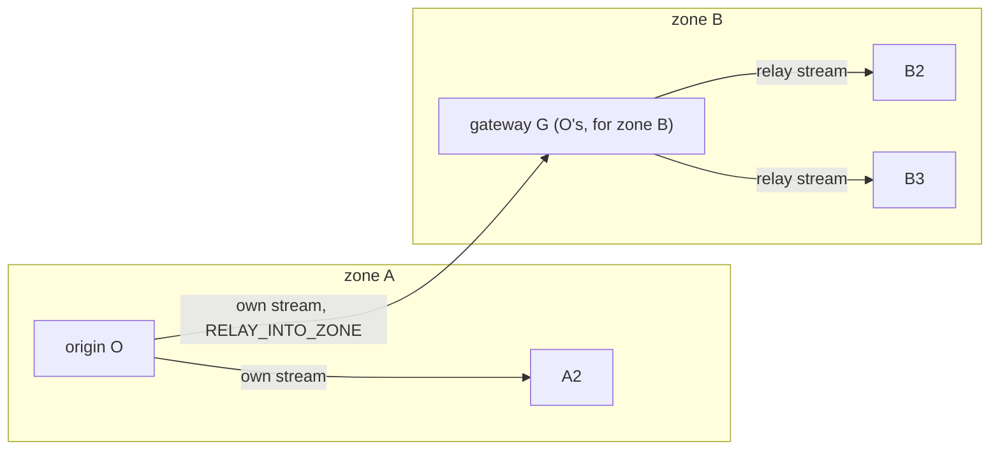
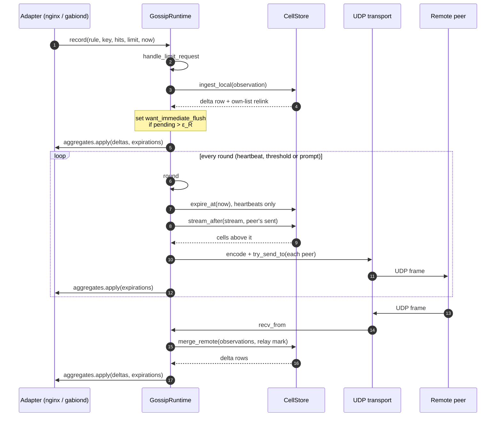

# How gabion gossips

This is the protocol as built: how a counted hit on one node reaches every
other node, what each packet holds byte by byte, and what happens when packets
are lost or a peer dies. Read it when you need to know why the cluster behaves
as it does; to run gabion you need only the [README](README.md), and each log
message has its entry in [TROUBLESHOOTING.md](TROUBLESHOOTING.md). The counter
store that gossip keeps in step is described in [CRDT.md](CRDT.md).

## Contents

- [The idea](#the-idea)
- [Two tiers](#two-tiers)
  - [Roles](#roles)
  - [Choosing a gateway: rendezvous hashing](#choosing-a-gateway-rendezvous-hashing)
- [The anti-entropy loop](#the-anti-entropy-loop)
- [Rounds and scheduling](#rounds-and-scheduling)
- [Streams, acks and join sweeps](#streams-acks-and-join-sweeps)
- [Suspicion and its loss model](#suspicion-and-its-loss-model)
- [Gateway failover and the zone backstop](#gateway-failover-and-the-zone-backstop)
- [Adaptive emit rate](#adaptive-emit-rate)
- [Wire format, version 2](#wire-format-version-2)
  - [Header](#header)
  - [Flags](#flags)
  - [Body](#body)
  - [Decoding, in order](#decoding-in-order)
  - [Versions](#versions)
- [References](#references)

## The idea

Gossip is the protocol that turns N independent counter stores into one
*eventually consistent* counter store. Every node admits requests
against its local view of the cluster aggregate, and gossip is what
keeps that view fresh. From the adapter's side it shows up as a single
call: admission writes a row through `GossipClient::record`, and a
later runtime round turns those rows into outbound frames.

The protocol has two parts, and they are the reason gabion holds up under
load that a textbook anti-entropy loop would not:

1. **Acknowledged streams in two tiers** — each node sends the cells it
   originated straight to every peer of its zone, and, flagged
   `RELAY_INTO_ZONE`, to one *gateway* in each other zone, chosen by
   rendezvous hashing so origins spread over a zone's members. The gateway
   relays them to the rest of its zone on a second stream. Every stream is
   per peer and acknowledged cumulatively; a gap report or a heartbeat
   without an ack brings a resend, so a lost packet costs one round, not a
   lifetime. A starting node asks two peers for a *join sweep* of every
   live cell.
2. **Adaptive emit rate** — the gossip cadence adapts to per-rule
   pressure. Heartbeats fire every `tick_interval` unconditionally, but
   the runtime also fires a synthetic *threshold* round between
   heartbeats whenever a hot rule's locally unreplicated hits would
   exceed its per-site error budget. The budget bounds cluster-wide
   unreplicated error per rule by 1 % of the rule's limit (default), no
   matter the request rate. A floor `min_emit_interval` caps the worst
   case so an adversarial workload cannot pin the gossip socket.

## Two tiers

A zone is a failure domain that also prices traffic: in a cloud, bytes
between availability zones cost money and bytes inside one do not. gabion
therefore sends every change once across each zone boundary and fans it out
inside the zone:



- **Inside a zone (tier 0)**, the origin sends its own stream directly to
  every zone peer.
- **Across zones (tier 1)**, the origin sends its own stream to one member of
  each other zone, its *gateway* there, with every packet flagged
  `RELAY_INTO_ZONE`. The gateway merges the cells and relays them to its zone
  peers on its *relay stream*.

A node's zone comes from `gossip.zone` or its own Kubernetes EndpointSlice
entry ([README, "Zones"](README.md#zones)). A node with no zone treats every
peer as a zone peer: counts stay correct, and nothing is saved across zones.
In a cluster of `N` nodes the two tiers send `N − 1` packets for each own
round, the same as a flat full mesh, but only `Z − 1` of them cross a zone
(the README's [How a change travels](README.md#how-a-change-travels) gives the
measured cost).

### Roles

Each peer table row has one `Role` (`gabion::gossip::Role`), recomputed when
a peer's zone or answer state changes (`PeerTable::refresh` in
`src/gossip/peer.rs`). `/snapshot` shows each peer's role and
`peers_by_role` counts them.

| Role | Who | What it is sent |
|---|---|---|
| `unheard` | A peer not heard from yet, of no zone discovery named | The own cells raised since it was added, and a greeting `PROBE` at once and each heartbeat until its first packet arrives with its zone. |
| `zone` | A peer of this node's zone, or of no zone | The own stream and the relay stream, directly. |
| `gateway` | The member of a remote zone that ranks first for this node | The own stream, flagged `RELAY_INTO_ZONE`. |
| `remote` | Any other member of a remote zone | Acks only. |
| `incompatible` | A peer that speaks another wire version | Nothing, until a packet of this version arrives from it. |

A peer's zone is the one its headers announce once it is heard, even none;
until then it is the zone discovery reported for it (a Kubernetes
EndpointSlice endpoint's `zone`).

### Choosing a gateway: rendezvous hashing

Every origin ranks each remote zone's members by a rendezvous
(highest-random-weight) weight, `rendezvous_weight(local_key, addr)` in
`src/gossip/peer.rs`: a 64-bit mix of the origin's own id hash and the peer's
address. Each origin ranks the members differently, so a zone's members share
the gateway work for the origins of other zones, about `Z − 1` origins each,
and no member is everyone's gateway. The weight needs no coordination: two
origins never agree or disagree about anything, they only rank.

The rank (`Rank` in `src/gossip/peer.rs`) puts every live member above every
suspect, live members by weight, suspects by the earliest suspicion, and
the address last as a tie-break. So a suspect gateway is
replaced by the next member of its zone at once, and returns when it answers
again and outranks its replacement. Join sweeps use the same weights to pick
their sources.

## The anti-entropy loop

The runtime (`GossipRuntime`, in `src/gossip/runtime.rs`) is a
single-threaded event loop driven by one `tokio::select!` with six arms:
limit requests from the adapter, the heartbeat, the prompt-round pacer
(polled only while a resend, gap report, probe answer or sweep waits),
inbound packets, peer membership churn, and admin commands. A round
first reads the datagrams already waiting, then serves every peer in one
send loop, handing each packet to the socket as it is encoded; a packet
the kernel refuses is held and retried first on the next round, and the
cut round resumes from the peer it stopped at (see
[Socket buffers](README.md#socket-buffers)).
After every iteration that produced delta or expiration rows, the
runtime calls `aggregates.apply(...)` exactly once — that is the
contract with the downstream rate-limit decision path. Empty iterations
(an idle tick, a peer event with no CRDT effect) short-circuit the
apply so the read side of the aggregate is never disturbed for no
reason.



`CellStore::merge_remote` performs the CRDT join: max-merge per
`(origin, key, bucket)`, sum across origins.

## Rounds and scheduling

A round serves every peer once. Three things start one:

| Round | When | What it sends |
|---|---|---|
| Heartbeat | Every `gossip.tick_interval` (default 500 ms), unconditionally | Every stream's cells above the peer's `sent`, acks, resends of streams unacknowledged for one heartbeat, probes to suspects. It also expires old buckets. |
| Threshold | Between heartbeats, when a rule's unreplicated hits pass its error budget ([Adaptive emit rate](#adaptive-emit-rate)), at most once per `gossip.min_emit_interval` | Every stream's new cells and acks. |
| Prompt | Paced by `gossip.min_emit_interval` (default 5 ms), only while work waits: a resend after a gap report, a probe answer, a sweep page, or a stream whose quantum ran out | That waiting work. |

The retransmission timeout is the heartbeat itself: a stream unacknowledged
for one heartbeat is resent with `PROBE`. A receiver acknowledges mostly at its
own next heartbeat, so a shorter timeout would resend data that was only
waiting for that heartbeat; this assumes the round trip between zones is well
under `tick_interval`, which is why `setting_warning` warns below 20 ms.

One stream sends one peer at most `q` cells a round:

```text
q = max(⌈storage.max_cells / 128⌉, cells in one packet)
```

1,024 at the default (`GOSSIP_BACKLOG_ROUNDS` = 128 in `gabion::defaults`;
`quantum` in `src/settings.rs`). A stream with more waiting goes on in the
next prompt round, so the largest backlog there is, a full store owed to a new
gateway, drains in 128 prompt rounds (about 0.64 s at the default
`min_emit_interval`) whatever `max_cells` is. A join sweep pages `q` cells per
prompt round too.

## Streams, acks and join sweeps

Each node's own stream is its own cells in the order they last changed,
numbered by `origin_sequence`; its relay stream is the remote cells it was
asked to relay, numbered by a relay sequence drawn when each is marked. The
cell store keeps each on one ordered list, so `stream_after(stream, sent)`
reads what a peer has not been sent without a scan. Zone peers get both
streams, a gateway the own stream flagged, other members of a remote zone
neither, and a peer not yet heard from, of no zone discovery named, only the
own cells raised since it was added. A flagged packet marks its cells for
relay: all of them when its range ends above the receiver's *gateway* mark
(so a new gateway relays what it held directly), else those the merge
raised; any other packet takes the cells it raised off the relay list, since
its sender is responsible for them. For each peer the runtime keeps `sent` and the peer's last ack,
`acked`. Heartbeat and threshold rounds send each peer the cells above its
`sent`, at most `q` a round, where `q` is `⌈storage.max_cells / 128⌉` or one
packet, whichever is larger; a stream with more waiting goes on in the next
prompt round. A frame holding every live cell up to the head closes the
range through the head, so cells that expired unsent are not owed.

The receiver keeps `have`, the highest position it holds contiguously, and
returns it on every packet it sends back, or alone at its next heartbeat.
A packet above `have` opens a gap (a direct one from a peer of another
zone, sent before it heard this node's zone, is merged but opens none):
after one relay floor (`min_emit_interval`) the receiver reports it, and the
sender rewinds to the report's ack and resends on a prompt round. A gap
reported four times without progress is abandoned until the next packet
above `have` reopens it. A stream unacknowledged for
one heartbeat times out and is resent with `PROBE`, which the peer answers
on a prompt round. Acks name the incarnation they answer, so an ack written
for a restarted process credits nothing; a peer's new incarnation resets
both directions of its stream. The receiver keeps the own ranges it gets as
the origin's gateway on a mark of their own, the gateway mark, and says which
mark an ack carries (`ACK_AS_GATEWAY`); a gateway's acks count only as
gateway acks, a zone peer's only as direct acks. A peer whose role changes so
that it gains a stream is resent that stream from 0.

When a peer stops answering, see
[Suspicion and its loss model](#suspicion-and-its-loss-model) and
[Gateway failover and the zone backstop](#gateway-failover-and-the-zone-backstop).

A node that starts asks its two highest-weight peers it has heard from in
its zone (or, once no peer is or may be of its zone, one heard peer of any
zone; after `gossip.zone_grace` a peer not yet heard no longer counts, so a
silent peer cannot keep a new zone's first node from sweeping) for a join
sweep, greeting meanwhile the unheard peers of its zone
and its unheard gateways,
and asks again when its zone becomes known,
retrying each heartbeat until a page arrives, and each source pages its live
cells, `q` per prompt round, to at most `gossip.sweep_concurrency`
requesters at a time. The sweep brings back the node's own previous-incarnation cells, which
no stream carries.

## Suspicion and its loss model

A peer is suspect once a packet that asks for an answer (stream data, or a
probe that retries it) has gone unanswered for `gossip.suspect_after`, by
default `max(4 × tick_interval, 2 s)` (`GOSSIP_SUSPECT_AFTER_TICKS` and
`GOSSIP_SUSPECT_AFTER_FLOOR_MS` in `gabion::defaults`). A shorter heartbeat
therefore buys more answer attempts, not a shorter suspicion time. The
judgement runs after a round has read its waiting datagrams, so a node that
was paused reads the answers that queued meanwhile before it judges, and
never while the kernel holds a refused packet, whose held time does not
count. A suspect's retries shrink to one 86-byte header-only probe per
heartbeat; the first answer clears the suspicion and brings the resend.

At the default, about four attempts fall inside `suspect_after` (at least
three, when the first unanswered packet went out between heartbeats). An
attempt fails when the packet or its answer is lost, so at independent loss
`p` it fails with probability `p_a = 1 − (1 − p)²` and a late answer ends in a
false suspicion with probability at most `p_a` to the power of the attempts.
The design's loss model predicts (these are model predictions, not
measurements):

| Packet loss | One late answer ends in a false suspicion | A quiet row retried once per heartbeat is falsely suspected |
|---|---|---|
| 5 % | 9.0 × 10⁻⁵ | about once per 1.7 h |
| 20 % | 0.017 | about once per 47 s |

A busy row fares better, since every own round adds a delivery chance. A
false suspicion costs bytes only: it lasts until the suspect's next probe is
answered, about one heartbeat, and the failover and failback resend the
origin's live window. A real failure is detected within
`suspect_after + tick_interval + 2 × min_emit_interval` of the first
unanswered packet, 2.51 s at the defaults.

A pause on either side is tolerated while it is shorter than about
`suspect_after`: a paused peer answers the queued probe when it resumes, and
a paused node reads every answer that fits its receive buffer before it
judges ([README, "Socket buffers"](README.md#socket-buffers)). Raise
`gossip.suspect_after` when `gateway_failover` warns often on a lossy network;
lower it, to no less than two heartbeats, for faster failover.

## Gateway failover and the zone backstop

**Failover.** A suspect ranks last, so when a gateway turns suspect its
zone's next member takes over and is sent the origin's whole live own stream
from 0; nothing is lost, and `gateway_failover` is logged. An origin that goes
quiet sends its gateways nothing, so a gateway that dies meanwhile is
replaced on the origin's next change, within `gossip.suspect_after` and a
heartbeat of it. Retries to a gateway that has acked nothing since it took
the role shrink to header-only probes, as a suspect's do, so a new gateway
that has not discovered the origin yet costs no resent data.

**The zone backstop (`CANNOT_RELAY`).** A gateway the origin can reach but
whose own zone cannot hear it would otherwise swallow every relay. So a node
watches its own zone: when more than half of the zone peers it has heard are
suspect (`PeerTable::impaired`), it sets `CANNOT_RELAY` on every packet it
sends, and origins that send to it fail over at once (`gateway_failover` with
`reason = "cannot_relay"`; the gateway logs `relay_stalled`). Only heard
peers count, because one that discovery placed in the zone and that has not
answered yet may simply not have discovered this node. Repair takes at most
`suspect_after + 3 × tick_interval + 2 × min_emit_interval` from the first
swallowed relay, 3.51 s at the defaults.

**Unknown senders.** A packet from an address outside the peer table is
merged and never acked, but the cells a flagged one raised are relayed, so an
origin's hits reach a zone whose gateway has not yet discovered the origin.

## Adaptive emit rate

The heartbeat tick is bounded below by `tick_interval` (default
500 ms). That cadence works for cold rules but is pessimistic for hot
ones, because a saturating burst between two heartbeats could leak many
admissions past the limit before the next tick. Lowering
`tick_interval` for everyone is not an answer either: it costs
bandwidth on every quiet rule in the cluster.

The runtime crosses this trade with a per-rule error budget.
`GossipRuntime::handle_limit_request` keeps a small `rule_pending`
column indexed by rule slot; each admission adds its hits. The runtime
also computes a per-site safe zone:

```text
ε_R = max(1, L_R · target_err_bps / (10_000 · N))
```

where `L_R` is the rule's limit and `N` is the peer count. When
`rule_pending` for that rule crosses `ε_R`, the runtime sets
`want_immediate_flush = true`. On the next loop iteration the top of
the run loop reads that flag (instead of waiting on `tick.tick()`) and
dispatches a synthetic gossip tick straight away. Every round, heartbeat
or threshold, first settles the budget: it zeroes each rule's pending
column and stamps its `last_emit_ms`, even with no peers or a blocked
socket, so neither turns each later request into another round.

The constant `target_err_bps` is in basis points of each rule's own
limit, default 100 = 1 %. The cluster-wide unreplicated error per rule
is then bounded by `N · ε_R` (Sharfman, Schuster & Keren, SIGMOD 2006)
— roughly 1 % of the rule's limit, regardless of the request rate.

A floor `min_emit_interval` (default 5 ms) sits in front of the flush:
the runtime won't set `want_immediate_flush` if the gap since the last
emit is below the floor. Under adversarial traffic ε saturates to 1 and
every hit would otherwise emit; the floor caps the worst-case emit rate
so a bad client cannot pin the gossip socket.

```mermaid
stateDiagram-v2
    [*] --> Idle
    Idle --> Accumulating: limit request<br/>adds hits to rule_pending
    Accumulating --> Accumulating: pending ≤ ε_R
    Accumulating --> ReadyToFire: pending > ε_R
    ReadyToFire --> Idle: now − last_emit < min_emit_interval<br/>(floor blocks the emit)
    ReadyToFire --> Emit: now − last_emit ≥ min_emit_interval
    Emit --> Idle: synthetic tick dispatched,<br/>rule_pending reset,<br/>last_emit_ms stamped
    Idle --> Emit: heartbeat tick<br/>(unconditional; drains cold rules)
```



Three operational properties fall out of this design. The cluster-wide
unreplicated error per rule is bounded: at the default
`target_err_bps = 100`, the global error never exceeds 1 % of the
rule's limit no matter how fast requests come in. Cold rules still
propagate, because the heartbeat is independent of the threshold path
and any rule whose pending count never reaches ε_R still replicates
every `tick_interval`. Finally, under an adversarial workload where ε
saturates and every hit would otherwise emit, `min_emit_interval` caps
the worst-case emit rate; convergence still happens, but the cluster
absorbs the burst at a different bandwidth budget.

## Wire format, version 2

Every gossip packet is self-describing: each decodes independently, even
if its predecessor was dropped. Loss of a packet costs you a few cells until a
gap report or the retransmission timeout resends them. The codec lives in
`src/wire/{header,body}.rs`.

### Header

The header is fixed at 86 bytes, version 2. Every multi-byte field is
encoded little-endian; the first four bytes on the wire are `0x32 0x47
0x42 0x47` so a packet capture reads `2GBG`. (The numeric `MAGIC`
literal `0x4742_4732` spells "GBG2" when written most-significant byte
first; the LE encoding then writes those bytes in reverse.)

```text
byte  field                  width
----  ---------------------  -----
0     MAGIC                  4   (0x4742_4732)
4     VERSION                2   (= 2)
6     kind                   1   (see below)
7     flags                  1   (one meaning per bit; 0x80 must be 0)
8     cluster_id_hash       16
24    sender_node_id        16
40    sender_incarnation     4
44    sender_zone            4   (0 = no zone)
48    cell_count             2
50    ack_incarnation        4
54    ack_own                8
62    ack_relay              8
70    stream_lower           8   (exclusive)
78    stream_upper           8   (inclusive)
----                       ----
                            86
```

| Kind | Byte | Carries |
|---|---|---|
| `Ack` | 0 | header only |
| `Own` | 1 | the sender's own stream, range `(lower, upper]` |
| `Relay` | 2 | the sender's relay stream, range `(lower, upper]` |
| `Sweep` | 3 | cells outside any stream; no range |
| `SweepRequest` | 4 | header only |

The decoder turns kind, flags and range into one typed payload and
drops any combination the format forbids. A node sends its own stream as
`Own` packets that tile the frame's range, acks and gap reports alone as
`Ack`, and join sweeps as `SweepRequest` and `Sweep`; every data kind it
receives merges the same way. `sender_zone` is the low 32 bits of the
stable hash of the sender's zone name (`gabion::zone::ZoneName`), never 0;
0 means the sender has no zone. A node takes each peer's zone from that
peer's headers; until it has heard the peer, it uses the zone discovery
reports for it, if any.

`ack_incarnation` is the addressee's incarnation as the sender knows it (0
before it has heard the addressee); the acks apply only when it matches.
`ack_own` and `ack_relay` are the sender's cumulative marks for the
addressee's own and relay streams.

### Flags

| Bit | Name | Allowed on | Meaning |
|---|---|---|---|
| `0x01` | `RELAY_INTO_ZONE` | `Own` | The addressee is the sender's gateway: relay these cells into your zone. |
| `0x02` | `GAP_OWN` | every kind | The sender holds a gap in the addressee's own stream above `ack_own`: resend from there. |
| `0x04` | `GAP_RELAY` | every kind | The same for the relay stream, above `ack_relay`. |
| `0x08` | `CANNOT_RELAY` | every kind | The sender cannot reach most of its zone: do not use it as a gateway. |
| `0x10` | `ACK_AS_GATEWAY` | every kind | `ack_own` is the mark of what the sender received as the addressee's gateway, not directly. |
| `0x20` | `PROBE_REPLY` | every kind | The packet answers a probe. |
| `0x40` | `PROBE` | `Ack`, `Own`, `Relay` | The sender asks for an answer at once. |
| `0x80` | reserved | none | Must be 0. |

### Body

The body follows immediately. When `cell_count > 0` it carries a
*per-frame* rule dictionary, a per-frame node dictionary, and the cell
rows. Each cell row references rule and node slots by `u8` index into
those dictionaries (so the same fingerprint isn't repeated 4096 times),
plus its `key_hash`, `bucket`, origin incarnation, `last_update_millis`
and `count`, 38 bytes in all:

```text
[rule_dict_len    : u8     ]    R rules in this frame (1–255)
[rule_dict        : u128×R ]    rule fingerprints
[node_dict_len    : u8     ]    D origins in this frame (1–255)
[node_dict        : u128×D ]    origin node ids
[rule_slot        : u8 ×N  ]    each < R
[key_hash         : u128×N ]
[bucket           : u32 ×N ]
[node_slot        : u8 ×N  ]    each < D
[origin_incarn.   : u32 ×N ]
[last_update_ms   : u64 ×N ]
[count            : u32 ×N ]
```

An `Ack`, a `SweepRequest`, or an `Own` or `Relay` packet with no cells
has an empty body. Nothing follows the body: packets are not
authenticated, so isolate the gossip port with a NetworkPolicy (see the
[root README](../../README.md#running-across-a-cluster)).

The codec's `FrameLimits` can only be built with a payload between 158 and
65,507 bytes, and the runtime takes it from the validated
`gossip.max_payload_bytes`, which defaults to 1400 bytes (the safe IPv4 MSS
floor), so frames stay well below the path MTU and avoid IP fragmentation. A
1,400-byte packet holds 33 cells of one rule and one origin; that same bound
caps what a received packet may carry, so no cell count is configured. Frames
larger than the cap split into multiple packets at the sender, and each packet
is independently decodable.

### Decoding, in order

`wire::decode` checks, in this order, and stops at the first failure:

| Check | Error | Logged as |
|---|---|---|
| The packet is at most `gossip.max_payload_bytes` | `PayloadTooLarge` | `decode_rejected`, `reason = "peer_limits"` |
| It holds a whole header | `TooShort` | `decode_rejected`, `reason = "framing"` |
| Magic | `BadMagic` | `decode_rejected`, `reason = "framing"` |
| Version | `BadVersion` | `peer_version_mismatch` |
| Kind, flags (the table above) and range | `BadKind`, `BadFlags`, `BadRange` | `decode_rejected`, `reason = "framing"` |
| Cluster id | `ForeignCluster` | `decode_rejected`, `reason = "cluster"` |
| Body length, then each row's slots | `BodyLength`, `BadSlot` | `decode_rejected`, `reason = "framing"` |

So a packet from another protocol version or another cluster is dropped
before any cell is read. Each reason has its own counter in `/snapshot`
(`counters.decode_rejects_*`) and its entry in
[TROUBLESHOOTING.md](TROUBLESHOOTING.md#decode_rejected).

### Versions

The version field is checked right after the magic. Version 1, which earlier
releases speak, and version 2 nodes drop each other's packets, so a
cluster mid-upgrade splits into two islands until every node runs one
release; [README, "Upgrading"](README.md#upgrading) says how to roll through
it.

## References

In-tree primary sources:

- `src/gossip/runtime.rs` — the event loop. `GossipRuntime::run` is the
  outer `select!`; `round` and `serve_row` carry the per-peer streams;
  `handle_limit_request` carries the per-site safe zone and the
  threshold-fire flag. `src/gossip/peer.rs` holds the peer table, the roles,
  the rendezvous weights and the stream state; `src/gossip/sweep.rs` the join
  sweeps.
- `src/wire.rs` and `src/wire/` — packet shape, encoders, decoder.
- `src/crdt.rs` and `src/crdt/` — counter store, the own-stream list, expiry.
  The structures here are documented in depth in [`CRDT.md`](CRDT.md).

External:

- Chen, Toueg and Aguilera, "On the quality of service of failure detectors",
  IEEE Transactions on Computers 51(1), 2002: the detection time and mistake
  rate terms of the suspicion model.
- Sharfman, Schuster and Keren, "A geometric approach to monitoring threshold
  functions over distributed data streams", SIGMOD 2006: the per-site safe
  zone behind the error budget.
- Olston, Jiang and Widom, "Adaptive filters for continuous queries over
  distributed data streams", SIGMOD 2003: the error budget it calibrates.
