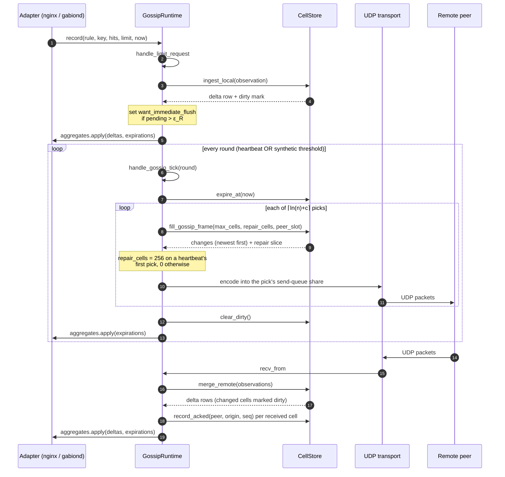

# gabion

The pure-Rust library at the heart of every gabion deployment. It owns
the CRDT, the gossip runtime, the wire codec, the rule machinery, and the
discovery interface, while knowing nothing about YAML, gRPC, or nginx.
Both adapters in the workspace (`gabion-server` and `gabion-nginx`) build
their configuration on top of the same library types and call the same
hot paths.

This README is the canonical guide to the library. If you want to
understand how the cluster stays consistent, how a packet is shaped, or
which knob to turn when an operator asks, read it end-to-end. For the
CRDT data structures behind the gossip protocol, see [`CRDT.md`](CRDT.md).
For cross-adapter vocabulary (rule, descriptor, bucket, fail-open), see
the [repo root README](../../README.md#glossary).

## Contents

- [Module map](#module-map)
- [How gossip works](#how-gossip-works)
  - [The wire frame](#the-wire-frame)
  - [The anti-entropy loop](#the-anti-entropy-loop)
  - [Coverage fanout](#coverage-fanout)
  - [Adaptive emit rate](#adaptive-emit-rate)
  - [Dirty rings and the peer frontier](#dirty-rings-and-the-peer-frontier)
- [Operator knobs](#operator-knobs)
- [What we measured](#what-we-measured)
- [References](#references)

## Module map

The library is divided into six modules, and every type that crosses an
adapter boundary lives in exactly one of them. The dependency graph is
a DAG, so no module imports from a module that imports it.

| Module       | Path                          | What it owns                                                                                                                              |
|--------------|-------------------------------|--------------------------------------------------------------------------------------------------------------------------------------------|
| `crdt`       | `src/crdt/*`                  | The per-origin counter store. Robin Hood hash index, structure-of-arrays columns, bounded dirty rings, per-peer frontier. Allocates only at construction. See [`CRDT.md`](CRDT.md). |
| `rules`      | `src/rules/*`                 | `Rule`, `RuleTable`, `Descriptor`, fingerprint hashing. Two nodes with the same rules produce identical `rule_fingerprint` values, which is what makes the CRDT addressable across the cluster. |
| `gossip`     | `src/gossip/*`                | `GossipRuntime`, `GossipClient`, `GossipTransport`, `Clock`, the `sim::SimTransport` used in tests, and the `AdminCommand` / `AdminSnapshot` observability surface. |
| `wire`       | `src/wire/*`                  | The on-the-wire codec. One UDP packet = header + rule dictionary + node dictionary + cell rows + optional HMAC tag. Each packet decodes independently. |
| `discovery`  | `src/discovery/*`             | `PeerDiscovery` trait and the Kubernetes EndpointSlice implementation. Adapters consume `PeerEvent` streams; the gossip runtime treats peer add/remove as a normal `select!` arm. |
| `defaults`   | `src/defaults.rs`             | Constants shared by both adapters: storage capacities, tick interval, fanout floor and coverage margin, payload and per-round cell caps, send-queue capacity, the repair budget, the per-rule error budget, and the min-emit floor. |

`gossip` sits at the top of that graph and depends on every other
module, whereas `wire` and `crdt` are independent of each other.
`defaults` is a leaf: `rules` and `gossip` import it, and it imports
nothing else in this crate. Adapters consume the public surface of
`gossip`, `rules`, and `discovery`, together with the constants in
`defaults`.

## How gossip works

Gossip is the protocol that turns N independent counter stores into one
*eventually consistent* counter store. Every node admits requests
against its local view of the cluster aggregate, and gossip is what
keeps that view fresh. From the adapter's side it shows up as a single
call: admission writes a row through `GossipClient::record`, and a
later runtime tick turns those rows into outbound frames.

The protocol has two adaptive aspects, and they are the reason gabion
holds up under load that a textbook anti-entropy loop would not:

1. **Coverage fanout** — the per-round peer count is sized to the
   *coverage threshold* `⌈ln(n)+c⌉` (`n` = peer count), the fanout that
   reaches every node with high probability. It scales with cluster
   size, not the number of changes: a burst rides one frame per pick
   instead of widening the pick. `fanout` is the floor; small clusters
   go full-mesh.
2. **Adaptive emit rate** — the gossip cadence adapts to per-rule
   pressure. Heartbeats fire every `tick_interval` unconditionally, but
   the runtime also fires a synthetic *threshold* tick between
   heartbeats whenever a hot rule's locally unreplicated hits would
   exceed its per-site error budget. The budget bounds cluster-wide
   unreplicated error per rule by 1 % of the rule's limit (default), no
   matter the request rate. A floor `min_emit_interval` caps the worst
   case so an adversarial workload cannot pin the gossip socket.

The rest of this section walks through each in turn, then closes with
the dirty rings and peer frontier — the data structures that decide
which cells go to which peer.

### The wire frame

A gossip frame travels as one or more self-describing UDP packets, with
no session state on either side: each packet decodes independently,
even if its predecessor was dropped. A lost packet costs that peer the
cells it carried until they arrive another way — from another
forwarder, in the cell's next change, or through the repair lane.

The header is fixed at 72 bytes. Every multi-byte field is encoded
little-endian; the first four bytes on the wire are `0x32 0x47 0x42
0x47` so a packet capture reads `2GBG`. (The numeric `MAGIC` literal
`0x4742_4732` spells "GBG2" when written most-significant byte first;
the LE encoding then writes those bytes in reverse.)

```
byte  field                  width
----  ---------------------  -----
0     MAGIC                  4   (0x4742_4732)
4     VERSION                2   (= 1)
6     flags                  2   (FLAG_MORE | FLAG_AUTHENTICATED)
8     cluster_id_hash       16
24    sender_node_id        16
40    sender_incarnation     4
44    count_width            4   (2, 4, or 8 — width of the count column;
                                  matches u16/u32/u64 `impl Count`)
48    cell_count             4
52    body_len               4
56    min_origin_sequence    8
64    max_origin_sequence    8
----                       ----
                            72
```

The body follows immediately. When `cell_count > 0` it carries a
*per-frame* rule dictionary, a per-frame node dictionary, and the cell
rows. Each cell row references rule and node slots by `u8` index into
those dictionaries (so the same fingerprint isn't repeated 4096 times),
plus its `key_hash`, `bucket`, origin incarnation, `last_update_millis`,
`origin_sequence`, and `count`:

```
[rule_dict_len    : u8     ]    R rules in this frame (1–255)
[rule_dict        : u128×R ]    rule fingerprints
[node_dict_len    : u8     ]    D origins in this frame (1–255)
[node_dict        : u128×D ]    origin node ids
[rule_slot        : u8 ×N  ]    each < R
[key_hash         : u128×N ]
[bucket           : u32 ×N ]
[node_slot        : u8 ×N  ]    each < D
[origin_incarn.   : u32 ×N ]
[last_update_ms   : u64 ×N ]
[origin_sequence  : u64 ×N ]
[count            : C  ×N  ]    count_width × N bytes
```

A packet with `cell_count = 0` has an empty body. The codec accepts
one, but the runtime never sends it: a pick whose frame comes up empty
gets no packet.

If the cluster is configured with a shared HMAC key, an additional
**32-byte HMAC-SHA256 tag** is appended over the header and body, and
`FLAG_AUTHENTICATED` is set. Inbound packets whose tag fails verify are
dropped on the floor, and the whole cluster must agree on the key.

The codec lives in `src/wire/{header,body,auth}.rs`. The library's own
`FrameLimits::default()` is 256 KB — useful for tests and the simulator
— but production adapters plumb `gabion::defaults::GOSSIP_MAX_PAYLOAD_BYTES`
(1400 bytes, the safe IPv4 MSS floor) into `FrameLimits` so frames stay
well below the path MTU and avoid IP fragmentation. Frames larger than
the cap split into multiple packets at the sender, and each packet is
independently decodable.

### The anti-entropy loop

The runtime (`GossipRuntime`, in `src/gossip/runtime.rs`) is a
single-threaded event loop driven by one `tokio::select!` with six
arms: limit requests from the adapter, inbound packets, outbound
writability, peer membership churn, admin commands, and the heartbeat
tick. After every iteration that produced delta or expiration rows, the
runtime calls `aggregates.apply(...)` exactly once — that is the
contract with the downstream rate-limit decision path. Empty iterations
(an idle tick, a peer event with no CRDT effect) short-circuit the
apply so the read side of the aggregate is never disturbed for no
reason.



`CellStore::merge_remote` performs the CRDT join: max-merge per
`(origin, key, bucket)`, sum across origins. A cell whose count rose
joins a dirty ring (`forwarded_dirty` for another node's origin), so
this node forwards it once, in its next round. The runtime also
records, per peer and origin, the highest origin sequence among the
cells that peer just sent (`PeerFrontierTable`). That sequence is in
the sender's own numbering — every node re-stamps the cells it merges —
so it is a hint, not an acknowledgement: it only lets later rounds skip
changes that peer probably holds, a latency optimization that
convergence never depends on.

### Coverage fanout

Three separate concerns pull on the gossip plane, and it is tempting to
fold them all into the fanout knob. They are governed by three different
variables, and gabion keeps them apart:

| Concern | Governed by | Mechanism |
|---|---|---|
| **Coverage** — reach every node reliably | cluster size `n` | **fanout** = `⌈ln(n)+c⌉` |
| **Volume** — a big burst of changes | changes per round | frame fill: `max_cells_per_tick` + packet-splitting, within each pick's share of `send_queue_capacity` |
| **Urgency** — a fresh delta matters *now* | per-rule error budget | threshold-fire emissions (`target_err_bps`) |

Only the first is a fanout question. Kermarrec, Massoulié & Ganesh (IEEE
TPDS 2003, *Probabilistic Reliable Dissemination in Large-Scale
Systems*, Theorem 1) prove that spreading a message by
infect-and-forward-once — each node forwards it once, to `fanout` random
peers — with mean fanout `ln(n)+c` reaches **every** node with
probability → `e^(−e^(−c))`: *"there is a sharp threshold in the
required fanout at log n."* That is how each change travels in gabion:
a round sends it to that round's picks, and every node that merges it
forwards it once, in its own next round. The fanout needs to grow by
only 1 each time `n` rises by a factor of e, and a single round *"can
easily be modified … to send several notifications per gossip
message"* — which is exactly what gabion does: each round's changes
ride one frame per pick, split across as many packets as they need, so
burst **volume** never widens the peer pick and a burst does not
translate into proportionally more rounds.

The pick lives in `GossipRuntime::handle_gossip_tick`:

```rust
let n = peers.len();
let coverage = (n as f64).ln() + GOSSIP_COVERAGE_MARGIN;   // c = 3.0
let pick_count = config.fanout.max(coverage.ceil() as usize).min(n);
```

A partial Fisher-Yates shuffle then picks `pick_count` distinct peers
from `self.peers`. The peers must be distinct rather than sampled with
replacement, because sampling the same peer twice in one round would burn
a send-pool slot encoding the same frame twice. `config.fanout` is a
hard floor; `.min(n)` makes small clusters full-mesh (coverage demands
it there and the bandwidth is trivial). Some example pick counts at
`fanout = 3`, `c = 3`:

| peers `n` | `⌈ln(n)+c⌉` | `pick_count`               |
|-----------|-------------|----------------------------|
| 1         | 3           | 1 (capped at peers)        |
| 4         | 5           | 4 (capped at peers)        |
| 15        | 6           | 6                          |
| 31        | 7           | 7                          |
| 63        | 8           | 8                          |
| 255       | 9           | 9                          |
| 9 999     | 13          | 13                         |

Fanout trades **change bandwidth** (linear in the pick: every change
is sent `≈ n·pick` times across the cluster) against
**coverage-failure probability** (`≈ 1 − e^(−e^(−c))` per change) and
**latency** (`≈ log_{1+pick} n` rounds, with diminishing return above
the threshold). `⌈ln(n)+c⌉` is the minimal fanout at which one
forward-once spread reaches every node with high probability, so it is
the natural operating point. We size to `c = 3` — a 95.1 % per-change
chance of reaching every node — rather than a higher margin. At
`c = 3` a change misses at least one node ≈ 4.9 % of the time, and the
expected number of nodes it misses is `e^(−c)` ≈ 0.05. Two things close
that gap without a wider fanout: the cell's next change carries its
whole count, and the heartbeat repair slice resends every live cell
once per rotation (and also covers packet loss and frames cut by a full
send queue). KMG's validated single-shot threshold sits near `c ≈ 4`
(fanout 13 @ 10 000, 15 @ 50 000); `c = 3` saves ≈ 1 peer per round at
every scale. The pick only drives traffic when there are changes: a
quiet heartbeat sends just the repair slice, to one random pick. The
`coverage_fanout` bench
[below](#what-we-measured) shows the pick tracking `⌈ln(n)+c⌉` and
staying flat as burst volume changes.

### Adaptive emit rate

The heartbeat tick is bounded below by `tick_interval` (default
500 ms). That cadence works for cold rules but is pessimistic for hot
ones, because a saturating burst between two heartbeats could leak many
admissions past the limit before the next tick. Lowering
`tick_interval` for everyone is not an answer either: it costs
bandwidth on every quiet rule in the cluster.

The runtime crosses this trade with a per-rule error budget.
`GossipRuntime::handle_limit_request` keeps a small `rule_pending`
column indexed by rule slot; each admission adds its hits. The runtime
also computes a per-site safe zone:

```
ε_R = max(1, L_R · target_err_bps / (10_000 · N))
```

where `L_R` is the rule's limit and `N` is the peer count. When
`rule_pending` for that rule crosses `ε_R`, the runtime sets
`want_immediate_flush = true`. On the next loop iteration the top of
the run loop reads that flag (instead of waiting on `tick.tick()`) and
dispatches a synthetic gossip tick straight away. The post-emit sweep
inside `handle_gossip_tick` zeroes the rule's pending column and stamps
its `last_emit_ms`.

The constant `target_err_bps` is in basis points of each rule's own
limit, default 100 = 1 %. The cluster-wide unreplicated error per rule
is then bounded by `N · ε_R` (Sharfman, Schuster & Keren, SIGMOD 2006)
— roughly 1 % of the rule's limit, regardless of the request rate.

A floor `min_emit_interval` (default 5 ms) sits in front of the flush:
the runtime won't set `want_immediate_flush` if the gap since the last
emit is below the floor. Under adversarial traffic ε saturates to 1 and
every hit would otherwise emit; the floor caps the worst-case emit rate
so a bad client cannot pin the gossip socket.

```mermaid
stateDiagram-v2
    [*] --> Idle
    Idle --> Accumulating: limit request<br/>adds hits to rule_pending
    Accumulating --> Accumulating: pending ≤ ε_R
    Accumulating --> ReadyToFire: pending > ε_R
    ReadyToFire --> Idle: now − last_emit < min_emit_interval<br/>(floor blocks the emit)
    ReadyToFire --> Emit: now − last_emit ≥ min_emit_interval
    Emit --> Idle: synthetic tick dispatched,<br/>rule_pending reset,<br/>last_emit_ms stamped
    Idle --> Emit: heartbeat tick<br/>(unconditional; drains cold rules)
```



Three operational properties fall out of this design. The cluster-wide
unreplicated error per rule is bounded: at the default
`target_err_bps = 100`, the global error never exceeds 1 % of the
rule's limit no matter how fast requests come in. Cold rules still
propagate, because the heartbeat is independent of the threshold path
and any rule whose pending count never reaches ε_R still replicates
every `tick_interval`. Finally, under an adversarial workload where ε
saturates and every hit would otherwise emit, `min_emit_interval` caps
the worst-case emit rate; convergence still happens, but the cluster
absorbs the burst at a different bandwidth budget.

The `error_budget` and `min_emit_clamp` bench suites measure both
sides of this trade.

### Dirty rings and the peer frontier

Three data structures decide which cells the current round sends to
which peer:

1. **`local_dirty`** — every locally-observed hit pushes onto this
   bounded ring. Cleared at the end of every round (heartbeat or
   threshold), so it holds only the changes since the last round.
2. **`forwarded_dirty`** — every cell merged from a peer whose count
   rose pushes onto a separate ring, so the runtime can forward a
   remote delta even if its local origin column is quiet. Cleared at
   the end of every round, like `local_dirty`. Larger than
   `local_dirty` because a round can merge changes from every origin
   in the cluster.
3. **`peer_frontier`** (`PeerFrontierTable`) — for each peer × each
   origin slot, the highest origin sequence among the cells that peer
   has sent us. The dirty lanes skip a change whose sequence is at or
   below it. The sequence is in the peer's own numbering, so this is a
   hint that saves bandwidth, never a delivery guarantee.

Together they keep `fill_gossip_frame` allocation-free and strictly
bounded. For each pick the runtime walks the round's changes — local
dirty, then forwarded dirty, each newest first — skips stale entries
and those the peer's frontier says it holds, and stops at
`max_cells_per_tick` cells. Then comes the repair lane, which has its
own budget (`GOSSIP_REPAIR_CELLS_PER_TICK` = 256 cells, on a
heartbeat's first pick only, still within `max_cells_per_tick`) and is
never pruned by the frontier. The rings are pre-sized at construction.
When more changes arrive between two rounds than a ring holds, a push
overwrites the oldest entry and logs a rate-limited warning; the lost
change reaches peers late, through other forwarders, the cell's next
change, or the repair lane.

`CRDT.md` documents these structures end-to-end with traces, slot
lifecycles, and invariant proofs. Read it once if you ever need to
debug the CRDT.

## Operator knobs

Most deployments leave the defaults alone, because they are chosen to
keep convergence under a second: in the simulator a single write
converges in two or three rounds at every cluster size up to 1 024
nodes (see [What we measured](#what-we-measured)), and a hot rule's
threshold rounds run well inside one heartbeat. The table below is for
the days when you do need to tune, and
it splits into the two adaptive halves of the protocol.

### Heartbeat cadence and fanout (coverage fanout)

| Knob                 | Default     | What it controls                                                                                                                       | When to tune                                                                                                  |
|----------------------|-------------|----------------------------------------------------------------------------------------------------------------------------------------|----------------------------------------------------------------------------------------------------------------|
| `tick_interval`      | 500 ms      | Heartbeat cadence — period between proactive gossip rounds. Only heartbeat rounds carry the repair slice.                              | Bigger clusters tolerate longer intervals; lower it only if you need sub-100 ms convergence on cold rules.    |
| `fanout`             | 3           | Fanout floor. The runtime scales the actual pick to the coverage threshold `⌈ln(n)+c⌉` (`c` = `GOSSIP_COVERAGE_MARGIN`, 3), capped at the peer count. | Rarely tune — the floor binds only if you lower `GOSSIP_COVERAGE_MARGIN`. To trade bandwidth for coverage, change the margin, not this floor. |
| `max_cells_per_tick` | 4 096       | Cap on cells in one pick's frame per round: the round's changes, newest first, plus up to 256 repair cells on a heartbeat's first pick. Changes over the cap (the oldest) skip that pick this round and reach it through other forwarders or the repair lane. | Raise if a round regularly carries more than 4 096 changes.                                                   |
| `send_queue_capacity`| 512         | Pre-allocated outbound packet slots, shared evenly across a round's picks. A frame over its pick's share loses its tail — repair cells first, then the oldest changes — and a rate-limited warning names this knob when changes are cut. | Raise if the "more changes than this peer's share of the send queue" warning keeps firing.                    |
| `max_payload_bytes`  | 1 400       | UDP datagram budget. The codec splits each pick's frame across multiple packets when the cell list overflows.                          | Lower if your network path has a tighter MTU; never raise past the IPv4 safe floor of 1400.                   |

### Per-rule error budget (adaptive emit rate)

| Knob                 | Default     | What it controls                                                                                                                       | When to tune                                                                                                  |
|----------------------|-------------|----------------------------------------------------------------------------------------------------------------------------------------|----------------------------------------------------------------------------------------------------------------|
| `target_err_bps`     | 100 (= 1 %) | Per-rule error budget in basis points of the rule's limit. Tighter = more threshold fires, looser = more local lag.                    | Lower if a hot rule needs tighter convergence than 1 %; higher if bandwidth is the bottleneck.                |
| `min_emit_interval`  | 5 ms        | Floor between two threshold-fire emissions. Caps worst-case emit rate when ε saturates under adversarial load.                         | Raise if a bad client is pinning the gossip socket; lower to chase microsecond convergence on tiny clusters.  |

The `gabion::defaults` module is the single source of truth for these
constants. Both adapters read from it, so if you change a default the
two adapters move together. Per-adapter configuration translates each
knob to its surface name — see [`crates/server/README.md`](../server/README.md)
for the YAML keys and [`crates/nginx/README.md`](../nginx/README.md) for
the directives.

## What we measured

Every figure below is regenerated from current code by running the
gossip simulator across the suites; see
[`../gossip-bench/README.md`](../gossip-bench/README.md) for the
"how to re-run it" perspective. The figures here are committed to
`figures/` so this README renders correctly on GitHub without first
running the bench.

The suites split into four bundles. Steady-state convergence and scale
together show that the protocol meets its asymptotic bounds, while the
resilience suite shows that it survives the failure modes operators
see in practice. The adaptive machinery suites — `coverage_fanout`,
`error_budget`, `min_emit_clamp`, and `heartbeat_threshold_mix` — are
the empirical evidence for the two adaptive aspects of the protocol.

### Steady-state convergence


**Method.** Single write at node 0; measure rounds-to-converge (100 ms
ticks) as both cluster size N and the static fanout floor sweep.
Bandwidth is total bytes sent across the run divided by `N · duration`.

**Takeaway.** Every configuration converges in 2 rounds (200 ms) from
N = 4 to N = 256, at or below the Karp `log₂ N` line. The floor barely
matters, because the runtime lifts the pick to `⌈ln(N−1)+3⌉` — 3, 5, 6,
7, 8, 8, 9 for N = 4 … 256 — so at N ≥ 64 every floor up to 8 picks the
same number of peers. With that pick a single write spreads in about
`log_{1+pick} N` rounds: each informed node forwards it to `pick`
peers, so the informed set grows by up to `1 + pick` per round rather
than doubling. Bandwidth sits at ~1.5–1.6 kB/node/s throughout: once the
write has spread, a quiet heartbeat sends only the repair slice (here,
one cell in one packet) to one pick.


**Method.** Fix N = 32, sweep the static `fanout` floor from 1 to 12,
measure both convergence rounds and bytes-per-node-per-second.

**Takeaway.** Floors 1 through 7 are the same configuration: the
coverage threshold `⌈ln(31)+3⌉` = 7 overrides them, so the pick is 7
throughout. Only f = 8 and f = 12 raise it, to 8 and 12. Every point
converges in 2 rounds, and bandwidth barely moves (~1.59 kB/node/s up
to f = 8, 1.64 kB/node/s at f = 12), because the write goes out once
per node and the rest of the run is the repair slice to one pick per
heartbeat, which the floor does not touch. Below the coverage threshold
the floor is inert; the coverage margin, not `fanout`, is the lever for
trading bandwidth against coverage.

### Scale


**Method.** Sweep N from 4 to 1024 with the `fanout` floor at 3; the
pick grows from 3 to 10 with N, per `⌈ln(N−1)+3⌉`. Time-to-converge
should track `log₂ N` or better; bytes-per-node-per-second should stay
roughly constant (SWIM's "constant load per node" property).

**Takeaway.** Rounds-to-converge is 2 up to N = 256 and 3 at N = 512
and 1024 — under `log₂ N` throughout, since the pick grows with `ln N`.
Per-node bandwidth is flat at ~1.54 kB/node/s across the whole sweep:
the write itself is a one-time cost, and afterwards each node sends one
repair packet per heartbeat to one pick, independent of N.

### Resilience


**Method.** Three trials at each per-link drop probability from 0 % to
50 %. N = 16, f = 3 (pick 6), 20 s of virtual time.

**Takeaway.** Every trial converges with zero final divergence, in 2–4
rounds: 2 at no loss, 2–3 at 10–30 %, 3 at 40 %, and 3–4 at 50 %.
Bimodal Multicast (Birman et al. 1999) reports stable delivery to
~25–30 %; gabion tolerates roughly twice that here because forwarding is
redundant — every node that merges a change forwards it to its own
picks, so each node is sent the change by about `⌈ln(n)+c⌉` different
forwarders — and the heartbeat repair slice resends whatever every
forwarder's packet to a node lost.


**Method.** Two equally-sized partitions of N = 8, single write inside
one at t = 200 ms, heal at t = 10 s. Time-to-reconverge measured from
the heal.

**Takeaway.** The far side has the write by the first sample at the
heal (the bench reports 0 ms after heal, at its 100 ms sampling
resolution). The change itself went out once, in the round after the
write, and could not cross the cut; what crosses is the heartbeat
repair slice, which here holds the cluster's only cell every heartbeat.
So reconvergence after a heal is bounded by a heartbeat whose random
first pick lands across the cut plus one rotation of the repair cursor
over the live cells — a single heartbeat with a store this small.


**Method.** Sustained writes from k ∈ {1, 2, 4, 8} sources
concurrently; measure per-hit p50 / p95 lag (Astrolabe-style
staleness).

**Takeaway.** P50 lag is 0 ms and p95 stays within one 100 ms
`tick_interval` (0 ms for 1–4 sources, 100 ms at 8) regardless of the
number of concurrent writers, because each change goes out in the round
after it is recorded and the forward-once spread covers the 16-node
cluster within a round or two.

### Adaptive machinery

These four suites are the empirical evidence for the two adaptive
aspects of the protocol. `coverage_fanout` exercises coverage fanout;
`error_budget` and `min_emit_clamp` exercise adaptive emit rate; and
`heartbeat_threshold_mix` confirms the cold-rule heartbeat is
independent of the threshold path.


**Method.** Sweep two axes against a `DistinctKeyBurst` (each write
lands in its own cell store slot, so `local_dirty.len()` jumps to the
burst size in one step). Across cluster size `n ∈ {16, 64, 256}` at a
fixed burst, read the per-round `peak_effective_fanout`. Across burst
size `cells ∈ {16, 256, 1024}` at each `n`, read the same peak pick.
Static `fanout = 1` (the floor, which the coverage threshold
overrides).

**Takeaway.** The left panel: the observed peak fanout tracks
`⌈ln(n−1)+c⌉` — 6 at `n=16`, 8 at `n=64`, 9 at `n=256` — sitting right
on the predicted threshold and rising by ~1 per factor-of-e of cluster
growth, exactly the KMG law. The right panel: the pick does not move
with volume — the peak is the same 6 / 8 / 9 at all three burst sizes,
because a round's changes ride one frame per pick, split across as many
packets as they need, rather than widening the peer pick. Volume shows
up as packets per frame, not peers per round. Every run converges
within 100–300 ms.


**Method.** Sustained workload at N = 16, `rule_limit = 10 000`,
`per_tick = 5` hits / source / sample. Sweep `target_err_bps` across
nearly three decades. Each scenario reports bandwidth,
threshold-fires/node, and the empirical
`max_lag = max(ground_truth − min(per_node_total))`, alongside the
theoretical `N · ε_R` bound.

**Takeaway.** Two regimes show up cleanly. At 50 bps, ε_R ≈ 3.3 hits
(15 peers) — below the 5 hits each node accumulates per sample — so the
runtime fires a threshold round nearly every sample (99 per node over
10 s) and bandwidth is ~63 kB/node/s. From 100 bps up, ε_R ≥ 6.7 hits
is never crossed: threshold fires go to zero, the heartbeat carries the
work alone at ~51 kB/node/s, and max lag plateaus at 80 hits — one
sample's cluster-wide hits (16 sources × 5) in flight before the next
heartbeat. Max lag stays under `N · ε_R` at every point (30 against 50
at 50 bps, 80 against ≥ 100 above it); the budget only matters when it
would force gossip *faster* than the heartbeat. Because the workload
never stops, the last sample also has hits in flight: the heartbeat-only
runs end with a divergence of 40 and report no convergence time.


**Method.** Adversarial workload: drive 10 000 hits into 50 ms of
virtual time at N = 8. The `BurstCompressed` workload calls
`record(...)` with `rule_limit = 1`, which forces
`ε_R = max(1, 1 · bps / 70_000) = 1` (7 peers) at every bps — so every
hit crosses the budget. Sweep `min_emit_interval ∈ {0, 1, 5, 10, 50}` ms.

**Takeaway.** The floor caps the worst-case emit rate. Threshold fires
per node drop 49× across the sweep (6.125 at floor = 0 and 1 ms, then
1.25, 0.625, and 0.125 at 5, 10, and 50 ms), and bandwidth falls with
them (~6.5, 6.5, 2.9, 2.5, and 2.0 kB/node/s). Final divergence is zero
in every configuration, reached within 100 ms — the cluster still
converges after the burst, just at a different bandwidth budget.


**Method.** Two rules side by side. The hot rule receives a saturating
burst every tick (threshold path); the cold rule receives one hit per
second (heartbeat path). Both must converge.

**Takeaway.** The left panel shows the hot rule converging
sub-heartbeat through threshold fires, while the right panel shows the
cold rule riding the proactive heartbeat; both converge within 100 ms
with zero final divergence. Cold-rule replication does not depend on
the threshold ever firing, because heartbeat and threshold are
independent code paths.

## References

In-tree primary sources:

- `src/gossip/runtime.rs` — the event loop. `GossipRuntime::run` is the
  outer `select!`; `handle_gossip_tick` carries the coverage-fanout
  pick; `handle_limit_request` carries the per-site safe zone and the
  threshold-fire flag.
- `src/wire.rs` and `src/wire/` — packet shape, encoders, HMAC
  authentication.
- `src/crdt.rs` and `src/crdt/` — counter store, dirty rings, peer
  frontier, expiry. The structures here are documented in depth in
  [`CRDT.md`](CRDT.md).
- [`../gossip-bench/REFERENCES.md`](../gossip-bench/REFERENCES.md) — the
  literature survey behind the benchmark methodology (Demers 1987,
  Karp 2000, SWIM 2002, HyParView / Plumtree 2007, Astrolabe 2003,
  Bimodal Multicast 1999, plus Sharfman/Schuster/Keren and
  Olston/Jiang/Widom for the error-budget machinery).
