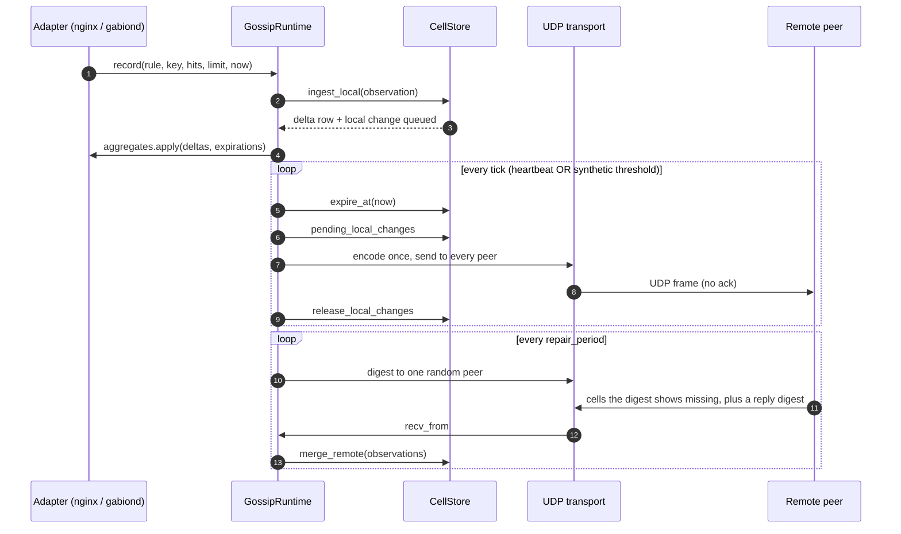

# gabion

The pure-Rust library at the heart of every gabion deployment. It owns
the CRDT, the gossip runtime, the wire codec, the rule machinery, and the
discovery interface, while knowing nothing about YAML, gRPC, or nginx.
Both adapters in the workspace (`gabion-server` and `gabion-nginx`) build
their configuration on top of the same library types and call the same
hot paths.

This README is the canonical guide to the library. If you want to
understand how the cluster stays consistent, how a packet is shaped, or
which knob to turn when an operator asks, read it end-to-end. For the
CRDT data structures behind the gossip protocol, see [`CRDT.md`](CRDT.md).
For cross-adapter vocabulary (rule, descriptor, bucket, fail-open), see
the [repo root README](../../README.md#glossary).

## Contents

- [Module map](#module-map)
- [Design notes: bimodal multicast](#design-notes-bimodal-multicast)
- [How gossip works](#how-gossip-works)
  - [The wire frame](#the-wire-frame)
  - [The anti-entropy loop](#the-anti-entropy-loop)
  - [Adaptive emit rate](#adaptive-emit-rate)
  - [The local change queue](#the-local-change-queue)
- [Operator knobs](#operator-knobs)
- [What we measured](#what-we-measured)
- [References](#references)

## Module map

The library is divided into six modules, and every type that crosses an
adapter boundary lives in exactly one of them. The dependency graph is
a DAG, so no module imports from a module that imports it.

| Module       | Path                          | What it owns                                                                                                                              |
|--------------|-------------------------------|--------------------------------------------------------------------------------------------------------------------------------------------|
| `crdt`       | `src/crdt/*`                  | The per-origin counter store. Robin Hood hash index, structure-of-arrays columns, bounded local change queue. Allocates only at construction. See [`CRDT.md`](CRDT.md). |
| `rules`      | `src/rules/*`                 | `Rule`, `RuleTable`, `Descriptor`, fingerprint hashing. Two nodes with the same rules produce identical `rule_fingerprint` values, which is what makes the CRDT addressable across the cluster. |
| `gossip`     | `src/gossip/*`                | `GossipRuntime`, `GossipClient`, `GossipTransport`, `Clock`, the `sim::SimTransport` used in tests, and the `AdminCommand` / `AdminSnapshot` observability surface. |
| `wire`       | `src/wire/*`                  | The on-the-wire codec. One UDP packet = header + (cells: rule dictionary + node dictionary + cell rows, or digest: scope + entries) + optional HMAC tag. Each packet decodes independently. |
| `discovery`  | `src/discovery/*`             | `PeerDiscovery` trait and the Kubernetes EndpointSlice implementation. Adapters consume `PeerEvent` streams; the gossip runtime treats peer add/remove as a normal `select!` arm. |
| `defaults`   | `src/defaults.rs`             | Constants shared by both adapters: tick and repair periods, repair budget, payload caps, the per-rule error budget, and the min-emit floor. |

`gossip` sits at the top of that graph and depends on every other
module, whereas `wire` and `crdt` are independent of each other.
`defaults` is a leaf: `rules` and `gossip` import it, and it imports
nothing else in this crate. Adapters consume the public surface of
`gossip`, `rules`, and `discovery`, together with the constants in
`defaults`.

## Design notes: bimodal multicast

The protocol follows Birman, Hayden, Ozkasap, Xiao, Budiu and Minsky,
"Bimodal Multicast", ACM TOCS 17(2), 1999
(<https://www.cs.cornell.edu/projects/Quicksilver/public_pdfs/Bimodal.pdf>).

**Phase one, direct mail.** Every gossip tick (the unchanged 500 ms heartbeat
plus error-budget threshold rounds) a node sends the changes to its *own*
cells to *every* peer, once, in packets it encodes once and queues for each
peer. There is no acknowledgement and no per-receiver state; a change the send
pool had no room for waits for the next tick. A node never relays a
cell it learned from a peer. The local dirty ring is therefore a queue: a
change leaves it when it has been sent.

**Phase two, digest repair.** Every `repair_period` (1 s) a node sends one
random peer a digest of the origin sequences it holds. The peer answers with
the cells the digest shows missing, at most `repair_max_cells` (512) per
repair period across all digests it answers, and, when the digest started an
exchange, with a digest of its own so the first node can return what the peer
lacks. Any holder can serve any cell, as pbcast retransmits from any member's
buffer.

**Adaptations to a state CRDT, and why.**

- *The digest is a bitmap, not a message history.* The paper's digest lists
  message ids. Here the unit is a cell, and a cell keeps the sequence its
  origin stamped on it (a cell learned from a peer is no longer re-stamped, so
  sequences compare across nodes). A digest entry is one origin's maximum
  sequence held plus a 256-bit bitmap of the sequences held below it;
  sequences further back are assumed held. A bare maximum, as Scuttlebutt
  uses over an ordered stream, would never repair a gap left by a lost
  datagram, because direct mail is unordered and unacknowledged. A newer
  version of a held cell has a new sequence, so it shows as missing.
- *Digests are packet-independent.* A digest larger than one packet is sent as
  several, each naming the half-open range of origin keys it speaks for, so
  an origin in range with no entry is one the sender holds nothing for.
  Receivers keep no state across packets.
- *Repair is bounded per period, not per message.* The paper's per-round
  retransmission limit becomes `repair_max_cells`, refilled each repair tick.
  The paper gives no value, so it is derived from the receive buffer: half of
  Linux's `rmem_default` (212,992 bytes) at a worst-case 82 wire bytes per
  cell is 1,298 cells (`GOSSIP_REPAIR_MAX_CELLS`; the arithmetic is in
  `gabion::defaults`). Under loss and churn the repair phase is
  budget-bound: a node that misses more cells per period than the budget
  catches up over several periods, so results on those regimes depend on
  this value. Like `repair_period` (sweep 0.5, 1, 2 s), `repair_max_cells` is a
  `GossipConfig` field meant to be swept.
- *Repair answers go in cell-store slot order.* The paper lists
  most-recent-first retransmission as an optimization when the round limit
  binds. It is not adopted here: ordering by recency needs either a sort or a
  second scan over the cell store per digest, and sequences compare only within
  one origin. The scan stops at the budget, so the cells served first are
  whichever the store holds first. Progress still comes from the requester's
  next digest, which no longer lists what it received.
- *The digest window is bounded.* The bitmap covers
  `GOSSIP_DIGEST_WINDOW_WORDS * 64` (256) sequences below an origin's maximum.
  A lost cell more than 256 sequences behind its origin's newest is taken as
  held and never repaired. That covers the live window when an origin stamps
  up to about 2 sequences a second over a two-minute window; a long-window rule
  (hours) at a high per-origin hit rate, or a very high-rate regime, can have
  older losses that repair cannot see. Widening the window costs 8 bytes per
  word in every digest entry.
- *A node far behind pulls again at once (adapted from the `pull-sweep-join`
  component).* A repair answer that stops at the responder's budget, or at its
  free send slots, carries `FLAG_CUT` on its last packet. The receiver then
  sends a digest to another random peer at once instead of waiting a repair
  period, and keeps doing so until an answer arrives whole. The paper has no
  join or catch-up path: a member that falls far behind recovers at one
  budget-limited exchange per round, which here took a joining pod three to
  five seconds to fetch a live window of about 8,000 cells. The component as
  specified pulls from two rendezvous-chosen peers on join; the adaptation keeps
  the paper's random pairwise exchange and its per-round retransmission limit,
  and covers a joiner and a node returning from a partition alike, with no
  join detection. Every link of a chain spends a peer's repair budget, so the
  extra pulls per period are bounded by the budgets; a link that reaches a peer
  whose budget is spent gets no answer and the chain ends, to resume at the
  next repair tick. A repair tick that finds no peer (a node that starts before
  discovery reports its peers) is owed to the first peer to arrive rather than
  skipped.
- *Peer removal during a broadcast.* A broadcast walks the peer list by index
  and steps back over a removed peer, so no peer is skipped. A peer added
  mid-broadcast joins the walk's tail or misses that one packet; digest repair
  covers it.
- *Datagrams, not multicast.* The unreliable multicast of phase one is one UDP
  datagram per peer, the transport gabion already has.

**Config.** `GossipConfig::repair_period` and `repair_max_cells` take their
defaults from `gabion::defaults::GOSSIP_REPAIR_PERIOD_MILLIS` and
`GOSSIP_REPAIR_MAX_CELLS`. `fanout` is ignored (phase one reaches every peer),
and `CellStoreConfig::forwarded_dirty_capacity` and `peer_capacity` are
ignored (nothing is forwarded; no peer frontier is kept); they remain so
the study harness's solution contract compiles. The coverage margin and the
peer frontier are gone. The server and nginx adapters do not yet expose
`repair_period` or `repair_max_cells`; their READMEs and
[`CRDT.md`](CRDT.md) still describe the replaced fanout, forwarded-ring and
peer-frontier machinery for knobs and structures that are now inert.

**Wire.** Digest packets are marked `FLAG_DIGEST` in the common header, carry
`FLAG_REPLY` when sent in answer to a digest, and are authenticated like cell
packets. The cell packets of a repair answer cut at the responder's budget
carry `FLAG_CUT`.

## How gossip works

Gossip is the protocol that turns N independent counter stores into one
*eventually consistent* counter store. Every node admits requests
against its local view of the cluster aggregate, and gossip is what
keeps that view fresh. From the adapter's side it shows up as a single
call: admission writes a row through `GossipClient::record`, and a
later runtime tick turns those rows into outbound frames.

The protocol has two phases, described in
[Design notes](#design-notes-bimodal-multicast): *direct mail* sends each
node's own changes to every peer on the heartbeat, and *digest repair*
reconciles whatever the datagrams lost. One adaptive aspect rides on the
first phase:

- **Adaptive emit rate** — the gossip cadence adapts to per-rule
  pressure. Heartbeats fire every `tick_interval` unconditionally, but
  the runtime also fires a synthetic *threshold* tick between
  heartbeats whenever a hot rule's locally unreplicated hits would
  exceed its per-site error budget. The budget bounds cluster-wide
  unreplicated error per rule by 1 % of the rule's limit (default), no
  matter the request rate. A floor `min_emit_interval` caps the worst
  case so an adversarial workload cannot pin the gossip socket.

### The wire frame

Every gossip frame is one self-describing UDP packet, with no session
state on either side: each frame decodes independently, even if its
predecessor was dropped. Loss of a packet costs you a few cells until
digest repair returns them.

The header is fixed at 72 bytes. Every multi-byte field is encoded
little-endian; the first four bytes on the wire are `0x32 0x47 0x42
0x47` so a packet capture reads `2GBG`. (The numeric `MAGIC` literal
`0x4742_4732` spells "GBG2" when written most-significant byte first;
the LE encoding then writes those bytes in reverse.)

```
byte  field                  width
----  ---------------------  -----
0     MAGIC                  4   (0x4742_4732)
4     VERSION                2   (= 1)
6     flags                  2   (FLAG_MORE | FLAG_AUTHENTICATED |
                                  FLAG_DIGEST | FLAG_REPLY)
8     cluster_id_hash       16
24    sender_node_id        16
40    sender_incarnation     4
44    count_width            4   (2, 4, or 8 — width of the count column;
                                  matches u16/u32/u64 `impl Count`)
48    cell_count             4
52    body_len               4
56    min_origin_sequence    8
64    max_origin_sequence    8
----                       ----
                            72
```

The body follows immediately. When `cell_count > 0` it carries a
*per-frame* rule dictionary, a per-frame node dictionary, and the cell
rows. Each cell row references rule and node slots by `u8` index into
those dictionaries (so the same fingerprint isn't repeated 4096 times),
plus its `key_hash`, `bucket`, origin incarnation, `last_update_millis`,
`origin_sequence`, and `count`:

```
[rule_dict_len    : u8     ]    R rules in this frame (1–255)
[rule_dict        : u128×R ]    rule fingerprints
[node_dict_len    : u8     ]    D origins in this frame (1–255)
[node_dict        : u128×D ]    origin node ids
[rule_slot        : u8 ×N  ]    each < R
[key_hash         : u128×N ]
[bucket           : u32 ×N ]
[node_slot        : u8 ×N  ]    each < D
[origin_incarn.   : u32 ×N ]
[last_update_ms   : u64 ×N ]
[origin_sequence  : u64 ×N ]
[count            : C  ×N  ]    count_width × N bytes
```

When the frame carries no cells, the body is empty. A digest frame
(`FLAG_DIGEST`) carries instead the origin-key range it speaks for and one
entry per origin; see `src/wire/digest.rs`.

If the cluster is configured with a shared HMAC key, an additional
**32-byte HMAC-SHA256 tag** is appended over the header and body, and
`FLAG_AUTHENTICATED` is set. Inbound packets whose tag fails verify are
dropped on the floor, and the whole cluster must agree on the key.

The codec lives in `src/wire/{header,body,digest,auth}.rs`. The library's own
`FrameLimits::default()` is 256 KB — useful for tests and the simulator
— but production adapters plumb `gabion::defaults::GOSSIP_MAX_PAYLOAD_BYTES`
(1400 bytes, the safe IPv4 MSS floor) into `FrameLimits` so frames stay
well below the path MTU and avoid IP fragmentation. Frames larger than
the cap split into multiple packets at the sender, and each packet is
independently decodable.

### The anti-entropy loop

The runtime (`GossipRuntime`, in `src/gossip/runtime.rs`) is a
single-threaded event loop driven by one `tokio::select!` with arms for
limit requests from the adapter, inbound packets, outbound writability,
peer membership churn, admin commands, the heartbeat tick, and the repair
tick. After every iteration that produced delta or expiration rows, the
runtime calls `aggregates.apply(...)` exactly once, which is the
contract with the downstream rate-limit decision path. Empty iterations
(an idle tick, a peer event with no CRDT effect) short-circuit the
apply so the read side of the aggregate is never disturbed for no
reason.



`CellStore::merge_remote` performs the CRDT join: max-merge per
`(origin, key, bucket)`, sum across origins. A merged remote cell keeps
the sequence its origin stamped on it and is never queued for sending.

### Adaptive emit rate

The heartbeat tick is bounded below by `tick_interval` (default
500 ms). That cadence works for cold rules but is pessimistic for hot
ones, because a saturating burst between two heartbeats could leak many
admissions past the limit before the next tick. Lowering
`tick_interval` for everyone is not an answer either: it costs
bandwidth on every quiet rule in the cluster.

The runtime crosses this trade with a per-rule error budget.
`GossipRuntime::handle_limit_request` keeps a small `rule_pending`
column indexed by rule slot; each admission adds its hits. The runtime
also computes a per-site safe zone:

```
ε_R = max(1, L_R · target_err_bps / (10_000 · N))
```

where `L_R` is the rule's limit and `N` is the peer count. When
`rule_pending` for that rule crosses `ε_R`, the runtime sets
`want_immediate_flush = true`. On the next loop iteration the top of
the run loop reads that flag (instead of waiting on `tick.tick()`) and
dispatches a synthetic gossip tick straight away. The post-emit sweep
inside `handle_gossip_tick` zeroes the rule's pending column and stamps
its `last_emit_ms`.

The constant `target_err_bps` is in basis points of each rule's own
limit, default 100 = 1 %. The cluster-wide unreplicated error per rule
is then bounded by `N · ε_R` (Sharfman, Schuster & Keren, SIGMOD 2006)
— roughly 1 % of the rule's limit, regardless of the request rate.

A floor `min_emit_interval` (default 5 ms) sits in front of the flush:
the runtime won't set `want_immediate_flush` if the gap since the last
emit is below the floor. Under adversarial traffic ε saturates to 1 and
every hit would otherwise emit; the floor caps the worst-case emit rate
so a bad client cannot pin the gossip socket.

```mermaid
stateDiagram-v2
    [*] --> Idle
    Idle --> Accumulating: limit request<br/>adds hits to rule_pending
    Accumulating --> Accumulating: pending ≤ ε_R
    Accumulating --> ReadyToFire: pending > ε_R
    ReadyToFire --> Idle: now − last_emit < min_emit_interval<br/>(floor blocks the emit)
    ReadyToFire --> Emit: now − last_emit ≥ min_emit_interval
    Emit --> Idle: synthetic tick dispatched,<br/>rule_pending reset,<br/>last_emit_ms stamped
    Idle --> Emit: heartbeat tick<br/>(unconditional; drains cold rules)
```



Three operational properties fall out of this design. The cluster-wide
unreplicated error per rule is bounded: at the default
`target_err_bps = 100`, the global error never exceeds 1 % of the
rule's limit no matter how fast requests come in. Cold rules still
propagate, because the heartbeat is independent of the threshold path
and any rule whose pending count never reaches ε_R still replicates
every `tick_interval`. Finally, under an adversarial workload where ε
saturates and every hit would otherwise emit, `min_emit_interval` caps
the worst-case emit rate; convergence still happens, but the cluster
absorbs the burst at a different bandwidth budget.

The `error_budget` and `min_emit_clamp` bench suites measure both
sides of this trade.

### The local change queue

`local_dirty` is a bounded ring that every locally-observed hit pushes
onto. A tick reads the pending entries with `pending_local_changes`,
encodes them once, and calls `release_local_changes` for the ones it
queued; entries the send pool had no room for stay for the next tick.
The ring is pre-sized at construction; pushes that hit the cap bump an
overflow counter and drop the change record (the cell itself stays, and
digest repair will return it to any peer that misses it).

`CRDT.md` documents the cell store's structures in detail; its sections on
the forwarded ring and the peer frontier describe the replaced protocol.

## Operator knobs

Most deployments leave the defaults alone, because they are chosen to
keep convergence well under a second at typical cluster sizes
(≤ 256). The table below is for the days when you do need to tune, and
it splits into the heartbeat and repair knobs and the per-rule error budget.

### Heartbeat, repair and payload

| Knob                 | Default     | What it controls                                                                                                                       | When to tune                                                                                                  |
|----------------------|-------------|----------------------------------------------------------------------------------------------------------------------------------------|----------------------------------------------------------------------------------------------------------------|
| `tick_interval`      | 500 ms      | Heartbeat cadence: period between direct-mail rounds.                                                                                  | Bigger clusters tolerate longer intervals; lower it only if you need sub-100 ms convergence on cold rules.    |
| `repair_period`      | 1 s         | Period between digest exchanges; each sends one digest to one random peer.                                                             | Shorter heals loss faster at more digest traffic; the design sweeps 0.5, 1 and 2 s.                           |
| `repair_max_cells`   | 1 298       | Cells a node will send answering digests per repair period (half of `rmem_default` at 82 wire bytes per cell).                         | Raise only with a larger socket receive buffer; loss and churn convergence are bound by it.                   |
| `max_cells_per_tick` | 4 096       | Cap on cells encoded in one tick or one digest answer.                                                                                 | Raise if you run many rules and the local change queue backlogs visibly under burst.                          |
| `max_payload_bytes`  | 1 400       | UDP datagram budget. The codec splits a frame across multiple packets when the cell list overflows.                                    | Lower if your network path has a tighter MTU; never raise past the IPv4 safe floor of 1400.                   |
| `fanout`             | 3           | Ignored: phase one sends to every peer.                                                                                                | Not applicable.                                                                                                |

### Per-rule error budget (adaptive emit rate)

| Knob                 | Default     | What it controls                                                                                                                       | When to tune                                                                                                  |
|----------------------|-------------|----------------------------------------------------------------------------------------------------------------------------------------|----------------------------------------------------------------------------------------------------------------|
| `target_err_bps`     | 100 (= 1 %) | Per-rule error budget in basis points of the rule's limit. Tighter = more threshold fires, looser = more local lag.                    | Lower if a hot rule needs tighter convergence than 1 %; higher if bandwidth is the bottleneck.                |
| `min_emit_interval`  | 5 ms        | Floor between two threshold-fire emissions. Caps worst-case emit rate when ε saturates under adversarial load.                         | Raise if a bad client is pinning the gossip socket; lower to chase microsecond convergence on tiny clusters.  |

The `gabion::defaults` module is the single source of truth for these
constants. Both adapters read from it, so if you change a default the
two adapters move together. Per-adapter configuration translates each
knob to its surface name — see [`crates/server/README.md`](../server/README.md)
for the YAML keys and [`crates/nginx/README.md`](../nginx/README.md) for
the directives.

## What we measured

The measurements that used to live here described the replaced
coverage-fanout protocol and have been removed. This branch is evaluated by
the study harness in [`../gossip-bench/README.md`](../gossip-bench/README.md)
(`judge/matrix.py --solution bimodal`).

## References

In-tree primary sources:

- `src/gossip/runtime.rs` — the event loop. `GossipRuntime::run` is the
  outer `select!`; `handle_gossip_tick` carries direct mail and
  `handle_repair_tick` / `handle_digest` carry repair; `handle_limit_request` carries the per-site safe zone and the
  threshold-fire flag.
- `src/wire.rs` and `src/wire/` — packet shape, encoders, HMAC
  authentication.
- `src/crdt.rs` and `src/crdt/` — counter store, local change queue,
  expiry. The structures here are documented in depth in
  [`CRDT.md`](CRDT.md).
- [`../gossip-bench/REFERENCES.md`](../gossip-bench/REFERENCES.md) — the
  literature survey behind the benchmark methodology (Demers 1987,
  Karp 2000, SWIM 2002, HyParView / Plumtree 2007, Astrolabe 2003,
  Bimodal Multicast 1999, plus Sharfman/Schuster/Keren and
  Olston/Jiang/Widom for the error-budget machinery).
