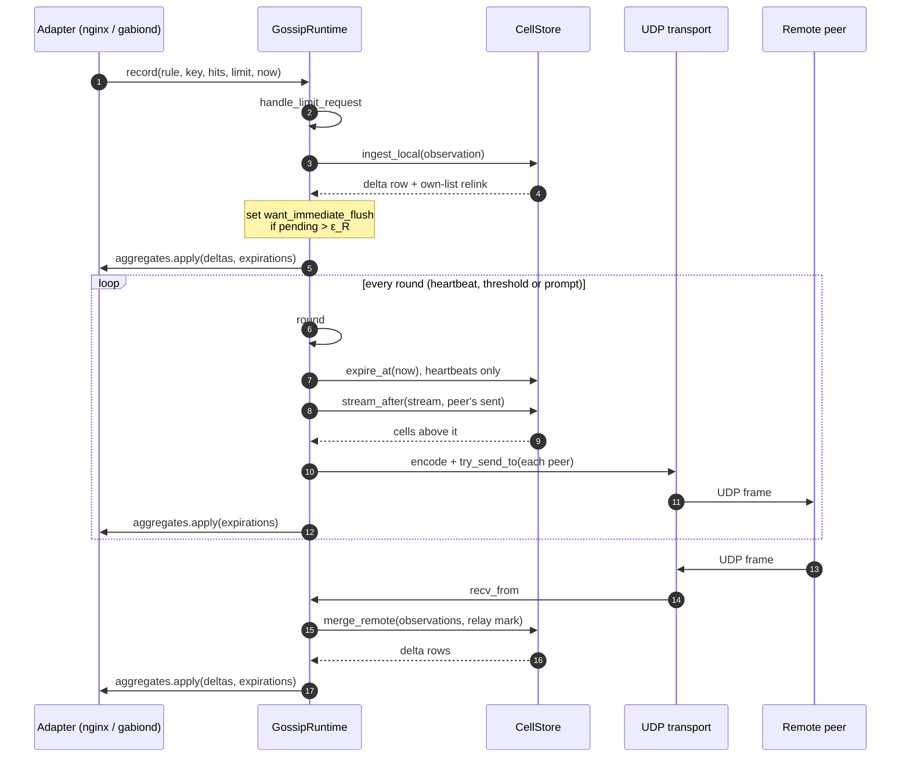

# gabion

The pure-Rust library at the heart of every gabion deployment. It owns
the CRDT, the gossip runtime, the wire codec, the rule machinery, and the
discovery interface, while knowing nothing about YAML, gRPC, or nginx.
Both adapters in the workspace (`gabion-server` and `gabion-nginx`) build
their configuration on top of the same library types and call the same
hot paths.

This README is the canonical guide to the library. If you want to
understand how the cluster stays consistent, how a packet is shaped, or
which knob to turn when an operator asks, read it end-to-end. For the
CRDT data structures behind the gossip protocol, see [`CRDT.md`](CRDT.md).
For cross-adapter vocabulary (rule, descriptor, bucket, fail-open), see
the [repo root README](../../README.md#glossary).

## Contents

- [Module map](#module-map)
- [How gossip works](#how-gossip-works)
  - [The wire frame](#the-wire-frame)
  - [The anti-entropy loop](#the-anti-entropy-loop)
  - [Streams, acks and join sweeps](#streams-acks-and-join-sweeps)
  - [Adaptive emit rate](#adaptive-emit-rate)
- [Writing the same rule for NGINX and gabiond](#writing-the-same-rule-for-nginx-and-gabiond)
- [Operator knobs](#operator-knobs)
- [What we measured](#what-we-measured)
- [References](#references)

## Module map

Every type that crosses an adapter boundary lives in exactly one of the
library's modules. The dependency graph is
a DAG, so no module imports from a module that imports it.

| Module       | Path                          | What it owns                                                                                                                              |
|--------------|-------------------------------|--------------------------------------------------------------------------------------------------------------------------------------------|
| `crdt`       | `src/crdt/*`                  | The per-origin counter store. Robin Hood hash index, structure-of-arrays columns, the ordered own-stream list. Allocates only at construction. See [`CRDT.md`](CRDT.md). |
| `rules`      | `src/rules/*`                 | `RuleDef::build` and `RuleTable::new`, the one way both adapters build rules; `Descriptor`, fingerprint and key hashing. Two nodes with the same rules produce identical `rule_fingerprint` values and key hashes, whatever order they list them in, which is what makes the CRDT addressable across the cluster. |
| `aggregate`  | `src/aggregate.rs`            | The cluster-aggregate table both adapters read on admission: seqlocked slots, linear probing within 128 slots of home, backward-shift removal. NGINX lays it over shared memory; `gabiond` owns one as `Aggregate`, sized from `storage.max_cells`. |
| `gossip`     | `src/gossip/*`                | `GossipRuntime`, `GossipClient`, `GossipTransport`, `Clock`, the `sim::SimTransport` used in tests, the pre-sized peer table, and the `AdminCommand` / `AdminSnapshot` observability surface. |
| `wire`       | `src/wire/*`                  | The on-the-wire codec. One UDP packet = header + rule dictionary + node dictionary + cell rows. Each packet decodes independently. |
| `discovery`  | `src/discovery/*`             | `PeerDiscovery` trait and the Kubernetes EndpointSlice implementation. Adapters consume `PeerEvent` streams; the gossip runtime treats peer add/remove as a normal `select!` arm. |
| `defaults`   | `src/defaults.rs`             | Constants shared by both adapters: tick interval, payload caps, the per-rule error budget, the min-emit floor, and the stream and sweep constants (gap reports, sweep sources, the backlog that sizes the per-round quantum). |
| `settings`   | `src/settings.rs`             | Every operator setting named once: `gabiond` YAML key, environment variable and NGINX directive. Messages interpolate from it so each names both adapters' spellings. |
| `throttle`   | `src/throttle.rs`             | The one power-of-two log throttle every repeating warning counts through. |
| `identity`   | `src/identity.rs`             | This host's stable node id, and an incarnation that differs on every start (wall-clock milliseconds, stepped past the previous one). Behind `transport-udp`. |

`gossip` sits at the top of that graph and depends on every other
module, whereas `wire` and `crdt` are independent of each other.
`defaults`, `settings` and `throttle` are leaves: the other modules import
them, and they import nothing else in this crate. Adapters consume the public surface of
`gossip`, `rules`, and `discovery`, together with the constants in
`defaults`.

## How gossip works

Gossip is the protocol that turns N independent counter stores into one
*eventually consistent* counter store. Every node admits requests
against its local view of the cluster aggregate, and gossip is what
keeps that view fresh. From the adapter's side it shows up as a single
call: admission writes a row through `GossipClient::record`, and a
later runtime round turns those rows into outbound frames.

The protocol has two parts, and they are the reason gabion holds up under
load that a textbook anti-entropy loop would not:

1. **Acknowledged streams in two tiers** — each node sends the cells it
   originated straight to every peer of its zone, and, flagged
   `RELAY_INTO_ZONE`, to one *gateway* in each other zone, chosen by
   rendezvous hashing so origins spread over a zone's members. The gateway
   relays them to the rest of its zone on a second stream. Every stream is
   per peer and acknowledged cumulatively; a gap report or a heartbeat
   without an ack brings a resend, so a lost packet costs one round, not a
   lifetime. A peer whose zone is none gets everything directly. A peer not
   yet heard from is routed by the zone discovery reports for it (a
   Kubernetes EndpointSlice endpoint's `zone`) until it is first heard;
   from then on its headers' zone wins, even none; one with neither gets
   only the cells raised since it was
   added, greeted with `PROBE` each heartbeat until it answers with its zone.
   A node that starts asks two peers for a *join sweep* of every live cell.
2. **Adaptive emit rate** — the gossip cadence adapts to per-rule
   pressure. Heartbeats fire every `tick_interval` unconditionally, but
   the runtime also fires a synthetic *threshold* tick between
   heartbeats whenever a hot rule's locally unreplicated hits would
   exceed its per-site error budget. The budget bounds cluster-wide
   unreplicated error per rule by 1 % of the rule's limit (default), no
   matter the request rate. A floor `min_emit_interval` caps the worst
   case so an adversarial workload cannot pin the gossip socket.

The rest of this section walks through each in turn.

### The wire frame

Every gossip packet is self-describing: each decodes independently, even
if its predecessor was dropped. Loss of a packet costs you a few cells until a
gap report or the retransmission timeout resends them.

The header is fixed at 86 bytes, version 2. Every multi-byte field is
encoded little-endian; the first four bytes on the wire are `0x32 0x47
0x42 0x47` so a packet capture reads `2GBG`. (The numeric `MAGIC`
literal `0x4742_4732` spells "GBG2" when written most-significant byte
first; the LE encoding then writes those bytes in reverse.)

```
byte  field                  width
----  ---------------------  -----
0     MAGIC                  4   (0x4742_4732)
4     VERSION                2   (= 2)
6     kind                   1   (see below)
7     flags                  1   (one meaning per bit; 0x80 must be 0)
8     cluster_id_hash       16
24    sender_node_id        16
40    sender_incarnation     4
44    sender_zone            4   (0 = no zone)
48    cell_count             2
50    ack_incarnation        4
54    ack_own                8
62    ack_relay              8
70    stream_lower           8   (exclusive)
78    stream_upper           8   (inclusive)
----                       ----
                            86
```

| Kind | Byte | Carries |
|---|---|---|
| `Ack` | 0 | header only |
| `Own` | 1 | the sender's own stream, range `(lower, upper]` |
| `Relay` | 2 | the sender's relay stream, range `(lower, upper]` |
| `Sweep` | 3 | cells outside any stream; no range |
| `SweepRequest` | 4 | header only |

The decoder turns kind, flags and range into one typed payload and
drops any combination the format forbids. A node sends its own stream as
`Own` packets that tile the frame's range, acks and gap reports alone as
`Ack`, and join sweeps as `SweepRequest` and `Sweep`; every data kind it
receives merges the same way. `sender_zone` is the low 32 bits of the
stable hash of the sender's zone name (`gabion::zone::ZoneName`), never 0;
0 means the sender has no zone. A node takes each peer's zone from that
peer's headers; until it has heard the peer, it uses the zone discovery
reports for it, if any.

The body follows immediately. When `cell_count > 0` it carries a
*per-frame* rule dictionary, a per-frame node dictionary, and the cell
rows. Each cell row references rule and node slots by `u8` index into
those dictionaries (so the same fingerprint isn't repeated 4096 times),
plus its `key_hash`, `bucket`, origin incarnation, `last_update_millis`
and `count`, 38 bytes in all:

```
[rule_dict_len    : u8     ]    R rules in this frame (1–255)
[rule_dict        : u128×R ]    rule fingerprints
[node_dict_len    : u8     ]    D origins in this frame (1–255)
[node_dict        : u128×D ]    origin node ids
[rule_slot        : u8 ×N  ]    each < R
[key_hash         : u128×N ]
[bucket           : u32 ×N ]
[node_slot        : u8 ×N  ]    each < D
[origin_incarn.   : u32 ×N ]
[last_update_ms   : u64 ×N ]
[count            : u32 ×N ]
```

An `Ack`, a `SweepRequest`, or an `Own` or `Relay` packet with no cells
has an empty body. Nothing follows the body: packets are not
authenticated, so isolate the gossip port with a NetworkPolicy (see the
[root README](../../README.md#running-across-a-cluster)).

The decoder checks the size, the header's length, magic, version, kind,
flags and range, then the cluster id, and only then the body, so a
packet from another protocol version or another cluster is dropped
before any cell is read, and logged (`peer_version_mismatch`,
`decode_rejected`; see [TROUBLESHOOTING.md](TROUBLESHOOTING.md)).

The codec lives in `src/wire/{header,body}.rs`. Its `FrameLimits` can
only be built with a payload between 158 and 65,507 bytes, and the
runtime takes it from the validated `gossip.max_payload_bytes`, which
defaults to 1400 bytes (the safe IPv4 MSS floor), so frames stay well
below the path MTU and avoid IP fragmentation. A 1,400-byte packet
holds 33 cells of one rule and one origin; that same bound caps what a
received packet may carry, so no cell count is configured. Frames larger
than the cap split into multiple packets at the sender, and each packet
is independently decodable.

### The anti-entropy loop

The runtime (`GossipRuntime`, in `src/gossip/runtime.rs`) is a
single-threaded event loop driven by one `tokio::select!` with six arms:
limit requests from the adapter, the heartbeat, the prompt-round pacer
(polled only while a resend, gap report, probe answer or sweep waits),
inbound packets, peer membership churn, and admin commands. A round
first reads the datagrams already waiting, then serves every peer in one
send loop, handing each packet to the socket as it is encoded; a packet
the kernel refuses is held and retried first on the next round, and the
cut round resumes from the peer it stopped at (see
[Socket buffers](#socket-buffers)).
After every iteration that produced delta or expiration rows, the
runtime calls `aggregates.apply(...)` exactly once — that is the
contract with the downstream rate-limit decision path. Empty iterations
(an idle tick, a peer event with no CRDT effect) short-circuit the
apply so the read side of the aggregate is never disturbed for no
reason.



`CellStore::merge_remote` performs the CRDT join: max-merge per
`(origin, key, bucket)`, sum across origins.

### Streams, acks and join sweeps

Each node's own stream is its own cells in the order they last changed,
numbered by `origin_sequence`; its relay stream is the remote cells it was
asked to relay, numbered by a relay sequence drawn when each is marked. The
cell store keeps each on one ordered list, so `stream_after(stream, sent)`
reads what a peer has not been sent without a scan. Zone peers get both
streams, a gateway the own stream flagged, other members of a remote zone
neither, and a peer not yet heard from, of no zone discovery named, only the
own cells raised since it was added. A flagged packet marks its cells for
relay: all of them when its range ends above the receiver's *gateway* mark
(so a new gateway relays what it held directly), else those the merge
raised; any other packet takes the cells it raised off the relay list, since
its sender is responsible for them. For each peer the runtime keeps `sent` and the peer's last ack,
`acked`. Heartbeat and threshold rounds send each peer the cells above its
`sent`, at most `q` a round, where `q` is `⌈storage.max_cells / 128⌉` or one
packet, whichever is larger; a stream with more waiting goes on in the next
prompt round. A frame holding every live cell up to the head closes the
range through the head, so cells that expired unsent are not owed.

The receiver keeps `have`, the highest position it holds contiguously, and
returns it on every packet it sends back, or alone at its next heartbeat.
A packet above `have` opens a gap (a direct one from a peer of another
zone, sent before it heard this node's zone, is merged but opens none):
after one relay floor (`min_emit_interval`) the receiver reports it, and the
sender rewinds to the report's ack and resends on a prompt round. A gap
reported four times without progress is abandoned until the next packet
above `have` reopens it. A stream unacknowledged for
one heartbeat times out and is resent with `PROBE`, which the peer answers
on a prompt round. Acks name the incarnation they answer, so an ack written
for a restarted process credits nothing; a peer's new incarnation resets
both directions of its stream. The receiver keeps the own ranges it gets as
the origin's gateway on a mark of their own, the gateway mark, and says which
mark an ack carries (`ACK_AS_GATEWAY`); a gateway's acks count only as
gateway acks, a zone peer's only as direct acks. A peer whose role changes so
that it gains a stream is resent that stream from 0.

A peer is *suspect* once a packet that asks for an answer (data, or a
probe that retries it) has gone unanswered for `gossip.suspect_after` (by default four
heartbeats and at least 2 s), judged after each round reads its waiting
datagrams and never while the kernel holds a refused packet, whose held time
does not count. A suspect ranks last for the gateway role, so its zone's
next member takes over with the origin's whole live stream; its retries
shrink to one 86-byte header-only probe per heartbeat, as do those to a
gateway that has acked nothing since it took the role, and the first probe
answer brings the resend at once. An origin that goes quiet sends its
gateways nothing, so a gateway that dies meanwhile is replaced on the
origin's next change, within `gossip.suspect_after` and a heartbeat of it. A
gateway that cannot reach most of the zone peers it has heard sets
`CANNOT_RELAY` on every packet, and origins that send to it fail over at
once. A packet from an address outside the peer table is merged and never
acked, but the cells a flagged one raised are relayed, so an origin's hits
reach a zone whose gateway has not yet discovered it.

A node that starts asks its two highest-weight peers it has heard from in
its zone (or, once no peer is or may be of its zone, one heard peer of any
zone) for a join sweep, greeting meanwhile the unheard peers of its zone
and its unheard gateways,
and asks again when its zone becomes known,
retrying each heartbeat until a page arrives, and each source pages its live
cells, `q` per prompt round, to at most `gossip.sweep_concurrency`
requesters at a time. The sweep brings back the node's own previous-incarnation cells, which
no stream carries.

### Adaptive emit rate

The heartbeat tick is bounded below by `tick_interval` (default
500 ms). That cadence works for cold rules but is pessimistic for hot
ones, because a saturating burst between two heartbeats could leak many
admissions past the limit before the next tick. Lowering
`tick_interval` for everyone is not an answer either: it costs
bandwidth on every quiet rule in the cluster.

The runtime crosses this trade with a per-rule error budget.
`GossipRuntime::handle_limit_request` keeps a small `rule_pending`
column indexed by rule slot; each admission adds its hits. The runtime
also computes a per-site safe zone:

```
ε_R = max(1, L_R · target_err_bps / (10_000 · N))
```

where `L_R` is the rule's limit and `N` is the peer count. When
`rule_pending` for that rule crosses `ε_R`, the runtime sets
`want_immediate_flush = true`. On the next loop iteration the top of
the run loop reads that flag (instead of waiting on `tick.tick()`) and
dispatches a synthetic gossip tick straight away. Every round, heartbeat
or threshold, first settles the budget: it zeroes each rule's pending
column and stamps its `last_emit_ms`, even with no peers or a blocked
socket, so neither turns each later request into another round.

The constant `target_err_bps` is in basis points of each rule's own
limit, default 100 = 1 %. The cluster-wide unreplicated error per rule
is then bounded by `N · ε_R` (Sharfman, Schuster & Keren, SIGMOD 2006)
— roughly 1 % of the rule's limit, regardless of the request rate.

A floor `min_emit_interval` (default 5 ms) sits in front of the flush:
the runtime won't set `want_immediate_flush` if the gap since the last
emit is below the floor. Under adversarial traffic ε saturates to 1 and
every hit would otherwise emit; the floor caps the worst-case emit rate
so a bad client cannot pin the gossip socket.

```mermaid
stateDiagram-v2
    [*] --> Idle
    Idle --> Accumulating: limit request<br/>adds hits to rule_pending
    Accumulating --> Accumulating: pending ≤ ε_R
    Accumulating --> ReadyToFire: pending > ε_R
    ReadyToFire --> Idle: now − last_emit < min_emit_interval<br/>(floor blocks the emit)
    ReadyToFire --> Emit: now − last_emit ≥ min_emit_interval
    Emit --> Idle: synthetic tick dispatched,<br/>rule_pending reset,<br/>last_emit_ms stamped
    Idle --> Emit: heartbeat tick<br/>(unconditional; drains cold rules)
```



Three operational properties fall out of this design. The cluster-wide
unreplicated error per rule is bounded: at the default
`target_err_bps = 100`, the global error never exceeds 1 % of the
rule's limit no matter how fast requests come in. Cold rules still
propagate, because the heartbeat is independent of the threshold path
and any rule whose pending count never reaches ε_R still replicates
every `tick_interval`. Finally, under an adversarial workload where ε
saturates and every hit would otherwise emit, `min_emit_interval` caps
the worst-case emit rate; convergence still happens, but the cluster
absorbs the burst at a different bandwidth budget.

`CRDT.md` documents the cell store end-to-end with traces, slot
lifecycles, and invariant proofs. Read it once if you ever need to
debug the CRDT.

## Writing the same rule for NGINX and gabiond

NGINX nodes and `gabiond` nodes in one cluster count a rule together when
both adapters write it the same way: the same domain, the same descriptor keys
and value patterns in the same order, and the same window and bucket. Those
fields are the rule's identity, hashed into the fingerprint every counter is
filed under, so neither the rule's name nor its position in either
configuration matters. The rate's count and the mode are not part of the
identity: changing either keeps a rule's counts. The rate's period is, when
`window` is omitted, because it sets the default window and through it the
default bucket: `rate=10r/s` and `rate=600r/m` without a window are two rules.
Write the rate and mode the same in both adapters too, because each adapter
enforces its own against the shared count.

| Field | `gabiond` YAML (`limits:` entry) | NGINX `gabion_limit_rule` argument | When omitted | Identity |
|---|---|---|---|---|
| name | `name: api_tenant` | first argument | required | no; unique within each configuration |
| domain | `domain: nginx` | `domain=nginx` | `gabiond`: required; NGINX: `nginx` | yes |
| descriptors, in order | `descriptors: [{key: uri}, {key: tenant}]` | one binding per descriptor: `$uri tenant:$arg_t` (a bare `$uri` is keyed `uri`; `key:$source` names the key) | required, at least one | yes: keys and their order |
| value pattern | `value: acme` on a descriptor | `value=tenant:acme` | `*`, any value | yes |
| rate | `rate: 100r/10s` | `rate=100r/10s` | required | count: no; period: yes when `window` is omitted |
| window | `window: 10s` | `window=10s` | the rate's period | yes |
| bucket | `bucket: 1s` | `bucket=1s` | the window | yes |
| mode | `mode: dry_run` (`enforce`, `dry_run`, `disabled`) | `mode=dry_run`, or the flag `dry_run` | `enforce` | no |

Both adapters compute the limit as ⌊rate count × window ÷ rate period⌋.
These two rules are one rule:

```yaml
# gabiond
limits:
  - name: api_tenant
    domain: nginx
    descriptors:
      - key: uri
      - key: tenant
    rate: 100r/10s
    bucket: 1s
```

```nginx
# NGINX
gabion_limit_rule api_tenant $uri tenant:$arg_t rate=100r/10s bucket=1s;
```

and so are these, which count only the tenant `acme`:

```yaml
  - name: acme_only
    domain: nginx
    descriptors:
      - key: tenant
        value: acme
    rate: 10r/s
```

```nginx
gabion_limit_rule acme_only tenant:$arg_t rate=10r/s value=tenant:acme;
```

Rules that differ in any identity field, even only in `bucket`, are
different rules: each adapter counts its own, so a mixed cluster admits up to
the limit through each. gabion cannot tell such a pair from two unrelated
rules, so if a mixed cluster admits more than a rule allows, compare the two
spellings field by field against the table.

**Which requests reach a rule is not part of it.** NGINX selects them with
the location's `gabion_limit`, `except_if=$var` and the variable each binding
reads; Envoy with the route's rate-limit actions, which decide the
descriptors a request carries. Requests share a counter only when both
adapters hand gabion the same bytes for each value: NGINX's `$uri` is the
normalized path without the query string, whereas an Envoy action that reads
the `:path` header sends the raw path with its query.

## Operator knobs

Most deployments leave the defaults alone, because they are chosen to
keep convergence well under a second at typical cluster sizes
(≤ 256). The table below is for the days when you do need to tune, and
it splits into the two adaptive halves of the protocol, then the socket
buffers that carry it.

### Heartbeat cadence and streams

| Knob                 | Default     | What it controls                                                                                                                       | When to tune                                                                                                  |
|----------------------|-------------|----------------------------------------------------------------------------------------------------------------------------------------|----------------------------------------------------------------------------------------------------------------|
| `tick_interval`      | 500 ms      | Heartbeat cadence — period between proactive gossip ticks.                                                                             | Bigger clusters tolerate longer intervals; lower it only if you need sub-100 ms convergence on cold rules.    |
| `suspect_after`      | `max(4 × tick_interval, 2 s)` | How long a packet to a peer may go unanswered before the peer is suspect: routed around as a gateway and sent only probes. At least two heartbeats. | Raise on a lossy network or with long pauses when `gateway_failover` warns often; lower for faster failover. |
| `sweep_concurrency`  | 4           | Join sweeps this node answers at once; each pages `q` cells per prompt round.                                                          | Raise only if `sweep_declined` fires outside rollouts; each extra sweep adds a burst of packets to every prompt round while it runs. |
| `max_payload_bytes`  | 1 400       | UDP datagram budget, 158 to 65 507 bytes. The codec splits a tick's frame across multiple packets when the cell list overflows.        | Lower if your network path has a tighter MTU; never raise past the IPv4 safe floor of 1400.                   |

### Per-rule error budget (adaptive emit rate)

| Knob                 | Default     | What it controls                                                                                                                       | When to tune                                                                                                  |
|----------------------|-------------|----------------------------------------------------------------------------------------------------------------------------------------|----------------------------------------------------------------------------------------------------------------|
| `target_err_bps`     | 100 (= 1 %) | Per-rule error budget in basis points of the rule's limit, 1 to 10 000. Tighter = more threshold fires, looser = more local lag.       | Lower if a hot rule needs tighter convergence than 1 %; higher if bandwidth is the bottleneck.                |
| `min_emit_interval`  | 5 ms        | Floor between two threshold-fire emissions, at least 1 ms and below `tick_interval`. Caps worst-case emit rate when ε saturates under adversarial load. | Raise if a bad client is pinning the gossip socket.                                                            |

The `gabion::defaults` module holds these defaults, and `gabion::settings`
is the one table both adapters name, parse and validate every setting
through: each row gives the YAML key, the environment variable and the
NGINX directive, so if you change a default or a bound the two adapters
move together, and a bad value fails configuration load with the same
message in both. See [`crates/server/README.md`](../server/README.md)
for the YAML keys and [`crates/nginx/README.md`](../nginx/README.md) for
the directives.

### Peer table

`gossip.peer_capacity` (`GABION_GOSSIP_PEER_CAPACITY`; NGINX
`gabion_gossip_peer_capacity`, default 512) sizes the table of peers a node
gossips with, once, at start. A peer discovery reports past it is declined,
logged as `peer_table_full`, and still has its counts merged. It also sets the
node dictionary's default, twice the peer table, which
`storage.node_dictionary_capacity` overrides.

### Socket buffers

The kernel's socket buffers are gossip's queues. `gossip.recv_buffer_bytes`
(`GABION_GOSSIP_RECV_BUFFER_BYTES`; NGINX `gabion_gossip_recv_buffer_bytes`,
default 4 MiB) absorbs bursts and pauses such as CPU throttling;
`gossip.send_buffer_bytes` (`GABION_GOSSIP_SEND_BUFFER_BYTES`; NGINX
`gabion_gossip_send_buffer_bytes`, default 1 MiB) holds one round's packets.
Linux grants at most `net.core.rmem_max` and `net.core.wmem_max` (212,992 bytes
by default) and reports double what it grants; gabion halves the report, so
every size it logs is the grant itself. When it grants less than asked,
gabion logs `socket_buffer_capped` once per buffer at start; an NGINX node with
no `gabion_gossip_bind` asks for the smallest buffers and never logs it. Raise
the host settings in the node's bootstrap; in Kubernetes they are node settings,
not pod sysctls:

```sh
sysctl -w net.core.rmem_max=4194304 net.core.wmem_max=1048576
```

A host that cannot change sets the two settings to the granted sizes, which
silences the warning. `send_blocked` means the send buffer filled during a
round: the round stopped there, and the next round sends the refused packet
first, then the rest.

## What we measured

The comparative study of gossip designs, its method and its results are in
[`docs/study/README.md`](../../docs/study/README.md); the harness that produced
them is [`crates/gossip-bench`](../gossip-bench/README.md).

## References

In-tree primary sources:

- `src/gossip/runtime.rs` — the event loop. `GossipRuntime::run` is the
  outer `select!`; `round` and `serve_row` carry the per-peer streams;
  `handle_limit_request` carries the per-site safe zone and the
  threshold-fire flag. `src/gossip/peer.rs` holds the stream state and its
  rules; `src/gossip/sweep.rs` the join sweeps.
- `src/wire.rs` and `src/wire/` — packet shape, encoders, decoder.
- `src/crdt.rs` and `src/crdt/` — counter store, the own-stream list, expiry. The structures here are documented in depth in
  [`CRDT.md`](CRDT.md).
