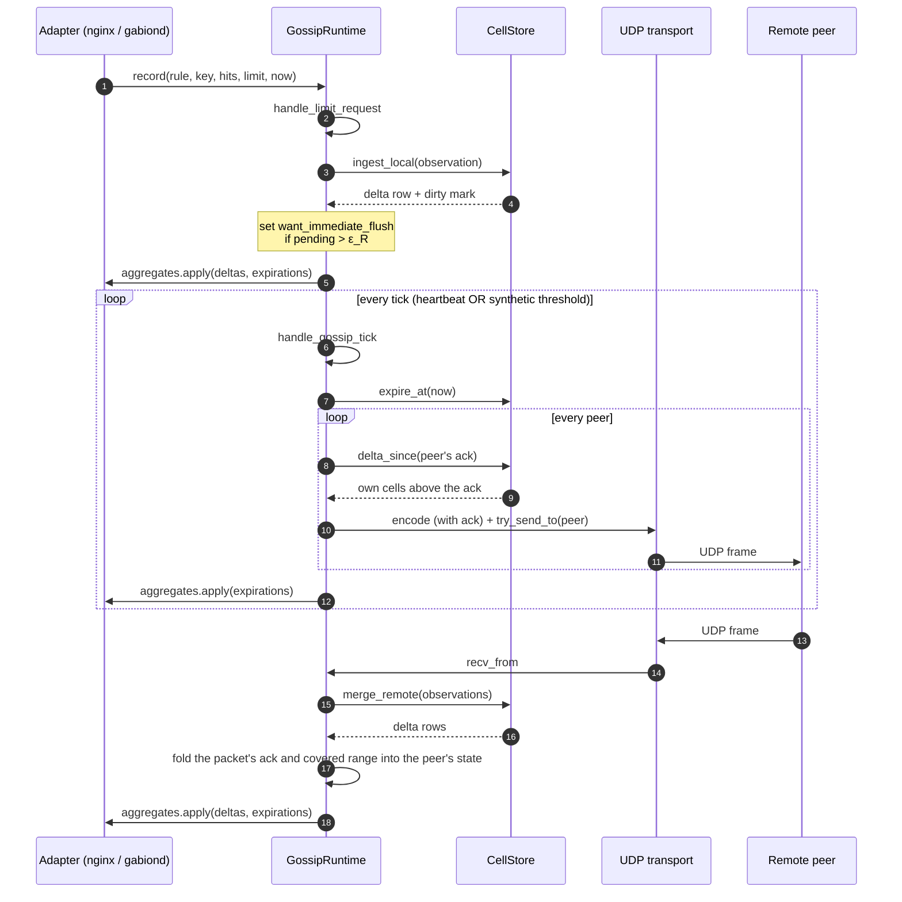
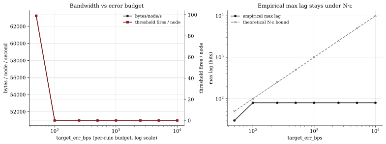
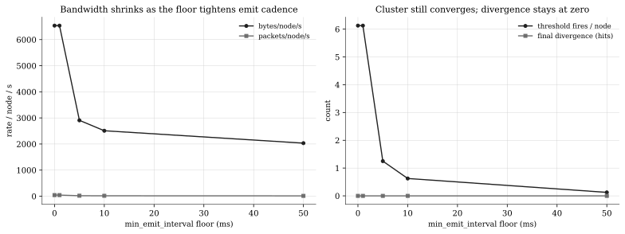
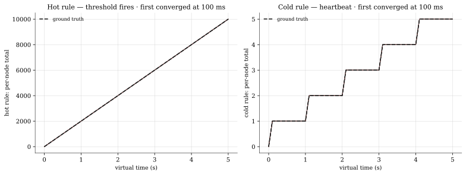

# gabion

The pure-Rust library at the heart of every gabion deployment. It owns
the CRDT, the gossip runtime, the wire codec, the rule machinery, and the
discovery interface, while knowing nothing about YAML, gRPC, or nginx.
Both adapters in the workspace (`gabion-server` and `gabion-nginx`) build
their configuration on top of the same library types and call the same
hot paths.

This README is the canonical guide to the library. If you want to
understand how the cluster stays consistent, how a packet is shaped, or
which knob to turn when an operator asks, read it end-to-end. For the
CRDT data structures behind the gossip protocol, see [`CRDT.md`](CRDT.md).
For cross-adapter vocabulary (rule, descriptor, bucket, fail-open), see
the [repo root README](../../README.md#glossary).

## Contents

- [Module map](#module-map)
- [How gossip works](#how-gossip-works)
  - [The wire frame](#the-wire-frame)
  - [The anti-entropy loop](#the-anti-entropy-loop)
  - [Direct mail and cumulative acks](#direct-mail-and-cumulative-acks)
  - [Adaptive emit rate](#adaptive-emit-rate)
  - [The dirty ring and full-state fallback](#the-dirty-ring-and-full-state-fallback)
- [Design notes](#design-notes)
- [Operator knobs](#operator-knobs)
- [What we measured](#what-we-measured)
- [References](#references)

## Module map

The library is divided into six modules, and every type that crosses an
adapter boundary lives in exactly one of them. The dependency graph is
a DAG, so no module imports from a module that imports it.

| Module       | Path                          | What it owns                                                                                                                              |
|--------------|-------------------------------|--------------------------------------------------------------------------------------------------------------------------------------------|
| `crdt`       | `src/crdt/*`                  | The per-origin counter store. Robin Hood hash index, structure-of-arrays columns, a bounded dirty ring that doubles as the delta buffer. Allocates only at construction. See [`CRDT.md`](CRDT.md). |
| `rules`      | `src/rules/*`                 | `Rule`, `RuleTable`, `Descriptor`, fingerprint hashing. Two nodes with the same rules produce identical `rule_fingerprint` values, which is what makes the CRDT addressable across the cluster. |
| `gossip`     | `src/gossip/*`                | `GossipRuntime`, `GossipClient`, `GossipTransport`, `Clock`, the `sim::SimTransport` used in tests, and the `AdminCommand` / `AdminSnapshot` observability surface. |
| `wire`       | `src/wire/*`                  | The on-the-wire codec. One UDP packet = header + rule dictionary + node dictionary + cell rows + optional HMAC tag. Each packet decodes independently. |
| `discovery`  | `src/discovery/*`             | `PeerDiscovery` trait and the Kubernetes EndpointSlice implementation. Adapters consume `PeerEvent` streams; the gossip runtime treats peer add/remove as a normal `select!` arm. |
| `defaults`   | `src/defaults.rs`             | Constants shared by both adapters: tick interval, send-pool slots per peer, payload caps, the per-rule error budget, and the min-emit floor. |

`gossip` sits at the top of that graph and depends on every other
module, whereas `wire` and `crdt` are independent of each other.
`defaults` is a leaf: `rules` and `gossip` import it, and it imports
nothing else in this crate. Adapters consume the public surface of
`gossip`, `rules`, and `discovery`, together with the constants in
`defaults`.

## How gossip works

Gossip is the protocol that turns N independent counter stores into one
*eventually consistent* counter store. Every node admits requests
against its local view of the cluster aggregate, and gossip is what
keeps that view fresh. From the adapter's side it shows up as a single
call: admission writes a row through `GossipClient::record`, and a
later runtime tick turns those rows into outbound frames.

The protocol has two aspects, and they are the reason gabion holds up
under load that a textbook anti-entropy loop would not:

1. **Direct mail with cumulative acks** — every round each origin sends
   its *own* changes straight to every peer; nothing is forwarded.
   Every packet carries the sender's cumulative acknowledgement of the
   receiver's own changes, and an origin re-sends to a peer only what
   that peer has not acknowledged, once the retransmission timeout
   expires. Reach is the full peer list, not a sampled subset.
2. **Adaptive emit rate** — the gossip cadence adapts to per-rule
   pressure. Heartbeats fire every `tick_interval` unconditionally, but
   the runtime also fires a synthetic *threshold* tick between
   heartbeats whenever a hot rule's locally unreplicated hits would
   exceed its per-site error budget. The budget bounds cluster-wide
   unreplicated error per rule by 1 % of the rule's limit (default), no
   matter the request rate. A floor `min_emit_interval` caps the worst
   case so an adversarial workload cannot pin the gossip socket.

The rest of this section walks through each in turn, then closes with
the dirty ring, the data structure that decides which cells go to which
peer.

### The wire frame

Every gossip frame is one self-describing UDP packet, with no session
state on either side: each frame decodes independently, even if its
predecessor was dropped. Loss of a packet costs you a few cells until
the next tick refills them.

The header is fixed at 92 bytes. Every multi-byte field is encoded
little-endian; the first four bytes on the wire are `0x32 0x47 0x42
0x47` so a packet capture reads `2GBG`. (The numeric `MAGIC` literal
`0x4742_4732` spells "GBG2" when written most-significant byte first;
the LE encoding then writes those bytes in reverse.)

```
byte  field                  width
----  ---------------------  -----
0     MAGIC                  4   (0x4742_4732)
4     VERSION                2   (= 2)
6     flags                  2   (FLAG_MORE | FLAG_AUTHENTICATED)
8     cluster_id_hash       16
24    sender_node_id        16
40    sender_incarnation     4
44    count_width            4   (2, 4, or 8 — width of the count column;
                                  matches u16/u32/u64 `impl Count`)
48    cell_count             4
52    body_len               4
56    min_origin_sequence    8
64    max_origin_sequence    8
72    range_start            8   (this packet covers the sender's own
                                  sequences in (range_start, max])
80    ack_sequence           8   (sender has merged the receiver's own
                                  cells up to this sequence)
88    ack_incarnation        4   (the receiver incarnation the ack is for)
----                       ----
                            92
```

The body follows immediately. When `cell_count > 0` it carries a
*per-frame* rule dictionary, a per-frame node dictionary, and the cell
rows. Each cell row references rule and node slots by `u8` index into
those dictionaries (so the same fingerprint isn't repeated 4096 times),
plus its `key_hash`, `bucket`, origin incarnation, `last_update_millis`,
`origin_sequence`, and `count`:

```
[rule_dict_len    : u8     ]    R rules in this frame (1–255)
[rule_dict        : u128×R ]    rule fingerprints
[node_dict_len    : u8     ]    D origins in this frame (1–255)
[node_dict        : u128×D ]    origin node ids
[rule_slot        : u8 ×N  ]    each < R
[key_hash         : u128×N ]
[bucket           : u32 ×N ]
[node_slot        : u8 ×N  ]    each < D
[origin_incarn.   : u32 ×N ]
[last_update_ms   : u64 ×N ]
[origin_sequence  : u64 ×N ]
[count            : C  ×N  ]    count_width × N bytes
```

When the frame carries no cells (a standalone ack), the body is
empty.

If the cluster is configured with a shared HMAC key, an additional
**32-byte HMAC-SHA256 tag** is appended over the header and body, and
`FLAG_AUTHENTICATED` is set. Inbound packets whose tag fails verify are
dropped on the floor, and the whole cluster must agree on the key.

The codec lives in `src/wire/{header,body,auth}.rs`. The library's own
`FrameLimits::default()` is 256 KB — useful for tests and the simulator
— but production adapters plumb `gabion::defaults::GOSSIP_MAX_PAYLOAD_BYTES`
(1400 bytes, the safe IPv4 MSS floor) into `FrameLimits` so frames stay
well below the path MTU and avoid IP fragmentation. Frames larger than
the cap split into multiple packets at the sender, and each packet is
independently decodable.

### The anti-entropy loop

The runtime (`GossipRuntime`, in `src/gossip/runtime.rs`) is a
single-threaded event loop driven by one `tokio::select!` with six
arms: limit requests from the adapter, inbound packets, outbound
writability, peer membership churn, admin commands, and the heartbeat
tick. After every iteration that produced delta or expiration rows, the
runtime calls `aggregates.apply(...)` exactly once — that is the
contract with the downstream rate-limit decision path. Empty iterations
(an idle tick, a peer event with no CRDT effect) short-circuit the
apply so the read side of the aggregate is never disturbed for no
reason.



`CellStore::merge_remote` performs the CRDT join: max-merge per
`(origin, key, bucket)`, sum across origins. Merged cells are stored and
expired but never re-sent; each origin is the only sender of its own
cells.

### Direct mail and cumulative acks

Each peer has two cumulative numbers, both over *origin sequences* (the
per-origin counter every cell is stamped with when it changes), in
`src/gossip/peer.rs`:

- `acked` — the highest of **our** sequences the peer has told us it
  merged. Round after round we send the peer only the live own cells
  above `sent_upto`; once the retransmission timeout expires with `acked`
  still short of `sent_upto`, we send everything above `acked` again.
- `have` — the highest of **the peer's** sequences we hold contiguously.
  We put it in the ack fields of every packet we send the peer. When we
  have nothing to send it, the next round sends a header-only packet
  instead, so an ack waits at most one tick.

Sequences of superseded cells are never sent, so a bare "I have up to 9"
cannot show that nothing below 9 is missing. Instead each packet states
the range it covers, `(range_start, max_origin_sequence]`, and carries
every live own cell in it (packets of one delta chain: each starts where
the previous ended). `have` advances to a packet's top only if it had
already reached the packet's `range_start`, and only if the store merged
every cell in it. An ack therefore never covers a cell the acker did not
merge, and a lost packet leaves `have` short, which makes the sender
repeat it. A packet that arrives beyond a hole is remembered as one range,
and `have` takes it in once the hole fills, so a reordered chain (two
packets of one round take different latencies) does not stall the ack.

Retransmission is go-back-N: when the timeout expires the send cursor
rewinds to `acked`, and that round and the ones after it walk the chain
from there, as many packets per round as the send pool gives the peer. A
backlog larger than one round's share therefore drains in consecutive
rounds rather than one share per timeout.

The retransmission timeout is `max(2 × RTT estimate, tick_interval)`
(500 ms at the default heartbeat). The estimate is a smoothed (7/8, 1/8) round
trip from first transmissions only (Karn; the re-sent tail of a go-back-N
walk is not timed either). The timer runs while anything
is unacknowledged, restarts when an ack advances, and is not postponed by
new data. Each timeout that passes with no ack doubles the next, up to
`GOSSIP_MAX_RTO_BACKOFF` (2) doublings, so a peer behind a partition or a
crashed one is re-sent its backlog every 2 s rather than every tick. Any
packet heard from the peer (data or ack) ends the backoff, so a peer that
is merely losing packets is resent once per base timeout as before. Once
two timeouts in a row have gone unanswered the peer is treated as
unreachable, and the first packet heard from it again sends the
outstanding chain at once, from the receive path, without waiting for a
timeout or the next round. Per-peer state is created when discovery announces a peer,
freed when it leaves, and reset if the same address answers with a
different node identity.

Cost is `n` packets per node per round, whenever there are changes, plus
one ack per peer per round for peers that send data and have none to
return. In exchange there is no sampling error and no multi-hop delay: a
change reaches every peer in one network latency.

### Adaptive emit rate

The heartbeat tick is bounded below by `tick_interval` (default
500 ms). That cadence works for cold rules but is pessimistic for hot
ones, because a saturating burst between two heartbeats could leak many
admissions past the limit before the next tick. Lowering
`tick_interval` for everyone is not an answer either: it costs
bandwidth on every quiet rule in the cluster.

The runtime crosses this trade with a per-rule error budget.
`GossipRuntime::handle_limit_request` keeps a small `rule_pending`
column indexed by rule slot; each admission adds its hits. The runtime
also computes a per-site safe zone:

```
ε_R = max(1, L_R · target_err_bps / (10_000 · N))
```

where `L_R` is the rule's limit and `N` is the peer count. When
`rule_pending` for that rule crosses `ε_R`, the runtime sets
`want_immediate_flush = true`. On the next loop iteration the top of
the run loop reads that flag (instead of waiting on `tick.tick()`) and
dispatches a synthetic gossip tick straight away. The post-emit sweep
inside `handle_gossip_tick` zeroes the rule's pending column and stamps
its `last_emit_ms`.

The constant `target_err_bps` is in basis points of each rule's own
limit, default 100 = 1 %. The cluster-wide unreplicated error per rule
is then bounded by `N · ε_R` (Sharfman, Schuster & Keren, SIGMOD 2006)
— roughly 1 % of the rule's limit, regardless of the request rate.

A floor `min_emit_interval` (default 5 ms) sits in front of the flush:
the runtime won't set `want_immediate_flush` if the gap since the last
emit is below the floor. Under adversarial traffic ε saturates to 1 and
every hit would otherwise emit; the floor caps the worst-case emit rate
so a bad client cannot pin the gossip socket.

```mermaid
stateDiagram-v2
    [*] --> Idle
    Idle --> Accumulating: limit request<br/>adds hits to rule_pending
    Accumulating --> Accumulating: pending ≤ ε_R
    Accumulating --> ReadyToFire: pending > ε_R
    ReadyToFire --> Idle: now − last_emit < min_emit_interval<br/>(floor blocks the emit)
    ReadyToFire --> Emit: now − last_emit ≥ min_emit_interval
    Emit --> Idle: synthetic tick dispatched,<br/>rule_pending reset,<br/>last_emit_ms stamped
    Idle --> Emit: heartbeat tick<br/>(unconditional; drains cold rules)
```



Three operational properties fall out of this design. The cluster-wide
unreplicated error per rule is bounded: at the default
`target_err_bps = 100`, the global error never exceeds 1 % of the
rule's limit no matter how fast requests come in. Cold rules still
propagate, because the heartbeat is independent of the threshold path
and any rule whose pending count never reaches ε_R still replicates
every `tick_interval`. Finally, under an adversarial workload where ε
saturates and every hit would otherwise emit, `min_emit_interval` caps
the worst-case emit rate; convergence still happens, but the cluster
absorbs the burst at a different bandwidth budget.

The `error_budget` and `min_emit_clamp` bench suites measure both
sides of this trade.

### The dirty ring and full-state fallback

`local_dirty`, a bounded ring in the `CellStore`, records every local
change in sequence order. `CellStore::delta_since(after, max_cells)`
reads it with a binary search: the own cells newer than a peer's ack,
oldest first, at most `max_cells_per_tick`. The ring is the delta buffer
of delta-state anti-entropy.

The ring tracks the highest sequence it has overwritten
(`evicted_through`). A peer whose ack is below that has missed changes
the ring no longer holds, so `delta_since` selects its delta by scanning
the active set instead, which is the origin's full live state above the
ack; capped at `max_cells_per_tick` it keeps the oldest cells and the ack
chain walks the rest. The same path serves a joiner, whose ack is 0. The
overflow warning reads "Local gossip dirty ring overflowed" and tells the
operator which knob raises it (`storage.local_dirty_capacity`).

`CRDT.md` documents the cell store end-to-end with traces, slot
lifecycles, and invariant proofs, but predates direct mail: its
forwarded ring, repair lane, and peer frontier no longer exist.

## Design notes

The dissemination design is **direct mail with per-peer cumulative acks**,
the delta-state anti-entropy of Almeida, Shoker & Baquero ([arXiv
1603.01529](https://arxiv.org/abs/1603.01529), [arXiv
1803.02750](https://arxiv.org/abs/1803.02750)) on a full mesh, where
every origin is the only sender of its own state. Where this
implementation departs from the papers, and why:

- **UDP datagrams carry the acks.** The papers' acknowledgements travel
  on a channel the protocol takes as given; here they ride the same lossy
  datagrams as the data, piggybacked on every packet, with a standalone
  ack only if a round has no data for the peer. Retransmission is
  timeout-driven; nothing consults delivery state the sender cannot
  observe.
- **Sequence ranges instead of delta-group indices.** The papers number
  delta-groups that the sender buffers. A gabion cell is overwritten in
  place when it changes, so there are no groups: the sequence of the
  cell's latest change plays the index, and each packet declares the
  range of sequences it covers so that the receiver can tell a gap from a
  superseded sequence (see [above](#direct-mail-and-cumulative-acks)).
- **The full-state fallback is the ring's overwrite horizon.** The papers
  fall back to full state when the buffered deltas no longer cover an
  acknowledgement. The delta buffer is the dirty ring, bounded by
  `storage.local_dirty_capacity`; the fallback fires when a peer's ack is
  below `evicted_through`.
- **Standalone ack delay is one round, not a timer.** An ack is owed from
  the arrival of data until the next round; if that round sends the peer
  data the ack rides on it, otherwise a header-only packet carries it.
  Rounds come from the shared scheduler (500 ms heartbeat plus
  error-budget threshold rounds), so the wait is at most one tick.
- **Retransmission floor is one tick.** The timeout is
  `max(2 × RTT estimate, tick_interval)`, the spec's `max(2·RTT, 1 tick)`;
  at the 500 ms heartbeat a lost packet is repaired no later than the second
  round after it.
- **Go-back-N, exponential backoff, resend on reachability.** The spec
  re-sends everything above the ack once per timeout. Here a retransmission
  rewinds the send cursor to the ack and the next rounds walk the chain,
  so a backlog larger than one round's share of the send pool does not
  take one timeout per share. Unanswered timeouts double the next one
  (RFC 6298 §5.5), capped at 4× the base; any packet from the peer ends
  the backoff, and a peer heard again after two unanswered timeouts is
  re-sent at once. Reason: with a fixed timeout
  every node re-sent its whole growing window to every peer across a cut
  every 500 ms (az-partition: 1.18 GB against 0.66 GB for the same load
  without the cut), and the repair after the heal waited for the next
  timeout and then for one share per timeout (3.1 s to heal). Retransmission
  stays driven by acks and timers only.
- **The send pool is sized to the peer count.** Direct mail queues a packet
  for every peer every round, so the pool holds at least
  `GOSSIP_SEND_SLOTS_PER_PEER` (2) slots per live peer, or
  `gossip.send_queue_capacity` if that is larger. It grows when discovery
  adds a peer, never per packet, and does not shrink when peers leave. If the
  pool still runs dry mid-round (the transport is backed up, or a delta needs
  more packets than a peer's even share), the unserved peers are first in the
  next round and nothing is lost: a peer's `sent_upto` advances only over
  packets actually queued. This is an engineering adaptation, not part of the
  papers, which assume an unbounded channel.
- **Config fields that no longer do anything:** `GossipConfig::fanout`,
  `GossipConfig::rng_seed`, `CellStoreConfig::forwarded_dirty_capacity` and
  `CellStoreConfig::peer_capacity` are accepted and ignored so adapter
  configs keep compiling. The wire format version is 2.
- **Full mesh assumed.** Discovery supplies every member as a peer; a
  cluster whose discovery shows each node only a subset would see only
  that subset's changes.
- **Not done here:** the shared scheduler's per-rule threshold accounting
  is unchanged, and the operator-facing sections below, and the
  measurements, describe the previous design and are not yet revised.

## Operator knobs

Most deployments leave the defaults alone, because they are chosen to
keep convergence well under a second at typical cluster sizes
(≤ 256). The table below is for the days when you do need to tune, and
it splits into the two adaptive halves of the protocol.

### Heartbeat cadence and delta size

| Knob                 | Default     | What it controls                                                                                                                       | When to tune                                                                                                  |
|----------------------|-------------|----------------------------------------------------------------------------------------------------------------------------------------|----------------------------------------------------------------------------------------------------------------|
| `tick_interval`      | 500 ms      | Heartbeat cadence — period between proactive gossip ticks.                                                                             | Bigger clusters tolerate longer intervals; lower it only if you need sub-100 ms convergence on cold rules.    |
| `fanout`             | 3           | Ignored: every round goes to every peer.                                                                                               | Nothing to tune.                                                                                              |
| `max_cells_per_tick` | 4 096       | Cap on cells `delta_since` returns for one peer in one round. Cells over the cap go out in the following rounds.                        | Raise if you run many rules and a peer's delta visibly backlogs under burst.                                  |
| `max_payload_bytes`  | 1 400       | UDP datagram budget. The codec splits a tick's frame across multiple packets when the cell list overflows.                             | Lower if your network path has a tighter MTU; never raise past the IPv4 safe floor of 1400.                   |

### Per-rule error budget (adaptive emit rate)

| Knob                 | Default     | What it controls                                                                                                                       | When to tune                                                                                                  |
|----------------------|-------------|----------------------------------------------------------------------------------------------------------------------------------------|----------------------------------------------------------------------------------------------------------------|
| `target_err_bps`     | 100 (= 1 %) | Per-rule error budget in basis points of the rule's limit. Tighter = more threshold fires, looser = more local lag.                    | Lower if a hot rule needs tighter convergence than 1 %; higher if bandwidth is the bottleneck.                |
| `min_emit_interval`  | 5 ms        | Floor between two threshold-fire emissions. Caps worst-case emit rate when ε saturates under adversarial load.                         | Raise if a bad client is pinning the gossip socket; lower to chase microsecond convergence on tiny clusters.  |

The `gabion::defaults` module is the single source of truth for these
constants. Both adapters read from it, so if you change a default the
two adapters move together. Per-adapter configuration translates each
knob to its surface name — see [`crates/server/README.md`](../server/README.md)
for the YAML keys and [`crates/nginx/README.md`](../nginx/README.md) for
the directives.

## What we measured

The figures below cover the threshold-triggered emit machinery (the
per-rule error budget and the min-emit floor), which is unchanged. They
were taken on an earlier dissemination design and have not been re-run for
direct mail, so read the bandwidth numbers as relative, not absolute. The
earlier steady-state, scale, loss and fanout figures described a design
that no longer exists and are gone; for current numbers use the study
harness in [`../gossip-bench/README.md`](../gossip-bench/README.md#study-harness).

### Adaptive machinery

These suites exercise the adaptive emit rate: `error_budget` and
`min_emit_clamp` against the per-rule budget and the min-emit floor, and
`heartbeat_threshold_mix` confirms the cold-rule heartbeat is independent of
the threshold path.



**Method.** Sustained workload at N = 16, `rule_limit = 10 000`,
`per_tick = 5` hits / source / sample. Sweep `target_err_bps` across
nearly three decades. Each scenario reports bandwidth,
threshold-fires/node, and the empirical
`max_lag = max(ground_truth − min(per_node_total))`, alongside the
theoretical `N · ε_R` bound.

**Takeaway.** Two regimes show up cleanly. While ε_R is small enough
that per-sample accumulated hits cross the budget (left of bps ≈ 100
here), the runtime fires nearly every sample and bandwidth climbs to
~130 kB/node/s. Past that crossover, ε_R is comfortably above the
per-sample hit count and the proactive heartbeat carries the work
alone — bandwidth drops to ~73 kB/node/s and threshold fires go to
zero. Empirical max lag plateaus at ~65 hits across the entire sweep
because the heartbeat alone keeps lag bounded by one `tick_interval`
× per-sample hit count — the budget only matters when it would force
gossip *faster* than that. Empirical max lag may briefly exceed
`N · ε_R` at the tight end of the sweep — those are hits in flight
between the bench's sample point and the next gossip apply, bounded by
one workload batch and absorbed by the following sample.



**Method.** Adversarial workload: drive 10 000 hits into 50 ms of
virtual time. The `BurstCompressed` workload calls `record(...)` with
`rule_limit = 1`, which forces `ε_R = max(1, 1 · bps / 80_000) = 1` at
every bps — so every hit crosses the budget. Sweep
`min_emit_interval ∈ {0, 1, 5, 10, 50}` ms.

**Takeaway.** Bandwidth scales inversely with the floor, which is what
caps worst-case emit rate. Threshold-fires-per-node drops by ~50×
across the sweep (6.1 at floor = 0 / 1 ms down to 0.1 at floor = 50 ms),
and final divergence stays at zero in every configuration — the cluster
still converges after the burst, just at a different bandwidth budget.



**Method.** Two rules side by side. The hot rule receives a saturating
burst every tick (threshold path); the cold rule receives one hit per
second (heartbeat path). Both must converge.

**Takeaway.** The left panel shows the hot rule converging
sub-heartbeat through threshold fires, while the right panel shows the
cold rule riding the proactive heartbeat. Cold-rule replication does
not depend on the threshold ever firing, because heartbeat and
threshold are independent code paths.

## References

In-tree primary sources:

- `src/gossip/runtime.rs` — the event loop. `GossipRuntime::run` is the
  outer `select!`; `handle_gossip_tick` carries the round that sends
  every peer its delta; `handle_limit_request` carries the per-site safe zone and the
  threshold-fire flag.
- `src/wire.rs` and `src/wire/` — packet shape, encoders, HMAC
  authentication.
- `src/crdt.rs` and `src/crdt/` — counter store, dirty ring,
  expiry. The structures here are documented in depth in
  [`CRDT.md`](CRDT.md).
- [`../gossip-bench/REFERENCES.md`](../gossip-bench/REFERENCES.md) — the
  literature survey behind the benchmark methodology (Demers 1987,
  Karp 2000, SWIM 2002, HyParView / Plumtree 2007, Astrolabe 2003,
  Bimodal Multicast 1999, plus Sharfman/Schuster/Keren and
  Olston/Jiang/Widom for the error-budget machinery).
