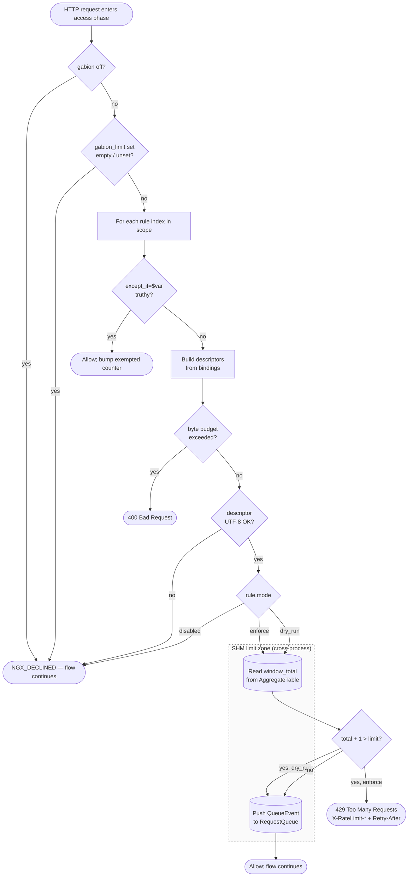
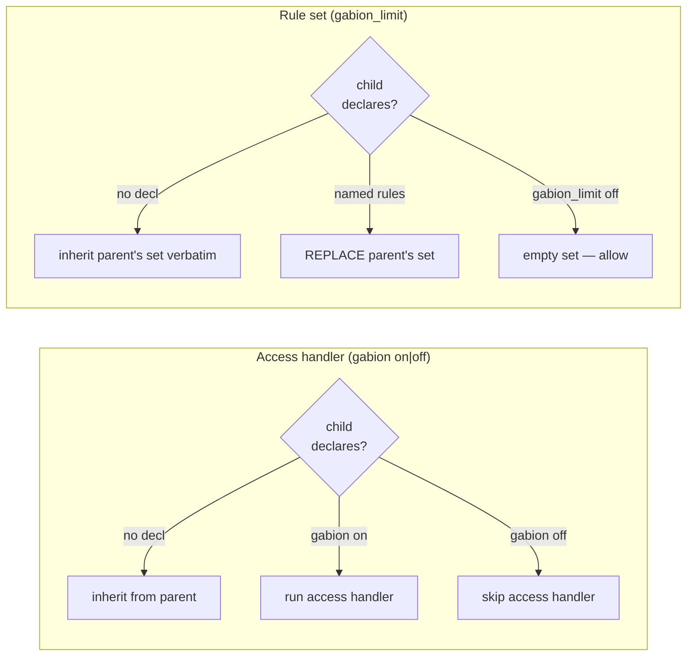

# gabion-nginx — gabion's NGINX module

`gabion-nginx` is gabion's in-process NGINX module: a dynamic `.so` that
loads into every worker, enforces rate limits at the access phase, and
(on the elected leader worker) drives the gossip runtime that keeps
counters in sync across replicas. Admission is decided against a
cluster-wide aggregate without ever leaving the worker process, so
each request costs neither an out-of-process call, a syscall, nor a
heap allocation.

If you're running Envoy sidecars instead of nginx, see
[`../server/README.md`](../server/README.md) for the gRPC adapter
that speaks the same gossip protocol over the same wire codec.

For the project-level overview, glossary, and the cross-adapter
explainer of rate / window / bucket, gossip, discovery, and the
fail-open invariant, see the [top-level README](../../README.md).

## Contents

- [Your first rule](#your-first-rule)
- [Common patterns](#common-patterns)
- [Per-request access flow](#per-request-access-flow)
- [Directive reference](#directive-reference)
- [Composition: rule layering](#composition-rule-layering)
- [Predicates: `except_if=$variable`](#predicates-except_ifvariable)
- [Dry-run mode](#dry-run-mode)
- [Running across a cluster](#running-across-a-cluster)
- [Deploying on Kubernetes](#deploying-on-kubernetes)
- [Configuration errors (`nginx -t`)](#configuration-errors-nginx--t)
- [Troubleshooting](#troubleshooting)
- [Unknown variable detection](#unknown-variable-detection)

## Your first rule

A minimal single-node nginx config that exercises gabion end-to-end:

```nginx
load_module /etc/nginx/modules/ngx_http_gabion_module.so;

worker_processes 2;
events {}

http {
    gabion_limit_zone zone=api:2m;
    gabion_limit_rule per_ip $remote_addr rate=100r/s;

    server {
        listen 8080;
        location / {
            gabion_limit per_ip;
            root html;
        }
    }
}
```

`zone=api:2m` holds 16,384 counters, plenty for one rule on one node; the
smallest SIZE `nginx -t` accepts at the default queue capacity is `1m` (the
sizing notes under [`gabion_limit_zone`](#gabion_limit_zone-zonenamesize-http)
say how to choose one).

gabion runs in nginx's access phase, so it never sees a request that a
`return` directive answers first: `return` runs in the earlier rewrite
phase.

A request under budget gets `200 OK`; hammering the same IP past 100
in one second gets `429 Too Many Requests` together with
`X-RateLimit-Limit`, `X-RateLimit-Remaining: 0`, `X-RateLimit-Reset`,
and `Retry-After`. Those four headers are pinned to the rule with
the longest window, so a client that just tripped a narrow rule is
not immediately re-rejected by a wider one.

Before flipping a new rule to enforcing, it is worth running it in
dry-run first by appending the `dry_run` flag. The rule evaluates
and records hits — metrics and gossip see real traffic — but never
rejects, which lets you watch the allow/reject ratio against
production load before you drop the flag.

To scale beyond one node, bind the gossip socket on an address peers
can reach with `gabion_gossip_bind 0.0.0.0:9000`, set a
`gabion_gossip_cluster` id shared by every peer, and, under Kubernetes,
set `gabion_discovery_namespace_allow`. See
[Running across a cluster](#running-across-a-cluster).

<a id="fail-open-invariant"></a>

> **Fail-open in one paragraph.** Internal limits — matched-rule
> overflow, descriptor decode failures, a missing predicate variable —
> decline the request rather than reject it, so a bug or saturation in
> gabion never returns a spurious 429. The full statement of the
> invariant lives in the [root README](../../README.md#fail-open-invariant).

## Common patterns

Each subsection asks an operator's question first and then names the
recipe. You can stack as many as you need at one location; rules
compose left-to-right, and the first enforcing reject wins.

### How do you exempt internal traffic without measuring it?

```nginx
geo $trusted_ip {
    default 0;
    10.0.0.0/8 1;
    127.0.0.1/32 1;
}
gabion_limit_rule per_ip $remote_addr rate=100r/s except_if=$trusted_ip;

server {
    location /api/ { gabion_limit per_ip; }
}
```

`except_if=$trusted_ip` skips the rule when the variable resolves
truthy. An exempted request neither bumps the counter nor reaches
the aggregate, and it produces no gossip cell. See
[Predicates](#predicates-except_ifvariable) for the truthy/falsy set.

### How do you key off a tenant header instead of an IP?

```nginx
gabion_limit_rule per_tenant tenant:$arg_tenant rate=1000r/m;

server {
    location /api/ { gabion_limit per_tenant; }
}
```

`$arg_tenant` reads the `?tenant=` query argument and `tenant:` is
the descriptor key, so each distinct tenant gets its own counter.
A request without `?tenant=` produces an empty value, at which point
the rule declines without bumping a counter and the request flows
through.

### How do you roll out a new limit safely?

```nginx
# Step 1: ship in dry-run; observe the allow/reject ratio for a release window.
gabion_limit_rule new_route tenant:$arg_tenant path:$uri rate=50r/m dry_run;
gabion_limit new_route;

# Step 2: once the ratio looks right, drop `dry_run`.
gabion_limit_rule new_route tenant:$arg_tenant path:$uri rate=50r/m;
```

A dry-run rule still records hits into the SHM aggregate and
gossips them to peers, so capacity planning is truthful before you
flip the switch — you are sizing against real load rather than a
synthetic projection.

### How do you stack per-IP and per-tenant limits?

```nginx
gabion_limit_rule per_ip     $remote_addr        rate=100r/s;
gabion_limit_rule per_tenant tenant:$arg_tenant  rate=1000r/m;

location /api/ { gabion_limit per_ip per_tenant; }
```

Each rule is an independent gate, and a reject from either rejects
the request. Headers pin to the rule with the longer window so that
a 1s per-IP reject does not tell the client to retry after 1s when
the 1-minute per-tenant budget would also reject them.

### How do you exclude `/healthz` from rate limiting?

```nginx
location /healthz {
    gabion off;
    return 200;
}
```

`gabion off` skips the access handler entirely, so the request pays
zero per-request cost. It is the right choice for liveness probes
and static asset paths where you would rather not pay even a SHM
atomic load.

### How do you scale beyond one node?

```nginx
gabion_gossip_bind 0.0.0.0:9000;
gabion_gossip_cluster 0xc0ffee;
gabion_discovery_namespace_allow my-app-namespace;
```

Every gabion process that shares the cluster identifier and can
reach the others' gossip sockets exchanges counters with them. The
[Running across a cluster](#running-across-a-cluster) section names
the directives by role.

## Per-request access flow



A few things are worth reading off the picture. Both `gabion off`
and an empty `gabion_limit` set decline early without ever touching
SHM, which is why those branches are essentially free. The byte-budget
check is the only cardinality gate evaluated at request time; the
descriptor count and key length are bounded earlier, at config phase.
Finally, a dry-run rule still pushes its event onto the SHM queue, so
counters and gossip continue to see real traffic — only the reject
verdict itself is suppressed. A request is decided once: internal
redirects (`index`, `try_files`, `error_page`, named locations) don't
count it again, though a pass that counted nothing leaves the next
limited location to decide, as with `limit_req`. So an inherited
http-level `gabion_limit` that counts a request keeps a stricter rule in
a location it is redirected to from applying. Subrequests never count,
and gabion reserves the `$gabion_decided` variable name for this mark.

## Directive reference

The full directive surface is below. Every directive starts with
`gabion_` and is registered as an http-block directive unless noted.
Errors at `nginx -t` time use the shape *what happened, why it
likely happened, what to do next*; if you see one that doesn't end
with a concrete next step, please open an issue.

### Core

#### `gabion_limit_zone zone=NAME:SIZE` *(http)*

Allocates the shared-memory limit zone that holds the local-aggregate
counters, the SHM queue, and its `Stats`. Required exactly
once per `http {}` block that declares rules; `nginx -t` refuses rules
without one. Mirrors nginx core's `limit_req_zone zone=name:size`.

Like nginx's own shared-memory zones, a limit zone survives `nginx -s reload` when its
name and size are unchanged: the node identity and any queued hits
carry over, and the log line `gabion: limit zone ready` says `reused=true`.
The counts do not: whenever a worker takes over gossip (after a reload,
a crash, or a lost lease), it empties the count table and peers gossip
the counts back, usually within a gossip tick or two, longer when the
cluster tracks many thousands of keys. Until then this node under-counts
and may admit requests over the limit. A node with no peers has nothing
to rebuild from, so a reload or leader change resets its limits as if
every window had just started. Changing the name or size starts an
empty limit zone, and the master releases the old one once no configuration
uses it. A reload that changes only `gabion_gossip_limit_queue_capacity`
cannot resize a reused limit zone's queue, so nginx refuses it and keeps the
previous configuration (`limit_queue_resized_on_reload`); change SIZE
with it, or restart nginx.

```nginx
gabion_limit_zone zone=api:128m;
```

SIZE sets how many `(rule, key, bucket)` counters the limit zone holds: after
the request queue (`gabion_gossip_limit_queue_capacity` × 72 bytes,
rounded up to a power of two: 576 KiB at the default) and nginx's slab
bookkeeping (under 1%), the rest becomes a power-of-two table of 64-byte slots, so each doubling of
SIZE doubles the slots (`2m` holds 16,384, `64m` holds 524,288; the
`gabion: limit zone ready` log line reports `slots`). A rule needs about
*active keys × (window / bucket + 1)* slots, and lookups stay short
while the table is under half full. For example, 650 keys a second under
`rate=20r/s window=10s bucket=1s` keep about 650 × 11 ≈ 7,200 cells
live, so choose 16,384 slots: `zone=api:2m`. A limit zone too small for the
queue and 1,024 slots fails `nginx -t` naming the smallest SIZE that fits;
`1m` fits the default queue capacity. When the table runs out of room, gabion allows the request,
under-counts that key, increments `aggregate_dropped` and logs
`aggregate_full` ([library troubleshooting](../gabion/TROUBLESHOOTING.md#aggregate_full)).

#### `gabion_limit_rule NAME [$bindings...] rate=Nr/<unit> [...]` *(http)*

Declares a rate-limit rule. Positional arguments after the name are
descriptor bindings; named arguments and bare flags follow.

```nginx
gabion_limit_rule per_ip     $remote_addr                  rate=100r/s;
gabion_limit_rule per_uri    $uri                          rate=10r/s;
gabion_limit_rule per_route  tenant:$arg_tenant path:$uri  rate=5r/s;

gabion_limit_rule by_asn     $geoip2_asn_number   rate=50r/s except_if=$trusted_ip;
gabion_limit_rule by_bot     class:$bot_class     rate=10r/s;
gabion_limit_rule shadow     $uri                 rate=60r/m dry_run;

gabion_limit_rule slow_path  $uri                 rate=5r/30s;
gabion_limit_rule smooth     $uri                 rate=5r/30s bucket=5s;
gabion_limit_rule daily_cap  tenant:$arg_tenant   rate=10000r/d;
gabion_limit_rule sustained  tenant:$arg_tenant   rate=10r/s window=5h bucket=1h;
gabion_limit_rule acme_cap   tenant:$arg_tenant   rate=100r/s value=tenant:acme;
```

**A rule's identity** is its domain, its bindings' keys and values, its
window and its bucket; the limit and the mode stay out, so changing either
keeps the rule's counts. Two rules with one identity would share counters,
so `nginx -t` refuses them; above, `per_uri`, `shadow`, `slow_path` and
`smooth` all key on `$uri` but each has its own window or bucket. A
`gabiond` rule with the same identity shares counts with the NGINX one in a
mixed cluster, whichever order either configuration lists them in.
[Writing the same rule for NGINX and gabiond](../gabion/README.md#writing-the-same-rule-for-nginx-and-gabiond)
gives every field in both spellings.

**Descriptor bindings.** A binding pairs a descriptor key with a
variable expression evaluated at request time:

| Form                              | Effect                                                         |
|-----------------------------------|----------------------------------------------------------------|
| `$identifier`                     | Auto-keyed by the variable name (`$uri` → key `uri`).          |
| `name:$identifier`                | Explicit key; single-variable.                                 |
| `name:"prefix-$foo-$bar"`         | Explicit key; template — compiled to a complex value.          |

Single-variable bindings dispatch through nginx's indexed-variable
subsystem, which is an O(1) array lookup with no allocation per
request. The inline fast path for `$uri`, `$request_uri`, `$args`,
`$remote_addr`, and `$arg_*` skips even the FFI hop. Template
bindings compile via `ngx_http_compile_complex_value` once at config
phase and allocate a few tens of bytes per evaluation against the
request pool, which is fine for operator-meaningful compositions
since they only pay for what they use.

**Named arguments.**

| Argument                | Meaning                                                                                                                                    |
|-------------------------|--------------------------------------------------------------------------------------------------------------------------------------------|
| `rate=Nr/<unit>`        | **Required.** `N` requests per the period named by `<unit>`. `<unit>` is `s\|m\|h\|d` or any humantime duration like `30s`, `5m`, `2h30m`. |
| `window=DURATION`       | Time horizon the rate is enforced over (default: the rate's period). When set, the resolved limit scales to `floor(rate_count * window / period)`. |
| `bucket=DURATION`       | Bucket granularity inside the window, no longer than the window (default: the resolved window — one fixed-window bucket).                  |
| `mode=enforce`          | Default. Evaluate and reject on overflow.                                                                                                  |
| `mode=dry_run`          | Evaluate and record the hit; never reject.                                                                                                 |
| `mode=disabled`         | Skip the rule entirely.                                                                                                                    |
| `dry_run`               | Bare flag; alias for `mode=dry_run`.                                                                                                       |
| `except_if=$variable`   | Skip the rule when `$variable` resolves truthy. See [Predicates](#predicates-except_ifvariable).                                           |
| `domain=NAME`           | Domain for the rule (defaults to `nginx`): 1 to 255 bytes with no whitespace or control characters, as in `gabiond`. Keys hash in it.        |
| `value=KEY:LITERAL`     | The binding keyed `KEY` matches only `LITERAL` (default `*`, any value); any other value declines the rule for that request, counting nothing. `KEY` must name one of the rule's bindings. |

**Rate, window, and bucket.** A rule resolves internally to three
numbers — a `limit`, a `window`, and a `bucket` — controlled by
three directive-level knobs that are evaluated in order:

* `rate=Nr/<unit>` (mandatory) — sustained allowance and its natural
  period.
* `window=DURATION` (optional) — widens the time horizon. The resolved
  limit is `floor(rate_count * window_millis / period_millis)`.
  Omitted, the window equals the rate's period.
* `bucket=DURATION` (optional) — granularity inside the window, no
  longer than the window. Omitted, the bucket equals the resolved
  window, which gives a single fixed-window bucket.

Worked example:

```nginx
gabion_limit_rule per_tenant tenant:$arg_tenant rate=10r/s window=5h bucket=1h;
```

resolves to `limit = 10 * 5 * 3600 = 180000`, `window = 5h`, and
`bucket = 1h`, leaving five live buckets. The same triple can be
written as `rate=180000r/5h bucket=1h` and the resolved enforcement
will be identical, but the original phrasing preserves the "10 r/s
applied over 5 hours" intent in the config text.

> **Rule of thumb.** If you set `window=` larger than the rate's
> period and don't also set `bucket=`, you get a *burstable* budget:
> clients can fire the whole window's allowance instantly and then
> sit empty for the rest of the window. For sustained-rate
> enforcement, set `bucket=` close to the rate's period — for
> example, `rate=10r/s window=5h bucket=1s` keeps the 180k 5-hour
> budget but smooths it to roughly 10 r/s.

A few related subtleties are worth knowing. `X-RateLimit-Limit`
reports the resolved number, so a rule written as
`rate=10r/s window=1h` returns `X-RateLimit-Limit: 36000`; clients
that see the header will read 36000, not 10. `Retry-After` scales
with the resolved window in the same way, which means that under
`window=5h` a rejected client may be told to wait up to five hours,
whereas without an explicit window the worst case is just the
rate's period. The floor in the limit calculation silently
under-budgets non-multiples — `rate=10r/m window=85s` resolves to
`limit=14` because the leftover 0.16 of a period vanishes — so if
you care about every last request, pick `window=` values that are
integer multiples of the rate's period. Finally, a `window=` shorter
than the rate's period is refused at `nginx -t` time, because a
window shorter than the rate's period has nothing to scale the rate
over; to enforce "100 in 500ms", write
`rate=100r/500ms` rather than `rate=200r/s window=500ms`.

#### `gabion_limit NAME [NAME ...]` *(http, server, location)*

Applies one or more rules at the current scope. See
[Composition: rule layering](#composition-rule-layering) for the
inheritance shape.

```nginx
gabion_limit per_ip per_tenant by_asn;
```

`gabion_limit off` locally suppresses all rules at this level
without disabling the module entirely.

#### `gabion on | off` *(http, server, location)*

`gabion off` disables the access handler for this scope so that
the request never incurs a rule lookup or an SHM read, leaving its
per-request cost at zero. `gabion on` re-enables the handler where
a parent had it off.

The two `off` modes are deliberately distinct. Both reach the same
access-phase outcome (allow); the difference is which directive an
operator reads as the intent. `gabion_limit off` says "this location
is in scope for gabion but has no active rules at this level".
`gabion off` says "this location is not in scope for gabion at all".

### Discovery

On Kubernetes the EndpointSlice watch makes membership self-healing:
gabion picks up peer pods as they come and go, and finds the node's own
entry by pod name, which gives the node its zone and keeps it out of its
own peers. Outside Kubernetes, `gabion_gossip_bootstrap_peers` lists the
peers instead, and the watcher never starts; see
[Zones](../gabion/README.md#zones).

| Directive                                     | Description                                                                                  |
|-----------------------------------------------|----------------------------------------------------------------------------------------------|
| `gabion_discovery_namespace_allow NAMESPACE`  | Restrict Kubernetes EndpointSlice discovery to the listed namespace. Repeat for several. Empty = the pod's own namespace. |
| `gabion_discovery_service_allow SERVICE`      | Restrict discovery to the listed Service name. Repeat for several. Empty = all services in the allowed namespaces. |
| `gabion_discovery_self_addr ADDR`             | This pod's IP and gossip port, only for `hostNetwork` pods, whose host name is not their pod name; otherwise the pod-name match finds the node's own entry. The own entry gives the zone and is never a peer. |

Each name must be a Kubernetes DNS label (`[a-z0-9]([-a-z0-9]{0,61}[a-z0-9])?`).

### Gossip — streams and the adaptive emit rate

Each node sends its changed counts straight to every peer of its zone, and
to one gateway in each other zone that relays them into its zone, each as
a stream the peer acknowledges; a gap report or a heartbeat without an ack
brings a resend, a peer silent for `gabion_gossip_suspect_after` is routed
around, and a starting node asks two peers for a join sweep of their live
counts. The defaults are sized for production loads.

- **Adaptive emit rate** — the gossip cadence adapts to per-rule
  pressure. Heartbeats fire every `gabion_gossip_tick_interval`;
  between heartbeats, the runtime fires a synthetic "threshold" tick
  whenever a hot rule's unreplicated local hits would exceed its
  per-site error budget. `gabion_gossip_target_err_bps` sets the
  budget; `gabion_gossip_min_emit_interval` caps the emit rate.

The math behind it lives in
[`crates/gabion/GOSSIP.md`](../gabion/GOSSIP.md#adaptive-emit-rate).
Defaults come from `gabion::defaults` and apply identically to both
adapters; the canonical knob table, with the memory each knob sizes and
which are common and which advanced, lives in
[`crates/gabion/README.md#operator-knobs`](../gabion/README.md#operator-knobs).

**Gossip directives controlling the adaptive emit rate.**

| Directive                                   | Default | Adapts                                                       |
|---------------------------------------------|---------|--------------------------------------------------------------|
| `gabion_gossip_target_err_bps N`            | `100`   | **Adaptive emit rate** — per-rule unreplicated-error budget in basis points of the rule's limit (`100` = 1%). Lower = tighter accuracy, more emissions. |
| `gabion_gossip_min_emit_interval DURATION`  | `5ms`   | **Adaptive emit rate** — floor between threshold-fire emissions, which caps a node's packet rate. Advanced: raise it when a flood of hits sends far more packets than normal and the gossip channel itself is the bottleneck ([Sizing](../gabion/README.md#sizing)). |

**Gossip directives — transport plumbing.** These are not adaptive;
they bound resource use.

| Directive                                       | Default | Effect                                                                                |
|-------------------------------------------------|---------|---------------------------------------------------------------------------------------|
| `gabion_gossip_bind ADDR:PORT`                  | *(none)* | UDP bind for the gossip channel. Required for clustering; without it the node counts alone and runs no peer discovery. |
| `gabion_gossip_cluster ID`                      | `1`     | Cluster identifier: any non-zero u128, in decimal or `0x`-prefixed hex. |
| `gabion_gossip_tick_interval DURATION`          | `500ms` | Heartbeat period, also the retransmission timeout. Shorter = faster convergence, more UDP traffic; below 20 ms, near a cross-zone round trip, it logs `setting_warning`. |
| `gabion_gossip_max_payload_bytes N`             | `1400`  | Cap on UDP payload size per gossip packet: 158 to 65,507. 158 bytes hold the header and one counter; 65,507 is the largest UDP payload over IPv4. Advanced: set one value on every node; a mismatch logs `decode_rejected` with `reason = "peer_limits"`. |
| `gabion_gossip_suspect_after DURATION`          | `max(4 × tick, 2s)` | How long a packet to a peer may go unanswered before the peer is suspect: routed around as a gateway and sent only probes. At least two heartbeats. Advanced: raise it when `gateway_failover` repeats on a lossy network. |
| `gabion_gossip_sweep_concurrency N`             | `4`     | Join sweeps this node answers at once, 1 to 255; each pages its live counts to one newly started peer. Past it a request is declined (`sweep_declined`) and the peer asks another. |
| `gabion_gossip_zone ZONE`                       | *(none)* | This node's availability zone: 1 to 63 letters, digits, `-`, `_` or `.`, starting and ending with a letter or digit. Leave it unset on Kubernetes, where the node reads its zone from its own EndpointSlice entry; set it outside, where nothing else can. An empty or malformed value fails `nginx -t`. |
| `gabion_gossip_zone_grace DURATION`             | `10s`   | How long after the first peer event the node waits for its own EndpointSlice entry before it logs `zone_unknown`, and a join sweep waits for unheard peers before a new zone's first node asks another zone. |
| `gabion_gossip_bootstrap_peers ADDR:PORT`       | *(none)* | A static peer, repeated once per peer; the list may name this node too. A non-empty list replaces Kubernetes discovery, and its peers are never removed. It may hold no more entries than `gabion_gossip_peer_capacity`. Without `gabion_gossip_bind`, `nginx -t` fails. |
| `gabion_gossip_peer_capacity N`                 | `512`   | The most peers this node gossips with, 1 to 32,767, sized once at start, about 330 bytes a peer. Past it, a new peer is declined (`peer_table_full`) and its counts still merged. Also sets the node dictionary's default, twice it. |
| `gabion_gossip_limit_queue_capacity N`          | `8192`  | Slots in the shared-memory request queue workers push counted hits onto for the leader, 64 to 1,048,576, rounded up to a power of two. Each slot is 72 bytes of the `gabion_limit_zone` SIZE, so raise SIZE with it. The default covers a 1.3 s leader handover at up to 6,300 counted hits a second per pod; raise it when the error log shows [`queue_dropped`](#queue_dropped). A reload that changes it needs a new SIZE or a restart. |
| `gabion_gossip_recv_buffer_bytes N`            | `4194304` | Receive buffer the gossip socket asks the kernel for, 65,536 to 1,073,741,823 bytes. The host's `net.core.rmem_max` caps it; `socket_buffer_capped` says when. See [Socket buffers](../gabion/README.md#socket-buffers). |
| `gabion_gossip_send_buffer_bytes N`            | `1048576` | Send buffer the gossip socket asks the kernel for, 65,536 to 1,073,741,823 bytes. The host's `net.core.wmem_max` caps it; `send_blocked` warns when a round fills it. |

### Storage — CRDT capacities

The CRDT cell store and dictionaries allocate exactly once, at leader
startup. These knobs size that allocation, so raising
one also raises the worker's RSS by roughly the named slot count
times the per-slot byte cost. The defaults are sized for production
clusters and you should only need to touch them if your workload runs
into the cap.

| Directive                                       | Default     | Effect                                                                                |
|-------------------------------------------------|-------------|---------------------------------------------------------------------------------------|
| `gabion_storage_max_cells N`                    | `131072`    | Total cell capacity in the CRDT, about 96 bytes a cell in the leader worker. Raise it on [`cell_store_full`](../gabion/TROUBLESHOOTING.md#cell_store_full). |
| `gabion_storage_rule_dictionary_capacity N`     | twice the rules, at least `256` | Number of distinct rule slots (each unique `rule_fingerprint` interns into one slot). Advanced: set it only on [`rule_dictionary_full`](../gabion/TROUBLESHOOTING.md#rule_dictionary_full); below the number of rules fails `nginx -t`. |
| `gabion_storage_node_dictionary_capacity N`     | twice `gabion_gossip_peer_capacity` (`1024`) | Number of distinct (node_id, incarnation) slots; must exceed `gabion_gossip_peer_capacity`. Advanced: set it only on [`node_dictionary_full`](../gabion/TROUBLESHOOTING.md#node_dictionary_full). |
| `gabion_storage_max_descriptor_count N`         | `16`        | Cap on descriptors a single rule may declare, up to 65,535.                           |
| `gabion_storage_max_descriptor_bytes N`         | `512`       | Per-request budget on `(key + value)` bytes summed across descriptors plus the domain. Exceeded ⇒ 400. |
| `gabion_storage_max_key_bytes N`                | `128`       | Cap on a single descriptor key's length (validated at config phase).                  |
| `gabion_storage_max_matched_rules N`            | `16`        | Most rules one request is counted against; past it the request is allowed and the rest under-count (logged as [`matched_rule_overflow`](#matched_rule_overflow)). Each worker reserves 64 bytes per rule once, on its first request. |

### Runtime / identity

| Directive                          | Effect                                                                                                                                              |
|------------------------------------|-----------------------------------------------------------------------------------------------------------------------------------------------------|
| `gabion_node_id_seed STRING`       | Non-empty string this node's stable identity is hashed from. Omitted, the host name is used (the pod name on Kubernetes), else the outbound IP address; set it only when two nodes share a host name. |

## Composition: rule layering

Each `gabion_limit` is an independent gate, so a request is allowed
only if **every** rule allows it and the first enforcing reject
wins. Reject headers pin to the rule with the longest window, which
prevents a client from seeing a short retry that puts it right back
into a 429 against a wider rule. Internal errors such as
matched-rule overflow or descriptor decode failures fall through to
allow, as described under the
[fail-open invariant](../../README.md#fail-open-invariant).

The inheritance shape mirrors nginx core's `limit_req`: **redeclaring
`gabion_limit` at a child level replaces the parent's set entirely**.
There is no append form, so a child that wants the parent's set plus
one more rule has to restate the parent's set explicitly.

A location's effective config is two independent axes — whether the
access handler runs at all (`gabion on|off`) and which rule set it
evaluates (`gabion_limit`). Each axis inherits from the enclosing
level when the child declares nothing, and each is resolved at the
child without consulting the other:



Both axes resolve independently. `gabion off` skips the access handler
regardless of any `gabion_limit` at the same level, and conversely
`gabion_limit off` empties the rule set without stopping the handler,
which is useful when a later directive (for example, a future header
writer) needs the handler to remain in the chain.

The picture in code:

```nginx
server {
    gabion_limit per_ip per_tenant;        # baseline at server level

    location /api/         { /* no decl → inherits per_ip + per_tenant */ }
    location /api/upload   { gabion_limit upload_throttle; }                # replaces baseline
    location /api/internal { gabion_limit per_ip; }                         # narrows baseline
    location /api/billing  { gabion_limit per_ip per_tenant billing_throttle; }  # parent + one more
    location /api/healthz  { gabion_limit off; }                            # local opt-out
    location /static/      { gabion off; }                                  # skip handler
}
```

Replace-rather-than-append is deliberate: if silent inheritance were
combined with override semantics, a remote `gabion_limit` in some
parent block could quietly change behaviour inside an apparently
self-contained sub-location, which is exactly the kind of action at a
distance the directive shape is designed to rule out.

### First-class ASN / UA / IP-range limits and bypasses

Variable lookup, `except_if=`, and multi-rule stacking together let
you treat trusted crawlers specially in a single location:

```nginx
geo $trusted_ip { default 0; 127.0.0.1/32 1; }
map $http_user_agent $bot_class {
    default      other;
    ~*Googlebot  google;
    ~*bingbot    ms;
    ~*facebook   fb;
}

gabion_limit_rule per_ip  ip:$remote_addr     rate=50r/s except_if=$trusted_ip;
gabion_limit_rule per_bot class:$bot_class    rate=10r/s;
gabion_limit_rule per_uri $uri                rate=10r/s;

server { location /api/ { gabion_limit per_ip per_bot per_uri; } }
```

Trusted IPs bypass `per_ip` but are still gated against `per_bot`
and `per_uri`, so a misbehaving Googlebot will trip the 10 r/s
`per_bot` cap, and anything else that hammers a single endpoint will
hit the `per_uri` floor.

**Cardinality safety.** Don't key directly on `$http_user_agent`,
because every unique UA string becomes a distinct counter and the
descriptor space explodes. Map UAs through a small `map` block first
(the `$bot_class` recipe above is the pattern) so that the
cardinality is bounded by the number of classes you care about.
`$geoip2_asn_number` is safe to bind directly because it is already
bucketed to ASN numbers; the human-readable `$geoip2_asn`
organisation name is not, and should be bound through a map before
it reaches a rule.

## Predicates: `except_if=$variable`

`except_if=` names a single nginx variable. When the variable
resolves to a truthy value at request time, the rule is skipped.

**Truthy ≡ non-empty AND not in the case-insensitive falsy set
`{ "0", "false", "off", "no" }`.** Anything else — `1`, `true`,
`yes`, or any arbitrary non-empty string — means "exempt this rule".

```nginx
geo $trusted_ip {
    default 0;
    10.0.0.0/8 1;
}
gabion_limit_rule public_traffic $remote_addr rate=100r/s except_if=$trusted_ip;
```

A few semantics are worth knowing. Only one `except_if=` is permitted
per rule, and a rule that repeats the argument quietly keeps the
last one — to compose multiple bypass conditions, pre-combine them
in a `map` or `geo` block. Predicates never bill the cardinality
budget, because a truthy predicate exempts the request before the
byte-budget check ever runs. A missing predicate variable falls
through, so the rule applies as if the predicate were not there,
which is the same fail-open shape as a missing descriptor variable;
operator-typo protection runs at startup, because `nginx -t` rejects
a predicate that names a variable no loaded module provides.
Finally, exempted requests bump a separate SHM counter, `exempted`, so a
misconfigured always-true predicate is visible against the allow
counter.

### Combining multiple bypass conditions

To exempt on **any** of several conditions (logical OR), fold the
source variables with `map`:

```nginx
map $trusted_ip$is_admin $exempt {
    default   0;
    "~.*1.*"  1;
}
gabion_limit_rule public_traffic $remote_addr rate=100r/s except_if=$exempt;
```

To exempt only when **all** conditions fire (logical AND):

```nginx
map $trusted_ip:$is_admin $exempt {
    default 0;
    "1:1"   1;
}
gabion_limit_rule sensitive_route $uri rate=10r/s except_if=$exempt;
```

The pattern generalises: build whatever boolean expression you need
in `map` or `geo`, then pass the final variable to `except_if=`.
Pushing the composition into nginx core keeps gabion's per-request
work to a single variable lookup.

## Dry-run mode

```nginx
gabion_limit_rule canary $uri rate=10r/s dry_run;
gabion_limit per_ip canary;     # canary stacks with per_ip but never rejects
```

A dry-run rule evaluates the descriptor, reads the aggregate, and
records the hit, but it never produces a reject verdict. Because
counters and gossip continue to see real traffic, capacity planning
remains truthful before you flip the rule to `enforce`.

## Running across a cluster

Once you move past a single nginx box, gabion's whole value is the
shared counters, and the three pieces of cluster plumbing involved
are the same across both adapters — the
[root README](../../README.md#running-across-a-cluster) carries the
narrative. The nginx directives that bind each piece are:

| Piece                  | Directive                                                    |
|------------------------|--------------------------------------------------------------|
| Gossip socket          | `gabion_gossip_bind ADDR:PORT`                               |
| Cluster identifier     | `gabion_gossip_cluster ID` (non-zero u128, decimal or `0x` hex) |
| Discovery filter       | `gabion_discovery_namespace_allow`, `gabion_discovery_service_allow`, `gabion_discovery_self_addr` |
| Static peers (outside Kubernetes) | `gabion_gossip_bootstrap_peers ADDR:PORT`, repeated     |
| Zone (outside Kubernetes)         | `gabion_gossip_zone ZONE`                               |

On Kubernetes, discovery also needs a Service port named `gabion` and a Role;
see the root README's
[Kubernetes checklist](../../README.md#kubernetes-checklist).

A complete cluster-side `http {}` block:

```nginx
http {
    gabion_limit_zone zone=api:2m;
    gabion_limit_rule per_ip $remote_addr rate=100r/s;

    gabion_gossip_bind 0.0.0.0:9000;
    gabion_gossip_cluster 0xc0ffee;

    gabion_discovery_namespace_allow my-app;
    gabion_discovery_service_allow   gabion-nginx;

    server { listen 8080; location / { gabion_limit per_ip; } }
}
```

The defaults need no tuning at production sizes: in the study they
converged with a 99th percentile of 337 ms at 80 pods and 301 ms at 183
([What we measured](../gabion/README.md#what-we-measured)). When you do need
to tune,
[`crates/gabion/README.md#operator-knobs`](../gabion/README.md#operator-knobs)
has the canonical knob discussion and a table of effects, and the
matching nginx directives are listed under
[Gossip — streams and the adaptive emit rate](#gossip--streams-and-the-adaptive-emit-rate).

### Verifying convergence

There are two things worth checking after a deploy. The first is the
process logs: each worker logs the gossip bind, its node identity, and
the discovered-peer count. A line that reads
`gabion: worker did not win leader lease` means you are looking at a
follower, which is expected because only one worker drives gossip per
node; the worker that does logs `gabion: worker won leader lease`.
Followers keep campaigning for the lease. A worker stops leading and
campaigning as soon as nginx starts shutting it down gracefully
(`nginx -s quit`, or the old generation on a reload), even while it
drains connections, so a worker that's staying up takes over gossip
within about 600ms. After a crash, takeover waits for the lease TTL
(1s) to run out. The absence of any peer-discovery logs at all means
the discovery filter doesn't match anything. The second check is the
counter delta under load: send traffic to one replica and watch the
counters on every other replica rise within a tick or two. If they
don't, the gossip channel is partitioned — typical causes are a UDP
firewall or `gabion_gossip_bind` being unreachable between pods.

### Observing gabion

The nginx adapter has no admin HTTP endpoint; the error log is its readout.
Workers count every request in the limit zone (`requests`, `allowed`,
`rejected`, `exempted`, `queue_pushed`, `queue_drained` and the counters
below), and every worker's leader thread reads them every lease tick
(300 ms), whether or not that worker leads gossip, so a node whose leader
cannot start still reports them. It logs each counter that records a bypass
or a rejection when its total passes a power of two (1, 2, 4, 8, …), so a
steady fault writes about one line per doubling instead of one per request.
The limit zone remembers what was logged, so only the first worker to read a
doubling logs it, and after a reload the workers carry on rather than
repeating. The request path never logs.

| Counter | Logged as | What it counts |
|---|---|---|
| `matched_rule_overflows` | [`matched_rule_overflow`](#matched_rule_overflow) | allowed requests that matched more rules than `gabion_storage_max_matched_rules` |
| `queue_dropped` | [`queue_dropped`](#queue_dropped) | counted hits the full request queue dropped |
| `declines_invalid_descriptor` | [`invalid_descriptor_declined`](#invalid_descriptor_declined) | rule checks that read a key value that is not UTF-8 |
| `rejected_cardinality` | [`cardinality_rejected`](#cardinality_rejected) | rule checks whose descriptor ran past `gabion_storage_max_descriptor_bytes` |
| `aggregate_dropped` | [`aggregate_full`](../gabion/TROUBLESHOOTING.md#aggregate_full) | counts the full count table could not hold |

The totals count from the moment the limit zone was created; a reload that
reuses it keeps them. The server adapter exposes its state via `/snapshot`
(see [`../server/README.md`](../server/README.md)).

## Deploying on Kubernetes

[`deploy/kubernetes/gabion-nginx.yaml`](../../deploy/kubernetes/gabion-nginx.yaml)
is a complete starting point: a ConfigMap holding `nginx.conf`, a Deployment
running the published image (which loads the module itself, so the
configuration has no `load_module`; see
[`deploy/nginx/README.md`](../../deploy/nginx/README.md)), and a Service whose
UDP port is named `gabion`, which is how discovery finds the peers. Apply it
with the RBAC discovery needs and the NetworkPolicy that keeps the gossip
port private:

```sh
kubectl apply -f deploy/kubernetes/gabion-discovery-rbac.yaml \
  -f deploy/kubernetes/gabion-nginx.yaml \
  -f deploy/kubernetes/gabion-networkpolicy.yaml
```

Each pod reads its zone from its own EndpointSlice entry, so zones need no
directive there. Outside Kubernetes, nginx cannot read environment variables
in directives (it scrubs the environment), so the container's entrypoint
writes the zone to a file the `http {}` block includes; the gabion README's
[Outside Kubernetes](../gabion/README.md#outside-kubernetes) shows how. The
root README's [Kubernetes checklist](../../README.md#kubernetes-checklist)
says what each object is for, and
[`deploy/kubernetes/README.md`](../../deploy/kubernetes/README.md) what to
edit in the manifests.

## Configuration errors (`nginx -t`)

Every `gabion_*` directive emits an operator-readable error at
`nginx -t` time when something is wrong, naming the file and line, with
the offending value quoted and the fix named. Each message ends with
` code=NAME`, the key of its entry below. Every setting directive
(`gabion_gossip_*`, `gabion_storage_*`, `gabion_discovery_*`,
`gabion_node_id_seed`) is parsed and validated by the gabion library's
settings table, the same one `gabiond` uses, so its errors name the setting
in both adapters' spellings: a zero count or duration, a value that does not
parse, or a value out of range fails `nginx -t` rather than being clamped. A
check across settings or rules runs once the whole `http {}` block is read,
so its error points at the block's end. In every case nginx refuses the
configuration and, on a reload, keeps serving the previous one.

### `decided_variable_unregistered`

**Level** `nginx -t` error · **Request allowed** not applicable, nginx refuses the configuration · **Emitted by** NGINX module, at module start

Message starts: "gabion: could not register `$gabion_decided`"

**What happened.** gabion could not register `$gabion_decided`, the variable it uses to count each request once across internal redirects.

**Why.** Another module defines a variable of that name, or nginx ran out of configuration memory.

**What to do next.** Look for an earlier error naming the variable, and remove the other definition.

**Fields** none · **Knob** none

### `directive_arg_not_utf8`

**Level** `nginx -t` error · **Request allowed** not applicable, nginx refuses the configuration · **Emitted by** NGINX module, at the directive's line

Message starts: "gabion: an argument of `"

**What happened.** An argument of the named directive is not valid UTF-8, so gabion cannot read it.

**Why.** The file was saved in another encoding, or a non-UTF-8 byte was pasted into it.

**What to do next.** Re-save the file as UTF-8, then run `nginx -t`.

**Fields** none · **Knob** none

### `directive_bad_value`

**Level** `nginx -t` error · **Request allowed** not applicable, nginx refuses the configuration · **Emitted by** NGINX module, at the directive's line

Message starts: "gabion: " and the setting's YAML key, for example "gabion: `storage.max_cells` is 0, but it must be at least 1"

**What happened.** A setting directive's argument is not a value the setting accepts: a zero count, capacity or duration (which would disable what it sizes), a value that does not parse (an integer in range, a duration in whole milliseconds such as `500ms`, a socket address, a Kubernetes name, a non-zero cluster id), a capacity outside the range gabion holds, or an invalid zone name.

**Why.** Usually a typo, or a unit the setting does not take (`500` for `500ms`).

**What to do next.** Write the value like the example the message gives, or remove the directive to use the default it names, then run `nginx -t`.

**Fields** none · **Knob** the directive named in the message

### `gabion_arg_count`

**Level** `nginx -t` error · **Request allowed** not applicable, nginx refuses the configuration · **Emitted by** NGINX module, at the directive's line

Message starts: "gabion: `gabion` takes one argument."

**What happened.** `gabion` was given no argument or more than one.

**Why.** A typo, or a rule name meant for `gabion_limit`.

**What to do next.** Write `gabion on;` or `gabion off;`, then run `nginx -t`.

**Fields** none · **Knob** none

### `gabion_bad_value`

**Level** `nginx -t` error · **Request allowed** not applicable, nginx refuses the configuration · **Emitted by** NGINX module, at the directive's line

Message starts: "gabion: `gabion "

**What happened.** `gabion` was given a value other than `on` or `off`.

**Why.** A typo, or a rule name meant for `gabion_limit`.

**What to do next.** Write `gabion on;` or `gabion off;`; to apply rules, use `gabion_limit`.

**Fields** none · **Knob** none

### `limit_main_conf_missing`

**Level** `nginx -t` error · **Request allowed** not applicable, nginx refuses the configuration · **Emitted by** NGINX module, at the directive's line

Message starts: "gabion: `gabion_limit` could not read gabion's http-level configuration"

**What happened.** `gabion_limit` found no gabion configuration for the `http {}` block, which nginx always provides.

**Why.** A gabion bug, or a module load order nginx should not allow.

**What to do next.** Report it with your nginx version and the configuration.

**Fields** none · **Knob** none

### `limit_missing_rule`

**Level** `nginx -t` error · **Request allowed** not applicable, nginx refuses the configuration · **Emitted by** NGINX module, at the directive's line

Message starts: "gabion: `gabion_limit` names no rule."

**What happened.** `gabion_limit` was given no argument.

**Why.** The rule names were left out.

**What to do next.** List rules declared with `gabion_limit_rule`, or write `gabion_limit off;` to turn them off at this level.

**Fields** none · **Knob** none

### `limit_off_mixed`

**Level** `nginx -t` error · **Request allowed** not applicable, nginx refuses the configuration · **Emitted by** NGINX module, at the directive's line

Message starts: "gabion: `gabion_limit off` turns off every rule at this level"

**What happened.** `gabion_limit` mixes `off` with rule names.

**Why.** `off` empties the rule set at this level, so a rule name beside it means nothing.

**What to do next.** Write `gabion_limit off;` alone, or list only rule names.

**Fields** none · **Knob** none

### `limit_rule_invalid`

**Level** `nginx -t` error · **Request allowed** not applicable, nginx refuses the configuration · **Emitted by** NGINX module, at the directive's line

Message starts: "gabion: `gabion_limit_rule` "

**What happened.** A `gabion_limit_rule` line does not parse: it has no rule name, an argument that is none of `$variable`, `name:$variable` or the named arguments (`rate=`, `window=`, `bucket=`, `mode=`, `dry_run`, `except_if=`, `domain=`, `value=`), a malformed value such as `rate=100r/fortnight`, no `rate=`, both `dry_run` and another `mode=`, or a `value=KEY:…` whose key no binding has.

**Why.** A typo, or an argument from another directive's grammar.

**What to do next.** Fix the argument the message quotes, as the message says ([`gabion_limit_rule`](#gabion_limit_rule-name-bindings-ratenrunit--http) gives the grammar), then run `nginx -t`.

**Fields** none · **Knob** none

### `limit_unknown_rule`

**Level** `nginx -t` error · **Request allowed** not applicable, nginx refuses the configuration · **Emitted by** NGINX module, at the directive's line

Message starts: "gabion: `gabion_limit` references rule"

**What happened.** `gabion_limit` names a rule that no `gabion_limit_rule` in this `http {}` block declares.

**Why.** Usually a typo, or a rule declared in a file this block does not include, or declared after the `gabion_limit` that uses it.

**What to do next.** Declare the rule before the `gabion_limit` that names it, or correct the name.

**Fields** none · **Knob** none

### `limit_zone_arg_count`

**Level** `nginx -t` error · **Request allowed** not applicable, nginx refuses the configuration · **Emitted by** NGINX module, at the directive's line

Message starts: "gabion: `gabion_limit_zone` takes one argument"

**What happened.** `gabion_limit_zone` was given no argument or more than one.

**Why.** Usually a space inside `zone=NAME:SIZE`.

**What to do next.** Write it as one argument, `zone=NAME:SIZE` (for example `zone=api:2m`), then run `nginx -t`.

**Fields** none · **Knob** `gabion_limit_zone`

### `limit_zone_bad_name`

**Level** `nginx -t` error · **Request allowed** not applicable, nginx refuses the configuration · **Emitted by** NGINX module, at the directive's line

Message starts: "gabion: `gabion_limit_zone` zone name"

**What happened.** The limit zone's name has a character outside `[A-Za-z0-9_]`, the grammar of nginx core's `limit_req_zone`.

**Why.** Usually a `-` or `.` in the name.

**What to do next.** Rename the zone with letters, digits and `_`, then run `nginx -t`.

**Fields** none · **Knob** `gabion_limit_zone`

### `limit_zone_bad_size`

**Level** `nginx -t` error · **Request allowed** not applicable, nginx refuses the configuration · **Emitted by** NGINX module, at the directive's line

Message starts: "gabion: `gabion_limit_zone` size"

**What happened.** SIZE in `zone=NAME:SIZE` is not a byte count.

**Why.** A unit nginx does not use (`MB`, `MiB`) or a typo.

**What to do next.** Write a number with the suffix `k`, `m` or `g`, for example `2m`, then run `nginx -t`.

**Fields** none · **Knob** `gabion_limit_zone`

### `limit_zone_declared_twice`

**Level** `nginx -t` error · **Request allowed** not applicable, nginx refuses the configuration · **Emitted by** NGINX module, at the directive's line

Message starts: "gabion: `gabion_limit_zone` is declared twice in this http {} block"

**What happened.** A second `gabion_limit_zone` appeared in one `http {}` block, but gabion keeps one limit zone per block.

**Why.** Usually two included files each declare one.

**What to do next.** Remove one, and size the other for every rule ([the sizing notes](#gabion_limit_zone-zonenamesize-http)).

**Fields** none · **Knob** `gabion_limit_zone`

### `limit_zone_missing_prefix`

**Level** `nginx -t` error · **Request allowed** not applicable, nginx refuses the configuration · **Emitted by** NGINX module, at the directive's line

Message starts: "gabion: `gabion_limit_zone` argument must start with `zone=`"

**What happened.** The argument does not start with `zone=`.

**Why.** Usually `gabion_limit_zone api:2m;`, without the prefix `limit_req_zone` also requires.

**What to do next.** Write it as `zone=NAME:SIZE`, then run `nginx -t`.

**Fields** none · **Knob** `gabion_limit_zone`

### `limit_zone_missing_size`

**Level** `nginx -t` error · **Request allowed** not applicable, nginx refuses the configuration · **Emitted by** NGINX module, at the directive's line

Message starts: "gabion: `gabion_limit_zone` value"

**What happened.** The argument names a zone but no `:SIZE`.

**Why.** The size was left out.

**What to do next.** Write it as `zone=NAME:SIZE` (for example `zone=api:2m`), then run `nginx -t`.

**Fields** none · **Knob** `gabion_limit_zone`

### `limit_zone_too_small`

**Level** `nginx -t` error · **Request allowed** not applicable, nginx refuses the configuration · **Emitted by** NGINX module, at the end of the `http {}` block

Message starts: "gabion: `gabion_limit_zone` size"

**What happened.** SIZE cannot hold gabion's request queue (`gabion_gossip_limit_queue_capacity` × 72 bytes, rounded up to a power of two) and 1,024 counter slots.

**Why.** A SIZE chosen before the queue was raised, or a very small SIZE.

**What to do next.** Raise SIZE to at least the size the message names, or lower `gabion_gossip_limit_queue_capacity`; the [sizing notes](#gabion_limit_zone-zonenamesize-http) give the formula.

**Fields** none · **Knob** `gabion_limit_zone`, `gabion_gossip_limit_queue_capacity`

### `rule_compile_failed`

**Level** `nginx -t` error · **Request allowed** not applicable, nginx refuses the configuration · **Emitted by** NGINX module, at the end of the `http {}` block

Message starts: "gabion: " and the rule's problem, for example "gabion: Two rules are named `per_ip`."

**What happened.** The rules parsed but cannot be built, for one of the reasons the message names: two rules share a name; two rules share an identity (domain, descriptors, window and bucket), so their counters could not be told apart; a rate that is zero or whose period is under 1 ms; a window shorter than the rate's period, longer than gabion tracks, or a bucket longer than the window; a domain or descriptor key outside the grammar both adapters share; more bindings than `gabion_storage_max_descriptor_count` or a key longer than `gabion_storage_max_key_bytes`; more rules than `gabion_storage_rule_dictionary_capacity`; or nginx could not compile a binding template.

**Why.** Usually a copy-pasted rule, or a rule written for a different window.

**What to do next.** Fix the rule the message names, or raise the directive it names, then run `nginx -t`. A short window is written in the rate (`rate=100r/500ms`), not with `window=`. [Writing the same rule for NGINX and gabiond](../gabion/README.md#writing-the-same-rule-for-nginx-and-gabiond) explains a rule's identity.

**Fields** none · **Knob** the directive named in the message

### `rules_without_limit_zone`

**Level** `nginx -t` error · **Request allowed** not applicable, nginx refuses the configuration · **Emitted by** NGINX module, at the end of the `http {}` block

Message starts: "gabion: rules are declared but `gabion_limit_zone` is not set"

**What happened.** The `http {}` block declares rules but no limit zone, so there is nowhere to count hits and every request would be admitted uncounted.

**Why.** The `gabion_limit_zone` line was left out, or the file declaring it is not included.

**What to do next.** Add `gabion_limit_zone zone=gabion:2m;` to the `http {}` block (see its sizing notes), or include the file that declares it.

**Fields** none · **Knob** `gabion_limit_zone`

### `setting_invalid`

**Level** `nginx -t` error · **Request allowed** not applicable, nginx refuses the configuration · **Emitted by** NGINX module, at the end of the `http {}` block

Message starts: "gabion: " and the problem, for example "gabion: The gossip packet size is"

**What happened.** The settings parsed one by one, but together they break a rule: the packet size outside 158 to 65,507 bytes, the error budget outside 1 to 10,000, `gabion_gossip_min_emit_interval` at or above `gabion_gossip_tick_interval`, `gabion_gossip_suspect_after` under two heartbeats, a capacity out of range against another, more `gabion_gossip_bootstrap_peers` than `gabion_gossip_peer_capacity`, or static peers with no `gabion_gossip_bind`.

**Why.** Usually one setting changed without the one it depends on.

**What to do next.** Follow the message, which names both directives and the range; then run `nginx -t`.

**Fields** none · **Knob** the directives named in the message

## Troubleshooting

Messages from the gabion library (gossip, discovery, the counter store) are
in [`../gabion/TROUBLESHOOTING.md`](../gabion/TROUBLESHOOTING.md); the entries
below are the module's own.

| Symptom                                                                       | What it means                                                                                                                                       | Fix                                                                                                                              |
|-------------------------------------------------------------------------------|-----------------------------------------------------------------------------------------------------------------------------------------------------|----------------------------------------------------------------------------------------------------------------------------------|
| `nginx -t` fails with a line ending ` code=NAME`                              | A gabion directive is wrong.                                                                                                                         | Follow the entry for that code under [Configuration errors](#configuration-errors-nginx--t).                                    |
| `nginx -t` says `unknown 'foo' variable`                                      | A `gabion_limit_rule` references a variable no loaded module defines.                                                                               | Load the providing module (`geoip2`, `map`, `geo`) before the `gabion_limit_rule` that references it.                            |
| Responses include `X-RateLimit-Remaining: 0` and `429 Too Many Requests`      | A client crossed a rule's limit.                                                                                                                    | Expected. `Retry-After` says how long to back off; the rule with the longest window owns the header.                             |
| `400 Bad Request` from gabion                                                 | Pathological request: client supplied more descriptor bytes than `gabion_storage_max_descriptor_bytes` permits (`512` by default). Logged as [`cardinality_rejected`](#cardinality_rejected). | Either tighten the upstream client or raise `gabion_storage_max_descriptor_bytes` after sanity-checking why it's that large.     |
| A `matched_rule_overflow`, `queue_dropped`, `invalid_descriptor_declined` or `cardinality_rejected` warning | A worker's leader thread saw a bypass or rejection counter pass a power of two ([Observing gabion](#observing-gabion)). | Follow the entry for its code below. |
| `The count table had no free slot for a rate-limit key` (warn, `aggregate_full`) | The limit zone holds too few slots for the live `(rule, key, bucket)` cells. **The request was allowed** and that key under-counted. Logged at powers of two of `aggregate_dropped`; see [`aggregate_full`](../gabion/TROUBLESHOOTING.md#aggregate_full). | Raise SIZE in `gabion_limit_zone` (see its sizing notes); each doubling doubles the slots.                                         |
| `Peer discovery hit an error and skipped an update` (warn) in the error log   | `discovery_error`, a library message: see [`../gabion/TROUBLESHOOTING.md`](../gabion/TROUBLESHOOTING.md#discovery_error).                           | Usually transient. If it keeps repeating, check pod RBAC and network reachability to the API.                                    |

### `cardinality_rejected`

**Level** warn, power of two, logged by a worker's leader thread · **Request allowed** no when no other rule on the location allowed or rejected it (400); if another allowed it, yes, and this rule under-counts · **Emitted by** NGINX module (`gabiond`'s is in its README)

Message starts: "gabion: a request's rate-limit descriptor took more than 512 bytes" (the number is `gabion_storage_max_descriptor_bytes`)

**What happened.** A rule's descriptor (its domain, keys and values) ran past the byte budget, so that rule did not count the request. With no other rule deciding the request, nginx answered 400.

**Why.** Usually a misbehaving client or an attack trying to exhaust gabion's tracking memory; sometimes a legitimately long value, such as a whole URI.

**What to do next.** If the traffic is legitimate, raise `gabion_storage_max_descriptor_bytes`.

**Fields** `limit` (`bytes`), `max`, `rejected_total` (rule checks past the budget since the limit zone was created; a request two such rules check counts twice), `config_key` · **Knob** `gabion_storage_max_descriptor_bytes` (default 512)

### `invalid_descriptor_declined`

**Level** warn, power of two, logged by a worker's leader thread · **Request allowed** by this rule, without counting it · **Emitted by** NGINX module only

Message starts: "gabion: a rate-limit rule read a key value that is not valid UTF-8"

**What happened.** A rule keys on a variable whose value was not valid UTF-8, so that rule let the request through without counting it, and its limit under-counts. Other rules on the request still decide.

**Why.** Usually a client sends binary data in a header a rule keys on.

**What to do next.** Key the rule on a different variable, or normalise the value with `map`.

**Fields** `declined_total` (rule checks since the limit zone was created) · **Knob** none

### `leader_panicked`

**Level** error, once as a worker exits · **Request allowed** yes, other workers keep admitting and one takes over gossip · **Emitted by** NGINX module only

Message starts: "gabion: leader thread panicked"

**What happened.** This worker's leader thread had panicked outside a leadership term, so the worker stopped campaigning for the leader lease before it exited.

**Why.** A gabion bug.

**What to do next.** Report it with the `panic` field and the panic location from earlier error log lines. Other workers still campaign and take over gossip.

**Fields** `panic` · **Knob** none

### `leader_runtime_failed`

**Level** error, once per worker · **Request allowed** yes, against the shared count table · **Emitted by** NGINX module only

Message starts: "gabion: could not start the leader thread's async runtime"

**What happened.** This worker's leader thread could not start its async runtime, so this worker will never drive gossip. Requests are still admitted against the shared count table, and another worker can still lead.

**Why.** Usually the worker hit its file-descriptor or memory limit.

**What to do next.** Check `worker_rlimit_nofile` and `dmesg`, then restart nginx.

**Fields** `worker_id`, `error` · **Knob** none

### `leader_spawn_failed`

**Level** error, once per worker · **Request allowed** yes, against the shared count table · **Emitted by** NGINX module only

Message starts: "gabion: failed to spawn the leader thread"

**What happened.** nginx started this worker, but the operating system refused it a leader thread, so this worker can never drive gossip. Requests are still admitted against the shared count table.

**Why.** Usually the host hit `RLIMIT_NPROC`, ran out of memory, or returned `EAGAIN` under fork pressure.

**What to do next.** Raise the process or thread limit for the nginx user, or check `dmesg` for out-of-memory kills.

**Fields** `worker_id`, `error` · **Knob** none

### `leader_standby`

**Level** info, once per worker, and again after each of that worker's `leader_stopped` lines · **Request allowed** yes · **Emitted by** NGINX module only

Message starts: "gabion: worker did not win leader lease"

**What happened.** Another worker holds the leader lease and drives gossip for this node; this worker admits requests and stands by to take over.

**Why.** Only one worker per node leads gossip, so every other worker logs this.

**What to do next.** Nothing. A `leader_won` line from one worker on each node is what to look for.

**Fields** `worker_id` · **Knob** none

### `leader_stopped`

**Level** error, once per failed leadership term · **Request allowed** yes, against the shared count table; counts are not gossiped meanwhile · **Emitted by** NGINX module only

Message starts: "gabion: this worker stopped leading gossip"

**What happened.** The leader's gossip runtime or queue drain failed or panicked, or it lost the lease. The worker released the lease and campaigns again after `retry_in` (doubling, up to 30 s); another worker may take over first. Until some worker leads, counts are not gossiped to or from peers.

**Why.** Usually the `gabion_gossip_bind` address is already in use, or the worker was starved long enough to miss its lease renewals.

**What to do next.** Read the `error` field, which names the step that failed. A bind error means another process holds `gabion_gossip_bind`; a lost lease means the worker was starved of CPU.

**Fields** `worker_id`, `error`, `retry_in` · **Knob** `gabion_gossip_bind`

### `leader_takeover`

**Level** info, once per takeover · **Request allowed** yes, and may briefly over-admit · **Emitted by** NGINX module only

Message starts: "gabion: this worker took over gossip and emptied the previous leader's counts"

**What happened.** This worker became the gossip leader and emptied the shared count table the previous leader left behind, so peers' gossip can refill it without counting anything twice. Until then, usually a gossip tick or two, this node under-counts and may admit requests over their limits; a node with no peers instead under-counts until each rule's window has passed.

**Why.** The previous leader exited (a reload, `nginx -s quit`, or a crash) and this worker won the lease.

**What to do next.** Nothing, unless it lasts more than a few gossip ticks. If it does, check that this node receives gossip from its peers ("Verifying convergence" above).

**Fields** `cleared` · **Knob** none

### `leader_thread_spawned`

**Level** info, once per worker start · **Request allowed** not applicable · **Emitted by** NGINX module only

Message starts: "gabion: leader thread spawned"

**What happened.** This worker started its leader thread, which campaigns for the leader lease.

**Why.** nginx started a worker: at start, on a reload, or after a crash.

**What to do next.** Nothing. One `leader_won` line per node follows.

**Fields** `worker_id` · **Knob** none

### `leader_thread_stopping`

**Level** info, once per worker stop · **Request allowed** yes, until the worker exits · **Emitted by** NGINX module only

Message starts: "gabion: worker is shutting down; stopping its leader thread"

**What happened.** nginx began shutting this worker down gracefully, so its leader thread stops leading and campaigning while the worker drains its connections. A worker that stays up takes over gossip within about 600 ms.

**Why.** `nginx -s quit`, or the old generation of workers on a reload.

**What to do next.** Nothing.

**Fields** none · **Knob** none

### `leader_won`

**Level** info, once per leadership term · **Request allowed** yes · **Emitted by** NGINX module only

Message starts: "gabion: worker won leader lease"

**What happened.** This worker took the leader lease and now drives gossip for this node: it binds `gabion_gossip_bind`, drains the request queue and writes peers' counts into the shared count table.

**Why.** The node started, or the previous leader exited or lost its lease.

**What to do next.** Nothing. `leader_takeover` follows when this worker replaced a previous leader.

**Fields** `worker_id` · **Knob** none

### `limit_queue_resized_on_reload`

**Level** error, once per refused reload · **Request allowed** yes, the previous configuration keeps serving · **Emitted by** NGINX module only

Message starts: "gabion: this reload changes `gabion_gossip_limit_queue_capacity`"

**What happened.** nginx refused the reload and kept the previous configuration, including its rules. The reload changed the queue capacity, but the `gabion_limit_zone` name and size stayed the same, so nginx reused the running limit zone, whose queue the running workers still use and cannot resize.

**Why.** nginx maps a fresh limit zone only when its name or size changes.

**What to do next.** Change SIZE in `gabion_limit_zone` along with `gabion_gossip_limit_queue_capacity` (a larger queue needs a larger SIZE anyway, 72 bytes a slot), so nginx maps a fresh limit zone, or restart nginx.

**Fields** `running`, `configured` · **Knob** `gabion_gossip_limit_queue_capacity`, `gabion_limit_zone`

### `limit_zone_change_needs_restart`

**Level** error, once per refused reload · **Request allowed** yes, the previous configuration keeps serving · **Emitted by** NGINX module only

Message starts: "gabion: this reload changes `gabion_limit_zone`, but with `master_process off`"

**What happened.** nginx refused the reload and kept the previous configuration: it changes the limit zone, but with `master_process off` the running leader thread still uses the old zone, which nginx would free.

**Why.** `master_process off` runs one process, which a reload cannot replace.

**What to do next.** Restart nginx to change the limit zone.

**Fields** none · **Knob** `gabion_limit_zone`

### `limit_zone_no_room`

**Level** error, once per refused configuration · **Request allowed** yes, the previous configuration keeps serving · **Emitted by** NGINX module only

Message starts: "gabion: the `gabion_limit_zone` zone had no room"

**What happened.** nginx mapped the limit zone, but its slab allocator had no room left for gabion's state, so nginx rejected this configuration.

**Why.** gabion sizes its state to fit SIZE, so nginx's slab bookkeeping used more of the zone than gabion allowed for: a gabion bug.

**What to do next.** Raise SIZE in `gabion_limit_zone zone=NAME:SIZE` to at least `needed_bytes` plus one page, and report your nginx version as a gabion bug.

**Fields** `zone_bytes`, `needed_bytes` · **Knob** `gabion_limit_zone`

### `limit_zone_ready`

**Level** info, once per configuration load · **Request allowed** not applicable · **Emitted by** NGINX module only

Message starts: "gabion: limit zone ready"

**What happened.** nginx mapped the `gabion_limit_zone` shared memory, fresh or reused from the previous configuration, and gabion laid out its count table and request queue in it.

**Why.** nginx loaded a configuration that declares rules: at startup, and on every `nginx -s reload`.

**What to do next.** Nothing. To size the limit zone, compare `slots` with the live cells your rules need (the `gabion_limit_zone` sizing notes above). `reused=true` means a reload kept the queued hits and node identity.

**Fields** `limit_zone`, `bytes`, `slots`, `queue`, `reused` · **Knob** `gabion_limit_zone`

### `matched_rule_overflow`

**Level** warn, power of two, logged by a worker's leader thread · **Request allowed** yes, only the first `cap` rules counted it · **Emitted by** NGINX module (`gabiond`'s is in its README)

Message starts: "gabion: a request matched more than 16 rate-limit rules" (the number is `gabion_storage_max_matched_rules`)

**What happened.** A request matched more allowed rules than this node counts per request. It was allowed; the first `cap` matched rules counted it, and the rest under-count.

**Why.** Usually overlapping rules on one location, for example a broad rule stacked with several narrow ones.

**What to do next.** Remove or narrow rules on that location, or raise `gabion_storage_max_matched_rules`. Each extra rule costs 64 bytes per worker, reserved once on the worker's first request.

**Fields** `cap`, `overflowed_total` (requests since the limit zone was created), `config_key` · **Knob** `gabion_storage_max_matched_rules` (default 16)

### `queue_dropped`

**Level** warn, power of two, logged by a worker's leader thread · **Request allowed** yes, its hits not counted · **Emitted by** NGINX module only

Message starts: "gabion: the shared-memory request queue was full"

**What happened.** Workers push every counted hit onto the limit zone's request queue for the gossip leader. The queue was full, so hits were dropped: their requests were allowed, and the limits under-count them.

**Why.** Either no worker drained the queue (look for a recent `gabion: this worker stopped leading gossip` error) or this node admitted more counted hits than the queue holds across a leader handover (about 1.3 s).

**What to do next.** Raise `gabion_gossip_limit_queue_capacity`. Each slot takes 72 bytes of SIZE in `gabion_limit_zone`, so raise SIZE by the same amount to keep the count table's size.

**Fields** `dropped_total` (hits since the limit zone was created), `capacity`, `config_key` · **Knob** `gabion_gossip_limit_queue_capacity` (default 8192)

Operator-facing errors are written to answer three questions: *what
happened*, *why it likely happened*, and *what to do next*. If you
see one that doesn't end with a concrete next step, please open an
issue.

## Unknown variable detection

A typo in a `gabion_limit_rule` binding source — `except_if=$tursted_ip`
when you meant `$trusted_ip` — fails `nginx -t` *before* any worker
accepts a single request. The detection happens inside nginx core:
when gabion encounters `$identifier` at config phase, it calls
`ngx_http_get_variable_index`, which declares the dependency. After
every module's `postconfiguration` callback, nginx walks the
declared dependencies and rejects the config if any variable has no
provider.

Gabion deliberately does not layer a second validator on top, because
the core check is already exhaustive and the resulting error message
(`unknown 'tursted_ip' variable`) is operator-clear on its own. Make
sure the module that provides the variable — `ngx_http_geoip2_module`,
or the `map` directive that defines `$bot_class`, or the `geo`
directive that defines `$trusted_ip` — is loaded before the
`gabion_limit_rule` that references it.
