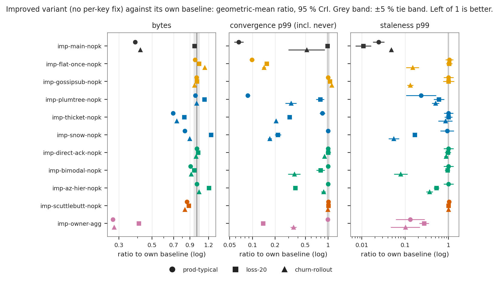
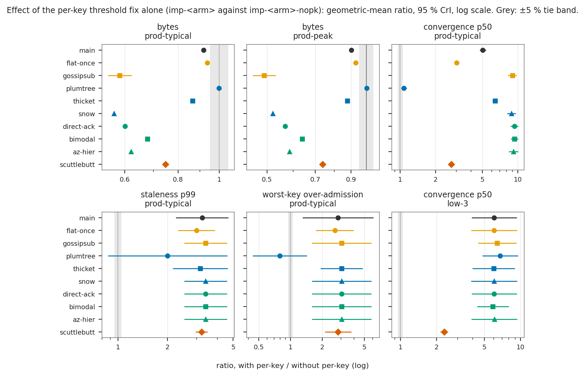
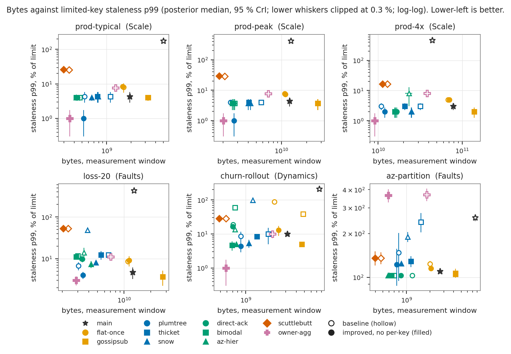
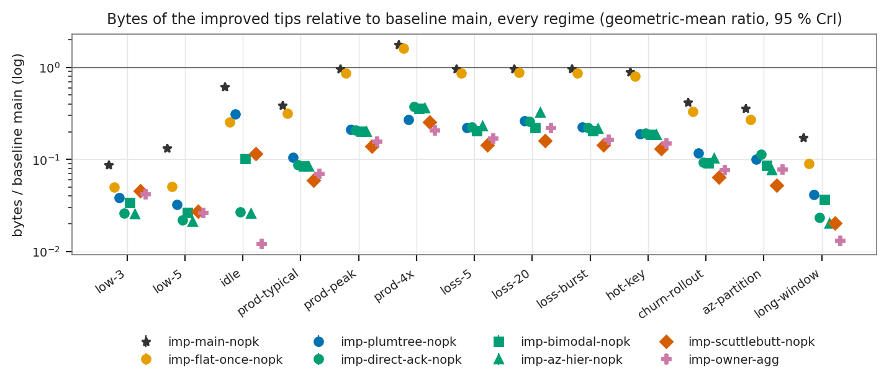

# Disseminating windowed counter deltas in a gossiped rate limiter: a controlled simulation study of eleven designs

*Study report, `sim/study` branch. Companion to the related-work survey in [`research.md`](research.md).*

## Abstract

A gossiped rate limiter keeps a per-key, windowed, cluster-wide request count
as a state-based CRDT and must spread each node's increments to every other
node quickly enough that admission decisions stay accurate, at a byte cost
that does not dominate the deployment. We compare eleven dissemination
designs on one deterministic, event-driven, virtual-time simulator: the
shipped baseline (`main`), ten designs taken from the literature (flat
forward-once, GossipSub, Plumtree, Thicket, Snow, direct mail with
acknowledgements, Bimodal Multicast, an availability-zone hierarchy,
Scuttlebutt and key-owner aggregation), and a no-dissemination reference.
Every design runs on the same simulator, workload, network model and judge,
over 13 regimes (3 to 300 pods, loss, churn, a zone partition, a 1 h
window) and 3 seeds: 468 baseline runs and 819 runs of 21 improved variants,
1,287 runs in all, every one valid. Statistics are Bayesian: posterior
medians with 95 % equal-tailed credible intervals (CrI) and the posterior
probability P that a solution is better than its comparator. Automated LLM
agents implemented, audited and repaired the designs under human
direction (§4.5).

In simulation, baseline `main` saturates at every production-shaped size
(§9 lists what the simulator does not model; R1 asks for a canary): at the
typical production size (80 pods) its limited-key staleness p99 is
177 % [160, 194] of the limit and its median convergence 4,775 ms
[4,730, 4,821]. Every literature design is credibly better than `main` on
at least 48 of 78 error cells. After each design was repaired, the
direct-mail, GossipSub and Snow tips reach the same limited-key staleness
p99 at the metric's one-hit resolution (4 % [3.25, 4.75] at 80 pods), the
direct-mail tips for 0.084 to 0.088 of `main`'s bytes; improved Plumtree
is lower (1 % [0.255, 1.75]), and a Stage 4 commit-level ablation (3 seeds,
outside the final judge) traces that lead to one scheduling change: its
relay rounds also carry the node's own changes (§8.1). Judged paired
against the zone-hierarchical tip (`imp-az-hier-nopk`), improved Plumtree
is credibly better on 42 of 78 error cells and worse on 7, and on total
bytes against the three error axes the zone hierarchy is on the improved
tips' front in 5 to 7 of the 12 or 13 regimes with owner aggregation
excluded and in 3 with it included (§8.2). On cross-zone bytes it is on
every front: 1.26e7 [1.26e7, 1.26e7] at 80 pods against 2.97e8 [2.96e8,
2.98e8] for direct mail, the lowest of any improved tip in all 13 regimes.
It also reaches exact counts after the zone partition on 3 of 3 seeds in
600 ms [352, 848], and is not credibly worse than its own baseline on any
error or health cell. Owner aggregation reaches 1 % [0.255, 1.75]
staleness at 0.0703 [0.0702, 0.0704] of `main`'s bytes but over-admits
during a partition (staleness p99 365 % [326, 404]). At `prod-typical`, a
shared per-key threshold fix, as implemented, lowers bytes by a ratio of
0.566 to 0.937 in 9 of 10 designs while raising staleness p99 by 3.0 to
3.4 times, and the staleness cost grows with cluster size (5 to 8.5 times
at 300 pods). We recommend the zone-hierarchical direct-mail design without
the per-key fix as the replacement for `main` where cross-zone traffic is
billed and zone partitions must heal, after a multi-rule check: that tip
keeps a per-rule threshold trigger whose firing rate, and so the design's
accuracy and bytes, depends on the workload. On total bytes and
steady-state accuracy alone the data do not single it out: improved
Plumtree is better on most error cells (42 of 78) and cheaper at 300 pods and
under 5 % and 20 % loss, but never heals the partition, and the ablation
ties its lead at 80 pods to a scheduler rule the study disallowed in
`imp-main`. The data suggest,
with that one ablation and no judged one across designs, that the round
scheduler rather than the dissemination topology sets limited-key
staleness. Baseline Plumtree and Thicket are 1.6 to 5.4 times slower than
direct mail on median convergence; both hold each relay hop for up to a
5 ms relay floor while GossipSub and Snow forward on receipt, so that gap
is consistent with per-hop relay pacing, possibly compounded by tree depth,
which sets how many hops pay the floor; the study does not separate the
two.

## 1. Introduction

Gabion admits each request against its own estimate of a cluster-wide,
windowed count. The count is a grow-only CRDT whose cells
`(origin, rule, key, bucket)` are written only by their origin
([`research.md`](research.md) §1). Every node must learn every other node's
increments within a fraction of the window, over UDP, while the cluster
grows from 3 to 300 pods, loses packets, rolls over its membership roughly a
thousand times a day, and occasionally loses a zone. The objective is the
best rate-limit accuracy per byte on the wire.

The gossip literature offers many dissemination designs (§2), but their
published evaluations use different workloads, network models, metrics and
implementations, and most do not target tiny, superseding, single-writer
counter updates ([`research.md`](research.md) §1). The closest prior study
we found is a master's thesis on a CRDT-counter rate limiter that trades
precision for performance [30]; we have not verified its numbers and cite
it only as related work. The closest production analogue is Akka
Distributed Data [25], whose default gossip cadence is an order of
magnitude slower than our staleness target ([`research.md`](research.md)
§2.1). No production rate limiter we found
publishes the byte cost of peer counter synchronisation
([`research.md`](research.md) §2.6). The measurements here are therefore
the primary evidence.

**Contributions.**

1. A controlled comparison of eleven dissemination designs plus a
   no-dissemination reference on a single deterministic simulator, with a
   frozen harness that every design must leave byte-identical (§4.4), 13
   production-shaped regimes, and a network and byte-accounting model
   validated against closed forms, with an independent byte tally and an
   independent epidemic simulation (§4.5).
2. A baseline result (§5): in simulation, the shipped design saturates at
   every production-shaped size (§9; R1's canary caveat), and the
   fast-delivery designs have the same limited-key staleness p99 at the
   metric's one-hit resolution, so they differ on bytes, fault behaviour
   and, for the two designs that pace their relay hops (Plumtree, Thicket),
   median convergence.
3. An improvement phase (§6) that repairs each design and judges it against
   its own baseline, and classifies, by audit judgement, what was repaired
   as implementation defects or as changes of specified behaviour, and what
   was left as design-inherent limits, plus a paired ablation of one shared
   fix, the per-key threshold (§7).
4. Recommendations with the evidence for each, and a list of what the data
   do not settle (§8, §9).

## 2. Background and related work

The survey in [`research.md`](research.md) covers the related work in
detail; we summarise only what the study builds on.

- **Delta-state CRDTs and their synchronisation** [1], [2]: ship
  join-irreducible deltas instead of full state; avoid back-propagation and
  redundant reception. Two of the study's components, `bp-skip` and
  `rr-filter`, come from [2].
- **Epidemic dissemination** [13], [14]: push, pull and push-pull
  anti-entropy; infect-and-forward-once with mean fanout `ln N + c` reaches
  everyone with probability `exp(-exp(-c))`. Both `main` and `flat-once`
  rest on this threshold.
- **Digest reconciliation** [9], [10], [31]: Scuttlebutt's per-origin
  version digests and Bimodal Multicast's best-effort push plus digest
  repair.
- **Structured broadcast** [3]-[8]: Plumtree's eager/lazy trees, Thicket's
  multiple trees, GossipSub's bounded mesh, and Snow's membership-derived
  `k`-ary trees.
- **Hierarchy** [11], [29]: Astrolabe zones and AZ-aligned gossip pools.
- **Rate limiting in practice** [19]-[24], [32]: central stores, quota
  leases, and owner aggregation (Gubernator's `GLOBAL` mode [20]); the
  accuracy of a synced limiter depends on the sync interval relative to the
  window and on `N` [24].

Three properties of the problem separate it from most gossip settings
([`research.md`](research.md) §1): cells are single-writer, so per-origin
digests are exact; a later value of a cell supersedes earlier ones, so
convergence of current state, not lossless delivery, is the goal; and
updates are tiny, frequent and mostly unique, so per-packet and per-peer
overheads dominate bytes at large `N`.

## 3. System model and designs

### 3.1 System model

A cluster of `N` pods (3 to 300) runs in one region across three
availability zones. Each pod admits a request iff its view of the key's
window total plus the request does not exceed the limit, then records the
hit in its local `CellStore`. The window total is the sum over origins of
the max-merged cells in the live buckets (10 s windows of 1 s buckets in
most regimes; a 1 h window of 1 min buckets in `long-window`). Membership
comes only from service discovery, with lag. Transport is UDP; nothing is
retransmitted unless a protocol does it.

Every design shares the CRDT join, the cell codec, and the round scheduler
from `main`, which decides **when** a node's own changes leave it: a 500 ms
heartbeat plus a synthetic round when a rule's unreplicated local hits
exceed its error budget, with a 5 ms floor ([`research.md`](research.md)
§3). A design decides **to whom** data goes, what is relayed, and how loss
and churn are repaired. Owner aggregation is the exception by specification:
it batches on its own 100 ms `sync_wait` and `broadcast_interval`
([`research.md`](research.md) §3.4).

### 3.2 Designs

Table 1 lists the designs. Families follow `data/arms.json`. Full
mechanisms, parameters and design-specific invariants are in
[`research.md`](research.md) §3.4, which also states the faithfulness
invariants I-1 to I-6 common to every design.

**Table 1.** Designs, what each sends, and its baseline commit
(`sim-baseline/<arm>` tag). Source: `data/arms.json`; `research.md` §3.

| design | family | what a node sends, to whom | repair | sources | baseline commit |
|---|---|---|---|---|---|
| `main` | Baseline | each round, its dirty cells and a repair slice to `⌈ln n + 3⌉` random peers, pruned by a per-peer frontier; merged cells re-gossiped until the frontier shows them acked | repair lane over the store | [13], [14], [33] | `fdf7390` |
| `flat-once` | Flat epidemic | changes since the last round, newest first, to `⌈ln n + 3⌉` distinct random peers; each receiver forwards a change once | 256-cell rotating slice per heartbeat | [14], [13] | `2db7585` |
| `gossipsub` | Flat epidemic | full messages to a degree-`D` mesh (`D = 6`); `IHAVE` ids to non-mesh peers each 1 s heartbeat | `IWANT` within a 5-heartbeat message cache | [6], [7] | `5348a1c` |
| `plumtree` | Trees | eager push along a per-origin spanning tree over a `⌈ln n + 3⌉` active view; batched lazy `IHAVE` to the rest | `GRAFT`/`PRUNE`, per-edge NACK | [3], [4] | `54430c1` |
| `thicket` | Trees | as Plumtree, over `T = 3` trees in which each node is interior in at most one | as Plumtree | [5] | `1e67bac` |
| `snow` | Trees | balanced `k = 4`-ary tree per root computed from the sorted membership ring; the packet carries the child's range | leaf-to-root ack aggregation, one root rebroadcast | [8] | `441d1af` |
| `direct-ack` | Direct mail | an origin's own changes to every peer; nothing forwarded | per-peer cumulative acks, retransmission timeout | [1], [2] | `8330de4` |
| `bimodal` | Direct mail | an origin's own changes to every peer, no acks | one digest exchange with a random peer per 1 s repair period | [10] | `7cef84e` |
| `az-hier` | Direct mail | an origin's changes to every peer in its zone and to one rendezvous gateway per other zone, which re-sends into its zone | per-hop cumulative acks; gateway failover on missing acks | [11], [29] | `21904a2` |
| `scuttlebutt` | Reconciliation | a per-origin version digest to one random peer per round; data only in reply to a digest | inherent (push-pull) | [9], [31] | `b1ab997` |
| `owner-agg` | Aggregation | non-owners send batched hits to the key's rendezvous owner every 100 ms; the owner broadcasts changed totals to every peer every 100 ms | owner acks, contributor re-send | [20] | `6b2001c` |
| `local-only` | Reference | nothing | none | — | `1fd656b` |

`local-only` bounds the space: zero bytes, and every pod counts only its own
hits. It is reported for scale, not as a candidate.

## 4. Methods

### 4.1 Simulator

The study harness is `crates/gossip-bench` on branch `sim/harness`. Its
README documents the model; we summarise it.

- **Time.** Virtual time is a nanosecond counter advanced only by the event
  loop; there is no fixed step. Each node's ticker mirrors
  `tokio::time::interval` with delayed missed ticks. A node is a task on a
  single-threaded executor; no virtual time passes while it runs.
- **Determinism.** A run is a pure function of (regime, seed, binary); the
  same triple yields byte-identical JSON (tested). Randomness comes from
  separate SplitMix64 streams per concern, so a solution that sends more
  datagrams consumes more of the network stream and nothing else: offered
  load and membership timeline are identical across solutions (tested).
- **Network.** Pods are assigned round-robin to three zones. One-way latency
  is 200 µs + U(0, 100 µs) within a zone and 800 µs + U(0, 400 µs) across
  zones; datagrams may reorder. A datagram's fate is decided at send time:
  partition, unknown destination, i.i.d. loss, Gilbert-Elliott burst loss.
  On arrival it is dropped if the receive buffer (212,992 B) would overflow.
- **Receive path.** Reading a datagram costs 1.5 µs + 3 ns/B of virtual
  time, calibrated to `main`'s measured whole-process CPU per delivered
  datagram; everything else a node does is free.
- **Byte accounting.** Every datagram is counted once at send time as UDP
  payload + 28 B. A payload above 1,472 B invalidates the run.
- **Workload and admission.** One enforced rule per regime; site keys
  request every ~3.2 s with jitter, hot keys are Poisson at a multiple of
  the sustainable rate. Every request lands on a uniformly random running
  pod. Admission follows the gRPC adapter's `SharedLimiter::evaluate`.
- **Membership and churn.** Planned before any node runs: discovery lag
  U(0, 2 s), rollout waves with dephased joiners, a silent crash removed
  from discovery after 10 s + U(0, 2 s), optional zone partitions.

### 4.2 Regimes

**Table 2.** Regimes. Source: `data/regimes.json`; harness README, *Regimes*.

| regime | group | pods | load | rule | duration (warm-up + measured) | stress |
|---|---|---|---|---|---|---|
| `low-3`, `low-5` | Scale | 3 / 5 | ~19 req/s incl. two hot keys | 20 / 10 s | 20 + 60 s | small clusters |
| `idle` | Scale | 80 | ~1 req/s | 100 / 10 s | 20 + 60 s | floor cost |
| `prod-typical` | Scale | 80 | ~650 req/s, ~2,100 sites, two hot keys, a 90 req/s burst | 100 / 10 s | 20 + 60 s | reference size |
| `prod-peak` | Scale | 183 | ~1,800 req/s | 100 / 10 s | 20 + 60 s | reference peak |
| `prod-4x` | Scale | 300 | ~7,200 req/s, 23,040 sites | 100 / 10 s | 20 + 60 s | autoscaler ceiling at 4x load |
| `loss-5`, `loss-20` | Faults | 183 | as `prod-peak` | 100 / 10 s | 20 + 60 s | 5 % / 20 % i.i.d. loss |
| `loss-burst` | Faults | 183 | as `prod-peak` | 100 / 10 s | 20 + 60 s | Gilbert-Elliott, 5 % mean, bursts of ~5 |
| `hot-key` | Dynamics | 183 | `prod-peak` sites + 20 keys at 5x limit | 100 / 10 s | 20 + 60 s | binding limits |
| `churn-rollout` | Dynamics | 80 (~92 mid-wave) | as `prod-typical` | 100 / 10 s | 20 + 90 s | 45-pod rollout, one silent crash |
| `az-partition` | Faults | 80 | as `prod-typical` | 100 / 10 s | 20 + 90 s | zone 0 cut off for 30 s, then healed |
| `long-window` | Dynamics | 60 | ~30 req/s, ~96 sites | 2,000 / 1 h, 1 min buckets | 3,600 + 1,200 s | long windows, large state |

`long-window` runs a tenth of the load first proposed; at 300 req/s a 1 h
window would hold ~1.1 M live cells per pod (harness README, *Deviations*).

### 4.3 Metrics

**Table 3.** Metrics judged in this report. Source: `data/metrics.json`;
harness README, *Metrics*. The ten "error" metrics are used for verdict
counts; bytes and cross-zone bytes are the cost; drops and send-queue depth
are health.

| metric | unit | definition | role |
|---|---|---|---|
| `bytes_total` | bytes | all bytes on the wire in the measurement window, payload + 28 B per datagram | cost |
| `cross_az_bytes` | bytes | bytes that crossed a zone boundary | cost |
| `conv_p50_incl_never_ms`, `conv_p99_incl_never_ms` | ms | time until every running pod counts a hit; a hit that never converges counts its remaining life (a lower bound) | error |
| `conv_never_frac` | fraction | hits some pod never counted before the bucket expired | error |
| `stale_limited_p99_pct` | % of limit | p99 over time and (pod, limited key) of truth minus the pod's view | error |
| `over_max_pct`, `over_mean_pct` | % of limit | admissions beyond the limit, worst limited key / mean over limited keys | error |
| `churn_parity_max_ms` | ms | longest time a joiner took to match established pods' error (`churn-rollout`) | error |
| `part_deficit_at_heal` | hits | hits missing per (pod, key) when the partition heals | error |
| `part_time_to_heal_ms` | ms | time after the heal until every closed bucket's count is exact; seeds that healed only, probed every 100 ms | error |
| `part_unrepaired_at_expiry` | hits | hits per (pod, key) that expired before repair | error |
| `drop_rcvbuf_pkts` | datagrams | dropped because a receive buffer was full | health |
| `send_pending_max` | slots | deepest send queue on any pod | health |

Staleness and over-admission are measured on *limited* keys (hot and burst
keys), where admission decisions bind; at limit 100 one hit is 1 % of the
limit. Not every metric applies in every regime (for example, joiner parity
only in `churn-rollout`); across 13 regimes there are 78 (regime, error
metric) cells with a posterior per solution, plus the partition's time to
heal for a solution that healed on at least one seed (79), and 26 health
cells. A paired comparison includes the time-to-heal cell only when both
sides healed, so verdict counts are out of 78 or, for such pairs, 79.

Two caveats on reading these metrics. First, *time to heal* is stricter
than partition repair: it requires every hit in every bucket closed before
the heal to be exact at every pod, with no tolerance, so it also counts
same-side hits and ordinary propagation lag. The harness audit warned that
a design whose steady-state convergence tail approaches the window may
never "heal" whatever its repair quality (Stage 3). In this report "healed"
means "reached exact counts", and "never healed" means "did not reach exact
counts before the buckets expired". Second, convergence values near the
10 s window are right-censored: a never-converged hit counts only its
remaining life, so such a value is a lower bound, its tight interval
describes the bound rather than the true tail, and a ratio against it
understates the improvement. Tables mark these cells with †.

### 4.4 Identical-harness enforcement

Every solution is a branch based on `sim/harness` that leaves
`crates/gossip-bench/` byte-identical, so the simulator, workload and judge
are the same code for every contender; `main` is the harness branch itself.
`matrix.py` stamps each result with the harness tree hash
(`git rev-parse HEAD:crates/gossip-bench`), the solution's branch and commit,
and whether either worktree was dirty. The judge refuses mixed harness
hashes unless the trees differ only in `judge/judge.py`, `judge/test_*.py`
or `README.md`, refuses several commits under one solution label, and
rejects dirty results. The 1,287 runs carry two harness tree hashes,
`8fb4e2d` (baseline runs) and `011e8be` (improved runs), which the judge
verified differ only in those exempt files; it rejected no result
(`data/judge/rejected.md`: "None").

A solution may use only the harness's documented contract (gossip
configuration, `CellStore`, `GossipRuntime`, transport, clock, aggregate
sinks, admin snapshot), must take all timing from the simulated clock, and
must stay deterministic. Six faithfulness invariants apply to every design
([`research.md`](research.md) §3.4): state learned only from delivered
packets (I-1); membership only from discovery (I-2); shared codec and join,
with every control field on the wire and counted (I-3); bounded,
pre-sized protocol state (I-4); no special-casing of regime or node (I-5);
seeded randomness and stable iteration order (I-6).

### 4.5 Study procedure, audits and harness validation

**Who did the work.** Automated large-language-model (LLM) agents
implemented, audited and repaired every design and the harness, and
drafted, checked and revised this report, under the direction of one
human. The human chose the question and the candidate designs, set the
rules (the frozen harness, the faithfulness invariants of §4.4, Bayesian
reporting), started each stage and read its summaries; the human did not
review individual audit findings before the workflow acted on them. Stages 2 to 4, and the
harness in Stage 1, ran as scripted workflows of agents with three roles;
the survey in Stage 1 and the analysis in Stage 5 did not.

- An *implementer* built or repaired one design on its own branch and
  returned a structured report: commits, design notes, tests run, and smoke
  or before-and-after results.
- An *auditor*, started fresh with the rules, the design's specification
  and the implementer's report but none of the implementer's working
  context, was instructed to be adversarial. It checked every faithfulness
  invariant with file-and-line evidence, the harness tree hash, the absence
  of hacks (state shared between nodes, oracle knowledge, special-casing of
  regimes, sizes or seeds), and correctness bugs that would distort
  results, and graded each finding *blocker*, *major* or *minor*.
- A *fixer* repaired the findings of a failed audit; a fresh auditor then
  re-checked the branch.

An audit passed when the auditor returned a pass verdict with no open
blocker or major; minors never blocked, and fixers repaired them only
where cheap. A stage allowed at most two audits per design in Stage 2 and
three in Stages 3 and 4. Thicket ended Stage 2 with a failed audit (one
open major) and passed after its Stage 3 repair (item 3 below); every other
design, the per-key fix and the harness passed within the limit, and in
the end no blocker or major was left open (the records below list the
open minors). Auditors re-ran tests and a small part of the evidence
themselves: one smoke regime on one seed in Stage 2, their own probes of
the harness and of Thicket's trees in Stage 3, and one claimed improvement
on a regime of at most 80 pods in Stage 4. They did not re-run the full
matrix; the 1,287 judged runs were made afterwards, by the study's run
scripts, from the audited commits. Independence was limited: implementers
and auditors were instances of the same model family (Anthropic's Claude;
a smaller model implemented in Stage 2 and fixed in Stages 2 to 4, a
larger one audited in every stage, implemented the harness and judge in Stage 1
and improvements in Stage 4, and fixed in Stage 1), each auditor read the implementer's report, and an error that implementer and auditor
share would not be caught. The sanitised implementation and audit records
of Stages 2 to 4, with local paths replaced, are in `data/audit/` (see
*Reproducibility*); the code changes they describe are the commits on the
named public branches, whose messages also give each change's reason.

The study ran in five stages.

1. **Survey and candidate set** ([`research.md`](research.md)), fixing the
   designs, parameters, invariants and bolt-on components. The only
   implementation here was the harness and the judge; no design was built.
2. **Implementation and audit.** Each design was implemented on its own
   branch (`sim/sol-<arm>`) and audited against I-1 to I-6 and its
   design-specific invariants. The ten literature designs and the
   `local-only` reference were audited (`main`, the harness branch, was
   not audited at this stage), and ten of these eleven passed. Thicket
   failed on one major finding: parents were chosen among peers known *so far*, and
   discovery delivers peers in a fixed order, so every tree became a star.
   The fix (reservoir-sampled parents and views) is in the baseline tag.
3. **Harness validation and repair.** The harness carries a validation suite
   (below). Its audit found one major defect, a bucket expiring at the heal
   instant charged as unrepaired; it was fixed before any baseline run
   (`fdf7390`, *do not charge the bucket that expires at the heal as
   unrepaired*). Thicket's repair (item 2) was also re-audited here and
   passed.
4. **Improvement.** Each design was diagnosed from the baseline data,
   repaired on `sim/imp-<arm>`, and audited again; every Stage 4 audit
   ended with a pass and no open blocker or major. One defect was shared by every arm
   that inherited `main`'s scheduler (§7); its fix (`00c159e`) was
   cherry-picked as the **last** commit of each `sim/imp-<arm>` branch, and
   the tip without it is published as `sim/imp-<arm>-nopk`. Owner
   aggregation never used that trigger and has no `-nopk` variant;
   `imp-main` is `main` with its defects repaired (§6.3).
5. **Analysis** of the final 1,287 runs by the judge (§4.6), and this
   report, which analyst agents drafted and two verifier agents checked,
   one checked the numbers against the data and one checked claims the evidence
   does not support.

**Validation suite** (harness README at `896ea20`, *Validation*; seeds
fixed). Each measured proportion is reported as its Jeffreys posterior
(Beta(`k` + 1/2, `n` − `k` + 1/2)) and each measured mean as a Student t
posterior: median [95 % CrI], and whether the closed-form value lies inside.
Each test also applies a fixed pass/fail band around the closed form; that
band is a test rule, not evidence, and is not repeated here.

- *Epidemic reach.* Infect-and-forward-once at fanout `ln n + c`, 5,000 runs
  per cell, against the finite-`n` Poisson value and the KMG limit [14]:
  for example `n = 300, c = 1` reached every node with posterior
  0.7086 [0.6959, 0.7211]; the finite-`n` value 0.7120 is inside, the
  limit 0.6922 is not (expected of an asymptotic limit at `n = 300`). All
  six cells contain their finite-`n` value. An independent plain-Python
  simulation's median lies inside each `n = 100` interval (its script is
  not in the repository, so this check cannot be reproduced from the
  published code).
- *Loss.* One million probes: i.i.d. `p = 0.20` gives 0.19998 [0.19920,
  0.20077] (0.20 inside); the `loss-burst` Gilbert-Elliott chain gives a
  loss rate of 0.05043 [0.04915, 0.05172] (0.05 inside) and mean burst
  5.331 [5.235, 5.427] (5.263 inside). A second chain (`p = 0.02`,
  `r = 0.10`, half lost while bad), which no regime uses, gives 0.08162
  [0.08014, 0.08311], which excludes its closed form 0.08333: the one
  interval in the suite that excludes the value its test checks. The
  harness README reads it as a low draw of the test's seed; 21 seeds of the
  same chain give 0.08320 [0.08280, 0.08359], which contains 0.08333.
- *Latency.* 200,000 probes per path; intra-zone mean 250.10 µs
  [249.97, 250.22] (250.0 inside), cross-zone 1,000.14 µs [999.63, 1,000.64]
  (1,000.0 inside); every delay lies in the configured range. As a
  descriptive check, the empirical distribution's largest distance from
  the configured uniform (Kolmogorov-Smirnov distance) is 0.00225 and
  0.00193; the test compares it with a fixed pass/fail bound, a test rule
  like the bands above and not evidence.
- *Byte accounting.* An independent per-socket tally equals the network's
  counters exactly (6,095,936 B over the `tiny` run).
- *Receive buffer.* The drop decision agrees with a reference queue model on
  every one of 300,000 operations.

The harness audit found that the finite-`n` value is itself a Poisson
approximation: at `n = 100, c = 0` the same unpublished independent simulation gives
0.3990 [0.3942, 0.4038], which excludes the finite-`n` 0.4121. The
pass/fail band absorbs the gap, and no study result depends on it.

### 4.6 Bayesian analysis

All statistics come from the harness judge,
`crates/gossip-bench/judge/judge.py` on `sim/harness` (`133375f`), Python
standard library only.

**Per cell.** For each (regime, solution, metric), the seed values
`y_1..y_n` are modelled as Normal(μ, σ²) with prior p(μ, σ) ∝ 1/σ on
σ ≥ σ_min. σ_min = h/√12 is the metric's rounding noise on its reporting
grid h (`RESOLUTION` in `judge.py`): 1 for counts and integer hit
quantiles (bytes, drops, send-queue depth), 100/limit for the staleness
p99 and worst-key over-admission percentages, 1/hits for a fraction of
hits, 100 ms for the time to heal; a metric with no declared grid,
including mean over-admission (`over_mean_pct`), has σ_min = 0 (the
Jeffreys prior). Let
κ = (n − 1)s² / (2σ_min²). When the floor removes negligible posterior mass
(κ ≥ 30 + (n−1)/2 + 10√((n−1)/2)), the posterior of μ is Student t with
n − 1 degrees of freedom, location the sample mean and scale s/√n.
Otherwise it is the normal mixture over σ cut at σ_min, integrated
numerically. The judge reports the posterior median of μ (the sample mean)
and its 95 % equal-tailed credible interval, which for this symmetric
unimodal posterior is also the highest-density interval; the posterior
mean coincides with the median, and this report says "posterior median"
throughout. The model ignores
bounds, so a count that ties at 0 gets an interval reaching below 0
(for example a never-converged fraction of `0 [-0.000144, 0.000144]`). One
seed, or seeds that agree exactly on a metric without a grid, give an
improper posterior and no interval.

**Paired comparisons.** A solution is compared with its comparator over the
seeds valid for both (3 in every cell except one per-key time-to-heal cell
for GossipSub, which has 1 and no interval). When every paired value is positive,
the judge models d_i = ln a_i − ln b_i with rounding noise
h_a²/(12a²) + h_b²/(12b²) by the delta method and reports the
geometric-mean ratio exp(mean d) with its 95 % CrI. Otherwise it models the
difference d_i = a_i − b_i with rounding noise (h_a² + h_b²)/12 and
reports the mean difference, written Δ here. P is the posterior probability
that the mean log ratio (or difference) favours the solution; lower is
better for every metric in this report. The seed is the only source of
variation, because the simulator is deterministic.

**Comparators.** `data/posterior.json` holds every solution against baseline
`main` (the final judge over all 1,287 runs). `data/self_posterior.json`
holds the same judge run with a different `--baseline`:
`comparison = vs_own_baseline` judges `imp-<arm>[-nopk]` against `<arm>`
(and `imp-main[-nopk]` against `main`); `comparison = perkey_effect`
judges `imp-<arm>` against `imp-<arm>-nopk`; `comparison = vs_reference`
judges every improved tip without the per-key fix, and `imp-owner-agg`,
against the recommended `imp-az-hier-nopk`.

**Verdicts.** To count cells we classify each paired comparison with a
±5 % tie band (region of practical equivalence): **better** if P ≥ 0.95 and
the ratio is below 0.95; **worse** if P ≤ 0.05 and the ratio is above 1.05;
**tie** if the whole 95 % CrI lies inside [0.95, 1.05]; **credible but
< 5 %** if P passes a threshold with the estimate inside the band;
**unsettled** otherwise. The rules apply in that order and the first that
matches wins, so a cell whose P passes a threshold and whose whole CrI lies
inside the band is a tie. On the difference scale the band is ±5 % of the
comparator's posterior median, and two all-zero samples tie, including
pairs whose posterior has no interval. The
classification is ours, not the judge's; it is implemented in
`figures/make_figures.py` and its output is `figures/verdicts.csv`. With 3
seeds a "worse" cell can have an interval that includes 1 (for example a
ratio of 2.00 [0.869, 4.60], P 0.036), so the counts summarise; the
intervals decide.

**Fronts.** `figures/fronts.csv` lists the solutions not dominated on
(cost, error metric) by posterior median, where the cost is total or
cross-zone bytes and the error metric is staleness p99, worst-key
over-admission or convergence p99, within three sets: the baselines, the
improved tips (each design's tip without the per-key fix, plus
`imp-owner-agg`), and the improved tips without owner aggregation. Fronts
ignore uncertainty, so `figures/az_hier_fronts.csv` adds, for every tip
that dominates `imp-az-hier-nopk`, its paired comparison against it
(`vs_reference` rows) and the verdict class above. The judge's own fronts
over all 33 solutions are in `data/judge/pareto.md`.

**Source notation.** `[P: s/r/m]` is the row of `data/posterior.json` for
solution s, regime r, metric m (absolute value, and ratio or Δ against
`main`); `[O: s/r/m]` and `[K: s/r/m]` are rows of
`data/self_posterior.json` with `comparison = vs_own_baseline` and
`perkey_effect`; `[V: …]` is `figures/verdicts.csv`; `[F: …]` is
`figures/fronts.csv`; `[J: file]` is a file under `data/judge/`;
`[S: j/s/r/m]` is a row of `data/stage4-plumtree/<j>-summary.csv`, the
Stage 4 judge over the Plumtree ablation runs (§8.1), which is not part of
the final judge. `[R: s/r/m]` is a row of `data/self_posterior.json` with
`comparison = vs_reference`: solution s judged paired against
`imp-az-hier-nopk` (§8.2). A table's caption names one source for all its
cells. `[A: arm]` refers to that arm's implementation and audit record in
`data/audit/` (§4.5): `stage2-spikes.json` for Stage 2,
`stage3-harness-thicket.json` for the harness and Thicket repairs of Stage
3, and `stage4-improvements.json` for Stage 4, whose `perkey` entry is the
per-key fix. These records are the agents' own reports, checked by an
auditor agent but not by the final judge; where a cause is cited, the
commit message on the named public branch gives it too. Numbers are
posterior median [95 % CrI], with P where a comparison is made.

## 5. Results: baselines

### 5.1 `main` saturates in simulation

At `prod-typical`, `main` sends 5.01e9 [4.98e9, 5.04e9] bytes in the 60 s
window, its limited-key staleness p99 is 177 % [160, 194] of the limit,
worst-key over-admission 209 % [170, 248], and median convergence
4,775 ms [4,730, 4,821] (Table 4). It drops 1,127 [737, 1,517] datagrams at
receive buffers at 80 pods and 22,876 [21,582, 24,171] at 300 pods
`[P: main/*/drop_rcvbuf_pkts]`; at `prod-4x` 0.538 [0.527, 0.549] of hits
never converge, and every `prod-4x` seed is flagged for dirty-ring overflow
on 293 to 296 of 300 nodes (the warning names the forwarded ring)
`[J: flags.md]`. The Stage 4 diagnosis [A: main] attributes this to two
causes, which no ablation isolated (§9): the per-peer frontier
compared sequence numbers from two unrelated numberings, so it skipped
cells peers never had; and frames never drained the dirty rings, so every
round re-sent the whole store oldest first and exhausted the 128-slot send
pool, leaving new changes queued behind old ones. The implementer reads the
overflow flag as a symptom of those never-drained rings rather than a
measure of live data lost: the commit that drains them (`de37e35`) asserts
that nearly every entry the forwarded ring overwrote was stale, but no
measurement in the Stage 4 record backs that assertion. The shipped code
documents the frontier as a deliberate, gap-blind latency optimisation
backed by an unconditional repair lane (`fdf7390`, `crates/gabion/src/crdt.rs`,
`fill_gossip_frame_for_peer`); it works as documented, but it prunes cells
peers lack, and in simulation that pushes their delivery onto the slow
repair lane. `main` is the shipped mechanism with production defaults, but
no production telemetry has confirmed this behaviour; §9 lists what the
simulator does not model.

Every literature design is credibly better than `main` on 48 to 60 of the
78 error cells and worse on 1 to 10 `[V: vs_main]`; the `local-only`
reference is worse on 68. Comparisons against `main` therefore say little about the designs'
relative merit; the rest of this section compares them with one another.

**Table 4.** Baselines at `prod-typical` (80 pods). Bytes as ratio to `main`;
other columns absolute. Source: `[P: <solution>/prod-typical/<metric>]`.

| design | bytes / `main` | staleness p99, % | worst-key over-admission, % | conv p50, ms | conv p99 incl. never, ms | never converged |
|---|---|---|---|---|---|---|
| main | 1 | 177 [160, 194] | 209 [170, 248] | 4,775 [4,730, 4,821] | 6,239 [6,035, 6,444] | 0 [-0.000135, 0.000135] |
| flat-once | 0.324 [0.323, 0.325] | 8 [5.52, 10.5] | 13 [8.03, 18] | 224 [217, 231] | 9,256 [9,052, 9,460]† | 0.0137 [0.00892, 0.0185] |
| gossipsub | 0.647 [0.624, 0.672] | 4 [3.25, 4.75] | 6.33 [2.54, 10.1] | 25.9 [23.9, 27.8] | 337 [306, 369] | 0 [-0.000144, 0.000144] |
| plumtree | 0.107 [0.106, 0.108] | 4.33 [2.88, 5.78] | 6.67 [1.5, 11.8] | 42.1 [38.8, 45.4] | 355 [321, 389] | 0 [-0.000144, 0.000144] |
| thicket | 0.222 [0.221, 0.223] | 4.33 [2.88, 5.78] | 7 [2.03, 12] | 39.8 [37.4, 42.3] | 417 [364, 471] | 0.000258 [-0.000477, 0.000994] |
| snow | 0.157 [0.157, 0.158] | 4.33 [2.88, 5.78] | 6.33 [2.54, 10.1] | 26.8 [22.8, 30.9] | 338 [313, 362] | 0 [-0.000144, 0.000144] |
| direct-ack | 0.0879 [0.0877, 0.0881] | 4 [3.25, 4.75] | 6.33 [2.54, 10.1] | 24.8 [22.7, 27] | 337 [305, 368] | 0 [-0.000144, 0.000144] |
| bimodal | 0.0936 [0.0906, 0.0966] | 4 [3.25, 4.75] | 6.33 [2.54, 10.1] | 24.8 [22.5, 27.1] | 336 [304, 368] | 0 [-0.000144, 0.000144] |
| az-hier | 0.0845 [0.0839, 0.0851] | 4 [3.25, 4.75] | 6.33 [2.54, 10.1] | 25.2 [22.7, 27.7] | 337 [306, 368] | 0 [-0.000144, 0.000144] |
| scuttlebutt | 0.069 [0.0689, 0.0691] | 25.7 [21.9, 29.5] | 36 [31.7, 40.3] | 721 [714, 727] | 1,039 [983, 1,095] | 0 [-0.000142, 0.000142] |
| owner-agg | 0.258 [0.256, 0.26] | 7.67 [6.22, 9.12] | 10.3 [6.54, 14.1] | 101 [99.3, 102] | 186 [185, 187] | 0 [-0.000144, 0.000144] |
| local-only | 0 | 892 [850, 933] | 840 [792, 888] | 9,499 [9,476, 9,522]† | 9,990 [9,985, 9,994]† | 1 [1, 1] |

† Right-censored lower bound near the 10 s window (§4.3).

### 5.2 Steady state: fast-delivery designs share a staleness floor

Seven designs, which we call the fast-delivery designs (GossipSub, the
three tree designs and the three direct-mail designs), reach the same
limited-key staleness p99 at `prod-typical`, at the metric's one-hit
resolution: 4 % [3.25, 4.75] (GossipSub, direct-ack, bimodal, az-hier) or
4.33 % [2.88, 5.78] (Plumtree, Thicket, Snow), with convergence p99
between 336 and 417 ms (Table 4). For the direct-mail designs and
GossipSub the rows agree within one hit on staleness and within 5 % on
convergence (p50 24.8 to 25.9 ms, p99 336 to 337 ms).
Once a change leaves its origin these designs deliver it to every pod
within a few tens of milliseconds: direct mail in one hop of about a
millisecond or less, GossipSub and Snow over several such hops, and
Plumtree and Thicket over several hops that each wait up to a 5 ms relay
floor (below). What remains is the time a change waits to leave its
origin: the 500 ms heartbeat, or a threshold round. The data are
consistent with the shared scheduler, not the topology, setting
limited-key staleness at that resolution (§8.1).

Median convergence separates the two designs that pace their relay hops.
Plumtree and Thicket hold a change that reaches a relay for up to a 5 ms
relay floor before forwarding it (`PLUMTREE_RELAY_FLOOR_MS` and
`THICKET_RELAY_FLOOR_MS` = 5 in `crates/gabion/src/defaults.rs` at
their `sim-baseline` tags: Plumtree arms a relay round 5 ms after the
first arrival of a batch, Thicket forwards on a 5 ms relay ticker), while
GossipSub and Snow forward a datagram from its receive handler. Plumtree
and Thicket take 42.1 ms [38.8, 45.4] and 39.8 ms [37.4, 42.3] at
`prod-typical` against 24.8 ms [22.7, 27.0] for direct-ack, about 1.6 to
1.7 times as long, and at `prod-4x` 32.8 ms [31.5, 34.0] and 23.6 ms
[21.7, 25.4] against 6.12 ms [4.63, 7.60], about 3.9 to 5.4 times.
GossipSub, a multi-hop mesh, and Snow, a tree, stay within 1.4 times
direct mail (25.9 and 26.8 ms at 80 pods, 7.63 and 8.51 ms at 300)
`[P: */prod-typical, prod-4x/conv_p50_incl_never_ms]`. The gaps, 15 to
27 ms, are a few relay floors long, so they are consistent with per-hop
relay pacing, a scheduling choice. Pacing and tree shape are not
independent, though: the pacing cost is the floor times the number of
paced hops, and the number of hops is the tree's depth. If all of
Plumtree's 26.7 ms gap at `prod-4x` were pacing, it would take at least
six hops each held for the full floor; and
improved Plumtree, which keeps the same 5 ms floor, is faster than direct
mail at 80 pods (below). The gaps are therefore consistent with per-hop
pacing, possibly compounded by tree depth, and the study cannot apportion
them: it measured neither hop counts nor runs with a different relay
floor, and Plumtree's and Thicket's trees also differ from Snow's in depth
and construction (R5).
After repair Thicket stays 1.55 and 4.0 times slower (38.5 ms [36.1,
41.0] and 24.6 ms [24.2, 25.0] against 24.9 and 6.12 ms for
`imp-direct-ack-nopk`), and improved Plumtree, whose relay rounds now
carry local changes (§8.1), is faster than direct mail at 80 pods (19.8 ms
[18.5, 21.0]) but 4.7 times slower at 300 (28.9 ms [28.2, 29.5]); both
improved tips keep the 5 ms relay floor. These
are ratios of posterior medians whose intervals do not overlap, not paired
comparisons. Thicket's convergence p99 is also higher, 417 ms [364, 471]
against 337 ms [305, 368] for direct-ack, though those intervals overlap
(Table 4).

What separates them is bytes: at `prod-typical` from 0.0845 [0.0839,
0.0851] of `main` (az-hier) to 0.647 [0.624, 0.672] (GossipSub). Among the
accurate designs, az-hier, direct-ack and bimodal are the cheapest; among
all baselines the bytes-staleness front at `prod-typical` is Scuttlebutt
(cheapest, 25.7 % staleness) and az-hier `[F: baseline/prod-typical]`.
Scuttlebutt is slower by design: one exchange per round at fanout `f = 1`
gives median convergence 721 ms [714, 727]. Owner aggregation's 100 ms
cadence gives the lowest convergence p99, 186 ms [185, 187], at 0.258
[0.256, 0.26] of `main`'s bytes, but its staleness is worse than the fast-delivery
designs' (7.67 % [6.22, 9.12]) because each hit waits for a sync and then a
broadcast. Flat forward-once leaves 0.0137 [0.00892, 0.0185] of hits
unconverged: forward-once at `c = 3` misses some pods with a probability
near `1 − exp(−exp(−3))` [14], and its only repair is a slow rotating slice.

### 5.3 Scale

At 300 pods (`prod-4x`, Table 5) the designs separate on bytes. GossipSub
costs 3.16 [3.1, 3.21] times `main`'s bytes, and flat-once 1.54 [1.54,
1.54]. GossipSub's design leads one to expect eager mesh duplicates and
per-heartbeat `IHAVE` to a quarter of the cluster (one Stage 4 probe at
`prod-typical` put eager forwards at 73 % of its bytes and `IHAVE` at
26 %), but the Stage 4 diagnosis also traces much of its message count, and
so its per-message overhead, to the shared per-rule threshold trigger,
which published about every second hit as a one-cell message
[A: gossipsub]; the per-key fix alone cuts its `prod-typical` bytes to
0.584 [0.547, 0.623] (§7).
Plumtree is the cheapest accurate design, at 0.247 [0.247, 0.248], then
bimodal (0.359 [0.358, 0.359]) and direct-ack (0.376 [0.376, 0.376]).
Baseline az-hier starved its send pool when the 100-pod zones outgrew it:
convergence p99 9,859 ms [9,656, 10,062] and 0.0994 [0.0202, 0.179] of hits
never converged. Baseline Thicket dropped 1.84e5 [1.79e5, 1.88e5]
datagrams at receive buffers `[P: thicket/prod-4x/drop_rcvbuf_pkts]`. Every
`prod-4x` seed of Snow is also flagged for dirty-ring overflow on all 300
nodes `[J: flags.md]`, but that flag is spurious: the shared merge path fed
a forwarded ring that only `main`'s frame filler reads, and Snow never
reads it (fixed in `42cd7b7`; [A: snow]). The same runs are not clean,
though: every flagged seed also logs, on 262 to 267 of the 300 nodes
(about 88 %), a warning that a change the node broadcast was not
acknowledged by every part of the cluster even after being sent again
`[J: flags.md]`.

**Table 5.** Baselines at `prod-4x` (300 pods). Source:
`[P: <solution>/prod-4x/<metric>]`.

| design | bytes / `main` | staleness p99, % | conv p99 incl. never, ms | never converged |
|---|---|---|---|---|
| main | 1 | 461 [428, 494] | 9,975 [9,971, 9,980]† | 0.538 [0.527, 0.549] |
| flat-once | 1.54 [1.54, 1.54] | 5 [4.25, 5.75] | 9,599 [9,358, 9,839]† | 0.0298 [0.0181, 0.0415] |
| gossipsub | 3.16 [3.1, 3.21] | 2 [1.25, 2.75] | 144 [126, 161] | 0 [-0.000145, 0.000145] |
| plumtree | 0.247 [0.247, 0.248] | 3 [2.25, 3.75] | 169 [156, 181] | 0 [-0.000144, 0.000144] |
| thicket | 0.724 [0.722, 0.725] | 3 [2.25, 3.75] | 248 [139, 357] | 0.000904 [0.000178, 0.00163] |
| snow | 0.569 [0.569, 0.57] | 2 [1.25, 2.75] | 146 [124, 167] | 0 [-0.000145, 0.000145] |
| direct-ack | 0.376 [0.376, 0.376] | 2 [1.25, 2.75] | 144 [129, 158] | 0 [-0.000145, 0.000145] |
| bimodal | 0.359 [0.358, 0.359] | 2 [1.25, 2.75] | 143 [127, 159] | 0 [-0.000145, 0.000145] |
| az-hier | 0.526 [0.478, 0.579] | 8 [3.03, 13] | 9,859 [9,656, 10,062]† | 0.0994 [0.0202, 0.179] |
| scuttlebutt | 0.293 [0.292, 0.293] | 16.3 [14.9, 17.8] | 551 [539, 563] | 0 [-0.000143, 0.000143] |
| owner-agg | 0.87 [0.868, 0.871] | 8 [7.25, 8.75] | 186 [182, 190] | 0 [-0.000144, 0.000144] |

† Right-censored lower bound near the 10 s window (§4.3).

At the other end of scale (`low-3`, `low-5`) every disseminating baseline but Scuttlebutt
has the same staleness p99, 5 % [1.27, 8.73] at `low-3` and 10 % [6.27,
13.7] at `low-5` (Scuttlebutt 10 % and 15 %)
`[P: */low-*/stale_limited_p99_pct]`, and the direct-mail designs are
cheapest: az-hier at 0.0257 [0.0249, 0.0265] and direct-ack at 0.0262
[0.0254, 0.027] of `main`'s bytes at `low-3` `[P: */low-3/bytes_total]`.
Convergence does differ: owner aggregation's convergence p99 is 189 ms
[176, 202] at `low-3` and 190 ms [187, 194] at `low-5`, against about 452
and 483 ms for most designs, and Thicket's is 512 ms [435, 589] and 704 ms
[546, 862] `[P: */low-*/conv_p99_incl_never_ms]`. In `long-window` the baseline owner
aggregation is the outlier: it re-broadcast every contributor cell of a key
on each change and sent 5.65 [5.64, 5.66] times `main`'s bytes
`[P: owner-agg/long-window/bytes_total]`.

### 5.4 Faults, churn and partition

Several baselines failed under faults for reasons the Stage 4 diagnoses
classify as implementation defects (§6.5):

- **Loss.** At 5 % loss Snow left 0.571 [0.564, 0.578] of hits unconverged
  (its single rebroadcast was backed only by a slow repair slice); at 20 %
  loss Thicket left 0.267 [0.247, 0.288] and owner aggregation 0.36 [0.345,
  0.375] `[P: snow/loss-5, thicket/loss-20, owner-agg/loss-20/conv_never_frac]`.
  Direct-ack and az-hier converged every hit at 20 % loss and bimodal all
  but 0.000866 [−0.000889, 0.00262] `[P: */loss-20/conv_never_frac]`, with
  convergence p99 from 3,063 ms [2,850, 3,276] (direct-ack) to 6,992 ms
  [6,053, 7,931] (bimodal) `[P: */loss-20/conv_p99_incl_never_ms]`.
- **Churn.** In the 45-pod rollout GossipSub dropped 18,501 [17,197, 19,805]
  datagrams at receive buffers, from joiners' `IWANT` storms. Joiners took
  24,788 ms [21,116, 28,460] to reach parity under Snow and 10,136 ms
  [9,493, 10,779] under flat-once, against 1,337 ms [591, 2,083] under
  Scuttlebutt, the fastest `[P: */churn-rollout/churn_parity_max_ms]`.
- **Partition.** Only direct-ack (3,100 ms [2,443, 3,757]) and Scuttlebutt
  (1,000 ms [503, 1,497]) healed the 30 s zone cut (reached exact
  closed-bucket counts, §4.3) on all three seeds; no other baseline did on
  any seed `[P: */az-partition/part_time_to_heal_ms]`.
  In every design about 30 % or more of the hits never converge (`main`
  0.335 [0.324, 0.346]), mostly because a 30 s cut is longer than the 10 s
  window and cross-cut hits expire before the heal. Part of the figure
  comes from the conservative side-ranked definition of convergence used
  whenever a partition is scheduled (§9): on one audited seed it raised the
  never-converged fraction from 0.280 to 0.336 (harness audit, Stage 3), so
  the figure is an upper bound on the hits lost to the cut.

Across all regimes the baseline fronts on (bytes, staleness p99) are made
of az-hier, Scuttlebutt, Plumtree, bimodal, direct-ack and GossipSub
`[F: baseline/*/stale_limited_p99_pct]`. Scuttlebutt is the cheapest point at 80 and 183
pods, under loss, with hot keys, in churn and in the partition, but never
the accurate one; az-hier is on the front at 3, 5, 80 and 183 pods, in
churn, in the partition and in `long-window`; Plumtree at 183 and 300 pods,
under loss, with hot keys and in churn.

## 6. Improvements

Each design was repaired in Stage 4 and re-run on all 13 regimes with 3
seeds. This section judges each repaired variant against **its own
baseline**, to separate what the repairs bought from what the design
already had. Unless stated, the variant discussed is the tip without the
per-key fix (`-nopk`); §7 treats that fix on its own.

### 6.1 Overview

**Table 6.** Verdicts against the design's own baseline over 78 error cells
(79 for direct-ack and Scuttlebutt, where both sides healed the partition
and time to heal is paired; §4.3) and 26 health cells, and bytes at
`prod-typical`. Verdict rule in §4.6.
Sources: `[V: vs_own_baseline]`; bytes `[O: <variant>/prod-typical/bytes_total]`.

| design | variant | error better / worse / tie / <5 % / unsettled | health better / worse | bytes / own baseline, `prod-typical` |
|---|---|---|---|---|
| main | `imp-main-nopk` | 59 / 2 / 10 / 0 / 7 | 22 / 1 | 0.386 [0.384, 0.387] |
| flat-once | `imp-flat-once-nopk` | 31 / 1 / 18 / 0 / 28 | 6 / 7 | 0.973 [0.971, 0.975] |
| gossipsub | `imp-gossipsub-nopk` | 6 / 3 / 31 / 0 / 38 | 2 / 0 | 0.997 [0.982, 1.01] |
| plumtree | `imp-plumtree-nopk` | 59 / 0 / 10 / 1 / 8 | 5 / 5 | 0.978 [0.967, 0.989] |
| thicket | `imp-thicket-nopk` | 29 / 2 / 11 / 1 / 35 | 9 / 0 | 0.694 [0.691, 0.696] |
| snow | `imp-snow-nopk` | 32 / 0 / 23 / 0 / 23 | 3 / 9 | 0.831 [0.830, 0.832] |
| direct-ack | `imp-direct-ack-nopk` | 7 / 0 / 35 / 2 / 35 | 0 / 2 | 1.00 [1.00, 1.00] |
| bimodal | `imp-bimodal-nopk` | 14 / 0 / 31 / 1 / 32 | 0 / 1 | 0.908 [0.882, 0.934] |
| az-hier | `imp-az-hier-nopk` | 26 / 0 / 33 / 0 / 19 | 0 / 0 | 0.999 [0.994, 1.00] |
| scuttlebutt | `imp-scuttlebutt-nopk` | 0 / 0 / 48 / 3 / 28 | 2 / 0 | 0.859 [0.859, 0.860] |
| owner-agg | `imp-owner-agg` | 51 / 1 / 19 / 2 / 5 | 0 / 0 | 0.273 [0.271, 0.275] |

Without the per-key fix the repairs are almost free on the error metrics:
no variant is credibly worse than its baseline on more than 3 error cells,
and six of eleven on none. They are not free on health and bytes: Snow is
worse on 9 health cells, flat-once on 7 and Plumtree on 5
`[V: vs_own_baseline, health]`; Plumtree spends 1.10 to 1.13 times its
baseline's bytes at 183 pods and up, Snow 1.24 at 20 % loss and flat-once
1.18 when idle (§6.2); and flat-once's enlarged 1,024-slot send queue is
full at `prod-4x` `[P: imp-flat-once-nopk/prod-4x/send_pending_max]`.
Figure 2 shows the ratios behind three of the metrics in three regimes.



**Figure 2.** Each improved variant (no per-key fix) against its own
baseline, at `prod-typical`, `loss-20` and `churn-rollout`: geometric-mean
ratio with 95 % CrI on a log scale; the grey band is the ±5 % tie band.
Comparisons on the difference scale are not drawn. Source:
`[O: <variant>/<regime>/<metric>]`.

### 6.2 Per design

Each paragraph names what was repaired [A: arm] and what it bought
`[O: <variant>/<regime>/<metric>]`.

**flat-once** (`sim/imp-flat-once-nopk`, `01b2023`). Digest repair replaced
the blind 256-cell rotation, relayed cells keep their origin's sequence, the
repair budget rose from 256 to 2,048 cells per heartbeat (a flagged
departure from the specification), and the send queue grew from 512 to
1,024 slots. Never-converged hits went to 0: `prod-typical` Δ −0.0137
[−0.0185, −0.0089], P 0.997, with convergence p99 0.0986 [0.0918, 0.106]
of baseline (913 against 9,256 ms; the baseline value is a censored lower
bound, so the ratio overstates the remaining fraction, §4.3). Joiner parity fell to 0.223 [0.172,
0.29] of baseline (2,268 against 10,136 ms). Bytes rose where nothing is
missing: `idle` 1.18 [1.15, 1.20], `churn-rollout` 1.13 [1.12, 1.13]. Which
of the changes costs these bytes is not separated (§9, *Separability*).

**gossipsub** (`56d8bea`). A catch-up sweep (an adaptation of
`pull-sweep-join`), an `IWANT` cap per peer and heartbeat, and zero-backoff
`PRUNE` for undiscovered grafters. Churn receive-buffer drops went from
18,501 to 0 (Δ −18,501 [−19,805, −17,197]), churn staleness p99 to 0.131
[0.111, 0.154] of baseline, and partition expired-unrepaired hits Δ −1.34
[−1.40, −1.28]. It is credibly worse on three cells, for example churn
convergence p99 1.12 [1.09, 1.14] (762 against 683 ms). Bytes are
unchanged. The diagnosis attributes the per-message cost to the
specification (`D`, gossip factor) but much of the message count to the
shared per-rule threshold trigger, which published about every second hit
as a one-cell message; the per-key fix alone cuts `prod-typical` bytes to
0.584 [0.547, 0.623] (§7).

**plumtree** (`6c6a08d`). `IHAVE` and `GRAFT` compare with what the tree
delivered; per-origin digest repair replaced the blind slice; an edge
outage restarts the edge instead of NACKing it; relay rounds now carry
queued local changes. 59 error cells better, none worse: `prod-typical`
convergence p99 0.0869 [0.0814, 0.0928] of baseline (30.8 against 355 ms),
partition expired-unrepaired hits 0.00424 [0.00223, 0.00807] of baseline.
A Stage 4 commit-level ablation at 80 pods (3 seeds, not in the final
judge; §8.1, Table 10) separates the relay-round change: the
`prod-typical` convergence p99 and staleness gains come with it, the churn
and partition repair gains with the earlier commits. The ablation also
splits the bytes at 80 pods: the earlier commits cut them to 0.75 to 0.80
of baseline, and the relay-round change raises them again by 1.24 to 1.28
times in `prod-typical`, churn and the partition (not when idle), ratios
of posterior medians `[S: jB, jC/*/*/bytes_total]`. At scale the Stage 4
changes as a whole cost bytes: `prod-peak` 1.10 [1.10, 1.10] and
`loss-burst` 1.13 [1.13, 1.14] of baseline, P < 0.001; the ablation was
not run at 183 or 300 pods, so the commit behind that rise is not
separated there (§9, *Separability*). §8.1 discusses why the relay-round
change is a scheduler change.

**thicket** (`d9e3712`). A leaf re-attaches through an announcer when its
tree fails, settled-bucket digest repair replaced the slice, and digest
scans were cut. Never-converged hits went to 0 under loss (`loss-20` Δ
−0.267 [−0.288, −0.247]); bytes fell to 0.64 to 0.82 of baseline at 80
pods and up, and to 0.22 to 0.28 at 3, 5 and 60 pods (`long-window`). Two cells are worse, for example `loss-20` convergence p50 1.10
[1.04, 1.16] (1,265 against 1,150 ms).

**snow** (`49e2af8`). Gap-driven pulls from the root, rebroadcast timing
from measured hop RTTs (the old estimator was pinned at 8x backoff),
per-root digests to one random peer per heartbeat (the paper's
anti-entropy), and a sweep on join. `loss-5` never-converged Δ −0.571
[−0.578, −0.564] and convergence p99 0.0682 [0.0673, 0.0691] of baseline
(680 ms against 9,981 ms†, a censored lower bound, so the ratio bounds the
improvement rather than estimating it, §4.3);
`churn-rollout` staleness p99 0.0544 [0.0412, 0.0719]; the partition healed
on 3 of 3 seeds in 733 ms [354, 1,113] where the baseline never healed.
Pulls cost bytes at 20 % loss (1.24 [1.24, 1.25]) and the send-queue peak
rose to 4.00 [3.81, 4.20] times baseline (64 against 16 slots at
`prod-peak`, with no drops).

**direct-ack** (`5d56174`). Go-back-N with a receiver reorder range,
exponential RTO backoff capped at 4x, and a send pool sized at construction.
The partition now heals in 600 ms [352, 848] against 3,100 ms (ratio 0.192
[0.141, 0.261], P 0.999). Loss repair is unchanged: `loss-5` convergence
p50 0.960 [0.952, 0.968], inside the tie band.

**bimodal** (`35594b4`). Catch-up pulls for far-behind nodes, expiry before
digesting, and compact digest entries. Churn staleness p99 0.0787 [0.055,
0.113] of baseline (4.67 against 59.0 %), joiner parity 0.493 [0.305,
0.796]; loss convergence p99 0.798 [0.771, 0.827] at 5 % loss. The
partition still never heals (no seed reaches exact counts before expiry,
§4.3): expired-unrepaired 0.731 [0.582, 0.919] of
baseline, 0.189 [0.179, 0.2] hits per (pod, key). The compact digest
changed the encoding without a wire version bump (open audit item).

**az-hier** (`328f7cf`). A full send pool now resumes at the skipped peer
instead of starving the end of the peer table; gap reports trigger an
immediate resend; a gateway forwards fresh cells after failover; joiners
and silent leaves trigger a zone sweep. At `prod-4x` convergence p99 fell to
0.0146 [0.0133, 0.0159] of baseline (144 against 9,859 ms, a censored lower
bound, so the ratio bounds the improvement rather than estimating it) and
bytes to
0.695 [0.631, 0.764]; loss convergence p50 to 0.287 [0.278, 0.297] at 5 %
loss; the partition heals in 600 ms [352, 848] on 3 of 3 seeds. No error or
health cell is worse. Total bytes at 20 % loss rose to 1.20 [1.19, 1.21]
while cross-zone bytes fell to 0.519 [0.513, 0.524]
`[O: imp-az-hier-nopk/loss-20/cross_az_bytes]`.

**scuttlebutt** (`7bc9e3e`). A SYN is answered with a request, not a
second full digest; the watermark advances over reordered replies; version
counters are seeded from the clock. A pure bytes saving: 0.69 to 0.88 of
baseline in every regime, with no error cell better or worse.

**owner-agg** (`sim/imp-owner-agg`, `5367539`). Owners broadcast one total
per changed bucket instead of every contributor cell; numbered broadcasts
with NACK repair (`edge-nack`); snapshot catch-up; immediate sync and
broadcast once a key reaches 50 % of its limit (`near-limit-urgency`).
`long-window` bytes fell to 0.00232 [0.00231, 0.00233] of baseline;
`loss-20` never-converged Δ −0.360 [−0.375, −0.345]; staleness p99 to about
1 % of the limit at every production size, under 5 % loss, with hot keys
and in churn (3 % at 20 % loss, 6 % under burst loss; `prod-typical` 0.131
[0.0609, 0.280] of baseline) `[P: imp-owner-agg/*/stale_limited_p99_pct]`;
the partition heals in 300 ms [225, 375], while partition staleness p99 is
unchanged from its baseline (0.987 [0.978, 0.996]). One cell is classed
worse, churn joiner parity 1.21 [0.959, 1.53], P 0.036; the departed-owner
mechanism (§8.3) predicts a loss there, but the interval includes no
change, so the data do not credibly measure it.

### 6.3 `main` improved

`imp-main` replaces the frontier with `bp-skip` (never send a cell back to
its origin or to the peer it came from), sends each change once and drains
the dirty rings, bounds the repair lane (16 cells per heartbeat, at most one
store sweep per 2 s), forwards relayed changes on a 20 ms relay pacer,
pushes an origin's live cells to newly discovered peers and to peers heard
again after 5 s of silence ("welcomes"), and raises the coverage margin to
`c = 4` (`sim/imp-main-nopk`, `e22c7d1`; [A: main]). An earlier version let
relay rounds drain the local lane; the audit ruled that a bypass of the
shared scheduler and it was removed (`ba9ee1c`).

Against `main`, `imp-main` (with per-key) improves 58 error cells and
worsens 8 `[V: vs_own_baseline]`. At `prod-typical` staleness p99 falls to
0.079 [0.060, 0.104] of `main` (from 177 % to 14.0 % [11.5, 16.5]), bytes to
0.354 [0.353, 0.355], and receive-buffer drops by Δ −1,127 [−1,517, −737].
Without per-key, staleness reaches 4.33 % [2.88, 5.78] at 0.386 [0.384,
0.387] of `main`'s bytes. Never-converged hits rise: `churn-rollout` 9.08
[4.86, 17.0], P 0.002 (0.00591 against 0.000646), and `prod-typical` Δ
+0.0037 [0.00055, 0.0069], P 0.019; the rise is present without per-key too
(churn 9.39 [6.31, 14.0], P 0.001), so it does not come from the per-key
fix. Which of `imp-main`'s other changes causes it is not separated (§9,
*Separability*); the audit flags one candidate, a welcome chunk that can
take every free send slot so that the next round returns early, but calls
the link unproven [A: main]. At `prod-4x` bytes *rise*, `imp-main`'s to
1.56 [1.56, 1.56] of `main` and `imp-main-nopk`'s to 1.77 [1.77, 1.78],
because baseline `main` was saturated rather than frugal; `imp-main`
leaves only 0.00905 [0.00789, 0.0102] of hits unconverged there.

After these repairs `main` is structurally a send-once push design with
repair, close to flat-once, and its relay pacer is a third scheduler in
neither `main`'s specification nor the component table [A: main]. Read
`imp-main` against `main` as defects plus redesign. It is far better than
`main` but not a front-runner: at `prod-typical` it needs 0.386 of `main`'s
bytes for the staleness the direct-mail variants reach at 0.084 to 0.088
(Table 8).

### 6.4 Health regressions seen only in the largest runs

Implementers measured mostly at 80 pods; some regressions appear only in
the final 183- and 300-pod runs:

- `imp-flat-once` drops Δ 6,854 [5,734, 7,973] datagrams at `prod-4x`, P <
  0.001, and `imp-scuttlebutt` Δ 21,548 [18,907, 24,189], against 0 for
  their baselines. Both `-nopk` tips drop none (Δ 0 [−1.05, 1.05])
  `[O: <variant>/prod-4x/drop_rcvbuf_pkts]`, so the drops come with the
  per-key fix. Larger heartbeat frames are one hypothesis for why; frame
  sizes were not measured.
- `imp-plumtree-nopk` spends 1.10 to 1.13 times its baseline's bytes at 183
  and 300 pods (above), and its send-queue peak reaches 128 [127, 129] slots
  at `prod-4x`. Under burst loss it drops Δ +78.3 [−12.8, 169] datagrams
  at receive buffers against none for its baseline, P 0.033, an interval
  that still includes 0 `[O: imp-plumtree-nopk/loss-burst/drop_rcvbuf_pkts]`.
- Send-queue depth rises where an implementer enlarged a queue or added
  bounded bursts (flat-once, direct-ack, Snow). Those cells show no
  receive-buffer drops, but flat-once's enlarged queue is full at
  `prod-4x` (1,024 slots, as its baseline's 512 were), so there it is still
  saturation `[P: flat-once, imp-flat-once-nopk/prod-4x/send_pending_max]`.

One finding is not a health regression though it reads like one: the
`imp-plumtree-nopk` tip fails a harness test,
`gabion_saturation_warnings_are_captured_and_flagged`, which checks that
the harness captures saturation warnings and needs at least 5 nodes to log
dirty-ring overflow in its fixture scenario. From `5364649` on, only 4 do,
because the repaired design overflows its forwarded ring less; the
per-key tip passes again. The audit called it "a harness fixture
threshold, not a gossip correctness bug" [A: plumtree], and we do not
count it against the design.

### 6.5 Implementation defects and design-inherent limits

An *implementation defect* is behaviour the design's specification does
not call for and that a fix removes without breaking a faithfulness
invariant. A *design-inherent limit* follows from the design's defining
invariant or from a specification parameter the study held fixed [A: arm].

**Table 7.** Defects repaired and limits left in place; ‡ marks a repaired
item that changed documented or specified behaviour (note below the table).
Sources: [A: arm]; branch commit messages; numbers as cited in §6.2.

| design | defects repaired | design-inherent limits left in place |
|---|---|---|
| main | frontier compared unrelated sequence spaces‡; dirty rings never drained; all-or-nothing welcome | send-once at `c = 4` leaves a never-converged tail in churn |
| flat-once | blind rotation as the only resend path; joiners never caught up; frontier hint mixed numberings | forward-once at `c = 3` leaves single-hit changes short without repair |
| gossipsub | unbounded `IWANT` storms; 60 s backoff for undiscovered grafters | eager duplicates on the mesh plus `IHAVE` to a quarter of the cluster; no repair beyond the message cache in the specification |
| plumtree | `IHAVE` compared with a watermark off-tree arrivals raise; blind repair; edge outage NACKed as loss; relay rounds skipped local changes‡ | digest blind spots (offsetting differences, stale sums after eviction) |
| thicket | star trees (Stage 2); leaf never re-parented; phantom digest sums | none identified (digest CPU above baseline at 183 pods is an implementation cost, single seed, not judged; §9) |
| snow | single rebroadcast with only a slow slice behind it; Karn-starved timer; dead interior node cut off its subtree | `N − 1` data plus `N − 1` acks per broadcast |
| direct-ack | no RTO backoff; reordered chain stalled the ack; pool grew on joins | joiner catch-up: only the origin sends (parity 0.978 [0.933, 1.03] of baseline) |
| bimodal | one budget-capped repair answer per period; expired buckets served | partition heal bound by the repair budget; loss convergence by the 1 s repair period |
| az-hier | send-pool starvation; Karn's rule violated; gaps repaired only at the RTO; no forwarding after gateway failover | none named by the audit; open in the data: the 128-slot send pool is full in every 183- and 300-pod regime and in the partition (no receive-buffer drops), a possible scaling limit of direct mail to a third of the cluster |
| scuttlebutt | SYN answered with a second full digest; watermark stalls | latency from one exchange per round at `f = 1` |
| owner-agg | every contributor cell re-broadcast on each change; no retry; no catch-up; 200 ms batching at the limit‡ | partition over-admission; hits of departed non-owner contributors lost. Open implementation item, not inherent: a successor owner holds the max of two lower bounds, which the audit says carrying the owner's own count per bucket would fix (R4) |
| all | — | ~30 % of hits near a 30 s zone cut never converge, mostly because the cut outlasts the 10 s window (for example `imp-az-hier-nopk` 0.296 [0.294, 0.298]); the side-ranked convergence definition adds part of this (§5.4), so it is an upper bound |

‡ A change of documented or specified behaviour, not a defect under the
definition above: `main`'s shipped code documents its frontier as a
deliberate, gap-blind latency optimisation (§5.1); owner aggregation's
100 ms `sync_wait` plus 100 ms broadcast cadence is its specification
(§3.1), changed by adopting `near-limit-urgency`; and baseline Plumtree's
relay rounds left local changes to the shared scheduler as its module
documentation specifies, so carrying them is the scheduler change of §8.1,
the same change ruled a bypass in `imp-main`. The implementers and
auditors listed all three among the repairs [A: arm].

Within a design, the largest error gains came from repairs, but not all of
them from defect repairs. Snow's 5 % loss and Thicket's 20 % loss
never-converged fractions fell to 0 through defect repairs bundled with
adopted components (Snow's `edge-nack` pulls and digest repair, Thicket's
digest repair) (§6.2, [A: arm]); flat-once's never-converged hits fell
with digest repair, an adopted component, alongside defect fixes.
Plumtree's `prod-typical` convergence p99 (0.0869 of baseline) and
staleness p99 fell with relay-carry, a scheduler change, and not with its
digest repair or defect fixes, according to a Stage 4 commit-level
ablation (3 seeds, 80 pods, not in the final judge; §8.1); its churn and
partition repair gains came with those earlier commits. Owner
aggregation's staleness p99 (0.131 of baseline) fell with the whole stack,
including the adopted near-limit urgency. Apart from that one Plumtree
ablation, defect repairs, adopted components and scheduler changes are not
separated inside an arm (§9). Gains on bytes and health follow the same
pattern (owner aggregation's long-window bytes fell by a factor of about
430, GossipSub's churn drops to 0). The study does not compare these gains
with those of switching designs, which are also large (every baseline
literature design is credibly better than `main` on 48 to 60 error cells,
§5.1), and
the defect-or-limit label is the implementers' and auditors' judgement.

## 7. The per-key threshold fix

**Defect.** The shared scheduler fires an early round when a rule's
unreplicated local hits exceed the error budget ε. It compared a *rule's*
hits, summed over all of its keys, against a *per-key* budget. With many
keys per rule and ε rounding to one hit, the sum crossed ε about every
second local hit [A: gossipsub], so threshold rounds fired at a high,
workload-dependent rate: one Scuttlebutt probe at `prod-typical` counted
about 5.7 rounds per node per second, 65 % of them threshold fires (36.6k
ticks in all), against the roughly 200 per second the 5 ms floor would
allow [A: scuttlebutt]. The rate depends on the number of rules, the keys
per rule and the per-pod hit rate; every regime here has one rule.

**Fix** (`00c159e`, on `sim/fix-perkey`). A direct-mapped table of pending
hits keyed by (rule slot, folded key hash), 65,536 slots sized once; a
frame clears only the counts of the keys it carried, once the whole frame is
queued; a fire stamps the rule's emit floor. Colliding keys share a count,
which usually brings a flush forward; it delays one when
`max_cells_per_tick` truncation frames one of two colliding keys and so
clears the other's count [A: per-key]. The audit also noted that the
counts are keyed without the bucket: at a bucket rollover, framing the old
bucket's cell clears hits that belong to the new bucket's cell, which is
still dirty and leaves with the next round unless truncated, a bounded
delay of the same kind as the collision case [A: per-key]. At `N = 80` and
limit 100 the per-key ε floors at 1 hit, so a key fires only on its second
unsent local hit; most hits now wait for the 500 ms heartbeat.

**Unfixed gap.** The fix's audit found that a crossing held back by the
5 ms floor is not re-armed: a key that crosses ε inside the floor and then
goes quiet waits for the 500 ms heartbeat. The audit judged that this
"probably accounts for part of the measured staleness and over_max
regression" [A: per-key]. The costs below are therefore those of the fix
as implemented, and part of them may be this gap rather than per-key
triggering itself. At 80 pods that part is probably small. A crossing is
held back only if the node emitted in the preceding 5 ms, and at
`prod-typical` a pod serves about 8 requests per second (~650 req/s over
80 pods): even if every request led to an emission, about
1 − e^(−8 × 0.005) ≈ 4 % of crossings would fall inside the floor (about
11 % at `prod-4x`'s 24 requests per pod per second). Most of the measured
cost at 80 pods more likely comes from ε = 1, which holds a key's first
unsent hit, and from the heartbeat wait that follows.

**Effect.** Table 9 and Figure 3 compare each `imp-<arm>` with its own
`-nopk` tip, so the only difference is this commit as ported to each arm.
The ports were cherry-picks resolved by hand where they conflicted
(GossipSub's in three places), and two differ in substance [A: arm]:
Scuttlebutt clears the counts where a reply is encoded rather than in the
tick, and flat-once clears them on encoder-error paths and clears both
dirty rings every round, so a key that shares a cleared slot is not
re-sent on the next tick.

**Table 9.** Effect of the per-key fix alone at `prod-typical` (ratio, with
per-key over without, 95 % CrI; P = probability per-key is better). Source:
`[K: imp-<arm>/prod-typical/<metric>]`; worse-cell counts `[V: perkey_effect]`,
out of 78 error cells (79 for GossipSub, Snow, direct-ack and az-hier, where
both sides healed the partition on at least one common seed; GossipSub's
time-to-heal cell rests on the one seed `imp-gossipsub-nopk` healed and has
no interval; §4.3, §4.6).

| design | bytes | conv p50 | staleness p99 | worst-key over-admission | error cells worse |
|---|---|---|---|---|---|
| main | 0.918 [0.915, 0.920], P > 0.999 | 5.03 [4.73, 5.36], P < 0.001 | 3.24 [2.25, 4.68], P 0.003 | 2.81 [1.30, 6.09], P 0.014 | 48 |
| flat-once | 0.937 [0.936, 0.938], P > 0.999 | 3.01 [2.94, 3.09], P < 0.001 | 3.00 [2.32, 3.88], P 0.001 | 2.63 [1.74, 3.98], P 0.005 | 52 |
| gossipsub | 0.584 [0.547, 0.623], P > 0.999 | 8.99 [8.23, 9.83], P < 0.001 | 3.40 [2.52, 4.59], P 0.002 | 3.05 [1.60, 5.84], P 0.009 | 53 |
| plumtree | 0.998 [0.997, 1.00], P 0.968 | 1.08 [1.02, 1.13], P 0.014 | 2.00 [0.869, 4.60], P 0.036 | 0.794 [0.439, 1.43], P 0.876 | 20 |
| thicket | 0.865 [0.859, 0.871], P > 0.999 | 6.40 [6.06, 6.75], P < 0.001 | 3.16 [2.16, 4.62], P 0.003 | 3.05 [1.93, 4.84], P 0.005 | 49 |
| snow | 0.566 [0.565, 0.567], P > 0.999 | 8.84 [8.13, 9.61], P < 0.001 | 3.40 [2.52, 4.59], P 0.002 | 3.05 [1.60, 5.84], P 0.009 | 52 |
| direct-ack | 0.600 [0.599, 0.602], P > 0.999 | 9.34 [8.68, 10.0], P < 0.001 | 3.40 [2.52, 4.59], P 0.002 | 3.05 [1.60, 5.84], P 0.009 | 53 |
| bimodal | 0.678 [0.678, 0.678], P > 0.999 | 9.35 [8.69, 10.1], P < 0.001 | 3.40 [2.52, 4.59], P 0.002 | 3.05 [1.60, 5.84], P 0.009 | 53 |
| az-hier | 0.621 [0.618, 0.624], P > 0.999 | 9.19 [8.40, 10.1], P < 0.001 | 3.40 [2.52, 4.59], P 0.002 | 3.05 [1.60, 5.84], P 0.009 | 54 |
| scuttlebutt | 0.747 [0.745, 0.749], P > 0.999 | 2.72 [2.67, 2.76], P < 0.001 | 3.22 [2.96, 3.50], P < 0.001 | 2.83 [2.12, 3.76], P 0.002 | 56 |



**Figure 3.** The per-key fix alone: ratio with per-key over without, 95 %
CrI, log scale, at `prod-typical` (and `prod-peak` bytes, `low-3` median
convergence). Grey: ±5 % tie band. Source: `[K: imp-<arm>/<regime>/<metric>]`.

The fix lowers `prod-typical` bytes in 9 of 10 arms, by a ratio of 0.566
(Snow) to 0.937 (flat-once), and in the same 9 raises staleness p99 by 3.00
to 3.40 times, worst-key over-admission by 2.63 to 3.05 times, and median
convergence by 2.72 to 9.35 times. At 3 pods it raises median convergence
by about 6 times (5.88 to 6.78) in every arm but Scuttlebutt, which rises
2.31 [2.15, 2.49], P < 0.001 (Figure 3). Plumtree is nearly neutral
(bytes 0.998 [0.997, 1.00]) because its relay rounds carry local changes
regardless of the trigger; its median convergence is still 1.08 [1.02,
1.13] times slower. Scuttlebutt pays the full accuracy cost for a 0.747
saving, because a pull from one peer clears the count where `main`'s emit
reaches `⌈ln n + 3⌉` peers [A: scuttlebutt].

**Across regimes.** Table 11 extends Table 9 to every regime. The fix
lowers bytes in every regime but `idle` (1.00; there is almost nothing to
trigger) and `long-window` (0.978 to 1.00), and most at 300 pods (0.370 to
0.881 in the nine arms other than Plumtree). Its accuracy cost grows with
cluster size: staleness p99 rises 3.00 to 3.40 times at 80 pods, 3.62 to
4.30 times at 183 and 5.00 to 8.50 times at 300, worst-key over-admission
up to 10.2 times and median convergence up to 40.7 times at 300 pods
`[K: imp-<arm>/prod-*/<metric>]`. In the rollout it raises never-converged
hits by 1.94 to 4.38 times in 7 of 10 arms (P ≤ 0.035)
`[K: imp-<arm>/churn-rollout/conv_never_frac]`. It is not uniformly worse:
with it, GossipSub reaches exact counts after the partition on 3 of 3 seeds
instead of 1, Thicket on 2 instead of 0 and `imp-main` on 1 instead of 0,
while Scuttlebutt falls from 3 of 3 to 0 and the other arms are unchanged
`[P: imp-<arm>[-nopk]/az-partition/part_time_to_heal_ms]`. Plumtree,
whose relay rounds carry local changes whatever the trigger, stays within
0.875 to 1.00 on bytes and within one hit on staleness p99 in every regime.

**Table 11.** The per-key fix alone across regimes: range of the
posterior-median ratios (with per-key over without) over the nine arms
other than Plumtree, and the number of the ten arms whose staleness p99 is
credibly worse (P ≤ 0.05, whatever the size). Source:
`figures/perkey_by_regime.csv`, from `[K: imp-<arm>/<regime>/<metric>]`;
`idle` has no limited key.

| family | regime | bytes | staleness p99 | worst-key over-admission | conv p50 | arms credibly worse on staleness |
|---|---|---|---|---|---|---|
| Scale | `low-3` | 0.703 to 0.940 | 1.14 to 2.00 | 1.26 to 2.00 | 2.31 to 6.38 | 9 of 10 |
| Scale | `low-5` | 0.808 to 0.983 | 1.14 to 1.44 | 1.14 to 1.82 | 1.49 to 3.25 | 2 of 10 |
| Scale | `idle` | 1.00 | — | — | 1.00 | — |
| Scale | `prod-typical` | 0.566 to 0.937 | 3.00 to 3.40 | 2.63 to 3.05 | 2.72 to 9.35 | 10 of 10 |
| Scale | `prod-peak` | 0.491 to 0.928 | 3.62 to 4.30 | 3.42 to 4.77 | 3.06 to 12.2 | 10 of 10 |
| Scale | `prod-4x` | 0.370 to 0.881 | 5.00 to 8.50 | 5.25 to 10.2 | 5.50 to 40.7 | 9 of 10 |
| Faults | `loss-5` | 0.497 to 0.945 | 3.51 to 4.13 | 3.20 to 4.51 | 1.19 to 11.5 | 9 of 10 |
| Faults | `loss-20` | 0.501 to 0.957 | 2.00 to 4.03 | 1.80 to 4.51 | 1.05 to 10.2 | 9 of 10 |
| Faults | `loss-burst` | 0.501 to 0.933 | 2.95 to 4.12 | 2.99 to 4.67 | 1.20 to 11.5 | 9 of 10 |
| Faults | `az-partition` | 0.580 to 0.934 | 1.00 to 1.64 | 1.03 to 1.65 | 2.39 to 3.43 | 8 of 10 |
| Dynamics | `hot-key` | 0.483 to 0.934 | 3.40 to 4.00 | 2.53 to 3.31 | 3.42 to 8.71 | 9 of 10 |
| Dynamics | `churn-rollout` | 0.599 to 0.936 | 1.53 to 3.19 | 1.12 to 2.44 | 2.69 to 5.31 | 9 of 10 |
| Dynamics | `long-window` | 0.978 to 1.00 | 1.00 to 1.06 | 1.13 to 1.52 | 1.05 to 1.26 | 0 of 10 |

The fix as implemented therefore does not repair a defect whose effect can
be read on its own; it moves each design along its bytes-accuracy curve,
in every arm but Plumtree toward bytes, and further the larger the
cluster. Combined with the drops that come with it at `prod-4x` (§6.4) we
treat it as a cost dial, not a default. That reading holds for this
implementation only: with the floor gap above closed, part of the accuracy
cost may disappear, though at 80 pods probably little of it.

## 8. Discussion

### 8.1 The scheduler, not the topology, probably sets limited-key staleness

This section is about limited-key staleness p99 at the metric's one-hit
resolution. Median convergence is a separate question: baseline Plumtree
and Thicket are 1.6 to 1.7 times slower than direct mail at 80 pods and
3.9 to 5.4 times at 300, a gap consistent with their 5 ms per-hop relay
floor, itself a scheduling choice, possibly compounded by tree depth, which
sets how many hops pay it; the study does not separate the two (§5.2,
R5). For staleness, three observations point the same way.

1. Seven baselines that deliver within a few tens of milliseconds of a
   change leaving its origin (§5.2) have the same staleness p99, 4 % to
   4.33 %, and convergence p99 of 336 to 417 ms at `prod-typical` (Table 4); after repair the direct-mail
   designs' staleness p99 is identical at `prod-typical` (4 % [3.25, 4.75])
   and in the partition (103 % [102, 105]) (Table 8). Their staleness is
   consistent with the time a change waits to leave its origin.
2. The two improved designs that beat that floor both change *when* a
   node's own changes leave it. `imp-plumtree-nopk` lets relay rounds,
   which fire 5 ms after an arrival opens a batch, carry queued local changes
   (`6c6a08d`); its convergence p99 is 30.8 ms [29.9, 31.8] and staleness
   p99 1 % [0.255, 1.75] at `prod-typical`. The same tip also carries
   per-origin digest repair, the `IHAVE`/`GRAFT` fix, edge-outage restart
   and tree retention across slot reuse (`5364649` to `86d8080`), but a
   Stage 4 commit-level ablation separates relay-carry from them and
   attributes the steady-state lead to it (Table 10, below).
   `imp-owner-agg` syncs and broadcasts at once when a key's view reaches
   50 % of its limit; by the workload's design (hot keys request at a
   multiple of the sustainable rate) we expect limited keys to spend much
   of the window above that mark, though no metric measured it. It reaches
   1 % [0.255, 1.75]; its urgency rule was not ablated. The same
   relay-carry mechanism was ruled a bypass of the shared scheduler, and removed, in `imp-main` (`ba9ee1c`, [A: main]),
   while the Plumtree implementer argued that it touches no Plumtree
   invariant and the audit did not dispute this (it noted only that the
   module doc still says the shared scheduler alone decides origination)
   [A: plumtree]. The study's faithfulness enforcement was therefore not
   symmetric on this point, and Plumtree's accuracy lead cannot be
   attributed to trees.
3. The per-key fix changes only the threshold trigger and moves staleness
   by 3.0 to 3.4 times at 80 pods, and by more in larger clusters, in every
   arm that depends on that trigger (§7, Table 11).

**The Plumtree ablation.** In Stage 4 the Plumtree implementer judged two
consecutive commits of `sim/imp-plumtree-nopk` against the Plumtree
baseline, on the final runs' harness tree (`011e8be`) and judge, with 3
seeds in the 80-pod regimes (`prod-typical`, `idle`, `churn-rollout`,
`az-partition`) `[S: jB, jC]`; the earlier commit was also run at 3 and 5
pods (`low-3`, `low-5`), which this section does not use. `86d8080` carries every other Plumtree
repair; its child `6c6a08d`, the judged `imp-plumtree-nopk`, adds
relay-carry and a cap on `GRAFT`/`PULL` replies that does not bind at the
harness's 4,096-cell tick limit, so relay-carry is the only change that
acts in these runs.

**Table 10.** The Plumtree ablation at `prod-typical`: posterior median
[95 % CrI], 3 seeds. Source: `[S: jB/plumtree, jB/pt-nopk,
jC/pt2-nopk/prod-typical/<metric>]`.

| tip | staleness p99, % | worst-key over-admission, % | conv p50, ms | conv p99 incl. never, ms | bytes |
|---|---|---|---|---|---|
| baseline `plumtree` (`54430c1`) | 4.33 [2.88, 5.78] | 6.67 [1.50, 11.8] | 42.1 [38.8, 45.4] | 355 [321, 389] | 5.36e8 [5.32e8, 5.41e8] |
| without relay-carry (`86d8080`) | 4.33 [2.88, 5.78] | 6.67 [1.50, 11.8] | 42.0 [38.3, 45.6] | 354 [321, 388] | 4.10e8 [4.05e8, 4.15e8] |
| with relay-carry (`6c6a08d`) | 1 [0.255, 1.75] | 3 [0.516, 5.48] | 19.8 [18.5, 21.0] | 30.8 [29.9, 31.8] | 5.24e8 [5.14e8, 5.34e8] |

Without relay-carry, every other repair leaves `prod-typical` staleness
p99 and convergence where the baseline has them, at 0.765 of its bytes.
Relay-carry alone lowers staleness p99 from 4.33 % to 1 % and convergence
p99 from 354 to 30.8 ms, and raises bytes by a ratio of 1.28 of posterior
medians. In churn and the partition the earlier commits do the repair:
before relay-carry, `churn-rollout` convergence p99 had already fallen
from 9,814 ms [9,745, 9,884]† (a censored lower bound, §4.3) to 2,891 ms
[2,330, 3,452] and
never-converged hits from 0.0804 [0.00239, 0.158] to 0.000434 [0.000245,
0.000623], and `az-partition` expired-unrepaired hits from 0.256 [0.116,
0.397] to 0.000862 [−0.00114, 0.00286] per (pod, key); relay-carry then
cut median convergence in churn (85.9 to 25.3 ms) and in the partition
(147 to 24.5 ms) and churn staleness p99 from 7.33 % to 4.33 %
`[S: jB/pt-nopk, jC/pt2-nopk/*/*]`. On these runs, then, Plumtree's
steady-state accuracy lead and its `prod-typical` convergence-p99 drop
come from relay-carry, a scheduler change, not from digest repair or the
defect fixes. The caveats: three seeds; a comparison of posterior medians,
not a paired one; `86d8080` was judged in Stage 4 and is not in the final
data (the baseline and `6c6a08d` runs reproduce the final judge's values
exactly, as the deterministic simulator should); no run at 183 or 300
pods; and one design only. Measured with the per-key fix applied, the
same relay-carry change (`6c6a08d` on the `-nopk` branch) moved
`prod-typical` median convergence from 5.87 [5.49, 6.28] to 0.506 [0.488,
0.525] times Plumtree's baseline [A: plumtree].

This is still a reading of the evidence, not a settled result. Beyond
Plumtree, single-change evidence for relay-carry exists only as an
implementer and audit measurement on `imp-main`'s per-key tip, not judged
in the final data: in the audit's own runs, removing relay-carry there
moved `prod-typical` median convergence from 33 to 252 ms and staleness
p99 from 2 % to 14 % [A: main]. The final judge has only the tip without
relay-carry, `imp-main`, at 251 ms [245, 257] and 14 % [11.5, 16.5]
`[P: imp-main/prod-typical/conv_p50_incl_never_ms, stale_limited_p99_pct]`,
which matches the second pair of values. There is no such evidence for owner aggregation's urgency rule
alone: the staleness ratio its implementer reported, 0.131 [0.061, 0.280],
is the whole stack against its baseline (it equals
`[O: imp-owner-agg/prod-typical/stale_limited_p99_pct]`). A judged
ablation across designs (§8.4, R5) would settle it.

### 8.2 What to ship and why

**Table 8.** Candidates at the reference sizes and under faults. Bytes as
ratio to `main`. Sources: `[P: <variant>/<regime>/<metric>]`; time to heal
shows the number of seeds that reached exact counts (§4.3); † marks a
right-censored lower bound near the 10 s window (§4.3).

| variant | `prod-typical` bytes | `prod-typical` staleness p99, % | `prod-4x` bytes | `loss-20` conv p99, ms | `churn-rollout` joiner parity, ms | `az-partition` staleness p99, % | `az-partition` time to heal, ms (healed) |
|---|---|---|---|---|---|---|---|
| `imp-az-hier-nopk` | 0.0844 [0.0842, 0.0846] | 4 [3.25, 4.75] | 0.366 [0.365, 0.366] | 1,254 [1,199, 1,310] | 3,507 [−881, 7,895] | 103 [102, 105] | 600 [352, 848] (3/3) |
| `imp-bimodal-nopk` | 0.085 [0.0846, 0.0853] | 4 [3.25, 4.75] | 0.357 [0.357, 0.357] | 5,547 [5,277, 5,817] | 2,663 [1,909, 3,417] | 103 [102, 105] | never (0/3) |
| `imp-direct-ack-nopk` | 0.0879 [0.0877, 0.0881] | 4 [3.25, 4.75] | 0.376 [0.376, 0.376] | 3,061 [3,009, 3,113] | 10,843 [9,832, 11,853] | 103 [102, 105] | 600 [352, 848] (3/3) |
| `imp-plumtree-nopk` | 0.105 [0.103, 0.107] | 1 [0.255, 1.75] | 0.272 [0.272, 0.273] | 692 [652, 732] | 3,735 [3,085, 4,385] | 122 [87.5, 157] | never (0/3) |
| `imp-owner-agg` | 0.0703 [0.0702, 0.0704] | 1 [0.255, 1.75] | 0.208 [0.207, 0.208] | 1,380 [1,324, 1,435] | 10,038 [8,917, 11,158] | 365 [326, 404] | 300 [225, 375] (3/3) |
| `imp-main-nopk` | 0.386 [0.384, 0.387] | 4.33 [2.88, 5.78] | 1.77 [1.77, 1.78] | 9,658 [9,598, 9,718]† | 10,188 [8,886, 11,490] | 110 [107, 113] | never (0/3) |
| `imp-scuttlebutt-nopk` | 0.0593 [0.0592, 0.0593] | 26.3 [22.5, 30.1] | 0.256 [0.256, 0.256] | 2,040 [1,979, 2,102] | 1,312 [461, 2,163] | 136 [121, 151] | 967 [822, 1,112] (3/3) |



**Figure 1.** Bytes against limited-key staleness p99 for each baseline
(hollow) and its improved tip without per-key (filled; for `main`, the
filled star is `imp-main-nopk`), in three scale regimes and three fault or
dynamics regimes. Posterior medians with 95 % CrIs, log-log (lower
whiskers clipped at 0.3 % staleness for the log axis); lower-left is
better. Colour is the design family, marker the design. Source:
`[P: <solution>/<regime>/bytes_total, stale_limited_p99_pct]`.



**Figure 4.** Bytes of eight improved tips (`imp-main-nopk`,
`imp-flat-once-nopk`, `imp-plumtree-nopk`, `imp-direct-ack-nopk`,
`imp-bimodal-nopk`, `imp-az-hier-nopk`, `imp-scuttlebutt-nopk`,
`imp-owner-agg`; GossipSub, Thicket and Snow are omitted for legibility)
relative to baseline `main` in every regime (geometric-mean ratio, 95 % CrI,
log scale). Source:
`[P: <variant>/<regime>/bytes_total]`.

**Where the zone hierarchy sits on the fronts.** Table 12 places
`imp-az-hier-nopk` on or off the improved tips' fronts in every regime, on
total bytes against each of the three error axes, with and without owner
aggregation. With owner aggregation excluded it is on the front in 5 of the
12 regimes with limited keys for staleness p99 (3, 5 and 80 pods, the
partition and `long-window`), in 6 for worst-key over-admission (those and
churn) and in 7 of 13 for convergence p99 (those of staleness plus `idle`
and `hot-key`); with owner aggregation included, only at 3 and 5 pods and
in the partition. Two exact-CRDT tips dominate it on total bytes and
staleness. Bimodal does so at 183 and 300 pods and with hot keys at 0.977
to 0.998 of its bytes, inside the ±5 % tie band, and under 5 % and burst
loss and in churn at 0.889 to 0.936 of its bytes (P > 0.999), at equal or
lower staleness on posterior medians
`[R: imp-bimodal-nopk/*/bytes_total]`. Improved Plumtree does so at 300
pods, at 0.745 [0.742, 0.748] of its bytes and equal staleness, and under
5 % and 20 % loss, at 0.961 [0.945, 0.977] and 0.806 [0.797, 0.814] of its
bytes and 0.431 [0.270, 0.688] and 0.547 [0.424, 0.705] times its
staleness p99, P ≥ 0.992 `[R: imp-plumtree-nopk/prod-4x, loss-5,
loss-20/*]`. Over all 78 error cells, judged paired, Plumtree is credibly
better than `imp-az-hier-nopk` on 42 and worse on 7 (median convergence at
183 and 300 pods, convergence p99 under burst loss and in churn,
over-admission in churn and in the partition, and hits left unrepaired by
the partition); bimodal is better on 2 and worse on 10, all under loss or
in the partition; owner aggregation is better on 41 and worse on 20
`[V: vs_reference]`.

On cross-zone bytes the picture reverses. `imp-az-hier-nopk` is on every
cross-zone front, in all 13 regimes, on all three error axes, with and
without owner aggregation, and has the lowest cross-zone bytes of any
improved tip in every regime `[F: improved/*, cross_az_bytes]`. In every
regime of 60 pods or more the next-lowest tip (Snow, or owner aggregation
when idle) sends 3.2 to 15.8 times as many cross-zone bytes; Plumtree sends
24.6 [21.9, 27.7] times as many at 80 pods and 63.4 [61.8, 65.0] at 300,
bimodal 22.7 [22.6, 22.9] and 91.1 [91.0, 91.2] times
`[R: */prod-typical, prod-4x/cross_az_bytes]`.

**Table 12.** `imp-az-hier-nopk` on the improved tips' fronts on total
bytes against three error metrics, by posterior median. "on": on the front
of the improved tips without owner aggregation. A name: an improved tip
that dominates it, owner aggregation excluded. "(+ owner-agg)": owner
aggregation also dominates it when included. "—": no limited key. On
cross-zone bytes it is on every front (not shown). Source:
`figures/az_hier_fronts.csv`, which also gives each dominating tip's
paired comparison against it.

| family | regime | staleness p99 | worst-key over-admission | convergence p99 |
|---|---|---|---|---|
| Scale | `low-3` | on | on | on |
| Scale | `low-5` | on | on | on |
| Scale | `idle` | — | — | on (+ owner-agg) |
| Scale | `prod-typical` | on (+ owner-agg) | on (+ owner-agg) | on (+ owner-agg) |
| Scale | `prod-peak` | bimodal (+ owner-agg) | bimodal (+ owner-agg) | bimodal (+ owner-agg) |
| Scale | `prod-4x` | Plumtree, bimodal (+ owner-agg) | bimodal (+ owner-agg) | Plumtree |
| Faults | `loss-5` | bimodal, Plumtree (+ owner-agg) | Plumtree (+ owner-agg) | Plumtree |
| Faults | `loss-20` | Plumtree (+ owner-agg) | Plumtree (+ owner-agg) | Plumtree |
| Faults | `loss-burst` | bimodal | bimodal (+ owner-agg) | Scuttlebutt, bimodal |
| Faults | `az-partition` | on | on | on |
| Dynamics | `hot-key` | bimodal (+ owner-agg) | bimodal (+ owner-agg) | on (+ owner-agg) |
| Dynamics | `churn-rollout` | bimodal (+ owner-agg) | on (+ owner-agg) | Scuttlebutt, bimodal |
| Dynamics | `long-window` | on (+ owner-agg) | on (+ owner-agg) | on (+ owner-agg) |

**Recommendation: where cross-zone traffic is billed and zone partitions
must heal, replace `main` with the zone-hierarchical direct-mail design,
`imp-az-hier-nopk`, without the per-key fix.** It does not win on total
bytes from 183 pods up or under loss, nor on steady-state accuracy against
improved Plumtree and owner aggregation (above). It is preferred on four
criteria:

1. *Cross-zone bytes*: the lowest of any improved tip in every regime, and
   3.2 to 15.8 times below the next-lowest in every regime of 60 pods or
   more (above, and the bullet below).
2. *Partition behaviour*: with direct-ack, the only tip that both reaches
   exact counts after the zone partition on 3 of 3 seeds and holds
   partition staleness p99 at 103 % [102, 105] of the limit, the lowest of
   any tip. Plumtree and bimodal never heal; Snow and Scuttlebutt heal but
   over-admit more (1.21 [1.19, 1.22] and 1.32 [1.18, 1.46] times its
   partition staleness p99, with posterior probability at most 0.004 that
   either is lower); owner aggregation heals fastest but
   over-admits 3.53 [3.17, 3.93] times as much
   `[R: */az-partition/stale_limited_p99_pct]`.
3. *Accuracy without a disputed scheduler change*: among the tips whose
   local changes leave only on the shared scheduler's rounds, none has a
   lower posterior-median staleness p99 at any production size (below).
   Plumtree's lead rests, at 80 pods, on relay-carry, which the study's
   rules treated inconsistently, and owner aggregation's probably on
   near-limit urgency, a change of its specified cadence that was not
   measured on its own (§8.1, R5).
4. *Safety of the change*: not credibly worse than its own baseline on any
   error or health cell (below).

Where cross-zone bytes cost no more than other bytes and partitions are
rare, the data do not single out a design. Bimodal then costs fewer or tied
(within ±5 %) total bytes in 7 regimes (0.677 to 0.998 of az-hier's; the
saving is only 0.2 to 2.3 % at `prod-peak`, `prod-4x` and `hot-key`), with equal or lower staleness p99
except at 20 % loss (in churn it is lower, 4.67 against 5), but its convergence p99 is 2.98 and 4.42 times
az-hier's under 5 % and 20 % loss and it never heals the partition;
Plumtree is the stronger candidate on accuracy, and on bytes at 300 pods
and under 5 % and 20 % loss, if relay-carry is accepted (R5). Where
cross-zone bytes are billed but partitions are rare, it still
favours az-hier on cross-zone bytes (criterion 1), with Plumtree as the
accuracy alternative; where partitions must heal but cross-zone bytes are
not billed, az-hier and direct-ack are tied on criteria 2 and 3. The evidence
for the four criteria:

- *Accuracy.* At every production size it has the same posterior
  staleness p99 as the other improved direct-mail, GossipSub and Snow tips
  (paired ratio 1.00 against each, for example 1.00 [0.768, 1.30] at 80
  pods `[R: */prod-*/stale_limited_p99_pct]`): 4 % [3.25, 4.75] at 80 pods, 3.67 % [2.22, 5.12] at 183, 2 % [1.25, 2.75] at 300,
  against 177 %, 415 % [367, 464] and 461 % [428, 494] for `main`
  `[P: imp-az-hier-nopk, main/prod-*/stale_limited_p99_pct]`.
  `imp-plumtree-nopk` and `imp-owner-agg` are credibly lower at 80 and 183
  pods (1 % [0.255, 1.75]; 0.25 [0.116, 0.539] and 0.275 [0.12, 0.628]
  times its staleness p99 at 80 and 183 pods respectively, the same for
  each tip; P ≥ 0.989), and owner aggregation also at `prod-4x` (0.5
  [0.217, 1.15], P 0.964, better under the §4.6 rule), through a scheduler change: for
  Plumtree a Stage 4
  ablation traces the lead at 80 pods to relay-carry; for owner
  aggregation the urgency rule was not measured on its own (§8.1).
- *The trigger it keeps.* As a `-nopk` tip it keeps the per-rule threshold
  trigger that §7 calls a defect. Part of its accuracy therefore comes from
  that trigger firing about every second local hit in this one-rule
  workload; with more rules, a different number of keys per rule or a
  different per-pod rate, its cadence, and with it its accuracy and bytes,
  will change (§7, §9). With the per-key fix its `prod-typical` staleness
  p99 is 3.40 [2.52, 4.59] times higher (Table 9).
- *Bytes.* 0.0844 [0.0842, 0.0846] of `main` at 80 pods, 0.201 [0.2,
  0.201] at 183, 0.366 [0.365, 0.366] at 300, and 0.0203 [0.0202, 0.0204]
  in `long-window` (Figure 4). Among the ten exact-CRDT tips without
  per-key (owner aggregation excluded) it is the cheapest at 3 and 5 pods,
  idle and in `long-window`, and second-cheapest at `prod-typical` and in
  the partition. Elsewhere Scuttlebutt, at its higher staleness, is
  cheapest, and az-hier costs 1.42 to 1.61 times as much at 183 and 300
  pods, under 5 % and burst loss, with hot keys and in churn (3rd to 5th;
  at `prod-4x` it also costs 1.34 times Plumtree's bytes) and 2.06 times as
  much at 20 % loss, where it ranks 5th
  `[P: imp-*-nopk/*/bytes_total]`.
- *Cross-zone bytes*, which cost money in cloud deployments: 1.26e7 [1.26e7,
  1.26e7] at `prod-typical` against 2.97e8 [2.96e8, 2.98e8] for direct
  mail, and 3.31e7 [3.29e7, 3.32e7] against 1.81e9 [1.81e9, 1.81e9] at
  `prod-peak` `[P: */prod-*/cross_az_bytes]`; about 3 % and 1.3 % of its
  total bytes. Among the other improved tips without per-key, at
  `prod-typical` and `prod-peak`, the share is about 67 % for
  the random-peer, direct-mail, reconciliation and aggregation designs,
  about 60 % for Plumtree, 65 % for Thicket, 70 to 73 % for GossipSub,
  and 7 to 13 % for Snow, whose ring-derived trees keep most traffic inside
  a zone (`cross_az_bytes / bytes_total`). Its absolute cross-zone bytes
  are, with its own baseline's, the lowest of any disseminating solution
  without per-key. Against that baseline they are level at 80 and 183 pods
  (1.00 [0.998, 1.00] at `prod-typical`), 0.96 in churn and the partition,
  and 0.52 to 0.67 under loss and at 300 pods (`loss-20` 0.519 [0.513,
  0.524], `prod-4x` 0.668 [0.610, 0.731])
  `[O: imp-az-hier-nopk/*/cross_az_bytes]`.
- *Faults.* It converges every hit at 20 % loss, with the lowest
  convergence p99 of the direct-mail family (1,254 ms [1,199, 1,310]); it
  heals the partition (reaches exact counts, §4.3) on 3 of 3 seeds in
  600 ms [352, 848] and is on the
  partition's bytes-staleness front `[F: improved/az-partition]`.
- *Safety of the change.* It is credibly worse than its own baseline on no
  error or health cell (Table 6), and its audit named no material design
  limit; its full send pool from 183 pods up (below) remains an open
  scaling question (Table 7).

Its weaknesses are the direct-mail family's and its own: it is
heartbeat-bound in steady state (convergence p99 337 ms [307, 367] at 80
pods); its joiner parity interval is wide (3,507 ms [−881, 7,895]); at 20 %
loss it spends 1.20 [1.19, 1.21] times its baseline's bytes on resends, and
its staleness p99 there, 7.33 % [5.88, 8.78], is about twice GossipSub's
(3.67 % [2.22, 5.12]) and Plumtree's (4 % [3.25, 4.75]), though below
direct-ack's and bimodal's `[P: */loss-20/stale_limited_p99_pct]`; and its
128-slot send pool is full (128 slots) in every 183- and 300-pod regime and
in the partition `[P: imp-az-hier-nopk/*/send_pending_max]`, the same
saturation signal counted against `main` and Plumtree, though without
receive-buffer drops in any regime.

**Why not the others.**

- *Owner aggregation* is on the improved tips' bytes-staleness and
  bytes-over-admission fronts in every unpartitioned regime
  `[F: improved/*/stale_limited_p99_pct, over_max_pct]`, and on the
  bytes-convergence-p99 front in all of them but churn and burst loss, but: during a partition, pods cut
  off from a key's owner count only their own hits (staleness p99 365 %
  [326, 404], 1.42 [1.32, 1.51] times `main`'s 258 %, P 0.001; the
  over-admission is the design's own, unchanged from its baseline, ratio
  0.987 [0.978, 0.996]); a successor owner holds the maximum of two lower
  bounds, so the mechanism loses hits when an owner leaves, though the
  measured joiner parity, 1.21 [0.959, 1.53] of baseline (P 0.036), has an
  interval that includes no change; a NACK from any address is answered with up to 128
  datagrams, about a 2,500x reflection amplification on an unauthenticated
  cluster; and the improved arm replaces per-origin cells with an owner
  total view, a larger change to the state model than any other candidate
  [A: owner-agg]. Its accuracy probably owes much to near-limit urgency
  (§8.1), though that commit was not measured on its own: the 0.131
  staleness ratio its implementer reported is the whole stack against its
  baseline.
  It is the most promising direction for further work, not a drop-in
  replacement.
- *Plumtree* is the strongest competitor on accuracy and, at 300 pods and
  under 5 % and 20 % loss, on total bytes: credibly better than az-hier on
  42 of 78 error cells and worse on 7 `[V: vs_reference]`. Three things
  keep it second here. A Stage 4 ablation (3 seeds, 80 pods, not in the
  final judge) traces its steady-state lead to relay-carry, a scheduler
  change the study disallowed in `imp-main`, not to its trees or its other
  repairs (§8.1); at 80 pods that change also raises bytes by about 1.28
  times over the tip without it. It never heals the partition (0 of 3
  seeds) and over-admits more there (worst-key 1.25 [1.01, 1.53] times
  az-hier's, P 0.022). And it sends 24.6 to 63.4 times az-hier's
  cross-zone bytes at 80 to 300 pods. Its bytes at 183 to 300 pods rose by
  a ratio of 1.10 to 1.13 with the Stage 4 changes as a whole (the
  ablation was not run there; §9), and its send queue peaks at 128 slots
  at `prod-4x`. If R5 accepts relay-carry, Plumtree is the design to
  re-examine first; not settled.
- *Bimodal* matches az-hier's accuracy at production sizes and costs
  fewer or tied (within ±5 %) total bytes from 183 pods up and under loss (above), but never
  heals the partition (§4.3; 0.189 [0.179, 0.2] hits per (pod, key) expire unrepaired) and
  converges slowest of the direct-mail family under 20 % loss (5,547 ms
  [5,277, 5,817]). *Direct-ack* has among the slowest joiner catch-up
  (10,843 ms [9,832, 11,853], an interval that overlaps owner
  aggregation's and `imp-main-nopk`'s), a design-inherent limit.
- *Scuttlebutt* is the cheapest design in most regimes but carries 26 %
  staleness at `f = 1`; raising `f` is its lever and was not swept.
- *`imp-main`* is far better than `main` but needs 4.4 to 4.6 times the
  bytes of the direct-mail family at 80 pods for equal accuracy, regresses
  never-converged in churn, and rises above `main`'s bytes at 300 pods.

### 8.3 Design-inherent limits

The limits in Table 7 are properties of the designs as specified, as
classified by the implementers and auditors; Table 7 marks the one entry
the audit reclassified as an open implementation item. Two generalise. First, hits admitted near a zone cut
that lasts longer than the window cannot converge before they expire in any
design; 0.296 [0.294, 0.298] to 0.331 [0.327, 0.334] of the `az-partition`
hits never converge in every improved arm without per-key
`[P: */az-partition/conv_never_frac]`, an upper bound on the hits lost to
the cut, because the side-ranked convergence definition adds part of it
(about 0.06 on one audited seed; §5.4). Only over-admission during the cut
is under a design's control, and there the exact-CRDT direct-mail designs
reach a staleness p99 of 103 % [102, 105] of the limit while owner
aggregation reaches 365 % [326, 404]. Second, in designs where only the
origin sends an origin's cells (direct-ack), a joiner cannot catch up
faster than each origin's own resend.

### 8.4 Recommendations

Each recommendation is followed by its evidence and whether the data settle
it.

- **R1. Retire `main`'s frontier-and-resend loop.** In simulation `main`
  saturates at every production-shaped size (§5.1): 177 % to 461 %
  staleness, 0.538 of hits unconverged at 300 pods, and dirty-ring overflow
  flagged on every `prod-4x` seed (by the implementer's unmeasured
  account, a symptom of the never-drained rings that overwrote mostly stale
  entries). *Settled* in the simulator; confirm
  on a production-shaped canary, since the simulator does not model CPU,
  scheduling, send buffers or clock skew (§9).
- **R2. Where cross-zone traffic is billed and zone partitions must heal,
  ship `imp-az-hier-nopk` as the dissemination design, after a multi-rule
  check or the scheduler ablation (R5)** (§8.2). In the simulator, on three
  seeds, it has the lowest cross-zone bytes of any improved tip in every
  regime, reaches exact counts after the partition on 3 of 3 seeds with the
  lowest partition over-admission, and at every production size no tip
  that leaves the shared scheduler alone has a lower staleness p99. It is not the most accurate tip: improved Plumtree, through
  relay-carry, is credibly better on 42 of 78 error cells, and owner
  aggregation on 41; and on total bytes it is on the improved tips' front
  in only 5 to 7 of 12 or 13 regimes (owner aggregation excluded); on staleness p99 bimodal dominates
  it at 183 and 300 pods, under 5 % and burst loss, with hot keys and in
  churn, and Plumtree at 300 pods and under 5 % and 20 % loss (Table 12). Where cross-zone bytes cost no more than other bytes and
  partitions are rare, the data do not single out a design. Where cross-zone bytes are
  billed but partitions are rare, it still favours az-hier on cross-zone
  bytes, with Plumtree as the accuracy alternative; where partitions must
  heal but cross-zone bytes are not billed, az-hier and direct-ack are tied
  on criteria 2 and 3 (§8.2). *Not
  settled*: how its accuracy and bytes hold up with several rules, because
  the `-nopk` tip keeps the per-rule threshold trigger whose firing rate
  depends on the rules, the keys per rule and the per-pod rate (§7, §8.2);
  whether its send pool, full (128 of 128 slots) in every 183- and 300-pod
  regime and in the partition, holds up on a production-shaped canary,
  since the simulator charges no send-side cost and models no send buffers
  (§4.1, §9); how it ranks against Plumtree once R5 decides relay-carry;
  and how it ranks against owner aggregation once the latter's partition
  and departure behaviour are fixed.
- **R3. Do not ship the per-key threshold fix as a default.** It lowers
  bytes in every regime but `idle` and `long-window` (0.370 to 0.983 in the
  nine arms other than Plumtree) and credibly raises staleness p99 (P ≤ 0.05, whatever the size of the
  effect; Snow at `az-partition` counts, at 1.027 [0.997, 1.06], P 0.031,
  under 5 %) in 8 to
  10 of the ten arms in every regime with limited keys but `low-5` and
  `long-window`, by a factor that grows with cluster size: 3.0 to 3.4 times
  at 80 pods, 3.6 to 4.3 at 183 and 5.0 to 8.5 at 300, with worst-key
  over-admission up to 10.2 times at 300 pods (Table 11). It also raises
  never-converged hits in the rollout in 7 of 10 arms, and drops come with
  it at 300 pods in two arms (§7, §6.4). It is not uniformly worse: with it
  GossipSub, Thicket and `imp-main` heal the partition on more seeds, and
  Scuttlebutt on fewer (§7). *Settled* for the fix as implemented, which
  leaves a floor-blocked crossing un-re-armed and keys its counts without
  the bucket (§7); that gap fixed, a different ε, or a per-key trigger with
  a lower floor was not tested. Not shipping it keeps the per-rule trigger
  and its workload-dependent cadence (R2).
- **R4. Fix owner aggregation's open items before reconsidering it**: answer
  NACKs only from discovered members; carry the owner's own count per bucket
  so a successor can add it exactly, as the audit proposes; decide whether
  partition over-admission is acceptable. *Not settled* whether the fixed
  design keeps its bytes advantage.
- **R5. Run the scheduler ablation.** Give every arm the same relay-carry
  rule (local changes leave on any round, including relay rounds) or
  forbid it everywhere, ablate owner aggregation's urgency rule, and
  re-run through the final judge. This decides whether the remaining
  accuracy gap is the scheduler (§8.1); the Stage 4 Plumtree ablation
  points that way but covers one design, 80 pods and 3 seeds. Run
  Plumtree and Thicket with a shorter relay floor, and record hop counts,
  to separate per-hop pacing from tree depth in median convergence
  (§5.2). *Not settled.*
- **R6. Methodology for follow-up work.** Run the 183- and 300-pod regimes
  before declaring an improvement done (§6.4); give bolt-on components
  labelled switches or run commit-level ablations, because most arms
  adopted components with no switch and their effects cannot be separated
  inside an arm (§9); add seeds where cells are unsettled.

## 9. Threats to validity and limitations

- **Simulator scope.** Only the receive path costs virtual time; CPU
  saturation, scheduling delay, send-buffer limits, bandwidth limits and
  clock skew are not modelled, and the receive buffer is charged payload
  bytes rather than the kernel's larger per-datagram accounting (harness
  README, *Limitations*). Designs that spend more CPU per byte (for example
  Thicket's digests: one `loss-20` seed measured 106.5 s of CPU against
  70.3 s for its baseline [A: thicket]) are not charged for it. CPU and RSS
  are not judge metrics.
- **The network model is assumed, not calibrated.** The one-way latencies
  (200 µs + U(0, 100 µs) within a zone, 800 µs + U(0, 400 µs) across
  zones), the loss rates and burst chain, and the 212,992 B receive buffer
  (Linux's `rmem_default`) are modelling choices, not measurements of a
  kernel, of `netem` or of a cloud network; only the receive-path cost is
  calibrated, to one measurement of `main`'s whole-process CPU per datagram
  on one host (§4.1). The validation suite (§4.5) shows that the simulator
  implements its own model, against closed forms, not that the model
  matches a real network. The credible intervals cover seed-to-seed
  variation within the model only, not model error, so a difference that is
  credible here can still vanish or reverse on real hardware.
- **Parameters were not tuned.** Each design ran with the parameters its
  paper, specification, shipped code or prior prototype gives, or that the
  study fixed once before any run ([`research.md`](research.md) §3.4):
  GossipSub's `D = 6`, Thicket's `T = 3`, Snow's `k = 4`, Scuttlebutt's
  `f = 1` (its planned `f ∈ {1, 2, 3}` sweep was not run), `main`'s and
  flat-once's `c = 3`, Plumtree's and Thicket's 5 ms relay floors, and
  owner aggregation's 100 ms `sync_wait` and `broadcast_interval`. The
  Stage 4 repairs changed a few (for example `imp-main`'s `c = 4`), but the
  judged runs sweep no parameter. The rankings, and in particular the latency and
  bytes gaps between families, may change under tuning.
- **Automated implementation and audit.** LLM agents implemented, audited
  and repaired the designs, and their auditors came from the same model
  family and read the implementers' reports (§4.5). A faithfulness lapse or
  a bug that both missed would bias the arm it is in; the deterministic
  harness, the frozen-tree check and the final judge do not detect such
  errors, only distortions of the harness itself.
- **One adapter, one rule.** Admission follows the gRPC adapter; the NGINX
  adapter adds up to 5 ms before a hit reaches the runtime. Each regime has
  one rule and one hit per request.
- **Three seeds.** The seed is the only source of variation, and three
  seeds leave many cells unsettled (Table 6) and some "worse" cells with
  intervals that include 1 (for example `imp-main` at `low-3`, staleness p99
  2.00 [0.869, 4.60], P 0.036). Staleness and over-admission sit on a grid
  of one hit (1 % at limit 100), so differences of one or two hits between
  designs are within about one grid step.
- **Time to heal** is defined only for seeds that healed. Most baselines
  never healed, so improvements there are absolute values, not paired
  ratios; `imp-gossipsub-nopk` and `imp-main` healed on 1 of 3 seeds and
  `imp-thicket` on 2 of 3, so their heal times carry little weight. The
  metric requires exact counts in every closed bucket at every pod, so it
  also charges ordinary propagation lag (§4.3), and the harness audit
  warned that it may not separate designs whose steady-state tail
  approaches the window.
- **Partition convergence is stricter.** With a partition scheduled,
  whole-run convergence ranks hits within the origin's side of the cut for
  the entire run, a conservative bound; `az-partition` convergence is not
  comparable with other regimes' (harness audit, Stage 3).
- **Faithfulness was enforced by audit, and not symmetrically on one
  point.** The relay-carry rule was removed from `imp-main` and accepted in
  `imp-plumtree` (§8.1). Other flagged deviations remain: `imp-main` and
  Scuttlebutt refuse at merge time cells their last expiry sweep freed;
  bimodal's digest encoding changed without a wire version bump; flat-once's
  repair budget exceeds its specification; GossipSub's sweep adds a repair
  lane outside GossipSub; owner aggregation's improved state model is
  owner totals rather than per-origin cells.
- **Separability.** Only GossipSub's sweep has a labelled parameter; the
  other arms adopted components without switches, citing the project rule
  against parallel code paths. Separability rests on the `sim-baseline`
  tags, and attributing a gain or cost to one component inside an arm needs
  a commit-level ablation. The only one is Plumtree's relay-carry commit,
  judged in Stage 4 at 80 pods on 3 seeds, outside the final judge (§8.1).
  None separates, for example, `imp-main`'s never-converged rise in churn
  (§6.3), flat-once's byte rise, or Plumtree's byte rise at 183 and
  300 pods (§6.2).
- **Send-queue depth** is not comparable where an arm changed its queue or
  pool size (flat-once 512 to 1,024 slots, direct-ack) or added bounded
  bursts (Snow).
- **Implementer evidence.** Several Stage 4 reports quoted earlier tips or
  single seeds; where they disagree with the final judge (for example
  direct-ack's loss repair, reported as partly fixed but a tie in the final
  data: `loss-5` convergence p50 0.960 [0.952, 0.968]), this report uses the
  final judge.
- **External validity.** The workload is shaped on one production
  deployment's typical and peak sizes. Other key cardinalities, request
  skews, window lengths and zone layouts may rank the designs differently;
  the scheduler result (§8.1) suggests that accuracy rankings in particular
  depend on the cadence at which origins emit. That cadence comes partly
  from the per-rule threshold trigger the `-nopk` tips keep, whose firing
  rate depends on the number of rules, the keys per rule and the per-pod
  rate; every regime here has one rule (§7, §8.2).

## 10. Conclusion

On one deterministic harness with identical load, network and churn,
eleven dissemination designs for a gossiped CRDT rate limiter separate
cleanly on cost and on fault behaviour, and hardly at all on limited-key
staleness, at the metric's one-hit resolution, once they deliver within a
few tens of milliseconds. Baseline Plumtree and Thicket are 1.6 to 5.4
times slower than direct mail on median convergence; both pace each relay
hop with a 5 ms floor while GossipSub and Snow forward on receipt, so the
gap is consistent with that pacing, possibly compounded by tree depth,
which sets how many hops pay it; the study does not separate the two.
In simulation, the
shipped design saturates at every production-shaped size; a canary should
confirm this, since the simulator does not model CPU, scheduling, send
buffers or clock skew (§9, R1). Within each design the largest error gains
came from repairs, defect fixes and adopted components together, and the
repairs without the per-key fix cost little on the error metrics, though
some cost bytes and send-queue headroom. Where cross-zone traffic is
billed and zone partitions must heal, the zone-hierarchical direct-mail
design is the best-supported replacement: it sends the fewest cross-zone
bytes of any improved tip in every regime (about 3 % of its bytes at 80
pods, 1.3 % at 183), reaches exact counts after a zone partition on every
seed with the lowest partition over-admission (shared with direct-ack),
and at every production
size is as accurate on staleness as any tip that leaves the shared
scheduler alone. It is not the most accurate or, from 183 pods up and
under loss, the cheapest in total bytes: improved Plumtree is credibly
more accurate on 42 of 78 error cells, and cheaper at 300 pods and under
5 % and 20 % loss, and a Stage 4 ablation (3 seeds) traces its lead at
80 pods to a scheduler change that the study's rules treated
inconsistently (§8.1); bimodal is as accurate at production sizes for fewer or tied (within ±5 %) total
bytes from 183 pods up but never heals the partition. Without a price on
cross-zone bytes the data do not single out one design. The zone
hierarchy's accuracy rests partly on a per-rule threshold trigger whose cadence depends on the
workload, so a multi-rule check should precede shipping it. The per-key
threshold fix, as implemented, acts as a bytes-for-accuracy dial rather
than a correction, and its accuracy cost grows with cluster size. The
data, including one Stage 4 ablation on Plumtree,
suggest that the next gains in accuracy will come from the round
scheduler; a judged ablation across designs that would establish this is
the most useful next experiment.

## Reproducibility

**Branches and tags** (all public on the project repository):

- Harness: `sim/harness`. Baseline runs used harness tree hash `8fb4e2d`
  (commit `fdf7390`), improved runs `011e8be` (commit `133375f`); the trees
  differ only in judge files exempt from the equivalence check.
- Baselines: tags `sim-baseline/<arm>` for `main`, `flat-once`,
  `gossipsub`, `plumtree`, `thicket`, `snow`, `direct-ack`, `bimodal`,
  `az-hier`, `scuttlebutt`, `owner-agg` and `local-only` (commits in
  Table 1); branches `sim/sol-<arm>`.
- Improved: `sim/imp-<arm>` (with per-key; its last commit is a cherry-pick
  of `00c159e`) and `sim/imp-<arm>-nopk` (without); `sim/imp-owner-agg` has
  no per-key variant. The per-key fix alone is `sim/fix-perkey`. The judged
  commit of every solution is in `data/runs.json` (`commit` column).
- Plumtree ablation tip with the per-key fix (`pt-pk`, §8.1):
  `sim/abl-plumtree-pk` (`1d60e67`).
- This report, its data snapshot, scripts and figure code: `sim/study`.

**Requirements.** Runs and the validation suite need the Rust toolchain
with `cargo-nextest`; `prod-4x` needs several GB of memory per run, so size
`--jobs` accordingly. The judge, `matrix.py` and the scripts in
`study/scripts/` need Python 3 and its standard library only (tested with
3.11), plus `rsync`; `study/figures/make_figures.py` also needs matplotlib
(tested with 3.10).

**Commands.** Runs, from a checkout of `sim/harness` (see its
`crates/gossip-bench/README.md`), one solution at a time from that
solution's worktree, baselines into one directory and improved tips into
another:

```sh
python3 crates/gossip-bench/judge/matrix.py --solution az-hier \
    --repo ../gabion-sol-az-hier --seeds 3 --jobs 1 --out ../baseline-results
python3 crates/gossip-bench/judge/matrix.py --solution imp-az-hier-nopk \
    --repo ../gabion-imp-az-hier-nopk --seeds 3 --jobs 1 --out ../improved-results

# Validation suite and judge tests.
cargo nextest run --release -p gossip-bench validation --no-capture
python3 -m unittest discover -s crates/gossip-bench/judge
```

The data snapshot, from a checkout of `sim/study`. `refresh.sh` runs the
final judge over every run against `main` and writes `data/judge/`,
`data/posterior.json` and `data/runs.json`, then runs `self_judge.py`,
which writes `data/self_posterior.json` from one judge run per comparison
(each over a scratch directory holding only the solutions compared, with
`--baseline` set to the comparator):

```sh
study/scripts/refresh.sh ../gabion-sim-harness ../baseline-results ../improved-results ../study-work
python3 study/figures/make_figures.py   # figures and derived CSVs; reads study/data only
```

The same comparisons by hand, for one arm (here az-hier):

```sh
J=../gabion-sim-harness/crates/gossip-bench/judge/judge.py
# Own baseline: az-hier, imp-az-hier and imp-az-hier-nopk, against az-hier.
mkdir -p ../own-az-hier && cp -R ../baseline-results/az-hier \
    ../improved-results/imp-az-hier ../improved-results/imp-az-hier-nopk ../own-az-hier/
python3 $J ../own-az-hier --baseline az-hier --out ../own-az-hier-judge
# Per-key effect: imp-az-hier against imp-az-hier-nopk.
mkdir -p ../perkey-az-hier && cp -R ../improved-results/imp-az-hier \
    ../improved-results/imp-az-hier-nopk ../perkey-az-hier/
python3 $J ../perkey-az-hier --baseline imp-az-hier-nopk --out ../perkey-az-hier-judge
```

The 1,287 run files are not in the snapshot. Regenerate them
deterministically with `matrix.py` at the commits listed in this report;
`refresh.sh` then reproduces `data/judge/`, `data/posterior.json` and
`data/self_posterior.json` byte for byte, and `data/runs.json` except its
`generated_at` stamp.

**Data snapshot** (`study/data/`):

- `posterior.json`: every (regime, solution, metric) posterior and its
  paired comparison with `main`, extracted from the final judge's
  `summary.csv` for the metrics in `metrics.json`.
- `self_posterior.json`: the same columns plus `comparison` and `against`
  for the own-baseline, per-key and `vs_reference` comparisons (§4.6).
- `metrics.json`, `regimes.json`, `arms.json`: definitions.
- `runs.json`: every run's regime, solution, seed, validity, solution commit
  and harness tree hash (1,287 rows, all valid).
- `judge/summary.csv`, `judge/pareto.md`, `judge/flags.md`,
  `judge/rejected.md`: the final judge's outputs over all 1,287 runs
  (`rejected.md` reads "None").
- `stage4-plumtree/jB-summary.csv`, `stage4-plumtree/jC-summary.csv`: the
  Stage 4 judge's summaries for the Plumtree ablation (§8.1), not part of
  the final judge. `jB` holds `main`, the Plumtree baseline, `pt-nopk`
  (`86d8080`, on `sim/imp-plumtree-nopk`; `prod-typical`, `idle`,
  `churn-rollout`, `az-partition`, `low-3` and `low-5`, 3 seeds) and
  `pt-pk` (`1d60e67`, `86d8080` plus the per-key fix, on
  `sim/abl-plumtree-pk`; the same regimes and `long-window` on 3 seeds,
  `hot-key`, `loss-20` and `loss-burst` on 1); `jC` holds `main`, the
  Plumtree baseline, `pt2-nopk` (`6c6a08d`) and `pt2-pk` (`46189ac`), in
  the four 80-pod regimes on 3 seeds. Ratios in these files are against
  `main`.
- `audit/stage2-spikes.json`, `audit/stage3-harness-thicket.json`,
  `audit/stage4-improvements.json`: the implementation and audit records
  of Stages 2 to 4 (§4.5), keyed by arm (Stage 4: `perkey` and `arms`).
  Each holds the implementer's final report (for Stage 2 its commit,
  design notes and smoke results; for Stage 4 also the diagnosis, adopted
  components, evidence and tests), the last audit's verdict and its open
  findings by severity. Local paths are replaced by `<scratch>`,
  `<worktrees>` and `<home>`; nothing else is changed.

**Derived outputs** (`study/figures/`, written by `make_figures.py`):
`fig1_tradeoff.png`, `fig2_own_baseline.png`, `fig3_perkey.png`,
`fig4_bytes_by_regime.png`, `verdicts.csv` (verdict counts, §4.6),
`fronts.csv` (cost-error fronts), `az_hier_fronts.csv` (Table 12 and the
paired evidence behind it) and `perkey_by_regime.csv` (Table 11).

**Scripts** (`study/scripts/`): `refresh.sh` (the snapshot pipeline
above), `export_posterior.py` (a judge `summary.csv` to `posterior.json`),
`export_runs.py` (result directories to `runs.json`) and `self_judge.py`
(the own-baseline, per-key and `vs_reference` judge runs).

## References

Numbering follows [`research.md`](research.md).

1. P. S. Almeida, A. Shoker, C. Baquero. *Delta State Replicated Data Types.* JPDC 111, 2018. https://arxiv.org/abs/1603.01529
2. V. Enes, P. S. Almeida, C. Baquero, J. Leitão. *Efficient Synchronization of State-based CRDTs.* ICDE 2019. https://arxiv.org/abs/1803.02750
3. J. Leitão, J. Pereira, L. Rodrigues. *Epidemic Broadcast Trees.* SRDS 2007. https://www.dpss.inesc-id.pt/~jleitao/pdf/srds07-leitao.pdf
4. J. Leitão, J. Pereira, L. Rodrigues. *HyParView: A Membership Protocol for Reliable Gossip-Based Broadcast.* DSN 2007. https://www.dpss.inesc-id.pt/~jleitao/pdf/dsn07-leitao.pdf
5. M. Ferreira, J. Leitão, L. Rodrigues. *Thicket: A Protocol for Building and Maintaining Multiple Trees in a P2P Overlay.* SRDS 2010. https://www.dpss.inesc-id.pt/~jleitao/pdf/srds10-thicket.pdf
6. D. Vyzovitis, Y. Napora, D. McCormick, D. Dias, Y. Psaras. *GossipSub: Attack-Resilient Message Propagation in the Filecoin and ETH2.0 Networks.* 2020. https://arxiv.org/abs/2007.02754
7. libp2p. *gossipsub v1.1 specification.* https://github.com/libp2p/specs/blob/master/pubsub/gossipsub/gossipsub-v1.1.md
8. C. Tong. *Snow: Self-organizing Broadcast Protocol for Cloud.* arXiv preprint, 2025. https://arxiv.org/abs/2504.02676
9. R. van Renesse, D. Dumitriu, V. Gough, C. Thomas. *Efficient Reconciliation and Flow Control for Anti-Entropy Protocols.* LADIS 2008. https://doi.org/10.1145/1529974.1529983
10. K. P. Birman, M. Hayden, O. Ozkasap, Z. Xiao, M. Budiu, Y. Minsky. *Bimodal Multicast.* ACM TOCS 17(2), 1999. https://www.cs.cornell.edu/projects/Quicksilver/public_pdfs/Bimodal.pdf
11. R. van Renesse, K. P. Birman, W. Vogels. *Astrolabe: A Robust and Scalable Technology for Distributed System Monitoring, Management, and Data Mining.* ACM TOCS 21(2), 2003. https://www.cs.cornell.edu/projects/Quicksilver/public_pdfs/astrolabe.pdf
12. D. Kempe, A. Dobra, J. Gehrke. *Gossip-Based Computation of Aggregate Information.* FOCS 2003. https://www.cs.cornell.edu/johannes/papers/2003/focs2003-gossip.pdf
13. A. Demers, D. Greene, C. Hauser, W. Irish, J. Larson, S. Shenker, H. Sturgis, D. Swinehart, D. Terry. *Epidemic Algorithms for Replicated Database Maintenance.* PODC 1987. https://doi.org/10.1145/41840.41841
14. A.-M. Kermarrec, L. Massoulié, A. J. Ganesh. *Probabilistic Reliable Dissemination in Large-Scale Systems.* IEEE TPDS 14(3), 2003. https://doi.org/10.1109/TPDS.2003.1189583
15. L. Yang, Y. Gilad, M. Alizadeh. *Practical Rateless Set Reconciliation.* SIGCOMM 2024. https://arxiv.org/abs/2402.02668
16. G. Naumenko, G. Maxwell, P. Wuille, A. Fedorova, I. Beschastnikh. *Erlay: Efficient Transaction Relay for Bitcoin.* CCS 2019. https://arxiv.org/abs/1905.10518
17. A. Meyer. *Range-Based Set Reconciliation.* 2022. https://arxiv.org/abs/2212.13567
18. *ConflictSync: Bandwidth Efficient Synchronization of Divergent State.* arXiv preprint, 2025. https://arxiv.org/abs/2505.01144
19. B. Raghavan, K. Vishwanath, S. Ramabhadran, K. Yocum, A. C. Snoeren. *Cloud Control with Distributed Rate Limiting.* SIGCOMM 2007. https://cseweb.ucsd.edu/~snoeren/papers/drl-sigcomm07.pdf
20. Mailgun. *Gubernator architecture* (v2.4.0). https://raw.githubusercontent.com/mailgun/gubernator/v2.4.0/docs/architecture.md
21. Envoy. *Global rate limiting.* https://www.envoyproxy.io/docs/envoy/latest/intro/arch_overview/other_features/global_rate_limiting
22. YouTube. *Doorman: global distributed client-side rate limiting* (archived). https://github.com/youtube/doorman
23. Cloudflare. *How we built rate limiting capable of scaling to millions of domains.* https://blog.cloudflare.com/counting-things-a-lot-of-different-things/
24. API7. *Rate limiting accuracy.* https://docs.api7.ai/api7-gateway/how-to-guides/traffic-management/rate-limiting-accuracy
25. Akka. *Distributed Data.* https://doc.akka.io/libraries/akka-core/current/typed/distributed-data.html
26. HashiCorp. *memberlist.* https://github.com/hashicorp/memberlist
27. A. Dadgar, J. Phillips, J. Currey. *Lifeguard: Local Health Awareness for More Accurate Failure Detection.* 2017. https://arxiv.org/abs/1707.00788
28. A. Das, I. Gupta, A. Motivala. *SWIM: Scalable Weakly-consistent Infection-style Process Group Membership Protocol.* DSN 2002. https://doi.org/10.1109/DSN.2002.1028914
29. HashiCorp. *Consul scale test report to observe gossip stability.* https://www.hashicorp.com/en/blog/consul-scale-test-report-to-observe-gossip-stability
30. *Trading performance for precision in a CRDT-based rate-limiting system.* Master's thesis, Chalmers University of Technology. https://odr.chalmers.se/handle/20.500.12380/304211
31. Apache Cassandra. *Gossip.* https://cassandra.apache.org/doc/latest/cassandra/architecture/gossip.html
32. Unkey. *Rate limiting consistency model.* https://engineering.unkey.com/architecture/ratelimiting/consistency-model
33. C. Olston, J. Jiang, J. Widom. *Adaptive Filters for Continuous Queries over Distributed Data Streams.* SIGMOD 2003. https://doi.org/10.1145/872757.872825 ; I. Sharfman, A. Schuster, D. Keren. *A Geometric Approach to Monitoring Threshold Functions over Distributed Data Streams.* SIGMOD 2006. https://doi.org/10.1145/1142473.1142508
34. arXiv:2602.11741 (2026), a comparison of Redis-backed rate-limiter algorithms. https://arxiv.org/abs/2602.11741
